# Architecture and workflow diagrams

These diagrams describe the implemented system. Each has at most ten nodes; the overview abstracts subsystems that the later diagrams and the [pipeline guide](../src/yizkr/pipeline/README.md) expand. Arrows show data flow or processing order unless labelled otherwise.

The [current contract](CONTRACT.md) defines approved outcomes and lifecycle policy; the [ingestion contract](INGESTION_CONTRACT.md) defines target source, identity and stage boundaries. These diagrams show current code, including shared text and deterministic GEDCOM operations, its writer tied to one identity map and its disposable scratch path. Media adapter migration, graph-snapshot reconciliation and incremental retained ingestion remain tracked implementation work.

## System overview

The `yizkr` Python CLI coordinates ingestion, model bootstrap and presentation. Wikibase is the system of record for assertions; document views, proposal batches and model responses are resumable runtime files.

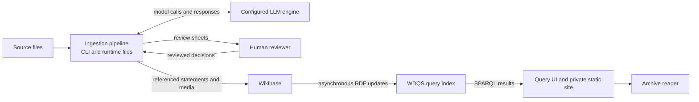

The review branch applies to reviewed ingestion. Development scratch runs follow the separate [scratch workflow](#whole-corpus-scratch-runs) below. A configured external LLM engine is the explicit opt-in path for sending source content to a model. Face inference runs locally.

The [model manifest](../src/yizkr/model/manifest.yaml) supplies vocabulary keys. [Bootstrap](../src/yizkr/model/README.md) creates their Wikibase properties and items and records the instance's ID mapping on a wiki page; writers and query templates use that mapping. Vocabulary reads check the mapped IDs against their manifest labels, falling back to a full label read when the mapping is missing or disagrees. Local P/Q IDs are not hard-coded into the repository.

## Deployed storage and query services

This expands the Wikibase and WDQS boxes above into the core service paths. WDQS and Elasticsearch are derived indexes; the database and uploaded media hold the underlying wiki content.

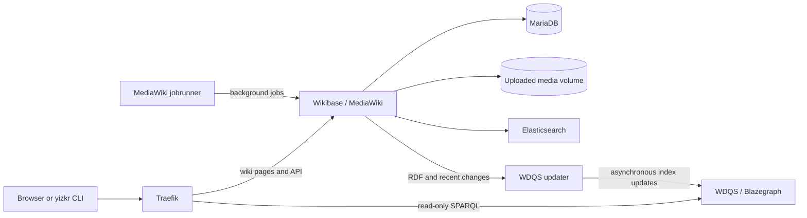

Traefik also routes to the bundled WDQS frontend and QuickStatements, omitted here to keep the core paths readable. The query service can lag behind wiki writes. The base Compose stack serves HTTP; the HTTPS and containerised CLI configurations are separate overlays.

Implementation: [Compose services](../deploy/docker-compose.yml), [proxy routes](../deploy/config/traefik-dynamic.yml) and the [deployment runbook](../deploy/README.md).

## Source and process provenance

This is the structure of a machine-written statement. Source and process provenance occupy separate reference blocks; a statement can accumulate several blocks of either kind. Qualifiers record the context or uncertainty asserted by the source.

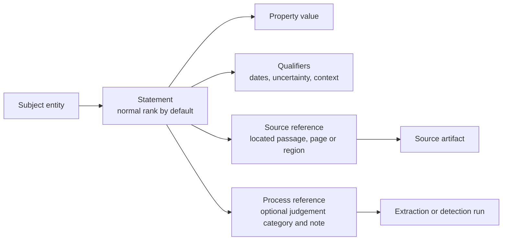

Different values or qualifiers remain separate statements. Repeated property/value/qualifier combinations can collect additional provenance. No preferred value is required: contradictory source-attributed values are a supported resting state. Curator-corrected claims retain source attribution without an extraction-run reference.

A citation is a passage read where it stands in the source, with its locator and language. A machine judgement note belongs in the process reference. When a document explicitly says its text was prepared with machine assistance, the pipeline marks the applicable claims and cites that statement in an additional source block; it does not infer the marker from how the text reads.

Before writing, the writer resolves each source's media SHA-1 to its registered artifact item; a page is cited through its parent artifact and page locator. Entity mentions resolve through the run's identity map, or an explicit reviewed equivalence, rather than by label alone. The [clustering diagram](../src/yizkr/pipeline/README.md#corpus-clustering-clusteringpy-the-scratch-runs-identity-map) shows how the map is made.

Extraction and GEDCOM record births and deaths as statements on the person, including an unknown-valued death date when the source gives no date. Documents can also assert facts about themselves, placed media, and documents they record or mention. See [ADR-0040](adr/0040-deaths-and-births-are-statements-on-the-person.md) and [ADR-0039](adr/0039-claims-a-container-makes-about-what-it-places.md).

Implementation: [claim contract](../src/yizkr/claims.py), [writer](../src/yizkr/pipeline/writer.py) and [modeling conventions](MODELING.md).

## Reviewed ingestion

The [ingestion overview and preparation detail](../src/yizkr/pipeline/README.md#the-ingest-loop-one-command-two-gates-repeat) show how `yizkr ingest run` advances documents through transcription, extraction, identity review where proposals exist, claim review and writing. Saving a reviewed CSV and rerunning the same command advances the workflow. Registration occurs at write time; the current document stages before write do not access the wiki.

The same guide expands [serial ingestion](../src/yizkr/pipeline/README.md#resolving-entities-across-artifacts) and corpus clustering. These views complement the unattended development path below. The current writer refuses a different identity map on an instance already written under another map; reviewed CSVs alone do not make it an incremental retained workflow. The contract permits explicit, recorded graph snapshots for reconciliation, with relevant write-precondition checks, but that path and durable assignment/review state are not implemented (#85, #107, #130, #723).

## Container inventory

Run preparation persists a versioned `container-inventory.json` for PDFs and PPTX files before choosing or reusing a reading. The common record separates original source parts, placement occurrences, eligibility, preparation limitations and reading outcomes. Repeated placement of the same bytes produces separate occurrence records. Structural locators come from the original package or PDF content operations before eligibility or reading-route filters.

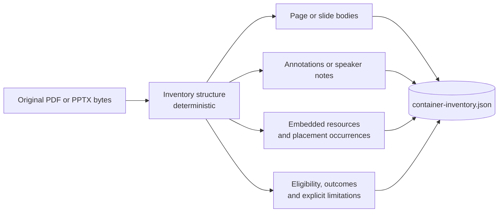

PPTX slide bodies and speaker notes are distinct source parts. Their original package bytes and ordered XML content remain separate from model commentary also called notes. PDF parts retain physical page positions, native object references or content-operation paths, original stream bytes and dictionary context, and available geometry. Raw transforms, crops, content operators and bounds do not establish composed clipping, visibility or visual reading order. Every original embedded image is an independent source, including full-page scans and picture backgrounds. A generated page render is a representation of its input sources. Preparation records explicit media-owner bindings for independent sources without creating graph items.

Available original bytes are kept under `container-parts/` unless the part is identified as excluded; keeping bytes does not establish permission to read them. PDF image streams use `<sha1>.pdf-stream`; their dictionary context and original-PDF identity are needed to interpret them. A decoded image, prepared page image or rebuilt whole PDF is a separate representation under `representations/`, with its own byte reference, transformation method and eligibility. Its digest never replaces the original source part. Excluded PDF content retains its metadata without publishing its bytes as an eligible representation.

### PDF preparation and admission

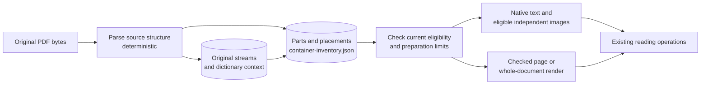

The PDF admission and rendering paths consume the prepared inventory and exclusion plan for those source bytes. Unresolved structure makes the inventory incomplete. Failed image preparation can leave a fully inventoried part unreadable; its eligibility and unsupported outcome remain explicit and cannot authorize a model call through fallback. Whole-document vision still receives only checked page pixels in a rebuilt PDF. [The model-input boundary](LLM_CACHE.md#pdf-model-input-exclusions) describes supported representations and refusal. Missing, invalid or incompatible persisted inventory is reconstructed from the original source, independently of existing reading and review products.

Inventory completeness, eligibility and successful reading remain separate facts. A page-wide vision result is not an independent successful reading of every image it contains. Multiple contextual representations without an unambiguous independent input remain explicitly unresolved; no consumer selects the first as proof that all were read.

### Shared source consumers

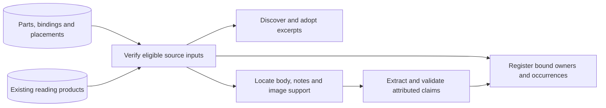

PDF and PPTX consumers project the same source/placement view from the inventory. Each independent source keeps its canonical media-owner bytes separately from its current reading representation. Verified legacy image products can establish a compatibility binding; a later re-encoding preserves that owner and existing excerpt directory. Missing canonical bytes, ambiguous legacy matches or unresolved contextual inputs block the affected source instead of allocating another owner. The pipeline does not write `derived-media.json`; an existing one is read only as a compatibility input, either verified against its files before preparation uses it for owner bindings or named explicitly to `--placed`, never as the authority for discovery or placement.

Original images keep independent source ownership regardless of size, page coverage, background assignment or visibility. Eligible, decodable images can be read and registered without a paint occurrence; their composition references retain original-part support and omit page qualifiers. Unpainted PDF resources without a verified decoding remain inventoried without a prepared reading input or owner binding. Native vector shapes remain container content. Repeated images share the established owner while retaining every actual occurrence.

Equal prepared image bytes do not establish that distinct original parts share an owner. Preparation checks the run's known container inventories and standalone originals for these collisions; ambiguous derived matches refuse affected ownership rather than merge witnesses. Registration can reuse an existing graph owner for a freshly prepared part only when the graph also records the matching original container and source part. Original-media identity and verified legacy-reading bindings retain their explicit compatibility routes. These checks require the available corpus evidence and do not establish general visual equivalence.

Transcriptions carry located `source_context` spans and structural placement references. Extraction and critique use these references instead of filtered image indices. Code assigns claim `source.support` from the supporting text and current context; model-provided support is discarded. Body and speaker-note spans remain separate, and a composite reading whose authorship cannot be separated is explicitly unsupported. A proposed claim with ambiguous support makes extraction incomplete, with supported claims retained only as diagnostics. Registration and writing preserve source-part and occurrence support alongside the established media-owner identity.

PPTX picture backgrounds resolve through the slide, layout, master and applicable theme fill, respecting explicit overrides. Occurrences retain the actual slide position and original XML origin. Unresolved declared inheritance refuses slide reading rather than silently dropping a possible image. Whole-slide visual reading remains [#747](https://github.com/WillHirsch/yizkr/issues/747).

A PDF page proven to contain only one readable original image uses the `image-source` route: the image is read once and its excerpt owns the claims. Empty container text does not produce a duplicate parent extraction. Invisible OCR may accompany the image; visible text, shapes, annotations or unknown drawing operations prevent that proof.

Equivalent metadata reconstruction preserves readings, proposals and human review. A real change of attribution requires review of the affected results. These media bindings are compatible with existing byte-addressed artifacts; they do not implement retained identity migration, general owner-equivalence decisions or retroactive graph correction.

Implementation: [inventory schema and persistence](../src/yizkr/pipeline/container_inventory.py), [shared source projection](../src/yizkr/pipeline/container_sources.py), [located extraction context](../src/yizkr/pipeline/source_context.py), [PPTX producer](../src/yizkr/pipeline/pptx_inventory.py), [PDF producer](../src/yizkr/pipeline/pdf_inventory.py) and [PDF reading/admission](../src/yizkr/pipeline/textlayer.py).

## Shared text-stage operations

[text_stages.py](../src/yizkr/pipeline/text_stages.py) provides ordinary Python operations used by standalone commands and the reviewed/scratch drivers. Requests carry explicit source inputs, configuration and diagnostic destinations. Clients are borrowed from the invocation, which owns their lifetime; operations receive no graph client or orchestrator. [gedcom_stages.py](../src/yizkr/pipeline/gedcom_stages.py) gives deterministic GEDCOM adaptation the same request/result boundary without a model client. CLI commands remain adapters.

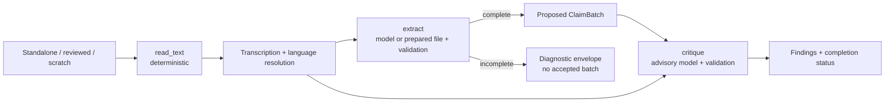

| Operation | Explicit inputs | Result |
| --- | --- | --- |
| `read_text` | Media path, separate text representation or curator correction, language settings | Located transcription, language resolution and input dependency metadata. The media bytes identify the source even when its text comes from another file. |
| `extract` | Transcription and source identity, strategy, chunk/retry/concurrency settings, preparation pointer, borrowed client or prepared claims file, diagnostic destinations | Complete proposed batch, or an incomplete result with a separate diagnostic batch; attention, failed-chunk reasons, gaps, emitted artifact paths and dependencies. |
| `critique` | Complete proposed batch, full transcription and borrowed client | Advisory findings, explicit complete/incomplete status, attention and dependencies. No approval or modification of the batch. |
| `derive_gedcom` | Source path and optional expected artifact identity | Complete validated proposed batch, warnings, unsupported-tag and adaptation-outcome counts, and source/text dependencies. The operation reads and hashes one byte snapshot; source mismatch, decoding, parsing or validation failure raises without publishing a product. |

Run ingestion explicitly selects entity-first chunked extraction because its identity and review steps use entity records. Standalone extraction retains `auto`, `single`, `chunked` and prepared-file modes; use the same explicit strategy/settings to compare equivalent invocations. Neither a failed chunk nor an unfinished single-call answer can supply an accepted batch. An unfinished critique preserves its findings and reports attention; it does not create another human gate.

The callers retain exclusion checks, scheduling, publication, view reuse and review invalidation. Reviewed ingestion schedules critique after deriving a complete batch; scratch schedules it as its own stage. Scratch's refresh decision consults the successful-refresh record without changing the invocation's settings. A refresh is recorded only after its output and document state are saved.

Result dependency metadata describes the computation; `derivations.json` records persisted-view inputs and, for text and GEDCOM documents, generation dependencies. A fixed stage registry and shared freshness planner support execution and estimation, as described below. The registry declares GEDCOM's sole document stage as deterministic, producing `batch.json` without a transcription or critique dependency; it still shares the `extract` refresh role. Media/container adapters retain their existing reuse rules pending #719. This does not implement an atomic multi-file generation store or a general workflow engine. Worker cancellation and provider-session separation remain #724 and #726; model prompts and response-cache keys are unchanged.

## Whole-corpus scratch runs

A new scratch run starts with fresh document state, while reusing unchanged model calls from the shared cache. By default, `yizkr scratch run` resumes the latest incomplete run when one exists. This diagram shows a full development run and its subsequent assessment.

For each stage's inputs, process type and intermediate files, see the [scratch-run stage and data-product breakdown](SCRATCH_WORKFLOW.md).

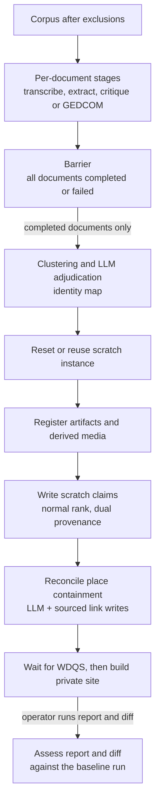

Independently read images from PDFs or slide decks can join as documents of their own. Only documents whose required stages completed feed the corpus stages; failed documents remain visible in the run's evidence. Clustering first uses deterministic evidence, then asks the model about eligible ambiguous pairs using batch and transcription views, without accessing the wiki. Development runs apply usable verdicts under the clustering guards. The `places` stage reads the written graph and source records, asks the model to resolve place containers where needed, and writes sourced `part_of` links under a cycle guard. The reset, register, write and site stages access the instance and make no model calls themselves.

Scratch writes have no human approval stop, mark their run items as unratified development output, and omit `depicts` claims. A kept instance refuses this write path. Resuming unchanged work can reuse the instance or continue a recorded write phase; it does not unconditionally reset on every invocation. The pipeline guide details the [write side](../src/yizkr/pipeline/README.md#the-scratch-runs-write-side-scratchwritepy-adr-0025-1-2).

Reports and diffs are explicit commands and can also inspect partial runs. The default baseline is the latest completed run on main. Detailed corpus reports and diffs stay local; aggregate summaries supply development evidence. Use whole-corpus comparisons when cross-document risk warrants them, alongside focused evidence selected under [TESTING.md](TESTING.md). Retained readiness is a separate owner decision based on supported workflows, not convergence of extraction outputs. The [monitor](MONITOR.md) reads run events and writes pause/resume/abort requests that the driver observes between stages.

Implementation: [scratch driver](../src/yizkr/pipeline/scratch.py), [adjudication](../src/yizkr/pipeline/adjudication.py), [write stages](../src/yizkr/pipeline/scratchwrite.py), [runbook](runbooks/scratch-run.md), [reports](RUN_REPORT.md) and [diffs](RUN_DIFF.md).

## Persisted views and model-response reuse

Reuse has two levels: a document's derived views and the responses used to compute them. This diagram shows the normal path for a stage that needs a model call; deterministic adapters need no engine response.

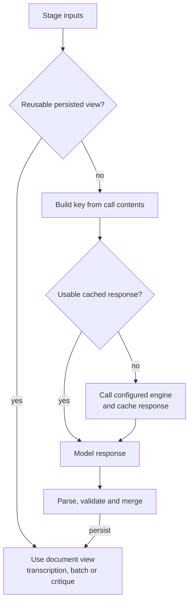

For text and GEDCOM documents, reuse compares both input content and recorded generation dependencies. The fixed descriptors in [stage_planning.py](../src/yizkr/pipeline/stage_planning.py) declare document stages, roles, artifacts and semantic code/resources; execution, estimation and reports consume that registry. Execution and estimation share view observation and the side-effect-free freshness decision (`reuse`, `recompute` or `blocked`), without creating a client during that decision. Legacy media/container adapters still compare their existing input hashes and validity checks; a prompt, model or code change alone does not stale those views. A new scratch run makes fresh document views for every kind.

The text fingerprint records source identity, relevant declared engine/model/effort/epoch, language/route and chunk settings, exact stage code and prompt/resource hashes, and installed Pydantic, PyYAML and py3langid versions. GEDCOM records source identity, its declared adapter/schema/resource hashes and the semantic-library versions; unrelated model, effort, language and cache settings are not generation inputs. An older GEDCOM record without processing metadata recomputes once. Its caller preserves the existing batch and human review when canonical output is unchanged, including the original process stamps; failed regeneration cannot make a previous stale generation current. Whole-file code hashes conservatively recompute a stage even for an edit that proves neutral. This is distinct from the actual engine configuration, installed provider CLI version and response-cache key, which are checked when a call is prepared. An unspecified model denotes the declared provider default: planning cannot detect a remote default or alias changing. Use a full model identifier for reproducible configuration.

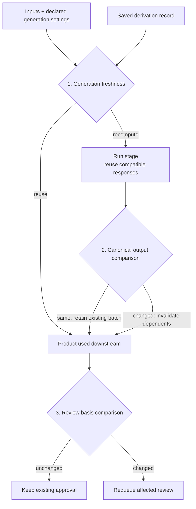

These comparisons use the implemented canonical hashes and CSV review bindings; they are not a general semantic-equivalence or durable approval engine. Recomputing the same canonical batch preserves its existing file and original producer provenance, and does not by itself revoke approvals. Changed batch content invalidates its dependent views and sets aside its reviewed CSVs; a changed re-exported review sheet requeues that sheet's decision. Missing processing metadata makes an older text view recompute once, after which its new dependency record supports reuse. Publication remains caller-owned and is not an atomic multi-file generation commit.

Call keys include prompt and file content hashes, engine/model/effort and configuration, call kind, conversation ancestry where applicable, attempt and role epoch. Input-file paths are replaced by content hashes in the key; sources are identified by media SHA-1 rather than artifact QID, and mtimes do not key calls. This allows reuse across fresh document directories and wiki resets while the engine configuration stays the same.

Persisted views and review state are separate from the response cache; cache removal alone does not invalidate them. Conversation forks bind to the opening answer whose context they assume. The current cache also owns provider session restoration and holds a process-wide lock; separating those responsibilities is future work (#726), not a feature shown in this diagram.

`--refresh ROLE` rebuilds that role's views and bypasses cached answers once per key in the run. Changing `--epoch ROLE=N` also stales that role's text extraction or critique view; legacy adapters still need refresh or a fresh directory when their current views must be rebuilt. The [cache guide](LLM_CACHE.md) covers rejection, retries and resume semantics; implementation lives in [orchestration](../src/yizkr/pipeline/orchestrate.py) and [the LLM cache](../src/yizkr/pipeline/llmcache.py).

## Human-confirmed face links

Face proposals join the ordinary claim-review and writer path. Detection and matching are local, using the optional face engine and a gallery of identities enrolled by a curator.

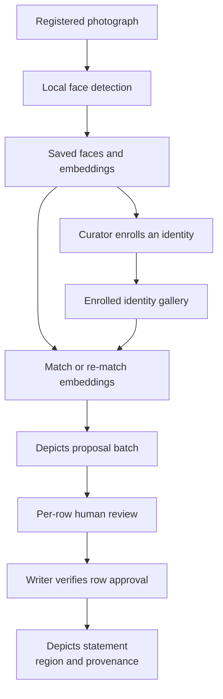

Unmatched faces remain in the detections file without a claim. Matching can rerun against saved embeddings after enrollment. A `depicts` claim requires its own row approval, including when it came from text extraction; bulk acceptance cannot supply that approval. The writer checks it before accessing the instance. Scratch runs exclude face detection and never write `depicts`.

Implementation: [face detection and matching](../src/yizkr/pipeline/faces.py), [review](../src/yizkr/pipeline/review.py) and [writer](../src/yizkr/pipeline/writer.py). The [pipeline guide](../src/yizkr/pipeline/README.md) gives the face commands; [ADR-0005](adr/0005-faces-strategy.md) distinguishes this implementation from later media-service integrations.

## Queries and private exploration

Query templates use manifest keys, resolved against each instance's vocabulary. Publishing query pages and building the static site are independent consumers of those templates.

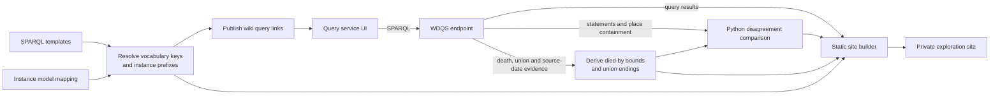

The site presents people, artifacts, timelines, galleries, places and source disagreements. Artifact pages show both what an artifact asserts and what sources say about it. Shared Python derivation computes "died by" bounds and union endings at read time, labels them as derived in the site, and stores no new graph statements.

Disagreement comparison accounts for date precision and ranges, derived bounds, source-stated parent sets, place containment and redirects; it does not choose a winning source. Containment follows sourced edges that have not been deprecated. The query library also provides provenance checks, the under-witnessed reappraisal queue and an unclassified-entity view for vocabulary development. The complementary `yizkr gaps rollup` command collects relation gaps from a run into a curator's CSV.

The current site reads the live graph and includes possibly-living people, with runtime badges. Those badges do not filter the site; this build is for private/LAN use. Its media links point back to the wiki.

Implementation: [query library](../src/yizkr/queries/README.md), [query publisher](../src/yizkr/queries/publish.py), [static site builder](../src/yizkr/staticsite.py) and [disagreement comparison](../src/yizkr/disagreement.py), with shared [death and union derivation](../src/yizkr/died_by.py).
