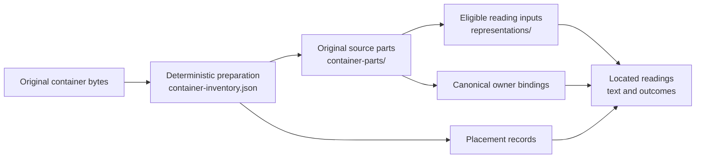
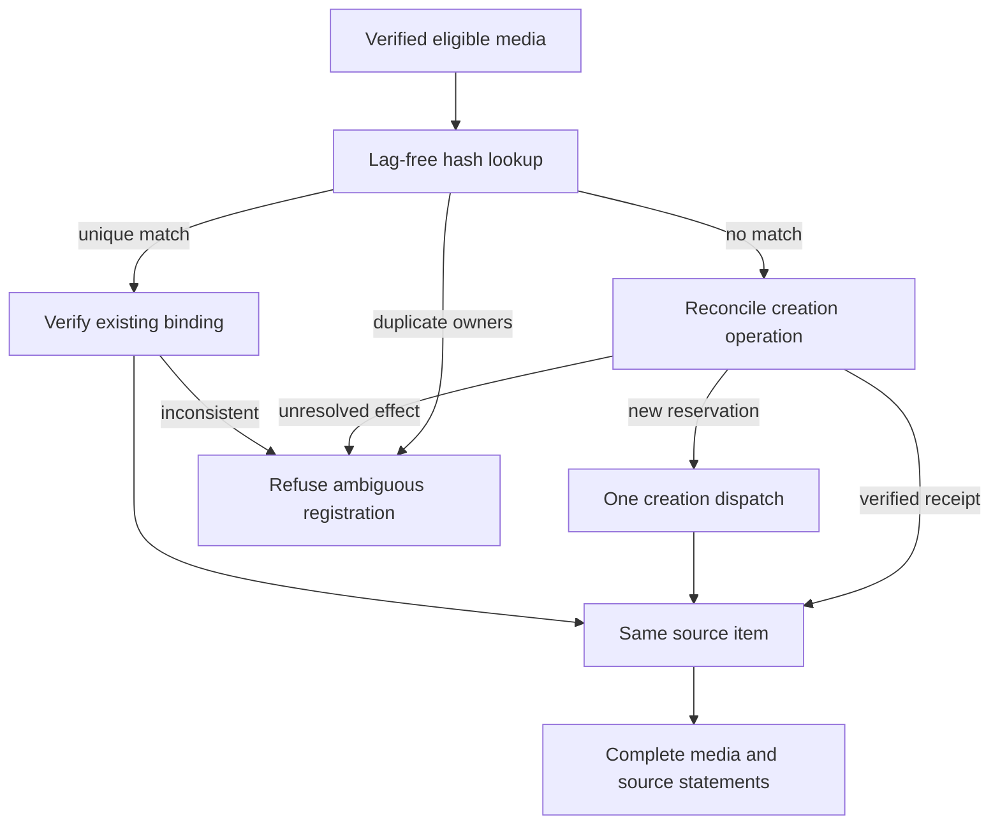

# Artifacts and container sources

An artifact supplies evidence; it can also be the subject of another source's assertions. Keep those roles separate. A letter's reading belongs to the letter, while a compilation's caption or translation belongs to the compilation even when it describes that letter. Two source owners do not necessarily provide independent testimony: copies and translations retain their relationship to the original.

This guide describes current container, registration and artifact-claim behavior. The [ingestion contract](INGESTION_CONTRACT.md#source-identity-and-attribution) defines the ownership and approval boundaries. [Source reading](SOURCE_READING.md), [extraction](EXTRACTION.md) and [identity review](IDENTITY_REVIEW.md) own their respective stages. The ADR identifiers in the headings are active rule keys used by schemas and diagnostics.

## Container sources (ADR-0008)

PDFs and PPTX presentations are multi-page containers with potentially several inner sources. Format-specific decoding does not change their attribution rules.

| Concept | Current meaning |
| --- | --- |
| Container | The held PDF/PPTX bytes and the compiler's own content. |
| Source part | An original structural part, such as native page text, speaker notes or an embedded image resource. |
| Placement | One occurrence of a part, with its structural locator and available page/slide, geometry, crop and transform. |
| Source owner | The artifact whose assertions a reading supports, bound explicitly to its original bytes/parts. |
| Representation | Bytes prepared for reading an existing part: a decoded image, page rendering or rebuilt PDF. |
| Reading | Located text and reading outcomes, with its source inputs and process provenance. |

Every original embedded image is independent, including full-page scans, small images, picture backgrounds and resources without a verified visible placement. Native vector shapes and text remain container content. Generated page renders are representations, not new sources. A physical page/slide is a locator; a registered page fragment is not another witness.

PPTX XML supplies native slide text and speaker notes as separately located source content. Speaker notes belong to the source, unlike a transcription engine's observational notes. The inventory resolves declared picture backgrounds through slide, layout, master and theme definitions; composed rendering applies stricter admission to ambiguous overrides. Unsupported formats and unresolved inheritance remain limitations. The optional [render-preparation API](SOURCE_READING.md#pptx-render-preparation) adds PNG representations to existing slide-body parts while retaining every image owner. Direct callers and the whole-corpus driver can [read selected slides by vision](SOURCE_READING.md#pptx-selected-slide-vision) with speaker notes kept separately. Supported mixed slides use vision only to arrange verified native text blocks; code supplies the exact wording while original images keep their separate readings. The opt-in [layout policy](SOURCE_READING.md#pptx-layout-routing) records routing reasons and unresolved visual coverage without changing ownership. PDF and PPTX share the ownership policy while their supported reading routes differ.

### Preparation and reading products

Deterministic format preparation inventories original parts and placements before choosing a text or vision route. The persisted `container-inventory.json` records those parts, their eligibility, source-owner bindings and representation lineage. Original resources live under `container-parts/`; generated reading inputs live under `representations/`. A PDF original image stream can require its dictionary context and need not be a standalone image file.

These are document products and bindings; preparation creates no graph items. [Container architecture](ARCHITECTURE.md#container-inventory) describes the inventory schema, and [shared consumers](ARCHITECTURE.md#shared-source-consumers) describes the `ContainerSources` projection used by reading, registration, extraction and reporting.

Canonical owner bytes and the representation currently being read are distinct. Re-encoding a bound representation retains its verified original-part lineage and owner. Equal prepared pixels alone cannot merge different original parts or adopt an existing graph owner. Missing canonical bytes, ambiguous bindings or preparation collisions block the affected source. New input files with different bytes do not acquire equivalence through a shared filename or visual similarity.

Repeated placements retain separate occurrence locators but share an established owner and reading. Native locators survive filtering; an image's index in a filtered list is not its identity. Unpainted resources retain source-part provenance without a fabricated page. Physical page/slide positions and printed page labels remain separate.

Eligible independent images are read once per prepared input. Checked readings remain reusable at `derived-media/<owner-sha1>.transcription.json`. Readings whose pages are all blank or `not-a-document-page` do not become excerpt documents; illegible document readings remain excerpts so their presence is visible. Each excerpt's language and class come from its own reading. An original image can be registered even when its reading produces no excerpt.

For a PDF page proved to contain only one readable original image, the `image-source` route reads that owner once and leaves a marker in the parent, avoiding duplicate container claims. Other composed page readings may contain several owners. If their assertions cannot be separated, extraction records incomplete/unsupported attribution rather than calling everything the compiler's evidence. [PDF reading limits](SOURCE_READING.md#pdf-reading-limits) describe the current route limitations.

Interpretation context can supply verified neighboring readings with their own owners, placements and reading revisions. Extraction and critique depend on that declared context. It can explain a continuing sentence or narrator reference, but cannot donate an assertion or quotation to the target source. Code binds supporting source locations; model-invented support is not accepted. Changes to context invalidate affected dependent views.

### Eligibility and supported compatibility

Supported runs apply the configured exclusion boundary before reading, model dispatch and independent registration. Eligibility and reading success are separate: excluded or undetermined inputs cannot be treated as successfully read; unsupported decoding does not erase the original source part. With configured exclusions, a page or whole-document vision fallback must use a verified eligible representation or refuse. Omitting an image's individual task does not permit sending it inside a composed page. [PDF model-input exclusions](LLM_CACHE.md#pdf-model-input-exclusions) defines the supported checks and the separate unguarded standalone debugging mode.

Filtering an embedded image does **not** redact the original container file. When the parent is eligible for registration, its held PDF/PPTX bytes are uploaded unchanged, including its embedded resources. Model-input eligibility and storage of the original container are distinct boundaries.

No `derived-media.json` is written by current preparation. Existing files remain supported only as verified compatibility inputs or explicitly supplied `--placed` inputs. `--placed` also accepts the common inventory or its directory, or explicit SHA-1 mappings; an invalid common inventory does not silently fall back to a legacy file. Self-placement is refused. Consumers verify source bytes, bindings and available readings before reuse. [The cache guide](LLM_CACHE.md) owns freshness, recovery and directory conventions.

## Registration and held media (ADR-0010)

Source preparation needs no Wikibase item. Registration establishes graph correspondence before historical claims are written. The scratch registration stage uses the disposable run's authority; the [retained text-source workflow](TEXT_INGESTION.md) requires explicit registration confirmation. Registration alone approves no historical claim, and that text workflow does not establish general retained PDF/PPTX or GEDCOM ingestion.

### Source lookup and interrupted creation

The registrar checks supplied media bytes, their expected SHA-1 and applicable exclusions before instance access or upload. A filename or title cannot substitute for bytes. For held media, `media SHA-1` is the current canonical lookup key; `media file` names the corresponding wiki file.

The registrar reads hashes through the lag-free item API, not a search or query index. A unique hash match is reused after checking its creation binding; multiple owners claiming that hash refuse registration. A hash miss first reconciles the persistent source-creation operation: an interrupted creation can have produced the item before its hash or self-references were written. A verified receipt resumes that item. Otherwise a new operation reserves one creation dispatch. Missing or ambiguous recovery evidence refuses another creation.

The [shared creation registry](ARCHITECTURE.md#item-creation-and-interrupted-write-recovery) supplies reservation, binding and receipt recovery. Repeats verify registry/graph state rather than trusting a document-local completion marker. Existing-item updates check the read revision; completion preserves curator labels, descriptions and ranks.

A registrar keeps one API snapshot current with its own writes. Reusing it across a corpus assumes other writers are coordinated; it is not an indefinitely live index of concurrent edits.

Page fragments require a typed artifact-fragment item with the matching parent and page qualifier. Multiple structural matches refuse. New fragments record parent/page in their creation operation and initial statements. A label match cannot adopt an unrelated item, and an original image placed on a page is not a page fragment.

Container registration consumes canonical owners and actual placements from the shared projection. Prepared representations can reuse an existing graph owner only when the original container/part composition is verified: a caption or another citation is not that binding. Paint occurrences receive verified page qualifiers; unplaced parts receive source-part locators without guessed pages. The `register_derived_media` entry point is a compatibility adapter to this registration behavior.

An independently registered artifact's kind, file and hash statements cite itself. A page fragment has `instance_of` → `artifact_fragment` and `part_of` → its parent with the physical page qualifier; those statements cite the parent. Container-contributed media have `part_of` → the container, once per located page/slide and with unqualified composition for unplaced parts. Their kind, file, hash and composition statements cite the contributing container; composition references additionally retain source-part locators. Equal statements can collect another container's reference without duplication. This is the registrar's graph encoding, not a requirement that all operational metadata cite a historical artifact.

### Files, display terms and collisions

Wiki files are never overwritten. Already-held bytes reuse an existing file. If the requested name contains different bytes, the new upload uses `<stem> <sha1[:8]><extension>`; a conflicting content-tagged name refuses. Known name-only warnings can be accepted deliberately. Unknown warnings stop the upload, especially `duplicate-archive`, because re-uploading deleted bytes could undo a curator's deletion.

A file reference is reused only if its current bytes match the declared source hash. Registration can add a matching reference without overwriting an older mismatched file. File identity is independent of the name under which MediaWiki stores it.

Labels and filenames are display/location choices, never adoption keys. Alternate source titles become aliases only when they do not take another item's label or the plain form of an already-disambiguated label. An item with a matching title but no hash, or another item referring to the same wiki file, produces a review alert rather than an identity decision; [registration anomalies](ANOMALIES.md) describes those alerts.

The writer also separates artifact and non-artifact label use. Artifact-kind records may share an unregistered artifact/fragment label; other records may share a non-artifact label. Neither may take a vocabulary or run item's label. An unused label is available, subject to the same side distinction within the batch. Where necessary the writer tries the supported `[media object]` or `[not an artifact]` display tag, then refuses if that also conflicts. These naming safeguards do not merge entities by label.

Registration uses shared stored-term normalization and field-specific Unicode handling. Filename normalization preserves supported letters, replaces illegal sequences, respects extension restrictions and reserves room for the content tag. Display limits are applied without splitting supported combining sequences. The exact rules belong to the [registrar](../src/yizkr/pipeline/registrar.py) and [writer](../src/yizkr/pipeline/writer.py), rather than a second copied specification of MediaWiki internals.

### Unheld records and equivalence limits

Held-media registration refuses a source without bytes. A structured adapter can nevertheless propose an **unheld** artifact record through the batch writer: a GEDCOM media object can have a label and source-stated attributes without a media hash or file. It is not automatically the held scan with the same title. [GEDCOM's unheld-media rules](GEDCOM.md#unheld-media) describe that distinction; acquisition remains separately authorized work under [#168](https://github.com/WillHirsch/yizkr/issues/168).

Newly supplied re-encodings, rescans and crops are different byte observations. General near-duplicate matching and reviewed artifact equivalence/version handling remain deferred under [#162](https://github.com/WillHirsch/yizkr/issues/162). This limitation does not undo a verified binding between an existing source part and its re-encoded reading representation. Neither a byte match nor a new owner allocation makes a copy independent corroboration by itself.

## Claims about artifacts (ADR-0039)

The source of a claim and the artifact it describes can differ. A passage must support both its asserted fact and its subject when read in context. The seven `document_subject` properties are `author`, `addressee`, `inception`, `location_of_creation`, `main_subject`, `shows` and `issued_by`.

| Subject form | Supported meaning |
| --- | --- |
| `source` | The claim's own source artifact. |
| `placed` | An artifact reference in the source's supplied placed-owner mapping. Inventory-backed mappings are verified; explicit mappings are supplied assertions. |
| `record` | A batch-local entity of an artifact kind, supplied by a structured adapter or a hand-written batch. |
| `mention` | The batch's `unclassified_entity`, such as a letter's mention of an enclosure. A free-text type hint does not establish identity. |
| `confirmed` | An existing QID replacing that claim's eligible local record/mention, with matching confirmation provenance. |

Every form other than `source` requires a nonblank supporting excerpt. The confirmed form requires `Claim.confirmed_from` for the former subject; any retained entity record must agree with its confirmed QID. An outright QID, or confirmation from a person/place/event subject, is insufficient. An unclassified mention is not automatically the held scan that its words might describe.

Model extraction cannot invent artifact-kind records or classification claims naming artifact kinds. Structured/manual batches can supply them; this is an extraction-stage restriction, not an exception based on a model's identifier. The shared pure [subject policy](../src/yizkr/claims.py) checks eligible forms, source ownership and raw excerpt presence. The writer additionally requires placed subjects to be registered and required excerpts to remain nonblank after storage normalization. Structural validation does not prove that a passage supports the assertion. Missing registration of a cited source refuses the batch; invalid subject claims have individual refusal records.

### Captions, structured assertions and support

`caption` is the separate `placed_subject` property. It takes an artifact the source places, never the source itself, and records one original-language passage verbatim. It may be a heading, caption or commentary referring to the image. A passage about several images gives one caption claim per image. The locator identifies where the words occur, which need not be the image's placement page. Placement and registration are required; a separate transcription excerpt is not.

Caption text is not corrected, translated, shortened or silently truncated. If storage cannot preserve it, the claim is refused. Reference excerpts have their own storage normalization and limits; they are not a promise that every reference string is stored unchanged.

The same passage can support a caption and structured facts, all citing the container. In [the fictional example universe](EXAMPLES.md), the booklet's “Wastl to Klara, July 1939” supplies a verbatim caption plus `author` and `addressee` for the letter image. Its unattached date does not establish `inception`. The booklet's translation of the dateline can support the letter's date, place and addressee, citing the booklet; a translation alone is not a caption. The letter's own visible dateline independently supports claims citing the image.

For a reproduction, document properties concern the historical original, not automatically the scanning/copying activity. “Scanned by Nicholas” does not make Nicholas the original's author. `main_subject` describes a work's topic; `shows` records what a source says an image shows. Neither is a confirmed person/region association. Source name order supplies no face positions, and `depicts` retains its explicit human-confirmation gate.

A source's explicit machine-preparation statement can mark applicable claims `machine_assisted`, with separate support for that marker. The pipeline does not infer it from writing style or propagate a container's marker to an image's own claims. [Extraction's preparation rules](EXTRACTION.md#completion-diagnostics-and-reuse) define how scope, quotations and unresolved cases are handled.

Independent assertions retain their provenance, including disagreement; equal values and qualifiers can collect separate reference blocks. The pipeline does not combine two sources' partial values into a new conclusion attributed to either. The vocabulary permits a curator's combined determination with `determination_method` → `combined_from_sources` and both sources, but does not supply a complete retained correction interface. [The current contract](CONTRACT.md#evidence-interpretations-and-correction) and [review guide](IDENTITY_REVIEW.md) define implemented authority and outstanding correction work.

### Display and export

Artifact pages group captions and document-subject values with their source and page citations, preserving conflicting values without requiring a preferred one. Person pages list structured associations such as addressee or whom an artifact shows; a name occurring only inside caption text is not an identity link. An unclassified artifact mention does not acquire an artifact page merely through these claims.

Non-privileged export removes every caption. For document-subject statements on held media or an artifact contained in its cited source, it removes the other source's reference/excerpt. An agreeing statement can remain when another item-citing evidentiary reference survives; a process/run reference alone cannot retain it. For statements carrying a reference selected by this filter, text-valued qualifiers cause whole-statement removal. These checks include all ranks. Unheld records/mentions without those media/composition relationships follow ordinary source rules; confirmation onto held media can bring them within this filter.

This filtering does not make the export public-safe. [The privacy contract](CONTRACT.md#human-authority-and-privacy) governs disclosure; [the exporter](../src/yizkr/backup.py) implements the current filter. No artifact or identity approval grants publication permission.
