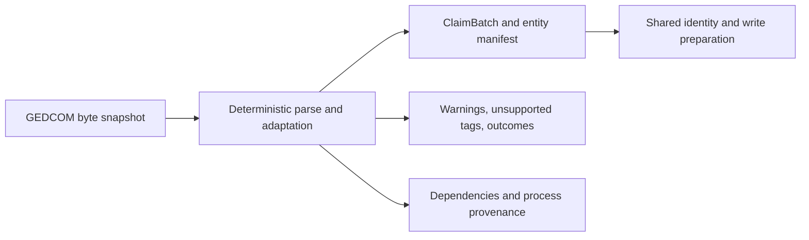

# GEDCOM adaptation (ADR-0021)

GEDCOM exports use a deterministic adapter, not transcription or model extraction. The adapter preserves what the export asserts in the ordinary `ClaimBatch` and entity-manifest format, with diagnostics for unsupported material. The [ingestion contract](INGESTION_CONTRACT.md) governs attribution and identity; [MODELING](MODELING.md) defines the resulting graph semantics. Deterministic conversion does not establish historical truth, confirm identities or authorize retained writes.

## Shared stage and products

[`derive_gedcom`](../src/yizkr/pipeline/gedcom_stages.py) accepts a source path and an optional expected `ArtifactRef`. It reads one byte snapshot, checks its SHA-1 against that expected identity, decodes UTF-8 and invokes [`adapt_gedcom`](../src/yizkr/pipeline/gedcom.py). Source mismatch, decoding, parsing and validation failures raise without returning an accepted result. No model, graph client or remote media fetch participates.

| Product | Contents and ownership |
| --- | --- |
| `GedcomResult.batch` | Validated proposed claims and entity manifest, with deterministic adapter process provenance. Local manifest IDs name this batch's entities, not accepted archive identities. |
| Diagnostics | Warnings, `unsupported_tags` counts and separate `outcomes` counts for notable adaptations. A complete result can contain unsupported material. |
| Dependencies | Source SHA-1, decoded-text SHA-256 and adapter/encoding configuration. The shared freshness machinery also records declared semantic code, schema, resources and relevant library versions. |
| Persisted views | Caller-owned. The standalone `ingest gedcom` command publishes the batch and prints diagnostics. The scratch driver publishes `batch.json`, records stage status and diagnostics in `state.json`, and processing dependencies in `derivations.json`. |

GEDCOM is the only per-document stage for this route; it has no `transcription.json` or critique dependency. Its refresh role is `extract`. Canonically unchanged regeneration preserves the existing batch and its producer provenance. See [shared operations](ARCHITECTURE.md#shared-document-stage-operations), [view reuse](LLM_CACHE.md#views) and the [scratch products](SCRATCH_WORKFLOW.md#per-document-stages). Publication, scheduling, identity decisions and write authorization remain caller responsibilities; a saved batch alone does not constitute retained-ingestion approval.

## Export ownership and citations

Every adapted claim cites the export's byte identity. Its excerpt contains the GEDCOM lines supporting that assertion, with record/tag context. The export remains the evidence owner even when its assertion names another source or describes a media object. A `SOUR` pointer does not mean that this system has read the upstream source, and resolving its title does not create another independent witness. Machine-process provenance remains separate from the historical source reference.

The adapter folds citations only from the records supporting the particular claim:

- A mapped event, fact or name contributes its own directly nested `SOUR` citations.
- Family parentage and union-participant claims use the family's citations. Wedding, divorce and annulment claims, and the union's links to those events, use the corresponding event's citations. Their excerpts retain family/partner context without borrowing citations from unrelated events.
- A person's `image` claim uses the object's citations and any citations on that person's `OBJE` link. An object's `inception` claim uses the object's citations alone.

Each distinct nonempty citation `PAGE` contributes to `page_number`, joined with `;`. A level-0 `SOUR` target is resolved by its opaque export-local pointer; all distinct `TITL` values are joined with `/` and surfaced as `cited:` text in the excerpt. The citation's original `SOUR`/`PAGE` lines remain visible. A missing target cannot supply a resolved title; it does not justify a remote lookup. A person's record-level `INDI.SOUR`, or a citation beneath a `DATE`, `PLAC` or family relationship line, is not spread over other claims: doing so would broaden its evidence beyond what the record says.

Excerpts and page numbers use NFC and fit Wikibase's 400-character limit. Excerpt clipping prioritizes folded citations and resolved titles, then their parent lines, then remaining lines where they fit. Omitted runs are marked `…`; a suffix includes the first 12 hex characters of the complete excerpt's SHA-1. If even the citations do not fit, the adapter keeps a prefix with that digest suffix. Long page lists retain the pages that fit and end with ` ; …`. These are bounded views of the export, not substitutes for retaining it. Identical repeated claims collapse; different excerpts or citations remain distinct support in the batch, and the writer can combine that support as separate reference blocks on one statement.

Paths and filenames are locations, not source identity. Export-local pointers such as `@S1@` are not archive IDs. The adapter preserves source text, including `FILE` names/URLs in excerpts and potentially labels; it does not sanitize those into public-safe metadata. Batches, diagnostics and persisted views derived from private exports remain private runtime data under the [data boundary](AGENT_PROTOCOL.md#6-the-data-boundary).

## Unheld media

A mapped individual's `OBJE`, either inline or pointing to a level-0 object, proposes an `artifact` entity and an undated `image` link from the person. The object has no held `media file` or `media SHA-1`; it is not classified as a photograph from a filename. Held-media gallery and face workflows cannot treat it as available image bytes. `image` records the export's media association; it is not a confirmed `depicts`/face assertion.

One export-local object pointer yields one media entity even when several people link it; inline objects are keyed by their record occurrence. The entity represents the first `FILE` only. Its label uses the first title beneath that file, then the object's own titles; further distinct titles become aliases. Without a title it falls back to the first file's name/URL, the object's value, then a generic label. Further `FILE` records are counted as unsupported rather than silently becoming the same medium.

Each parseable object `DATE` gives an `inception` claim on the media entity, preserving its precision, range and approximation. The source is still the GEDCOM export, with the object's own lines as evidence. The date does not qualify the person's association with the medium. An unparsed media date produces no inception claim and warns once per date record, regardless of how many people link it.

No `OBJE` reference triggers a download. Acquiring remote bytes requires explicit separate instruction; upstream-source artifacts and media acquisition remain parked in [#168](https://github.com/WillHirsch/yizkr/issues/168). An unheld object and a held scan remain separate until an explicit supported identity/equivalence decision connects them. Label agreement is insufficient; artifact-equivalence proposals remain parked in [#162](https://github.com/WillHirsch/yizkr/issues/162).

## Dates and evidence

Supported repeated events and details each contribute their own claims. The adapter preserves conflicting values and source-stated uncertainty: `ABT`/`EST`/`CAL` give `circa`; `BEF` and `AFT` give bounds; `BET … AND …` gives a range; absent month/day reduces precision. Residence and occupation periods become start/end qualifiers; union events carry their own dates. A partner's death does not infer the union's end. An unparseable date warns and supplies no guessed date. Any date before the common era or in an unsupported calendar refuses the whole file; Gregorian markers are accepted. See [date policy](adr/0034-unsupported-dates.md).

Birth and death facts are statements on people. `DEAT Y` can supply an unknown-valued `date_of_death`; a bare event, citation, note or cause alone does not establish death. An unknown or unreadable date alone does not become an unknown-valued death claim. Burial follows the corresponding evidence guards, with unknown `burial_place` when a stated burial supplies no place. These distinctions matter to possibly-living privacy; see [births and deaths](adr/0040-deaths-and-births-are-statements-on-the-person.md).

A family's first two distinct `HUSB`/`WIFE` lines identify its couple and parents according to the tags, including two fathers or two mothers. Further or duplicate partner lines are counted. With fewer than two mapped partners, union events remain unsupported; a family naming the same person as both partners gives no union or parentage claim. Marriage/partnership entities and their wedding, divorce and annulment events follow [union modeling](adr/0036-marriages-as-entities.md). Siblinghood is never inferred from parentage. `HEAD.LANG` determines excerpt/name language where recognized; otherwise it is `und`.

## Unsupported material and limits

The census runs after adaptation and reports the topmost unmapped tag in each branch, rather than itemizing descendants of an already unsupported subtree. Mapping is contextual: `BURI.CAUS` and an unrecognized `MARR.TYPE` do not imply that all causes or types are unsupported. Warnings and adaptation outcomes are separate diagnostics, so the tag census alone is not a complete loss report.

Only citations actually folded and objects actually mapped leave the census. Unused level-0 `SOUR`/`OBJE`, unmapped nested citations/objects and additional object files remain counted. Even within a folded citation, resolved source record or mapped object, a nested `SOUR`/`OBJE` unsupported in its own right is counted. Other metadata in those incorporated subtrees is not individually inventoried. Envelope records are structural; a successful adaptation and an empty census do not promise complete GEDCOM support. Review all diagnostics alongside the source before treating the output as sufficient for the intended ingestion.
