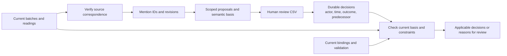
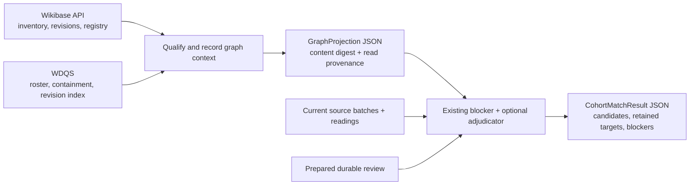
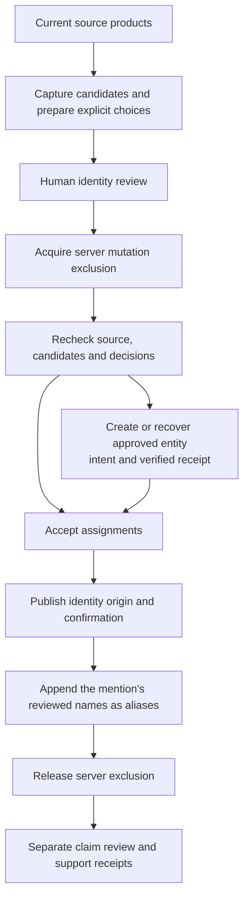
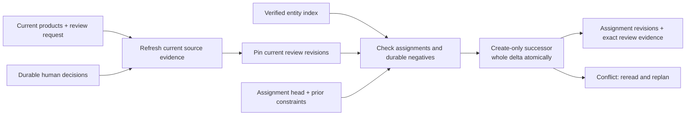
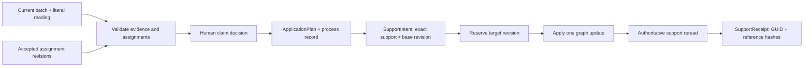

# Durable identity review

`yizkr.pipeline.review_stages` prepares bounded identity proposals from saved batches and readings, records human decisions in an explicitly selected SQLite database, and projects the decisions applicable to current evidence. The database owns mention and decision IDs; it does not allocate entities, resolve graph assignments or write to Wikibase. Keep it with durable archive state and back it up after closing the store. Response caches and clustering maps are disposable independently of this database.



## Supported decisions

| Operation | Explicit scope | Effect of approval | Effect of rejection |
| --- | --- | --- | --- |
| `same` | Two source mentions | May identify the same entity. | Preserve a negative identity constraint. |
| `different` | Two source mentions | Preserve a negative identity constraint. | Record rejection without inferring sameness. |
| `assign` | One mention and a supplied `EntityBinding` | Authorize that target while its deployment, generation and binding remain current. | Preserve rejection of that target. |
| `new_entity` | One mention | Record explicit permission for a new entity; allocate nothing. | Grant no creation permission. |

Proposals retain supplied before-state references, target references, method/run origin and a versioned material basis. Decisions add an opaque ID, revision, outcome, actor, timezone-qualified confirmation time and predecessor. A later decision cannot silently overwrite a concurrently recorded decision. Importing the same actor's unchanged decision twice is idempotent.

Approved same-mention relations and assignments to one target are checked together with negative constraints. A direct or transitive contradiction blocks the affected connected mentions, leaving unrelated applicable decisions available. Missing evidence for an existing negative constraint also blocks affected positive proposals. Omitting an old pair from a new request does not erase its decision.

## Prepare, review and project

Python callers use `ReviewRequest`, `ReviewSource`, `ReviewProposal`, `prepare_review`, `export_review` and `record_review` directly. The CLI is a human review adapter:

```bash
yizkr ingest identity-review prepare --request review-request.json \
  --store var/identity-review.sqlite --out var/identity-review.csv
# Inspect the evidence and enter approve/reject in selected decision cells.
yizkr ingest identity-review record --store var/identity-review.sqlite \
  --csv var/identity-review.csv --actor "curator"
yizkr ingest identity-review project --request review-request.json \
  --store var/identity-review.sqlite --out var/identity-decisions.json
```

The request supplies explicit inputs; nothing discovers corpus paths, model clients, credentials or a graph connection. Paths within the request are relative to its directory. A fictional request distinguishing the two Ursula Löbigs is:

```json
{
  "format": 1,
  "sources": [
    {
      "artifact_sha1": "aaaaaaaaaaaaaaaaaaaaaaaaaaaaaaaaaaaaaaaa",
      "batch": "ursulas.batch.json",
      "reading": "ursulas.transcription.json"
    }
  ],
  "proposals": [
    {
      "operation": "different",
      "mentions": [
        {
          "artifact_sha1": "aaaaaaaaaaaaaaaaaaaaaaaaaaaaaaaaaaaaaaaa",
          "local_id": "daughter"
        },
        {
          "artifact_sha1": "aaaaaaaaaaaaaaaaaaaaaaaaaaaaaaaaaaaaaaaa",
          "local_id": "widow"
        }
      ],
      "evidence": { "reason": "Distinct source occurrences and relationships" },
      "origin": { "method": "curator proposal" }
    }
  ]
}
```

Use the actual artifact hash and local IDs from the supplied fictional products when running the example. `reading` is optional, but a missing reading prevents automatic correspondence across changed products. An assignment supplies `target` as a complete `core.write_recovery.EntityBinding`, and `current_targets` supplies the currently verified bindings. A bare QID is insufficient. `blocked` accepts records of `mention` plus `reasons` for caller-owned current validation; preparation also runs the existing entity structure/container checks and blocks inconsistent or unsupported source attribution. Projection never overrides these guards, and downstream application must still perform its own current write validation.

CSV rows show the source occurrence, quoted evidence, semantic basis, target and before-state, method, proposal revision, prior-decision revision, and current status/blockers. A status such as `applied: reject` means the rejection remains applicable. Only the `decision` column supplies an outcome; leave it blank to make no new decision. Today a decision exists only where a reviewer marks a row. The target is one recorded act that approves the rows of a stored sheet that need no decision of their own, each still receiving its own decision record that cites the sheet ([#905](https://github.com/WillHirsch/yizkr/issues/905)). The store retains the complete immutable sheet, including displayed warnings and the prior-decision revision, and the decision references that sheet. Edits outside decision cells and stale proposal imports are refused, and a failed packet records none of its decisions. Change the request and prepare again to revise a proposal. Labels describe the stored proposal; display edits do not change its semantic digest.

The projection records applicable decision revisions and current mention revisions for reproducibility. It distinguishes `applied`, `needs_review` and `blocked`, and exposes assignments, explicit new-entity permissions and negative constraints separately. An approved identity decision does not admit historical claims or face associations.

## Correspondence and change

Automatic correspondence requires an unambiguous literal label or alias inside the declared source lines, uniquely located quoted context and the same source owner/native part/placement scope. The store records the old and new observations and reading digests. Exact context moving to different reading offsets can preserve a mention; changed model IDs and entity order cannot choose between homonyms. Overlapping occurrences, repeated context, unsupported source attribution and missing locations abstain. Exact replay of one immutable product can reuse its local locator without claiming correspondence to a different product.

For a reviewed locator correction, supply `remaps` entries with the current `mention`, `prior_id`, `prior_revision`, `actor`, `reason` and timezone-qualified `time`. Apply this explicit correspondence before observing the new product. Both observations must have verified located context for the same owner/native part, even when literal occurrence matching is ambiguous; a current occurrence already assigned to another durable mention is refused. Missing or unsupported source attribution must be repaired before remapping. A remap establishes correspondence only: changed quoted wording, interpretation or supporting claims still require a new decision.

The semantic basis retains source occurrence/scope, entity interpretation, relevant claims, attribution, excerpts, source uncertainty and judgment notes. It replaces local references with durable mention IDs and canonicalizes irrelevant ordering. Display labels, summaries, run timestamps and extraction confidence used only for review ordering do not establish identity. The actual quoted source wording remains material. Proven locator changes exclude absolute reading offsets and reading digests from semantic comparison while retaining them as provenance.

A new source gets its own mentions and unapproved proposals; it does not revoke unchanged decisions about earlier sources or inherit their consent. Only materially changed scopes need review. Unknown correspondence keeps the previous decision attached to its original evidence.

## Record graph context and inspect later-cohort matches

This operation applies to every increment, the first included, where the graph holds no entities yet. "Later-cohort" in this heading, and "cohort" in the module names, only record where it was first used. The matcher supplies candidate evidence for a proposal and derives no identity-review proposal itself; corpus clustering's map does ([proposals from clustering](#proposals-from-clustering)). [One proposal mechanism for every increment](MENTIONS_AND_MATCHING.md#one-proposal-mechanism-for-every-increment), in which clustering also takes accepted assignments as fixed points and this matcher keeps only that role, is the target of [#906](https://github.com/WillHirsch/yizkr/issues/906) and [#944](https://github.com/WillHirsch/yizkr/issues/944); the [integration boundary](#integration-boundary) says what is implemented.

`pipeline.graph_projection.capture_graph_projection(registry)` reads an explicitly supplied `CreationRegistry` and its Wikibase/WDQS connection. It records the current generation, every live nonredirect item/property revision, the existing matcher's roster and containment closure, verified entity bindings, accepted assignments and negative constraints. Each query and returned row is retained with the capture's time and watermarks. Capture never creates a generation, binding or assignment.



The roster carries every direct birth statement and every birth-event date linked through principal participation, with statement identity, rank, source references, date precision, uncertainty and determination methods. Curator-combined readings remain distinguishable from values stated by their sources. Normal and preferred statements coexist; collection selects neither a canonical date nor a preferred representation. Deprecated evidence remains explicitly marked as inactive. Birth disagreements are shown to adjudication and human review, never used to prune candidates automatically. The same evidence reaches both reconciliation commands and recorded cohort matching.

Saved projections must use the current roster selector (`roster-v2`). A rejected selector requires a fresh capture before matching; incomplete sampled evidence cannot be upgraded without reading the graph. Recapture changes the planning product, not existing accepted assignments or historical claims. A complete empty birth-evidence set preserves the durable review basis so the encoding change alone does not reopen pending approval or interrupted creation. Newly exposed evidence still requires scoped review where it changes a pending decision.

Capture requires the WDQS revision index to match the authoritative API inventory before and after reading. The inventory, entity revisions, generation and MediaWiki revision/log watermarks must remain unchanged. Lag, missing coverage, unsupported dates or an observed intervening edit refuse capture; retry after the index catches up or concurrent work finishes. This is an observed consistent read, not a transaction or permission to create an entity. Unbound graph entities remain visible candidates with an explicit blocker; display labels cannot supply their missing creation evidence.

The direct Python workflow takes current source products and an existing durable review store:

```python
from pathlib import Path

from yizkr.pipeline.cohort_matching import match_cohort, save_cohort_match
from yizkr.pipeline.graph_projection import (
    capture_graph_projection,
    load_graph_projection,
    save_graph_projection,
)
from yizkr.pipeline.review_stages import ReviewRequest, prepare_review

# registry, store and sources are explicitly supplied by the caller.
# sources is a tuple of ReviewSource(artifact_sha1, batch, reading).
projection_path = Path("var/graph-projection.json")
save_graph_projection(capture_graph_projection(registry), projection_path)

# Loading and matching need no graph connection.
recorded = load_graph_projection(projection_path)
request = ReviewRequest(
    sources=sources,
    current_targets=tuple(entry.binding for entry in recorded.bindings.values()),
)
prepared = prepare_review(store, request)
result = match_cohort(recorded, sources, prepared_review=prepared)
save_cohort_match(result, Path("var/cohort-matches.json"))
```

Preparation observes source occurrences in the local review store. Matching itself records no human decisions or assignments. It checks that the prepared review describes exactly the supplied products, then runs the existing name/kind blocker separately for each source batch. Artifact-qualified mention IDs prevent identical model-local IDs in different documents from colliding. Accepted targets remain attached after graph display edits, and current reviewed targets remain distinguishable from accepted assignments. A confirmed same-person component carries its accepted target as advice for the other mentions; conflicting accepted targets block the component without merging them. Relevant human negative constraints and missing or stale review context block affected proposals.

Omitting `client` performs deterministic candidate blocking only. To request the existing adjudicator, supply `client` and an `AdjudicationProvenance` naming its provider, model and configuration. The result records source, review and projection digests, the prompt digest, optional provider identity and returned candidate verdicts. Missing, repeated or invalid pair answers are incomplete advice. A verdict never becomes human approval, and an empty candidate list never authorizes creation. Matching does not change source extraction or its evidence.

Keep both JSON products with the inputs needed for replay, outside Git: their facts and query results may contain private archive data. Loaders verify their content digests; they do not establish current graph state or trust in an external producer. The recorded match product cannot be submitted directly for assignment acceptance or graph writes. The protected application below captures current evidence again. The target removes the optional adjudication and both saved products, leaving the candidates as an in-memory step whose candidate-context digest each choice's origin records ([#906](https://github.com/WillHirsch/yizkr/issues/906)).

## Apply later-cohort identity additions

This operation applies to every increment, the first included. "Later-cohort" in this heading, and "cohort" in the module name, only record where it was first used. The matcher supplies candidate evidence for a proposal and derives no identity-review proposal itself: each choice below is explicit, supplied by a caller or derived from an identity map ([proposals from clustering](#proposals-from-clustering)).

`pipeline.cohort_additions` connects explicit `assign` and `new_entity` choices to the shared authority. It uses the existing roster blocker, durable review store, creation registry, assignment acceptance and identity-provenance publisher. It is a Python API for bounded additions. The [one-source workflow](SOURCE_INGESTION.md) connects it to document products, registration and historical review; folder discovery and other adapters are outside that narrow lifecycle. Containers and the images they place are [#854](https://github.com/WillHirsch/yizkr/issues/854), structured sources [#859](https://github.com/WillHirsch/yizkr/issues/859) and [#878](https://github.com/WillHirsch/yizkr/issues/878), commands [#869](https://github.com/WillHirsch/yizkr/issues/869) and many sources [#876](https://github.com/WillHirsch/yizkr/issues/876).



Prepare a `ReviewRequest` with actual sources and explicit choices, using complete bindings for existing targets. Source artifacts must be uniquely registered before application. No model call or human interaction occurs while the mutation guard is held.

```python
from yizkr.pipeline.cohort_additions import (
    prepare_cohort_additions, apply_cohort_additions,
)
from yizkr.pipeline.review_stages import export_review, record_review

prepared = prepare_cohort_additions(store, request, registry)
sheet = export_review(store, prepared.review)
# The curator inspects sheet and fills only selected decision cells.
record_review(store, reviewed_sheet, actor="curator")
result = apply_cohort_additions(
    store, request, registry,
    state_path=state_dir / "cohort-capability.json",
    operation_id="cohort-addition-001",
    record_dir=record_dir,
)
# Use result.request with the separate historical-claim review/write API.
```

An optional `scope` selects durable mention IDs. Related positive and negative decisions still participate in validation. Each previously unassigned selected mention needs one explicit cohort choice; a call permits at most one creation (applying many in one protected operation is the target of [#846](https://github.com/WillHirsch/yizkr/issues/846)). Apply subsequent creations separately so each can consider the item just added. Existing-target assignments can be grouped. The initial creation contains only the reviewed display label and an operational description; it adds no historical type or claims, and the mention's names become aliases once its assignment is accepted (below). Its assignment references the original `new_entity` decision, verified through the exact creation authorization and receipt, with no synthetic `assign` decision.

Preparation stores scoped candidate bindings and identity facts in the ordinary proposal basis. Full capture digests belong to origin metadata, so an unrelated graph edit or display rename does not revoke unchanged approval. Previously inspected candidates stay in scope after renaming. New candidates or changed material facts require review for affected unaccepted choices; accepted identities remain fixed, while changed source interpretation still needs review. Source correspondence and retained negative constraints remain mandatory. Reassignment, merge and split are refused.

The operational creation authorization retains the reviewed source interpretation. Deterministic blocking considers that context even before historical claims exist, after a rename, or after a receipt/index publication was interrupted. It remains distinguishable from asserted graph facts and is never inserted into the historical-fact adjudication prompt. Ambiguous dispatch stays unresolved and is not resent. An untyped item without such context makes candidate coverage incomplete and conservatively blocks new assignments; finish or investigate that item before proceeding. An unbound candidate likewise cannot be silently ignored. An empty candidate list alone never grants creation permission.

Application requires the [deployed server mutation guard](../deploy/README.md#protected-identity-additions). It reacquires the graph and validates review inside that boundary; it accepts no saved projection as current authority. The same operation, products and review store recover an interrupted creation through its original intent. A partially completed application remains partial: identity provenance can be retried, and historical claims require their own explicit decisions and exact applied-support receipts. Keep the review database, process records and any retained graph-context products with backups. Capability files are private recovery credentials, not provenance records.

Accepted cohort origins use the explicit `reviewed_assignment` or `reviewed_creation` method, or for a choice derived from an identity map the map's method and cluster for the mention ([below](#proposals-from-clustering)), and separate actor/time confirmation references. Their immutable process record retains the actual scoped decision material and any supplied producer record. An operational `identity record` link carries them without asserting a source-backed historical type. Existing source statements, prior origins, ranks and curator display changes are preserved.

An accepted assignment, to an existing entity or a new one, also appends the mention's names to the entity's English aliases, on the authority of its identity decision: no alias takes a decision of its own, and the names depend on the decision alone, not on who made it. They are the mention's label and its entity record's aliases as the decision's review row showed them, in its `labels` and `basis` columns, never those of a later product. After publishing the origin, `pipeline.cohort_provenance.publish_cohort_assignment`, or for an [owner override](#migrate-an-existing-map-and-expose-its-provenance) `publish_owner_override`, rereads the item and appends each name it holds neither as its label nor as an alias, in the form the instance keeps terms, by one revision-checked single-attempt update; for one entity record these are the aliases the map-bound writer adds. The update changes no label, description or statement and removes or reorders no alias, a curator's included. A name holding a character the instance may keep in another form is left out, never altered, and reported in the alias receipt's `contribution.left_out`. Two immutable registry pages keyed to the assignment revision record the update: when the item lacks any of the names, an intent names the aliases it appends before it is sent, and a receipt, once the item holds them, names the aliases it appended, or none, with the assignment, item and decision that contributed them. [Correction planning](#inspect-the-scope-of-a-proposed-correction) lists these for a selected mention; removing them is [#142](https://github.com/WillHirsch/yizkr/issues/142). A conflicting edit or an uncertain result stops the update before its receipt. Repeating the application then completes it from a fresh read, appending whichever of the intent's names the item lacks, without resending an earlier request or making a second assignment revision; its receipt names every intended alias the item then holds, since the lost edit may have appended them. A receipt completes the assignment's update: a later repeat appends nothing, so a curator's rename of the item, or removal of an appended alias, stands.

## Proposals from clustering

`pipeline.cluster_proposals` turns an identity map into explicit choices for this review. It serves an increment of any size, from one source to the whole corpus, onto a graph with or without entities: an empty graph is the case in which no mention has an accepted assignment. It is a Python API that neither the [one-source workflow](SOURCE_INGESTION.md), which takes explicit choices, nor the commands call yet ([#876](https://github.com/WillHirsch/yizkr/issues/876), [#869](https://github.com/WillHirsch/yizkr/issues/869)). `prepare_cluster_proposals(store, identity, sources, registry, increment=...)` takes the map (`clustering.IdentityMap`), the current `ReviewSource`s it was computed from, the creation registry and the SHA-1s of the sources that form the increment. It derives at most one choice for each mention and prepares the choices through `prepare_cohort_additions`, so each carries current candidate evidence. It records no decision and writes nothing to the graph; like any candidate preparation, it needs the deployment generation that source registration establishes. `derive_cluster_choices`, with the same arguments, derives the choices without capturing the graph.

```python
from yizkr.pipeline.cluster_proposals import prepare_cluster_proposals
from yizkr.pipeline.clustering import IdentityMap
from yizkr.pipeline.review_stages import export_review

identity = IdentityMap.read(map_path)
proposals = prepare_cluster_proposals(
    store, identity, sources, registry, increment=increment_sha1s,
)
sheet = export_review(store, proposals.prepared.review)
# proposals.report gives each outcome by mention, entity, cluster and source.
```

A supplied source's current mentions meet the map's through their own fingerprints (`IdentityMap.clusters_of`), never by local ID or order. A source whose products review cannot observe (`unobservable_products`), or whose batch the map does not hold in full, every mention of it and no other of its document (`mentions_not_in_map`, `map_holds_another_batch`), is refused with that reason, and the other sources proceed. A cluster with a member in a document whose products were refused or not supplied gives none of its members a choice, since that member's assignment cannot be seen.

A mention with an accepted assignment gets no choice. In a cluster whose assigned members belong to one entity, each other member the assignment path admits gets `assign` to that entity's verified binding. A cluster whose members are assigned to more than one entity gives no choice and is reported as a conflict, also when it is held back for a member whose products are missing; reassignment and merge stay refused. In a cluster with no assigned member, the admitted member with the smallest mention fingerprint gets `new_entity`, so the creating mention, whose reviewed label the created entity takes, follows from the map and the products alone, never from the order in which sources are given or written. The cluster's other members are reported as waiting; once the creation is applied, deriving the choices again proposes them for the new entity. A mention the assignment path cannot admit gets no choice and is reported with its codes: the limitations of its source observation, such as a missing reading or no unique located occurrence, and the reason of each problem in its mention record (`structure: <reason>`, `container: <reason>`). No target is chosen by label or QID. The map's clusters are taken as they are: a mention the map gives the method `ambiguous` or `conflicting`, or leaves `unclustered`, is a cluster of its own, never merged here, and its choice records that method, which a rule asking such a mention for a decision of its own can read ([#905](https://github.com/WillHirsch/yizkr/issues/905)).

Each choice's origin names the operation `identity-map-proposal` and records the map's method for the mention, its cluster ID, the map's hash and `inputs` key, the map's producer record as `provenance` or a limitation saying the map has none, the SHA-1s of the increment's sources (`increment`) and the head of the accepted-assignment history at derivation (`assignment_head`, null for none). Preparation keeps that origin as `proposal_origin` beside the `reviewed_assignment` or `reviewed_creation` method that application requires, and an applied choice's process record keeps it, so a later reader can tell which increment and which fixed decisions produced the proposal. These fields are origin, not basis: a choice whose candidate evidence is unchanged keeps its decision when its cluster gains a member or the map is made again, and the store keeps the origin of the derivation that first proposed that basis. A choice already stored by the other route keeps its stored origin. An explicit choice that a derivation also gives is kept as stored, explicit, without marks and with the evidence its caller gave, so it keeps its decision. A derived choice that a caller supplies explicitly stays derived and takes the caller's evidence, so it keeps its decision unless the caller gives evidence of its own, which changes the material reviewed.

Each candidate of a derived choice carries `represented_in_map`: whether an accepted assignment of a mention among the corresponding sources names its entity. A `new_entity` choice beside a candidate marked `false`, such as a curator-created item or an entity whose source products were not supplied, shows that clustering did not compare that item ([entities without a clustered mention](MENTIONS_AND_MATCHING.md#one-proposal-mechanism-for-every-increment)). Preparing the choices again without the derivation, as application does, keeps each candidate's stored mark, so an unchanged basis stays unchanged; a candidate that has appeared since is marked `null` until the choices are derived again, and sends the choice back to review in any case. A choice not derived from a map carries no mark.

`proposals.report` (`ClusterReport`) gives each mention's outcome (`assigned`, `assign`, `new_entity`, `waiting`, `not_admitted`, `conflict` or `unresolved`) with its cluster and entity; the clusters whose members are assigned to more than one entity, with those entities; the entities whose assigned mentions the map puts in more than one cluster, with those clusters; the refused sources with their reasons, the clusters whose unassigned members are held back for a member's products and the map's documents not supplied; and `counts` of each. It names mentions, entities, clusters and sources by ID, never by label. Conflicts and divided entities are where present evidence disagrees with decisions earlier increments fixed; they are reported, neither proposed nor corrected ([#142](https://github.com/WillHirsch/yizkr/issues/142)).

Review and apply the choices as in [cohort application](#apply-later-cohort-identity-additions): pass `proposals.request` to `apply_cohort_additions`, with `scope` selecting one creation for each call, and derive the choices again after each creation. An applied derived choice publishes the map's method and cluster for the mention on its origin reference, in place of `reviewed_assignment` or `reviewed_creation`, and its record item states the map's hash (`identity_map_hash`); where the map has a producer record, the record's stages begin with its stages. The reviewer's actor and time stay a separate confirmation reference. The identity-provenance query returns the method, cluster, map hash, assignment revision, confirmation and producer stages of such an assignment.

Limits of the current derivation:

- Clustering takes no accepted assignment as a fixed point yet ([#944](https://github.com/WillHirsch/yizkr/issues/944)), so a map can join mentions of two entities, which gives a conflict and no choice, or divide one entity's mentions, which is reported. Which sources a map covers is its caller's choice; [the design](MENTIONS_AND_MATCHING.md#one-proposal-mechanism-for-every-increment) has it cover the increment and every applied source whose products are available.
- Application accepts an `assign` target only from the current whole-name candidates, so a member whose names share no whole-name key with its cluster's entity is refused at application ("chosen target is absent from current candidates"); the candidate step is [#906](https://github.com/WillHirsch/yizkr/issues/906) and its calibration [#66](https://github.com/WillHirsch/yizkr/issues/66).
- A source added before a creation is applied can change its cluster's creating member. An approved, unapplied `new_entity` choice for the earlier member then stays in the store beside the new one; once one is applied, the other's candidates change where the created item is among them, which returns it to review. Derive the choices again after each creation.
- Each derived choice's origin holds the map's producer record twice, at its top level, where publication reads it, and in `proposal_origin`, and an applied choice's process record copies that origin; every derivation prepares every supplied source. A whole-corpus increment is therefore slow to prepare and gives large review records and a large review sheet ([#876](https://github.com/WillHirsch/yizkr/issues/876)).

## Accept assignments to existing entities

`yizkr.pipeline.assignment_stages.accept_reviewed_assignments` accepts a `ReviewStore`, current `ReviewRequest` and explicitly supplied `CreationRegistry`. It prepares current evidence again, verifies target creation bindings against the server, and pins the observed mention, proposal and decision revisions while publishing. A saved projection is an inspection product, not authorization to import assignments. Relevant stale or blocked review refuses the entire request; callers can submit separately scoped requests for unrelated sources.

The registry is the same server authority used for item creation. Its entity-ID index points to the original verified creation receipt, preserving its bytes and QID. The receipt's item-creation revision and the index's binding revision are distinct. A label or description edit changes neither identity. A missing index can be created from verified receipt evidence; matching terms cannot supply that evidence.



A successful append records the exact mention revisions, proposals, material bases, decision origins and human confirmations together with assignment revisions and negative constraints. One immutable successor page accepts the complete delta. Independent clients competing at the same head cannot both publish different successors; a lost acknowledgement can recover an identical accepted delta. Repeating an unchanged assignment preserves its revision. Persisted different-mention and rejected-target constraints remain effective on later imports, including imports that omit the original proposal.

Approved `new_entity` components are returned as awaiting creation. This operation allocates no items and changes no historical graph statements or terms; the accepted mentions' names reach their entities' aliases when [cohort application](#apply-later-cohort-identity-additions), or for an owner override `publish_owner_override`, publishes their origins. It refuses reassignment and established-entity merge/split. The server records are operational metadata backed up with the database. Assignment acceptance alone publishes neither graph identity-method statements nor applied-assertion lineage; the separate projection below publishes methods.

## Apply reviewed historical claims

`pipeline.claim_review.prepare_claim_review(store, request, registry, selections=...)` takes current products and explicit `ClaimSelection(artifact_sha1, index, warnings=())` selections. It verifies registered source creation bindings, located literal excerpts and accepted assignments for every subject, object and item-valued qualifier. Any selected claim that fails refuses the whole call with a `ClaimRefused` carrying its reason code, and no claim proposal is stored. The checks of every selection's products (its source's reading and entity records, the artifact it cites, whether it is already resolved, and manifest validation) run before the checks against current authority, and each phase takes the selections in order, so the claim the refusal names is not necessarily the first selection that fails. An empty or repeated selection raises a plain `ReviewRefused` before any check, and so does a selection absent from current products unless an earlier selection has already failed its product checks. Local references remain in the source products; their durable mention, assignment and binding revisions become part of the historical claim's review basis. A saved projection, identity approval, a reviewed batch from another workflow cannot replace this claim approval.

`pipeline.claim_review.prepare_source_claims(store, request, registry, sources=..., warnings=...)` prepares every claim of whole sources with the same checks. `sources` names some of the request's sources by artifact SHA-1; its other sources serve only as identity context, such as the other side of a decision shared across sources. `warnings` maps a claim's `(artifact_sha1, index)` to the caller's warnings for it. Each claim of a named source is either prepared or listed in the result's `refusals` as a `ClaimRefusal` with its artifact SHA-1, claim index, reason code and message, and a refused claim stores no proposal and stops no other claim. A problem of the source itself refuses each of its claims under the source's reason code and no other source's: no current reading, entity records that already carry QIDs, a source that is unregistered or registered more than once, or no verified creation binding for it. These are checked before any check of a single claim. A request that `prepare_review` refuses, or a deployment without an established generation, still refuses the whole call. Preparing again stores no duplicate proposal and returns existing decisions, and a refused claim is prepared once its cause is removed. The result's `selections` are those of its prepared claims, so passing a prepared claim's `selection` to `prepare_claim_review` gives the same proposal, and `apply_reviewed_claims` applies only prepared claims.

`claim_review.REFUSAL_CATEGORIES` is the fixed set of reason codes, each in one category: `support` (no current reading, a missing, absent, repeated or mislocated excerpt, a page or source-part mismatch, a claim citing another artifact than its source, a source that is not uniquely registered or has no verified creation binding), `roles` (a bare QID or unsupported reference, a role that is not a uniquely located current mention, an artifact subject that is not uniquely registered or bound), `assignments` (no accepted assignment, no current binding, a binding the registry cannot verify), `identity_review` (review that is not current and unblocked for the claim's roles, including when a source sharing one of their decisions is absent from the request; review in conflict with an accepted assignment; an accepted assignment whose decision was revoked or replaced) and `admission` (a manifest validation problem, a claim or entity records already resolved to QIDs). `LOCATION_REFUSALS` are the codes of the source-location check.

Inspect each prepared claim's meaning, support, assignments and warnings, then pass explicit `ClaimDecisionInput` records to `record_claim_decisions`. Today a claim decision exists only where a reviewer marks that claim. A stored claim sheet with a recorded decision for each claim is the target of [#847](https://github.com/WillHirsch/yizkr/issues/847), and one recorded act that approves the rows of such a sheet that need no decision of their own is the target of [#907](https://github.com/WillHirsch/yizkr/issues/907). Decisions live in the same `ReviewStore` as identity review, with their own proposal, actor, time, outcome and revision. Refresh preparation before calling `pipeline.assignment_writes.apply_reviewed_claims(store, prepared, client, record_dir=...)`. This direct Python route has no implicit command-line or scratch-driver adoption; commands are [#869](https://github.com/WillHirsch/yizkr/issues/869), and the scratch write stage's use of it is [#883](https://github.com/WillHirsch/yizkr/issues/883). Depicts requires its separate explicit association confirmation.



| Product | Authority and purpose |
| --- | --- |
| Claim proposal and decision | SQLite review store; approved meaning, source/location, all assignment roles, warnings and explicit human confirmation. |
| `ApplicationPlan` | Shared server registry; immutable selected decisions, roles, graph payloads and original producer/application evidence. Its process records also persist as content-addressed JSON in `record_dir`. |
| `SupportIntent` | Registry record for one attributed claim; exact expected support, original target revision and any existing statement GUID. |
| Dispatch reservation | Immutable registry record for the target QID and base revision; only one attempt may dispatch from that revision, including competing plans. |
| `SupportReceipt` | Registry evidence from an authoritative reread: target revision, statement GUID, exact primary and optional circumstance reference hashes/JSON, and observed statement-level process references. |

Application pins current review revisions, verifies instance/generation, assignments and source bindings, and uses `BatchWriter` serialization/admission with single-attempt revision-checked updates. It adds historical statements or individual source references to already bound entities; it does not mint historical entities, append aliases or infer kind statements. Legacy map writes retain their existing preflight and one-map guards. Unbound creation, reassignment, merge/split and ambiguous equal statements refuse. A curator citation to the right artifact without the exact reviewed location/excerpt cannot stand in for applied support or be rewritten to manufacture it.

The supported evidence route requires a current literal reading and uniquely located excerpt, with readable page and native-owner checks where present. Structured-only inputs without that reading/excerpt are unsupported here ([#878](https://github.com/WillHirsch/yizkr/issues/878)). Image-region geometry remains a human-reviewed annotation; literal-text validation does not prove a pixel location. Verified reading/offset or local-ID changes preserve approval when meaning and correspondence remain unchanged; an existing application retains its original applied support. Actual changes to meaning, attribution, assignments or warnings need their scoped review.

Existing exact support receives a receipt without acquiring a new bare process reference. Shared statements retain their ranks and other sources' reference blocks. Observed process references describe the statement's context; they do not prove which old source block belongs to which process. `ApplicationInterrupted` exposes the plan ID and completed receipts. Retry rereads durable intents and visible effects before completing missing receipts; it never rebases an old intent or automatically resends a reserved attempt whose effect remains missing or uncertain. A stopped batch can have graph effects and is not rolled back. These records identify the affected support for future correction; they do not implement retraction or split.

## Inspect the scope of a proposed correction

`pipeline.correction_planning` supplies a read-only planning step for moving selected accepted mentions from one bound entity to another existing bound entity. The caller supplies the exact current assignment revisions, both verified bindings and a reason. This does not create a target, approve a correction, change assignments or alter historical statements.

Call `plan_correction(registry, CorrectionRequest(source=..., target=..., assignments=..., reason=...))` to obtain a `CorrectionPlan`; its `model_dump_json()` and `digest` provide a serializable, content-addressable report. Its `aliases` lists the alias receipt of each selected mention's assignment whose completed update appended names, naming those names (after an uncertain result, the retry's receipt names every intended alias the item then holds, so it can include an identical name a curator added before the retry), and `pending_aliases` the intent of an interrupted update that has no receipt, whose names may or may not have been appended. An assignment no alias update has appended to, such as one whose origin is unpublished, is in neither, and the plan removes no alias. `catalog_complete` describes a stable enumeration of the current generation's reviewed application records, while `complete_correction` and `mutation_authority` remain false.

The planner follows recorded reviewed applications to the selected mentions' subject, object and item-valued qualifier roles. Its report retains the original claim decision, assignment evidence, serialized support and application receipt, alongside the proposed support with the selected roles changed. Other references on a shared statement remain separately visible. Sharing a statement does not authorize moving all its sources; an exact reference still required by an unaffected reviewed application blocks its detachment. Selected authorities that share a reference but propose different meanings also require a support-partition decision. Missing or stale authority and changed or unresolved graph support produce blockers rather than guesses based on labels or equal statements.

Coverage is limited to reviewed application records in the current deployment generation. It is not an inventory of every graph statement: legacy imports, direct curator assertions, unrecorded writes and incoming graph references can remain outside this catalog. Checks of recorded source bindings do not establish globally unique ownership of source bytes. Immutable application records also cannot establish whether a decision was subsequently revoked in a local review database. Reads detect intervening changes without acquiring a locked graph snapshot. Even a report with no blockers is neither a complete correction nor mutation authority. It cannot be passed to the existing additions writer as permission to reassign a mention. Review, privacy-confirmation invalidation and protected application of a correction remain separate work under [#142](https://github.com/WillHirsch/yizkr/issues/142).

## Migrate an existing map and expose its provenance

**Deprecated:** the map migration described from here to the end of the `publish_identity_provenance` paragraph (`prepare_map_migration`, `accept_map_migration`, `publish_identity_provenance`, the diagram and the product table) is not authoritative for new policy. A map-written graph is disposable and is rebuilt through the assignment writer, not migrated ([current contract](CONTRACT.md#rebuild-and-retained-operation)). TODO: remove this material, and update the links to it, once [#860](https://github.com/WillHirsch/yizkr/issues/860) removes the migration from the code. The paragraphs after it describe current writes and queries.

`prepare_map_migration` and `accept_map_migration` in `yizkr.pipeline.identity_migration` provide a bounded migration for existing creation-registry bindings. Supply the review store, current review request and readings, original identity map, registry, and explicitly selected source mentions. Preparation validates supported map format/version, fingerprints, membership and methods; each selected occurrence must have an unambiguous located correspondence independent of occurrence order. Missing locations, indistinguishable homonyms, incompatible maps and absent creation receipts refuse. Changed graph labels and model-local IDs do not choose the target.

The map supplies a candidate cluster and original method. Its opaque `inputs` digest cannot reconstruct or prove the original batches/readings. Preparation resolves the cluster's original creation operation and proposes its verified binding through ordinary identity review. Inspect and approve the explicit assignments through the existing review store; migration never imports a scratch verdict or legacy CSV as human consent. Acceptance checks current evidence again and publishes only the selected assignments, while retaining relevant same/different and rejected-target constraints.

```mermaid
flowchart LR
    map["Validated original map"] --> prepare["Verify correspondence + original creation binding"]
    products["Current located products + selected mentions"] --> prepare
    prepare --> review["Explicit assignment review"]
    review --> accept["Accept selected durable assignments"]
    accept --> evidence["Immutable process record + migration receipt"]
    evidence --> publish["Append identity metadata to existing kind statements"]
    publish --> graph["Graph-only methods, decisions and confirmation query"]
```

| Product | What it establishes |
| --- | --- |
| Prepared migration | Selected map-to-current-mention correspondence, verified target bindings and review proposals. It grants no approval. |
| Immutable process record | Supplied map, current product digests, correspondence, accepted assignments, exact human decisions, available producer evidence and explicit historical limitations. |
| Registry migration receipt | The selected assignments were accepted in the shared authority. It does not mean graph projection or historical claim application completed. |
| Graph identity projection | Existing source-backed kind statements carry original methods and assignment/decision revisions, with human confirmation in separate references. |

`publish_identity_provenance(client, migration_id, record_dir=...)` reads the verified receipt and immutable record, checks current vocabulary, unique source items carrying a current nondeprecated media hash, and uniquely identified source-backed kind statements, and publishes their identity metadata. Bootstrap the current model first. The operation preserves QIDs, display terms, statement ranks and existing historical source/run references. Missing or ambiguous source/kind matches refuse before publication. Metadata item creation uses the shared recovery authority; interrupted publication can be retried using the same migration ID. Successful return requires authoritative rereading of the expected references; individual item updates use revision checks, and the multi-item operation is not an atomic historical-claim write.

Ordinary `BatchWriter.write_batch(..., identity=...)` writes also publish identity origins, including unattended scratch output. After materializing the batch’s local references and their sourced kind statements, the writer appends method and cluster references to a shared immutable map record. Its record digest identifies the complete supplied map, including saved producer metadata; the map’s decision hash alone does not identify the producer. Actual clustering and adjudication stages retain their recorded model, prompt and run identity. A map without producer evidence has an explicit limitation and no invented model, actor or time. The writer validates map evidence and vocabulary before its first graph mutation, preserves the existing creation payload and admission guards, and recovers interrupted metadata creation and reference publication through the shared authority. Keep its `record_dir` with backups. This path creates no accepted mention assignment or human confirmation, and a later accepted publication preserves the earlier origin. This paragraph describes the current scratch write, which is to be replaced under [#883](https://github.com/WillHirsch/yizkr/issues/883) by the assignment writer's unreviewed mode.

When a local reference supplies no kind, or a kind absent from the vocabulary, its item instead receives an operational `identity record` statement carrying the same origin evidence. This link asserts neither a historical type nor a source claim. Existing unknown-kind warnings remain; the writer does not invent an `unclassified entity` assertion. Later sourced kinds preserve that earlier link.

The production [identity-provenance query](../src/yizkr/queries/identity-provenance.rq) reads ordinary unratified and accepted origins entirely from the graph: methods, map/cluster identifiers, available assignment/decision revisions, record digests, human actors/times and producer facts. Rows anchored on an operational record link have no `kind` binding. Assignment revision and confirmation fields are absent on ordinary map-origin rows; `unratified` describes that saved origin, even if a later reference records acceptance. A reviewed assignment derived from an identity map ([proposals from clustering](#proposals-from-clustering)) gives the map's method and cluster from its origin reference and the map's hash from its record item, with its assignment revision and the curator's separate confirmation. When an original producer record exists, it also exposes that record’s exact digest/file and recorded run identity, separately from migration metadata. Its `<digest>.json` record name resolves in the explicitly managed `record_dir`; keep that directory with backups. Confident, adjudicated, confident-component and singleton methods remain distinct. Ambiguous, conflicting and unclustered origins remain visible as such even after an assignment is approved. Unsupported historical origin facts remain unknown rather than being inferred from current configuration. The private static site (`yizkr publish-site`, and a scratch run's site stage) shows these identity origins, reading only this query: each person page, a family's included, lists that entity's origins, and one identity page (`identity.html`) lists the origins of every other entity under the type of the statement each is on, with origins on an operational record link under a heading of their own. Rows that differ only in statement, decision revision, confirmation, stage or limitation are one origin; every other difference is a separate entry, and none is picked or merged. Each entry names its method by label, shows the cluster, map hash, revisions and record digest shortened, the original run, stages, models, prompts (by template name, digest shortened) and stated limitations where the rows give them, and states separately that a `true` `unratified` record is unreviewed machine output (`unknown` is shown as not stated, never as reviewed) and whether a person confirmed the origin, with each confirmation's actor and time beside it. The site names a record by its digest and reads no record file.

An explicit owner override replaces a rejected proposed target before the mention's first assignment. `pipeline.identity_origins.owner_override_evidence` captures the stored rejection, replacement binding and curator reason; include it in the replacement proposal's evidence with `origin.method = "owner_override"`, then review and accept that assignment normally. `pipeline.owner_override_provenance.publish_owner_override(client, mention_id, record_dir=...)` verifies the accepted rejection/replacement evidence and appends the override origin and separate human confirmation to a unique existing source-backed kind statement, then appends the replacement mention's reviewed names to the entity's aliases and records them as [cohort application](#apply-later-cohort-identity-additions) does. Ordinary approval is not an override, and legacy map migration cannot infer one. This route does not move an established assignment or authorize a merge/split.

## Integration boundary

The assignment-aware claim route writes reviewed claims to verified entities, and as policy it is the only writer of historical claims on a retained instance ([current contract](CONTRACT.md#rebuild-and-retained-operation)). The clustering map is a proposal snapshot. Its clusters can reach durable identity review as explicit per-mention choices, with the map as their recorded origin and never their authority, through `cluster_proposals` ([proposals from clustering](#proposals-from-clustering)), a Python API that the one-source workflow and the commands do not call yet ([#876](https://github.com/WillHirsch/yizkr/issues/876), [#869](https://github.com/WillHirsch/yizkr/issues/869)); its local IDs and QIDs cannot prove historical consent or source correspondence. The one-batch `reconcile`/`resolve --equivalences` CSV path is to be removed, not migrated into these decisions (target, [#892](https://github.com/WillHirsch/yizkr/issues/892)).

Clustering, which reads no graph, gives the proposals, and matching against a recorded roster, which groups nothing among new mentions, gives the candidates shown with each. The target is [one mechanism for every increment](MENTIONS_AND_MATCHING.md#one-proposal-mechanism-for-every-increment), which clusters an increment's mentions jointly with those of the applied sources, with accepted assignments as fixed points ([#906](https://github.com/WillHirsch/yizkr/issues/906), [#944](https://github.com/WillHirsch/yizkr/issues/944)). Recorded matching supplies candidate advice; protected cohort application separately establishes reviewed additions under server exclusion. The [incremental one-source workflow](SOURCE_INGESTION.md) supplies the narrow document lifecycle; correction/split remains under [#142](https://github.com/WillHirsch/yizkr/issues/142).

The map-bound writer keeps its one-map and retained-state guards until [#893](https://github.com/WillHirsch/yizkr/issues/893) removes it. On a kept instance, kept state alone does not refuse a map-bound write: the writer requires clean, committed code there and keeps its one-map restriction on every instance, while the scratch write stage refuses any kept instance. What remains before an instance can be designated retained and take increments is tracked in [#822](https://github.com/WillHirsch/yizkr/issues/822), and [#159](https://github.com/WillHirsch/yizkr/issues/159) authorizes the designation.
