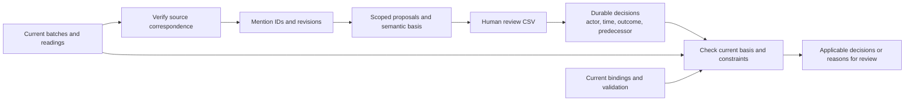
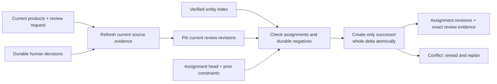

# Durable identity review

`yizkr.pipeline.review_stages` prepares bounded identity proposals from saved batches and readings, records human decisions in an explicitly selected SQLite database, and projects the decisions applicable to current evidence. The database owns mention and decision IDs; it does not allocate entities, resolve graph assignments or write to Wikibase. Keep it with durable archive state and back it up after closing the store. Response caches and clustering maps are disposable independently of this database.



## Supported decisions

| Operation | Explicit scope | Effect of approval | Effect of rejection |
| --- | --- | --- | --- |
| `same` | Two source mentions | May identify the same entity. | Preserve a negative identity constraint. |
| `different` | Two source mentions | Preserve a negative identity constraint. | Record rejection without inferring sameness. |
| `assign` | One mention and a supplied `EntityBinding` | Authorize that target while its deployment, generation and binding remain current. | Preserve rejection of that target. |
| `new_entity` | One mention | Record explicit permission for a new entity; allocate nothing. | Grant no creation permission. |

Proposals retain supplied before-state references, target references, method/run origin and a versioned material basis. Decisions add an opaque ID, revision, outcome, actor, timezone-qualified confirmation time and predecessor. A later decision cannot silently overwrite a concurrently recorded decision. Importing the same actor's unchanged decision twice is idempotent.

Approved same-mention relations and assignments to one target are checked together with negative constraints. A direct or transitive contradiction blocks the affected connected mentions, leaving unrelated applicable decisions available. Missing evidence for an existing negative constraint also blocks affected positive proposals. Omitting an old pair from a new request does not erase its decision.

## Prepare, review and project

Python callers use `ReviewRequest`, `ReviewSource`, `ReviewProposal`, `prepare_review`, `export_review` and `record_review` directly. The CLI is a human review adapter:

```bash
yizkr ingest identity-review prepare --request review-request.json \
  --store var/identity-review.sqlite --out var/identity-review.csv
# Inspect the evidence and enter approve/reject in selected decision cells.
yizkr ingest identity-review record --store var/identity-review.sqlite \
  --csv var/identity-review.csv --actor "curator"
yizkr ingest identity-review project --request review-request.json \
  --store var/identity-review.sqlite --out var/identity-decisions.json
```

The request supplies explicit inputs; nothing discovers corpus paths, model clients, credentials or a graph connection. Paths within the request are relative to its directory. A fictional request distinguishing the two Ursula Löbigs is:

```json
{
  "format": 1,
  "sources": [
    {
      "artifact_sha1": "aaaaaaaaaaaaaaaaaaaaaaaaaaaaaaaaaaaaaaaa",
      "batch": "ursulas.batch.json",
      "reading": "ursulas.transcription.json"
    }
  ],
  "proposals": [
    {
      "operation": "different",
      "mentions": [
        {
          "artifact_sha1": "aaaaaaaaaaaaaaaaaaaaaaaaaaaaaaaaaaaaaaaa",
          "local_id": "daughter"
        },
        {
          "artifact_sha1": "aaaaaaaaaaaaaaaaaaaaaaaaaaaaaaaaaaaaaaaa",
          "local_id": "widow"
        }
      ],
      "evidence": { "reason": "Distinct source occurrences and relationships" },
      "origin": { "method": "curator proposal" }
    }
  ]
}
```

Use the actual artifact hash and local IDs from the supplied fictional products when running the example. `reading` is optional, but a missing reading prevents automatic correspondence across changed products. An assignment supplies `target` as a complete `core.write_recovery.EntityBinding`, and `current_targets` supplies the currently verified bindings. A bare QID is insufficient. `blocked` accepts records of `mention` plus `reasons` for caller-owned current validation; preparation also runs the existing entity structure/container checks and blocks inconsistent or unsupported source attribution. Projection never overrides these guards, and downstream application must still perform its own current write validation.

CSV rows show the source occurrence, quoted evidence, semantic basis, target and before-state, method, proposal revision, prior-decision revision, and current status/blockers. A status such as `applied: reject` means the rejection remains applicable. Only the `decision` column supplies an outcome; leave it blank to make no new decision. The store retains the complete immutable sheet, including displayed warnings and the prior-decision revision, and the decision references that sheet. Edits outside decision cells and stale proposal imports are refused, and a failed packet records none of its decisions. Change the request and prepare again to revise a proposal. Labels describe the stored proposal; display edits do not change its semantic digest.

The projection records applicable decision revisions and current mention revisions for reproducibility. It distinguishes `applied`, `needs_review` and `blocked`, and exposes assignments, explicit new-entity permissions and negative constraints separately. An approved identity decision does not admit historical claims or face associations.

## Correspondence and change

Automatic correspondence requires an unambiguous literal label or alias inside the declared source lines, uniquely located quoted context and the same source owner/native part/placement scope. The store records the old and new observations and reading digests. Exact context moving to different reading offsets can preserve a mention; changed model IDs and entity order cannot choose between homonyms. Overlapping occurrences, repeated context, unsupported source attribution and missing locations abstain. Exact replay of one immutable product can reuse its local locator without claiming correspondence to a different product.

For a reviewed locator correction, supply `remaps` entries with the current `mention`, `prior_id`, `prior_revision`, `actor`, `reason` and timezone-qualified `time`. Apply this explicit correspondence before observing the new product. Both observations must have verified located context for the same owner/native part, even when literal occurrence matching is ambiguous; a current occurrence already assigned to another durable mention is refused. Missing or unsupported source attribution must be repaired before remapping. A remap establishes correspondence only: changed quoted wording, interpretation or supporting claims still require a new decision.

The semantic basis retains source occurrence/scope, entity interpretation, relevant claims, attribution, excerpts, source uncertainty and judgment notes. It replaces local references with durable mention IDs and canonicalizes irrelevant ordering. Display labels, summaries, run timestamps and extraction confidence used only for review ordering do not establish identity. The actual quoted source wording remains material. Proven locator changes exclude absolute reading offsets and reading digests from semantic comparison while retaining them as provenance.

A new source gets its own mentions and unapproved proposals; it does not revoke unchanged decisions about earlier sources or inherit their consent. Only materially changed scopes need review. Unknown correspondence keeps the previous decision attached to its original evidence.

## Accept assignments to existing entities

`yizkr.pipeline.assignment_stages.accept_reviewed_assignments` accepts a `ReviewStore`, current `ReviewRequest` and explicitly supplied `CreationRegistry`. It prepares current evidence again, verifies target creation bindings against the server, and pins the observed mention, proposal and decision revisions while publishing. A saved projection is an inspection product, not authorization to import assignments. Relevant stale or blocked review refuses the entire request; callers can submit separately scoped requests for unrelated sources.

The registry is the same server authority used for item creation. Its entity-ID index points to the original verified creation receipt, preserving its bytes and QID. The receipt's item-creation revision and the index's binding revision are distinct. A label or description edit changes neither identity. A missing index can be created from verified receipt evidence; matching terms cannot supply that evidence.



A successful append records the exact mention revisions, proposals, material bases, decision origins and human confirmations together with assignment revisions and negative constraints. One immutable successor page accepts the complete delta. Independent clients competing at the same head cannot both publish different successors; a lost acknowledgement can recover an identical accepted delta. Repeating an unchanged assignment preserves its revision. Persisted different-mention and rejected-target constraints remain effective on later imports, including imports that omit the original proposal.

Approved `new_entity` components are returned as awaiting creation. This operation allocates no items and changes no historical graph statements. It refuses reassignment and established-entity merge/split. The server records are operational metadata backed up with the database; they do not yet provide graph-readable identity-method statements or applied-assertion lineage.

## Integration boundary

The existing scratch clustering map remains a proposal snapshot, and the one-batch `reconcile`/`resolve --equivalences` CSV path has no automatic migration into human decisions here. Its local IDs and QIDs cannot prove historical consent or source correspondence. Verified migration, assignment-aware graph writing and graph-readable identity provenance remain under [#755](https://github.com/WillHirsch/yizkr/issues/755); later-cohort matching and protected candidate-absence checks remain under [#756](https://github.com/WillHirsch/yizkr/issues/756). These complete the remaining [#130](https://github.com/WillHirsch/yizkr/issues/130) scope. Incremental document application remains under [#723](https://github.com/WillHirsch/yizkr/issues/723). Current one-map and retained-state guards remain in force; assignment acceptance alone does not establish a supported keeper workflow.
