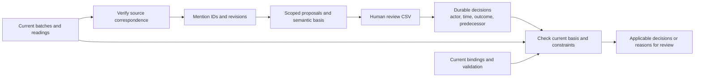
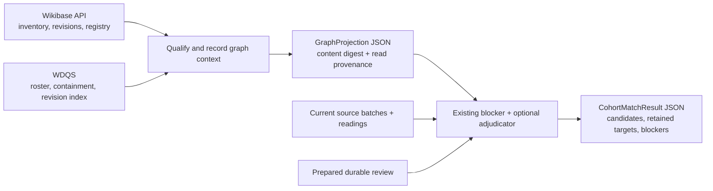
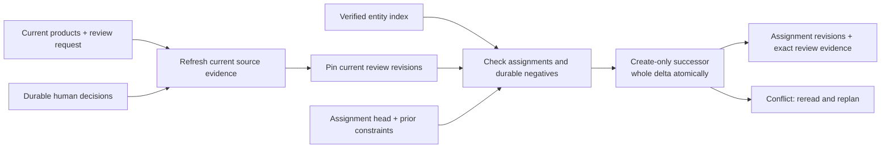
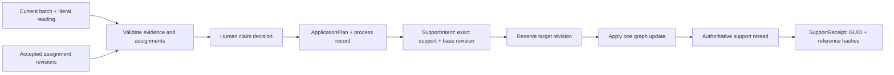

# Durable identity review

`yizkr.pipeline.review_stages` prepares bounded identity proposals from saved batches and readings, records human decisions in an explicitly selected SQLite database, and projects the decisions applicable to current evidence. The database owns mention and decision IDs; it does not allocate entities, resolve graph assignments or write to Wikibase. Keep it with durable archive state and back it up after closing the store. Response caches and clustering maps are disposable independently of this database.



## Supported decisions

| Operation | Explicit scope | Effect of approval | Effect of rejection |
| --- | --- | --- | --- |
| `same` | Two source mentions | May identify the same entity. | Preserve a negative identity constraint. |
| `different` | Two source mentions | Preserve a negative identity constraint. | Record rejection without inferring sameness. |
| `assign` | One mention and a supplied `EntityBinding` | Authorize that target while its deployment, generation and binding remain current. | Preserve rejection of that target. |
| `new_entity` | One mention | Record explicit permission for a new entity; allocate nothing. | Grant no creation permission. |

Proposals retain supplied before-state references, target references, method/run origin and a versioned material basis. Decisions add an opaque ID, revision, outcome, actor, timezone-qualified confirmation time and predecessor. A later decision cannot silently overwrite a concurrently recorded decision. Importing the same actor's unchanged decision twice is idempotent.

Approved same-mention relations and assignments to one target are checked together with negative constraints. A direct or transitive contradiction blocks the affected connected mentions, leaving unrelated applicable decisions available. Missing evidence for an existing negative constraint also blocks affected positive proposals. Omitting an old pair from a new request does not erase its decision.

## Prepare, review and project

Python callers use `ReviewRequest`, `ReviewSource`, `ReviewProposal`, `prepare_review`, `export_review` and `record_review` directly. The CLI is a human review adapter:

```bash
yizkr ingest identity-review prepare --request review-request.json \
  --store var/identity-review.sqlite --out var/identity-review.csv
# Inspect the evidence and enter approve/reject in selected decision cells.
yizkr ingest identity-review record --store var/identity-review.sqlite \
  --csv var/identity-review.csv --actor "curator"
yizkr ingest identity-review project --request review-request.json \
  --store var/identity-review.sqlite --out var/identity-decisions.json
```

The request supplies explicit inputs; nothing discovers corpus paths, model clients, credentials or a graph connection. Paths within the request are relative to its directory. A fictional request distinguishing the two Ursula Löbigs is:

```json
{
  "format": 1,
  "sources": [
    {
      "artifact_sha1": "aaaaaaaaaaaaaaaaaaaaaaaaaaaaaaaaaaaaaaaa",
      "batch": "ursulas.batch.json",
      "reading": "ursulas.transcription.json"
    }
  ],
  "proposals": [
    {
      "operation": "different",
      "mentions": [
        {
          "artifact_sha1": "aaaaaaaaaaaaaaaaaaaaaaaaaaaaaaaaaaaaaaaa",
          "local_id": "daughter"
        },
        {
          "artifact_sha1": "aaaaaaaaaaaaaaaaaaaaaaaaaaaaaaaaaaaaaaaa",
          "local_id": "widow"
        }
      ],
      "evidence": { "reason": "Distinct source occurrences and relationships" },
      "origin": { "method": "curator proposal" }
    }
  ]
}
```

Use the actual artifact hash and local IDs from the supplied fictional products when running the example. `reading` is optional, but a missing reading prevents automatic correspondence across changed products. An assignment supplies `target` as a complete `core.write_recovery.EntityBinding`, and `current_targets` supplies the currently verified bindings. A bare QID is insufficient. `blocked` accepts records of `mention` plus `reasons` for caller-owned current validation; preparation also runs the existing entity structure/container checks and blocks inconsistent or unsupported source attribution. Projection never overrides these guards, and downstream application must still perform its own current write validation.

CSV rows show the source occurrence, quoted evidence, semantic basis, target and before-state, method, proposal revision, prior-decision revision, and current status/blockers. A status such as `applied: reject` means the rejection remains applicable. Only the `decision` column supplies an outcome; leave it blank to make no new decision. The store retains the complete immutable sheet, including displayed warnings and the prior-decision revision, and the decision references that sheet. Edits outside decision cells and stale proposal imports are refused, and a failed packet records none of its decisions. Change the request and prepare again to revise a proposal. Labels describe the stored proposal; display edits do not change its semantic digest.

The projection records applicable decision revisions and current mention revisions for reproducibility. It distinguishes `applied`, `needs_review` and `blocked`, and exposes assignments, explicit new-entity permissions and negative constraints separately. An approved identity decision does not admit historical claims or face associations.

## Correspondence and change

Automatic correspondence requires an unambiguous literal label or alias inside the declared source lines, uniquely located quoted context and the same source owner/native part/placement scope. The store records the old and new observations and reading digests. Exact context moving to different reading offsets can preserve a mention; changed model IDs and entity order cannot choose between homonyms. Overlapping occurrences, repeated context, unsupported source attribution and missing locations abstain. Exact replay of one immutable product can reuse its local locator without claiming correspondence to a different product.

For a reviewed locator correction, supply `remaps` entries with the current `mention`, `prior_id`, `prior_revision`, `actor`, `reason` and timezone-qualified `time`. Apply this explicit correspondence before observing the new product. Both observations must have verified located context for the same owner/native part, even when literal occurrence matching is ambiguous; a current occurrence already assigned to another durable mention is refused. Missing or unsupported source attribution must be repaired before remapping. A remap establishes correspondence only: changed quoted wording, interpretation or supporting claims still require a new decision.

The semantic basis retains source occurrence/scope, entity interpretation, relevant claims, attribution, excerpts, source uncertainty and judgment notes. It replaces local references with durable mention IDs and canonicalizes irrelevant ordering. Display labels, summaries, run timestamps and extraction confidence used only for review ordering do not establish identity. The actual quoted source wording remains material. Proven locator changes exclude absolute reading offsets and reading digests from semantic comparison while retaining them as provenance.

A new source gets its own mentions and unapproved proposals; it does not revoke unchanged decisions about earlier sources or inherit their consent. Only materially changed scopes need review. Unknown correspondence keeps the previous decision attached to its original evidence.

## Record graph context and inspect later-cohort matches

`pipeline.graph_projection.capture_graph_projection(registry)` reads an explicitly supplied `CreationRegistry` and its Wikibase/WDQS connection. It records the current generation, every live nonredirect item/property revision, the existing matcher's roster and containment closure, verified entity bindings, accepted assignments and negative constraints. Each query and returned row is retained with the capture's time and watermarks. Capture never creates a generation, binding or assignment.



Capture requires the WDQS revision index to match the authoritative API inventory before and after reading. The inventory, entity revisions, generation and MediaWiki revision/log watermarks must remain unchanged. Lag, missing coverage, unsupported dates or an observed intervening edit refuse capture; retry after the index catches up or concurrent work finishes. This is an observed consistent read, not a transaction or permission to create an entity. Unbound graph entities remain visible candidates with an explicit blocker; display labels cannot supply their missing creation evidence.

The direct Python workflow takes current source products and an existing durable review store:

```python
from pathlib import Path

from yizkr.pipeline.cohort_matching import match_cohort, save_cohort_match
from yizkr.pipeline.graph_projection import (
    capture_graph_projection,
    load_graph_projection,
    save_graph_projection,
)
from yizkr.pipeline.review_stages import ReviewRequest, prepare_review

# registry, store and sources are explicitly supplied by the caller.
# sources is a tuple of ReviewSource(artifact_sha1, batch, reading).
projection_path = Path("var/graph-projection.json")
save_graph_projection(capture_graph_projection(registry), projection_path)

# Loading and matching need no graph connection.
recorded = load_graph_projection(projection_path)
request = ReviewRequest(
    sources=sources,
    current_targets=tuple(entry.binding for entry in recorded.bindings.values()),
)
prepared = prepare_review(store, request)
result = match_cohort(recorded, sources, prepared_review=prepared)
save_cohort_match(result, Path("var/cohort-matches.json"))
```

Preparation observes source occurrences in the local review store. Matching itself records no human decisions or assignments. It checks that the prepared review describes exactly the supplied products, then runs the existing name/kind blocker separately for each source batch. Artifact-qualified mention IDs prevent identical model-local IDs in different documents from colliding. Accepted targets remain attached after graph display edits, and current reviewed targets remain distinguishable from accepted assignments. A confirmed same-person component carries its accepted target as advice for the other mentions; conflicting accepted targets block the component without merging them. Relevant human negative constraints and missing or stale review context block affected proposals.

Omitting `client` performs deterministic candidate blocking only. To request the existing adjudicator, supply `client` and an `AdjudicationProvenance` naming its provider, model and configuration. The result records source, review and projection digests, the prompt digest, optional provider identity and returned candidate verdicts. Missing, repeated or invalid pair answers are incomplete advice. A verdict never becomes human approval, and an empty candidate list never authorizes creation. Matching does not change source extraction or its evidence.

Keep both JSON products with the inputs needed for replay, outside Git: their facts and query results may contain private archive data. Loaders verify their content digests; they do not establish current graph state or trust in an external producer. Protected review-to-application and candidate-absence enforcement remain in [#767](https://github.com/WillHirsch/yizkr/issues/767). The recorded proposal product cannot be submitted directly for assignment acceptance or graph writes.

## Accept assignments to existing entities

`yizkr.pipeline.assignment_stages.accept_reviewed_assignments` accepts a `ReviewStore`, current `ReviewRequest` and explicitly supplied `CreationRegistry`. It prepares current evidence again, verifies target creation bindings against the server, and pins the observed mention, proposal and decision revisions while publishing. A saved projection is an inspection product, not authorization to import assignments. Relevant stale or blocked review refuses the entire request; callers can submit separately scoped requests for unrelated sources.

The registry is the same server authority used for item creation. Its entity-ID index points to the original verified creation receipt, preserving its bytes and QID. The receipt's item-creation revision and the index's binding revision are distinct. A label or description edit changes neither identity. A missing index can be created from verified receipt evidence; matching terms cannot supply that evidence.



A successful append records the exact mention revisions, proposals, material bases, decision origins and human confirmations together with assignment revisions and negative constraints. One immutable successor page accepts the complete delta. Independent clients competing at the same head cannot both publish different successors; a lost acknowledgement can recover an identical accepted delta. Repeating an unchanged assignment preserves its revision. Persisted different-mention and rejected-target constraints remain effective on later imports, including imports that omit the original proposal.

Approved `new_entity` components are returned as awaiting creation. This operation allocates no items and changes no historical graph statements. It refuses reassignment and established-entity merge/split. The server records are operational metadata backed up with the database. Assignment acceptance alone publishes neither graph identity-method statements nor applied-assertion lineage; the separate projection below publishes methods.

## Apply reviewed historical claims

`pipeline.claim_review.prepare_claim_review(store, request, registry, selections=...)` takes current products and explicit `ClaimSelection(artifact_sha1, index, warnings=())` selections. It verifies registered source creation bindings, located literal excerpts and accepted assignments for every subject, object and item-valued qualifier. Local references remain in the source products; their durable mention, assignment and binding revisions become part of the historical claim's review basis. A saved projection, identity approval, legacy reviewed batch or `bulk_accepted` flag cannot replace this claim approval.

Inspect each prepared claim's meaning, support, assignments and warnings, then pass explicit `ClaimDecisionInput` records to `record_claim_decisions`. Decisions live in the same `ReviewStore` as identity review, with their own proposal, actor, time, outcome and revision. Refresh preparation before calling `pipeline.assignment_writes.apply_reviewed_claims(store, prepared, client, record_dir=...)`. This direct Python route has no implicit command-line or scratch-driver adoption. Depicts requires its separate explicit association confirmation.



| Product | Authority and purpose |
| --- | --- |
| Claim proposal and decision | SQLite review store; approved meaning, source/location, all assignment roles, warnings and explicit human confirmation. |
| `ApplicationPlan` | Shared server registry; immutable selected decisions, roles, graph payloads and original producer/application evidence. Its process records also persist as content-addressed JSON in `record_dir`. |
| `SupportIntent` | Registry record for one attributed claim; exact expected support, original target revision and any existing statement GUID. |
| Dispatch reservation | Immutable registry record for the target QID and base revision; only one attempt may dispatch from that revision, including competing plans. |
| `SupportReceipt` | Registry evidence from an authoritative reread: target revision, statement GUID, exact primary and optional circumstance reference hashes/JSON, and observed statement-level process references. |

Application pins current review revisions, verifies instance/generation, assignments and source bindings, and uses `BatchWriter` serialization/admission with single-attempt revision-checked updates. It adds historical statements or individual source references to already bound entities; it does not mint historical entities, append aliases or infer kind statements. Legacy map writes retain their existing preflight and one-map guards. Unbound creation, reassignment, merge/split and ambiguous equal statements refuse. A curator citation to the right artifact without the exact reviewed location/excerpt cannot stand in for applied support or be rewritten to manufacture it.

The supported evidence route requires a current literal reading and uniquely located excerpt, with readable page and native-owner checks where present. Structured-only inputs without that reading/excerpt are unsupported here. Image-region geometry remains a human-reviewed annotation; literal-text validation does not prove a pixel location. Verified reading/offset or local-ID changes preserve approval when meaning and correspondence remain unchanged; an existing application retains its original applied support. Actual changes to meaning, attribution, assignments or warnings need their scoped review.

Existing exact support receives a receipt without acquiring a new bare process reference. Shared statements retain their ranks and other sources' reference blocks. Observed process references describe the statement's context; they do not prove which old source block belongs to which process. `ApplicationInterrupted` exposes the plan ID and completed receipts. Retry rereads durable intents and visible effects before completing missing receipts; it never rebases an old intent or automatically resends a reserved attempt whose effect remains missing or uncertain. A stopped batch can have graph effects and is not rolled back. These records identify the affected support for future correction; they do not implement retraction or split.

## Migrate an existing map and expose its provenance

`prepare_map_migration` and `accept_map_migration` in `yizkr.pipeline.identity_migration` provide a bounded migration for existing creation-registry bindings. Supply the review store, current review request and readings, original identity map, registry, and explicitly selected source mentions. Preparation validates supported map format/version, fingerprints, membership and methods; each selected occurrence must have an unambiguous located correspondence independent of occurrence order. Missing locations, indistinguishable homonyms, incompatible maps and absent creation receipts refuse. Changed graph labels and model-local IDs do not choose the target.

The map supplies a candidate cluster and original method. Its opaque `inputs` digest cannot reconstruct or prove the original batches/readings. Preparation resolves the cluster's original creation operation and proposes its verified binding through ordinary identity review. Inspect and approve the explicit assignments through the existing review store; migration never imports a scratch verdict or legacy CSV as human consent. Acceptance checks current evidence again and publishes only the selected assignments, while retaining relevant same/different and rejected-target constraints.

```mermaid
flowchart LR
    map["Validated original map"] --> prepare["Verify correspondence + original creation binding"]
    products["Current located products + selected mentions"] --> prepare
    prepare --> review["Explicit assignment review"]
    review --> accept["Accept selected durable assignments"]
    accept --> evidence["Immutable process record + migration receipt"]
    evidence --> publish["Append identity metadata to existing kind statements"]
    publish --> graph["Graph-only methods, decisions and confirmation query"]
```

| Product | What it establishes |
| --- | --- |
| Prepared migration | Selected map-to-current-mention correspondence, verified target bindings and review proposals. It grants no approval. |
| Immutable process record | Supplied map, current product digests, correspondence, accepted assignments, exact human decisions, available producer evidence and explicit historical limitations. |
| Registry migration receipt | The selected assignments were accepted in the shared authority. It does not mean graph projection or historical claim application completed. |
| Graph identity projection | Existing source-backed kind statements carry original methods and assignment/decision revisions, with human confirmation in separate references. |

`publish_identity_provenance(client, migration_id, record_dir=...)` reads the verified receipt and immutable record, checks current vocabulary, unique source items carrying a current nondeprecated media hash, and uniquely identified source-backed kind statements, and publishes their identity metadata. Bootstrap the current model first. The operation preserves QIDs, display terms, statement ranks and existing historical source/run references. Missing or ambiguous source/kind matches refuse before publication. Metadata item creation uses the shared recovery authority; interrupted publication can be retried using the same migration ID. Successful return requires authoritative rereading of the expected references; individual item updates use revision checks, and the multi-item operation is not an atomic historical-claim write.

The production [identity-provenance query](../src/yizkr/queries/identity-provenance.rq) reads methods, assignment/decision revisions, record digests, human actors/times and available producer facts entirely from the graph. When an original producer record exists, it also exposes that record’s exact digest/file and recorded run identity, separately from migration metadata. Its `<digest>.json` record name resolves in the explicitly managed `record_dir`; keep that directory with backups. Confident, adjudicated, confident-component and singleton methods remain distinct. Ambiguous, conflicting and unclustered origins remain visible as such even after an assignment is approved. Unsupported historical origin facts remain unknown rather than being inferred from current configuration.

An explicit owner override replaces a rejected proposed target before the mention's first assignment. `pipeline.identity_origins.owner_override_evidence` captures the stored rejection, replacement binding and curator reason; include it in the replacement proposal's evidence with `origin.method = "owner_override"`, then review and accept that assignment normally. `pipeline.owner_override_provenance.publish_owner_override(client, mention_id, record_dir=...)` verifies the accepted rejection/replacement evidence and appends the override origin and separate human confirmation to a unique existing source-backed kind statement. Ordinary approval is not an override, and legacy map migration cannot infer one. This route does not move an established assignment or authorize a merge/split.

## Integration boundary

The existing scratch clustering map remains a proposal snapshot, and the one-batch `reconcile`/`resolve --equivalences` CSV path has no automatic migration into these decisions. Its local IDs and QIDs cannot prove historical consent or source correspondence. The explicit assignment-aware route above writes reviewed claims to verified existing entities; it does not select new candidates or allocate entities. Recorded later-cohort matching above supplies read-only advice. Protected application and candidate-absence checks remain under [#767](https://github.com/WillHirsch/yizkr/issues/767), completing [#756](https://github.com/WillHirsch/yizkr/issues/756). Incremental document orchestration remains under [#723](https://github.com/WillHirsch/yizkr/issues/723), and correction/split under [#142](https://github.com/WillHirsch/yizkr/issues/142). Legacy one-map and retained-state guards remain in force; these bounded operations do not establish a complete keeper workflow.
