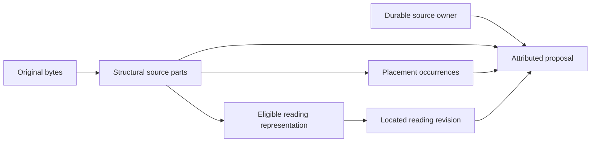
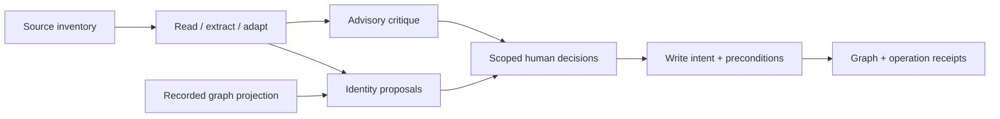

# Ingestion and identity contracts

These are the target boundaries for ingestion, review and persistence under the [current project contract](CONTRACT.md). They specify the shared decisions for implementation work; they do **not** describe an already-supported incremental writer or authorize a migration. [MODELING](MODELING.md), [ARCHITECTURE](ARCHITECTURE.md) and the [scratch stage guide](SCRATCH_WORKFLOW.md) describe the existing implementation. Keep its approval, identity, exclusion and reset guards until their replacements are verified.

The records below name required information and semantics, not a new database, workflow language or universal document class. Use ordinary typed Python operations with stage-specific payloads. Existing CLI commands remain useful adapters to those operations. Persist only the distinctions needed to preserve attribution, human decisions and recovery; a source part need not become a Wikibase item.

## Source identity and attribution

| Concept | Identity and minimum information | What changes it |
| --- | --- | --- |
| Byte object | Algorithm-qualified digest of exact bytes; available bytes and media type. Existing SHA-1 references remain supported. Paths and filenames are locations, not identity. | Changed bytes create a different byte object. |
| Source part | Immutable byte-object reference plus a typed structural locator: page/slide body, speaker notes, annotation or embedded resource. | A different owning byte object or structural part; never the native-text/vision choice. |
| Placement | Parent part, occurrence-specific structural locator, child source reference and available geometry/crop/transform. | A different occurrence. Repeated use of one image produces separate placements. |
| Source owner | Durable artifact/entity ID for whose assertions these are, with explicit bindings to byte objects and parts. Use the same durable identity/binding mechanism as other entities. | An explicit new source or reviewed change of ownership, not a rendering or label change. |
| Reading | Immutable product/revision with input parts and representations, process/configuration, text and located spans, and output digest. | A rereading or correction can produce a new revision without changing the source owner. |
| Mention | Persistent mention ID, source-part occurrence/record locator, revision, supporting reading/span references and any explicit predecessor mapping. | The same occurrence can acquire a new interpretation revision; a different or ambiguously matched occurrence gets a new ID. |
| Entity | Opaque stable ID in the archive namespace, with mutable descriptive attributes and separately versioned instance/QID bindings. | Labels, evidence additions and clustering do not change it. Reviewed identity changes have explicit revision semantics below. |

A derived PNG's digest identifies a representation, not a new witness. Record its derivation from the original part and the transformation used. Re-encoding a derived representation of the same original input part retains that part and owner through its recorded lineage; bytes known to depict the same source can share an owner through an explicit binding. A changed input file creates new byte/part observations: neither filename equality nor visual similarity silently establishes that it is the same historical source. Repeated observation of an already-bound byte object/source part reuses its established owner; a new invocation or placement is not a new owner allocation. Unknown equivalence remains a proposal. Copies or repeated placements are not independent corroboration merely because their byte digests differ.

Structural locators come from the immutable input, before eligibility filtering or reading. For PPTX, preserve the package part and shape/relationship occurrence path; for PDF, preserve the page and object/paint occurrence path, including a deterministic structural ordinal when no native ID exists. A filtered image list's index is not a locator. Store physical page/slide position separately from any printed page label. Relationships without a visible occurrence and content whose placement cannot be established are explicit limitations, not invented page placements.

For example, a notes locator can contain `kind: speaker_notes`, `package_part: ppt/notesSlides/notesSlide2.xml`, and `slide: 2`. It denotes a source part associated with the slide, not text visible on that slide. PPTX speaker notes are source content; a transcription engine's observations also called `notes` are process commentary. Do not merge those categories.

A citation binds **source owner, source part/placement, reading revision and supporting span/excerpt** as applicable. Before admission, an unresolved owner may remain a proposal anchored to its source part; later binding must preserve that attribution. Inventory need not create retained entities or maintain a second identity registry. Claims from deterministic structured inputs can cite a record/tag locator without inventing a transcription. A page-wide reading may contain several owners; extraction must retain the attribution of each span. If the route cannot separate an embedded witness from the compiler's text, return an explicit incomplete/unsupported result for that material. Do not relabel the entire reading as the compiler's evidence.

The owner of a claim is distinct from its subject. A slide caption can make a claim about its photograph while remaining evidence from the presentation. A read image can make its own claims, independent of the caption. Keep known translation/copy relationships visible; two source owners do not imply independent testimony.

### Inventory before reading

Inventory source parts and placements independently of the chosen reading route. Keep inventory completeness, eligibility and reading outcome separate:

- Eligibility is allowed, excluded or undetermined. Excluded and undetermined material cannot reach a model or registration/write path.
- Eligible parts may be unattempted, unsupported, failed or successfully read. A successful reading with no text is distinct from no attempt.
- Account for unsupported media, hidden content and relationship-only references without pretending they were read or visibly placed. Native source order, occurrence identity and known layout survive filtering.

Apply the configured exclusion boundary to the actual outbound material. A whole-page render or whole-PDF fallback containing an excluded image is not safe merely because its extracted-image task was skipped. Use a verified eligible representation or refuse that route. Inventory metadata does not authorize disclosing excluded bytes.

The diagram separates identities; it does not require seven storage systems or a graph item for every box.

## Persistent identity and review

### Entities, mentions and assignments

Allocate a stable entity ID once, before a possible item-creation attempt, and reuse it through the durable intent/binding record. A binding contains `entity_id`, deployment identity/generation, QID, binding revision and creation-intent key. A bare QID is not portable between instances or across reset/restore. Migration may preserve an existing QID through an explicit verified binding; it must not rediscover it by generated label or description. People, places, events and source owners use this same mechanism.

Mention IDs identify document/source-local occurrences, not the person believed to be mentioned. A model-local ID, canonicalized label, excerpt hash or line number can help find a candidate correspondence, but none is the durable key. Reuse a mention ID after rereading only when correspondence to the source occurrence is unambiguous and recorded. Preserve the old revision and provenance. Changed segmentation or indistinguishable homonyms must not be aligned by list position; unresolved correspondence stays a proposal and does not inherit approval. Different mentions may later be assigned to the same entity.

An assignment revision contains a revision ID, mention ID/revision, entity ID, previous assignment revision if any, and decision reference. There is at most one active assignment for a mention. Clustering snapshots contain candidate groupings, methods and evidence; their membership hashes identify proposals, not persistent entities. A new snapshot does not rename entities or replace accepted assignments.

Preserve reviewed negative decisions too: an explicit decision that two occurrences denote different entities must constrain later proposals while its material basis remains unchanged. A rejected match does not itself authorize creation of a new entity.

### Decisions and approval carry-forward

A decision records its explicit operation and scope (`assign`, `new entity`, `different`, `move`, `merge` or `split`), before/after stable references, evidence and material basis versions, originating method/run, outcome, actor and time. Retained identity changes require affirmative human confirmation of the shown assignments. Ordinary claim admission can be a bounded batch; face-to-person assertions require explicit confirmation of each displayed association. Scratch assignments remain unratified development proposals and cannot be imported as human approvals.

An approval binds the **meaning reviewed**, not a whole run, cluster hash, mutable entity record or CSV filename. For a claim, that includes subject/object/item-valued-qualifier assignments, predicate/value/qualifiers, uncertainty, source ownership and located support. For an identity decision it includes the affected mentions/entities and the evidence used to establish that equivalence or distinction. Record the relevant validation warnings and versioned comparison rules so changes are inspectable.

| Change | Required treatment |
| --- | --- |
| Curator edits an entity label; model renumbers local IDs; serialization/order or run timestamp changes; proven locator remapping preserves the same source occurrence/support | Retain identity and approval when the semantic proposal, source correspondence and material basis are unchanged. |
| Prompt/model or processing revision changes | Recompute affected products as required by freshness; compare their semantic outputs before deciding which approvals need review. |
| New source corroborates an accepted fact | Keep the existing approval. The new assertion and new mention assignment still need their applicable authorization. |
| A value, uncertainty, actual source attribution/supporting location, identity assignment or material decision basis changes | Propose a new revision and requeue only affected decisions. Unaffected evidence and approvals remain usable. |
| A new warning or incompatible validation rule makes the operation unsafe | Expose it and refuse the affected application until resolved; an old approval cannot bypass an active guard. |
| Rereading cannot establish correspondence to the old mention | Keep the old decision attached to its old evidence; require review of the new/ambiguous proposal. |

A semantic comparison must retain meaningful differences and abstain when equivalence cannot be established. It must not erase genuine disagreement, ignore changed source support or infer an identity from matching labels. Exact serialization and digest encodings can be selected by their implementations, but the persisted format and comparison semantics must be versioned. No new signature infrastructure or general authorization engine is required by these records.

### Additions, correction and migration

A compatible addition leaves existing entity/QID bindings and active assignments intact. It may add reviewed assertions, new mentions assigned to an existing entity, or explicitly approved new entities. It is not a merge merely because a new mention points to an existing entity. Assignment of an existing mention to a different entity, unification of established entities, and separation of an established entity are explicit revisions, never automatic consequences of reclustering.

Correction distinguishes a machine error from an authored source disagreement. A reviewed replacement or retraction retires the affected **active interpretation** and records its predecessor, actor and reason while preserving source evidence and recoverable history. It cannot silently remove an independently attributed contrary source. For a split, preserve the existing entity ID for the retained part; explicitly assign the split-off mentions to a reviewed existing entity or allocate an ID when a new entity is required; state exactly which mentions and attributed claims move. Preserve existing QIDs where possible, and mark identity revisions on both affected items so their privacy confirmations are requeued. A later merge needs an explicit survivor/alias and reference plan; the first incremental implementation may refuse it.

Applied-write provenance must map each attributed assertion, including mentions used as subject, object or item-valued qualifier, to its assignment revisions and graph statement/reference identifiers. A graph statement can combine support from several sources: correction or split moves/retires only affected attributed support and preserves the rest. Reconstructing the affected scope by labels or copying every statement on an item is insufficient.

Keep identity provenance readable in the graph. For clustering-derived decisions, expose the decision/clustering revision and method (confident, adjudicated, confident component, owner override or singleton), with the adjudication run/model/prompt where applicable. Source registration, migration and curator corrections record their actual origins without inventing a clustering classification. Human confirmation is recorded separately from the algorithmic origin; confirming a confident proposal does not erase how it was generated. Detailed maps/projections may remain off-graph with a resolvable reference and digest. Accepted assertions remain authoritative in Wikibase.

Migration inventories existing source/mention keys, map versions, QIDs and review state, then records verified old-to-new mappings, bindings and a migration receipt before switching writers. It must preserve existing QIDs, human edits and evidence. Ambiguous label-based matches, missing mapping provenance and incompatible partial state block only affected migration/application; never reset retained data or infer approval to make migration succeed. Until the replacement supports and verifies a transition, retain the current one-map refusal. Normal addition does not depend on implementing every merge/split operation.

## Stage interfaces and data products

A stage descriptor names its scope, input/output types and permitted process capabilities. A request supplies an explicit subject reference, named versioned input references/digests, relevant configuration and generation policy. Paths locate products; they are not dependency identity. Execution services provide cancellation, events, a workspace and the permitted engine/session capabilities. Evidence operations receive neither a live graph client nor a driver/orchestrator back-reference.

| Operation | Inputs | Durable result | Process type |
| --- | --- | --- | --- |
| Inventory/prepare | Original bytes, format adapter and eligibility configuration | Parts, placements, source bindings/proposals, eligible representations and explicit limitations | Deterministic format processing |
| Read/transcribe | Eligible part/representation references, reader configuration, optional curator correction | Located readings and per-part reading outcomes | Deterministic and/or model |
| Extract | Located readings, source ownership, preparation evidence and extraction configuration | Validated proposed claims/local mentions; coverage, rejected and unsupported material | Model plus deterministic validation |
| GEDCOM adaptation | Export bytes, citation/record locators and adapter configuration | The same proposed-claim/mention contract, retaining export provenance | Deterministic adaptation |
| Critique | Complete proposed batch, located readings and critique configuration | Advisory findings tied to claims/locations | Model plus deterministic validation |
| Reconcile/cluster | Mentions/evidence, accepted decisions, optional recorded graph projection | Proposed assignments, methods/reasons and unresolved alternatives | Deterministic and/or model |
| Review | Bounded proposals and differences, identity assignments, relevant evidence/warnings | Explicit decision records and approved revisions | Human decision |
| Plan/apply writes | Authorized revisions, durable bindings, registration needs and relevant graph preconditions | Durable intents, graph changes, receipts and updated bindings | Deterministic graph I/O |

An operation may publish several typed products. An excerpt discovered in a container becomes another source subject with explicit inputs, not a requirement that every adapter build a universal document tree. Scratch reset and site generation remain separate operations; extraction never implicitly performs them. A critic's success or a cluster's confidence is not authorization to write retained data.

### Completion, dependencies and reuse

Results distinguish **complete, incomplete, failed, paused and cancelled**. Record reuse separately: a reused complete product is still complete. A successful empty result has an explicit reason. Partial extraction chunks, malformed answers and diagnostic batches cannot be consumed as an accepted batch. A complete document may have explicit unsupported inventory entries; it must not imply that all source content was covered. The workflow's admission policy decides whether those disclosed limitations block further processing.

Publish completed products and their dependency manifest as one committed generation before announcing completion. A manifest-last commit over immutable files is sufficient; no multi-file database transaction is required. Preserve completed products and useful checkpoints on interruption. Consumers use only a verified complete generation, never a mixture of old and partially replaced files.

Each product records actual source/product dependencies, relevant configuration, schema and semantic-processing compatibility revisions, and producing process provenance. Exact prompt/resource content and model configuration are generation dependencies when used. The code revision is provenance; a documentation-only edit does not itself invalidate all products or writes. Keep three comparisons separate:

1. **Generation freshness:** did the actual inputs or relevant processing dependencies change?
2. **Semantic output:** did the proposed meaning, uncertainty or attribution change?
3. **Approval basis:** did the reviewed decision or its material support change?

A side-effect-free planner returns reuse, recompute or blocked with reasons and changed dependencies. Execution and estimation consume that same result; response-dependent estimates remain estimates. A refreshed generation does not silently replace retained assertions. Reuse compatible individual model responses while rerunning changed deterministic processing. Deleting a response cache does not invalidate persisted readings, proposals or review decisions.

### Graph acquisition and application

Reconciliation/planning may consume an explicitly acquired read-only projection. Record the deployment identity/generation, selection/query and its version, capture time, relevant entity/binding revisions, completeness/index-watermark qualifications and content digest. Source reading/extraction remains source-grounded; a candidate roster must not become evidence for what a document says.

At the write boundary verify the relevant assignments, bindings, approvals and graph preconditions. **Absence is also a precondition:** another writer can create a new candidate without changing the revisions of entities already read. Protect the relevant check and mutation together with conditional revisions, reservations, scoped serialization or an equivalent mechanism, including the affected candidate scope for absence checks. Two writers requerying absence can still race; requery alone is insufficient. If a transition cannot protect its preconditions against concurrent writers, require explicit exclusive operation or refuse it. An old negative query is not proof that minting is safe. WDQS lag is never evidence that an entity does not exist. Use authoritative reads or a verified synchronization condition where absence matters.

Record a durable operation/creation intent before a graph mutation, and its QID/statement/reference/revision receipt after application. Retries reconcile the intent through an instance-visible idempotency key or equivalent durable mechanism, never by label matching. Wikibase does not make a multi-item batch atomic: preserve receipts for completed effects and stop affected work when a precondition is stale. Recovery reconciles uncertain effects before retrying; evidence and approvals survive a stopped write. No partial batch may be reported as fully applied.

### Cancellation and provider sessions

The invocation owns cancellation, dispatch, worker pools and execution-service lifetimes. Stages borrow services; a provider-session service owns conversation leases, subprocesses, transcript restoration, replay and cleanup. Stop new dispatch on cancellation, interrupt owned waits/processes, join workers within a bound and report cancelled distinctly from failure or a resumable pause. Check cancellation before beginning another graph effect; reconcile an in-flight effect through its intent instead of treating a killed call as proof that nothing was written.

Response caching owns keyed responses and rejection provenance, not provider files or human decisions. Fork reuse binds to the opening answer and conversation ancestry actually used. Session loss may require replay; a changed opening answer requires forks under the new ancestry. Previously cached forks remain usable only with their original ancestry; never mix the contexts. Preserve current locking until the replacement has safe ownership. Cancellation and cache/session separation can be implemented independently against this boundary.

## Fictional contract cases

These cases use [the example universe](EXAMPLES.md) and specify target behavior; they do not claim the present pipeline passes them. The [small deterministic acceptance set](TESTING.md#semantic-acceptance) checks current contradictory-value, homonym, equivalence-review and face-approval behavior without freezing temporary IDs or prompt wording. The additional durability, correction and reuse requirements below remain acceptance work for their implementing tasks.

| Case | Required outcome |
| --- | --- |
| `family-booklet-2011`, physical page 6 / printed page 4, translates the embedded `letter-excerpt-1939` as “Angerring 71”; the letter image says “Angerring 11” | Retain both owners, locations and their known dependence through native-text/vision changes. Correcting a machine misreading of the image does not erase the compiler's contrary assertion. |
| `library-talk-2018` slide 2 has visible “Wastl and Hilde” and speaker notes “Photograph from the family album” | Cite distinct source parts of the presentation. Neither passage becomes writing on `album-photo-1906`. Engine observations are not speaker notes. |
| The existing fictional album photograph is placed twice on one slide and once in another container | Keep three occurrence records and the known shared source owner. Filtering decoration or re-encoding a rendered image does not renumber occurrences or create another witness. |
| A source mentioning the widow Ursula Löbig is added after a curator edits the younger Ursula's label | Preserve both entities and the edited label. Reject name-only reuse; review the new mention's assignment. Existing unaffected approvals stay valid. |
| Gustav's birth-register extract and naturalisation certificate give contradictory birth dates | Preserve both attributed values. An identical rereading retains approval; new evidence has its own admission without invalidating the old decision. |
| A reviewed false merge of the two Ursulas is split | Create a split-off entity, revise only the chosen mentions and affected attributed support, retain recoverable history and requeue privacy on both items. Refuse if the required lineage cannot be established. |
| A new entity is written but the process stops before the local receipt is saved | Resume through the same durable intent and recover the original QID even after a label edit; do not mint a duplicate. A stale absence check is revalidated. |
| Extraction is cancelled after completed chunks, or a provider conversation must be replayed | Retain completed work/checkpoints, expose incompleteness, and create no approval. A different opening answer cannot reuse forks from the old context. |

## Implementation boundaries and task ownership

The current code has byte-addressed media, located source references, derivation files, review CSVs, clustering maps and guarded writers. [Shared text-stage operations](ARCHITECTURE.md#shared-text-stage-operations) provide explicit computation inputs/results and separate incomplete extraction from accepted proposals across standalone, reviewed and scratch callers. They retain caller-owned publication and reuse; they do not implement all the durable boundaries above. PDF routes can change image inventory, derived images can be re-encoded, presentation records deduplicate occurrences, notes are flattened, mention/cluster fingerprints depend on content, and writer lookup uses generated display terms. Document freshness and estimation have separate implementations; the cache also manages provider sessions. These are implementation limits, not exceptions to the target contract.

| Work | Implementing tasks |
| --- | --- |
| Source inventory, distinct notes/occurrences, all PDF routes, migration of consumers | [#714](https://github.com/WillHirsch/yizkr/issues/714), [#715](https://github.com/WillHirsch/yizkr/issues/715), [#716](https://github.com/WillHirsch/yizkr/issues/716) |
| Shared semantic subject validation | [#717](https://github.com/WillHirsch/yizkr/issues/717) |
| Media and GEDCOM migration onto the shared operations | [#719](https://github.com/WillHirsch/yizkr/issues/719), [#720](https://github.com/WillHirsch/yizkr/issues/720) |
| Shared dependency descriptors/planning; narrow write invalidation | [#721](https://github.com/WillHirsch/yizkr/issues/721), [#713](https://github.com/WillHirsch/yizkr/issues/713) |
| Matching-policy detail/calibration; persistent reviewed decisions | [#66](https://github.com/WillHirsch/yizkr/issues/66), [#107](https://github.com/WillHirsch/yizkr/issues/107) |
| Durable bindings/assignment revisions, graph-readable provenance and migration; interrupted-write recovery | [#130](https://github.com/WillHirsch/yizkr/issues/130), [#85](https://github.com/WillHirsch/yizkr/issues/85) |
| First incremental text addition; reviewed split/reassignment | [#723](https://github.com/WillHirsch/yizkr/issues/723), [#142](https://github.com/WillHirsch/yizkr/issues/142) |
| Cancellation; response/session ownership | [#724](https://github.com/WillHirsch/yizkr/issues/724), [#726](https://github.com/WillHirsch/yizkr/issues/726) |

Implementation may choose serialized field names, storage layouts, hash encodings and locking mechanisms within these invariants. Matching thresholds remain evidence-driven implementation policy under #66; uncertainty defaults to an unresolved proposal, not automatic retained identity. A representation or concurrency choice that cannot preserve these semantics must be surfaced in its implementing issue. Do not create another owner-decision gate for routine choices. Runtime changes require the relevant semantic and real-boundary evidence in [TESTING](TESTING.md), using the isolated integration lane [#722](https://github.com/WillHirsch/yizkr/issues/722) or the permitted designated disposable target during the transition. Respect each task's native prerequisites. The isolated lane must be demonstrated before the shared instance is retained; unavailable necessary boundary evidence blocks affected persistence changes.
