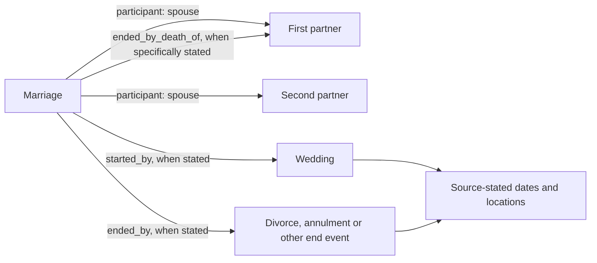

# Life events, relationships and dates

This guide describes current historical assertions and derived views. The [contract](CONTRACT.md) governs source fidelity, disagreement and human authority. A source assertion, a computed bound and permission to disclose a person are separate products. [Mention records](MENTIONS_AND_MATCHING.md) describe how the source names an entity; [GEDCOM](GEDCOM.md) describes deterministic tag adaptation.

## Dates and bounds (ADR-0034)

The claim schema supports dates from 1 CE in the proleptic Gregorian calendar, at day, month, year, decade or century precision. Missing month/day fields reduce precision; explicit precision must agree with supplied fields. A decade is represented by its first year. A century starts at year 1 of its hundred: the 19th century is 1801–1900, represented in a claim as 1801. “The 1800s”, meaning 1800–1899, is a range, not that century. Claim values have no millennium precision.

Preserve source precision, explicit bounds and `circa`; do not narrow a range to make an exact date or round an ambiguous reading to hide machine uncertainty. `TimeValue` represents one date, so an unresolved choice between interpretations cannot be committed as though resolved. [Machine judgment](EXTRACTION.md#machine-uncertainty-and-judgment-adr-0023) is separate from the source's own vagueness.

| What is dated | Date and bounds |
| --- | --- |
| A date-valued claim, including an entity's own `start_time` or `end_time` | `earliest_date` / `latest_date` bound its value. |
| Start of a statement's period | `start_time` qualifier, bounded by `earliest_date` / `latest_start_date`. |
| End of a statement's period | `end_time` qualifier, bounded by `earliest_end_date` / `latest_date`. |
| An observation with no start/end qualifiers | `point_in_time`, bounded by `earliest_date` / `latest_date`. |

The outer bounds of a period are therefore its earliest possible start and latest possible end. A `point_in_time` beside start/end qualifiers has no separately encoded range: those bounds already describe the period. `sourcing_circumstances = circa` qualifies the whole statement, so a period with an approximate endpoint does not encode which endpoint is approximate. Views show circa beside both.

An event's own dates and a statement's date qualifiers are different. A residence's start can describe moving in; a residence's point in time describes an observation. The document's creation date does not automatically date a residence, marriage observation, place containment or burial. Where a source gives only an early or late bound, preserve that open range rather than inventing the missing end.

### Unsupported dates and reader limits

Years before 1 CE and non-Gregorian calendars are unsupported. They are not converted or silently reinterpreted. The model schema permits reporting a Julian date as written with `calendar: julian` so it becomes an explicit rejection. Enforcement differs by boundary:

| Boundary | Current outcome |
| --- | --- |
| Extraction / claim schema | An invalid date rejects its claim with diagnostics; other usable claims can survive. |
| GEDCOM | A conservative DATE-line preflight refuses the file for an unsupported epoch/calendar. Parenthesized date phrases are free text; supported Gregorian markers are accepted. Other unparseable dates warn without a guessed value. |
| CSV correction | An unsupported or unreadable correction is warned about and left out; the rest of the sheet can apply. The correction format supplies no alternative calendar. |
| Batch writer | An unsupported value or qualifier date refuses the supplied batch before instance I/O, including dry runs. This also catches batches constructed around schema validation. |
| Site, non-privileged export and graph reconciliation roster | A graph-wide check refuses unsupported time values, including deprecated statements, qualifiers and references. Export refusal preserves the full backup while withholding the filtered product. |
| Disagreement and date-reading helpers | They check dates they consume; they do not all scan the whole graph. Raw published SPARQL pages run outside these Python guards. |

`core.dates.UnsupportedDate` identifies the affected context. Missing calendar metadata cannot be verified by a helper that only received a timestamp. Wikibase itself can hold unsupported dates, so acceptance by the wiki is not a promise that application readers can use them.

The site's formatter understands curator-entered century values using Wikibase's 1-based century count: 1801 and 1900 at century precision both display as the 19th century. It can display millennia and coarser values too. That display support does not extend the claim schema or establish equivalent precision support in every derived-date consumer.

## Birth and death assertions (ADR-0040)

Extraction and GEDCOM put birth/death facts on the person rather than creating vital-event entities. A birth supplies `date_of_birth` and `place_of_birth` as stated. A death can supply `date_of_death`, `place_of_death`, verbatim original-language `cause_of_death`, and `age_at_death` as a verbatim string statement. Redundant source assertions remain evidence: age is not recomputed from birth and death dates.

These properties accept a subject of kind `human` or `unclassified_entity` where its kind is known; the holding kind does not itself prove that the entity is a person. Validation rejects vocabulary/non-person subjects and extraction-created `birth`/`death` entities; writer guards repeat the relevant checks. A QID whose kind is unavailable cannot receive the same kind check. Curators can still make vital-event entities; existing readers interpret their principal roles separately from extraction's person assertions.

### Unknown values, missing evidence and burial

A positive death assertion without its date can produce `date_of_death` with `UnknownValue`, Wikibase's “some value”. A source's “the late” or a GEDCOM `DEAT Y` can support it. A blank field, “d. ?”, “date unknown”, an unreadable date or a note/citation alone does not establish a death. A marker adds no unknown-date assertion where that source already dates the death.

Unknown-value claims need an excerpt supporting the assertion. An unknown death date carries no date, bound or circa qualifiers. Unknown values are allowed only on the manifest's designated properties, currently `date_of_death` and `burial_place`, and never as qualifier values. They mean a positively supported event with an unstated value, not missing data or machine uncertainty.

`burial_place` is a separately sourced person assertion. Its `point_in_time` is the burial's own date, if stated. A positively stated burial without its place can use an unknown value and keep its burial date. A burial alone produces neither a stored death date nor a derived “died by” date. [GEDCOM evidence guards](GEDCOM.md#dates-and-evidence) distinguish a positive event from blank, unsupported or unreadable tag content.

The widow-marker case is different: where the source names the late spouse, it supplies the survivor's `civil_status = widowed` and the union's stated end by that partner's death, without also creating a death statement from the marker. Derived bounds use those assertions as described below.

## Unions and their events (ADR-0036)

A `partnership` represents a couple without a source-stated marriage; `marriage` is its subclass. Neither is an event. The couple participate with roles `partner` or `spouse`. A source-stated civil status is a person's own state: `unmarried`, `married`, `widowed` or `divorced`, dated only as the source dates it. It names no partner and creates no union by itself.

A marriage whose start the source dates or places gets a wedding linked by `started_by`. A named marriage or an observation that a couple are married, without a start, gets no invented wedding. Weddings can be generic, civil or religious. A source-stated divorce, annulment or end of unstated kind is an event linked by `ended_by`; its own date and location belong on that event.

`ended_by_death_of` names the partner whose death the source specifically says ended the union: the source states that the couple were married when that partner died. Supporting forms include a widow/widower description naming the late spouse, or a death record identifying the deceased as the survivor's spouse. “His late wife”, a family record plus a partner's DEAT, or separately sourced marriage and death facts do not by themselves establish that the couple were still married at death. Do not substitute a death event for this link or manufacture a union end from another source's dates.

Validation checks that the named deceased belongs to the supplied union participants, preferring those marked spouse/partner and falling back to all participants when no couple roles are supplied. If the batch gives no participants, that check cannot establish membership. Validation also does not prove that the cited wording conveys the end; this remains a source-reading and review responsibility.

If one source both calls a person widowed and names them as a union's deceased partner, the deterministic review advisory flags possible attribution confusion without rejecting the claims. Successive marriages or genuine source disagreement can explain both. CSV review, durable review and writer warnings expose the concern; unrelated source artifacts do not trigger it. The privacy reader separately limits that source's disclosure support. Accepting the history does not authorize disclosure.

### Derived bounds and union endings

`died_by` computes view-level results from referenced inputs. It writes nothing, and its result is not independent death evidence:

- An unknown-valued death assertion can be bounded by the latest date allowed by its source artifact's nondeprecated `inception` statements.
- A stated `ended_by_death_of` can be bounded by when the same source presents a surviving partner as widowed. Without that dating, the source artifact's own date can supply the bound.
- An undated, circa or open-at-the-late-end alternative prevents a finite bound, even when another alternative supplies a latest date. Candidate source dates must not be narrowed by choosing a convenient earlier alternative; the derivation preserves the latest permitted bound at its precision.
- Deprecated inputs contribute no bound. Burial contributes no bound. Different sources' bounds remain attributed results, compared as ranges open at the early end.

For a union with no nondeprecated stated end, the view can also derive an end from the partners' death evidence. It forms each person's span from their nondeprecated dated deaths and derived bounds, retaining the full extent rather than choosing a preferred death statement. For two partners, disjoint spans can identify whose death came first. Otherwise it can say only that the union ended no later than each evidenced partner's death. These are labeled derivations, not source-written `ended_by`/`ended_by_death_of` claims.

The shared derivation feeds the site, disagreement comparison, clustering and graph matching. Its date calculations support day-through-century inputs. The graph reader maps coarser precision to century, so it does not preserve those broader ranges; the no-narrowing guarantee does not cover those graph values. Privacy evaluates the underlying source evidence separately rather than releasing a person merely because a derived date exists.

### Adapter and reader compatibility

[GEDCOM union adaptation](GEDCOM.md#unions-and-parentage) uses its own explicit tag/evidence rules. Union identity proposals also have limits. One-partner unions remain ambiguous; two partner identities and compatible wedding dates can support grouping. Union observation dates and death-end links do not key a union. Event matching requires union/date compatibility and distinguishes civil from religious ceremonies. These rules are not a complete model of repeated relationships between the same people. Matching remains a reviewed proposal under [identity guidance](MENTIONS_AND_MATCHING.md#corpus-clustering-and-durable-identity).

The `spouse` property remains readable for existing data but is retired for new extraction/writer claims. Its existing start/end qualifiers date the marriage period; its `point_in_time` is an observation, not a wedding date. Reconciliation, disagreement and query consumers still read this representation. The kinship query does not derive spouse links from union participants. The raw person-timeline query reads direct participation and legacy spouse qualifiers; the site separately augments union endings using end-event `point_in_time`, without reading their start/end date claims or generally traversing weddings onto both partners' timelines. A represented event is not a promise that every view displays it.

## Kinship, roles and other life assertions (ADR-0014)

Primitive source assertions use `father`, `mother`, `child` and `sibling`. Stated siblinghood can coexist with relationships computed through shared parents; derived paths do not become extra source assertions. Sex follows source wording or grammar, never a guess from a given name. [Appellations and perspective](MENTIONS_AND_MATCHING.md#address-forms-and-perspective-adr-0018) distinguish address forms from historical relationships.

When a compound term cannot be faithfully decomposed into known primitives, `relative` carries the source's verbatim `kinship_type`: the referent is the subject and the viewpoint person is the value. Do not invent intermediate relatives or narrow an ambiguous aunt to blood or marriage. Controlled `kinship_class`, `side`, `degree` and `removes` retain only distinctions the source term supports. Classes cover parent/child, sibling, grandparent/grandchild, aunt-or-uncle/niece-or-nephew, cousin, in-law, step and unspecified-relative forms. A first cousin has degree 1; a non-cousin term without “great-” has degree 0.

`father`, `mother` and `child` can carry `parentage_birth`, `parentage_adoptive` or `parentage_foster` through the `parentage` qualifier, only where the source states that kind. The source's wording can remain in `kinship_type`, also available on `sibling`. Adoption can supply a start, fostering a start/end. Step terms use `relative` and the corresponding step class; half terms remain sibling assertions with their wording. A missing kind is not a source assertion of biological parenthood, even where a reader treats it as the default.

The current [kinship query](../src/yizkr/queries/README.md#queries) computes bounded paths, labels adoptive paths, excludes foster links from longer derivations and uses a multilingual `kinship_type` inversion table. It does not use the class/side/degree/removes qualifiers to compute a general calculus; that broader capability remains [#165](https://github.com/WillHirsch/yizkr/issues/165). Parent disagreement comparison is also limited: it compares unqualified/explicit-birth parents and sets aside a value with in-contention non-birth parentage, rather than comparing adoptive and foster alternatives in separate groups.

Roles on other events and unions are `principal`, `partner`, `spouse`, `witness` and `officiant`; generic validation does not require a role on every participant. In official-record extraction, people present only to certify, register, officiate, examine, report or witness are excluded. Named kin or parties with those roles remain eligible; issuing organizations and people mentioned outside that administrative apparatus are not excluded by this rule. A person identified only by the role in which they report or certify is not created. See [extraction scope](EXTRACTION.md#entity-manifest-and-fallback).

Deportation, imprisonment and release are event kinds, alongside migration and military service. They use participants, locations and their own dates; “deported to” is not a missing person-to-place property. An occupation is an item with the source's wording, distinct from the employer organization. Source-stated counts use unitless quantities; religion/worldview, citizenship, education and membership use their declared value kinds rather than invented relations.

Residence is a separately sourced person-to-place assertion. A form's address belongs to the person its field describes, not everyone mentioned. The current extraction prompt also permits a dependent's residence inferred from a relative's address with lowered confidence; that is a machine interpretation for review, not an explicit source-stated address. Shared residence and time can support co-residence inference, but there is no dedicated overlap query/view. It does not establish asymmetric hospitality: `gave_refuge_to` records separately stated sheltering. Computed co-residence is not a stored edge or a delivered general household-inference service.

Implementation: [claim validation](../src/yizkr/claims.py), [date domain](../src/yizkr/core/dates.py), [derived death bounds](../src/yizkr/died_by.py), [vocabulary](../src/yizkr/model/manifest.yaml), [query library](../src/yizkr/queries/README.md) and [GEDCOM adapter](../src/yizkr/pipeline/gedcom.py). [Current privacy controls](MODELING.md#living-persons-and-privacy-see-adr-0020) remain separate from these historical meanings.
