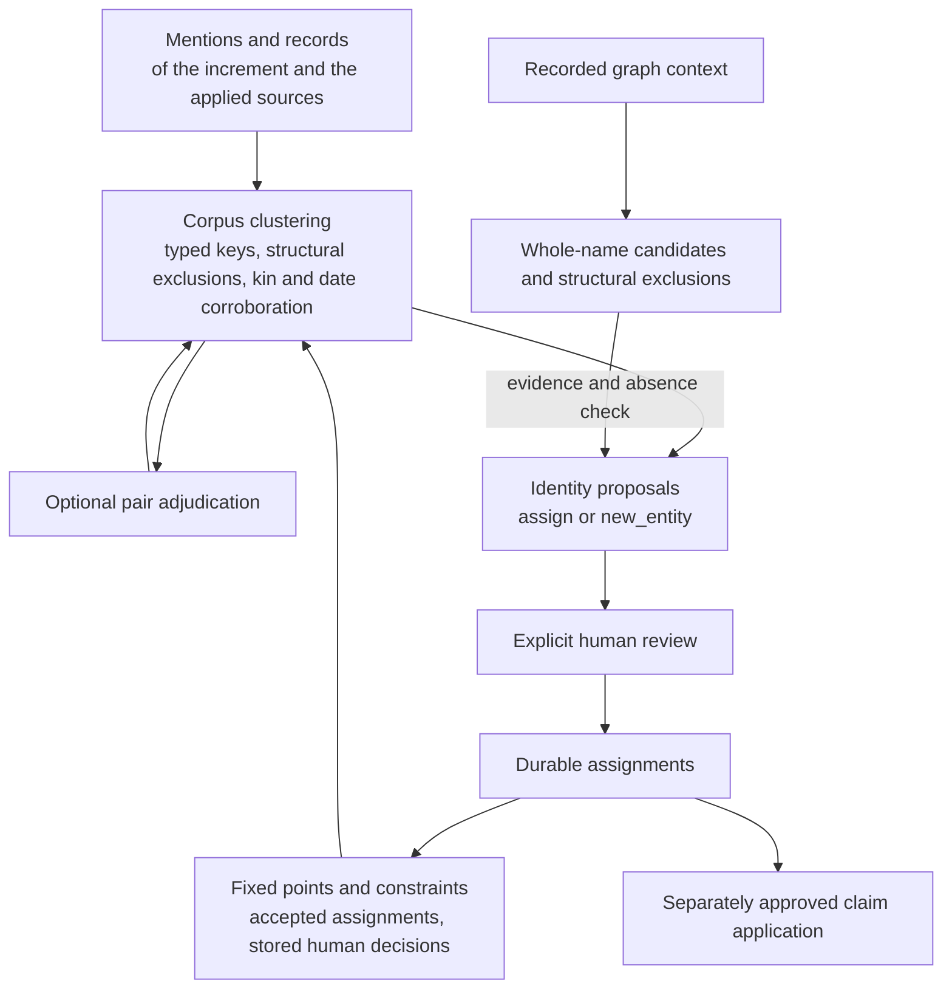

# Names, mention records and matching

The pipeline interprets how a source names an entity before proposing whether mentions refer to the same persistent entity. Neither a parsed name nor a matching verdict establishes historical truth or human approval. The [contract](CONTRACT.md) governs evidence and authority; [extraction](EXTRACTION.md), [GEDCOM adaptation](GEDCOM.md) and [durable identity review](IDENTITY_REVIEW.md) describe the operations that consume these representations.

## Three representations

| Representation | Purpose and limits |
| --- | --- |
| Label and aliases | Display and lookup terms. They have no statement-level citation, qualifier or rank, and are not durable identity. |
| Name and appellation claims | Source-attributed assertions about a name or form of address, with the source's typing and perspective where stated. |
| Structured mention record | A document-local interpretation of name components and naming context, used in cleanup and matching. These components are not graph name-part properties. |

A referenced name claim preserves evidence that the term layer alone cannot express. Conversely, a label is not automatically repeated as a sourced `name` statement. The manifest's local ID, the identity map and the persistent assignment authority have different scopes; none can be replaced by a display name.

## Source-attributed names (ADR-0011)

`birth_name`, `married_name`, `nickname` and `official_name` record types the source states. Contextual wording such as née/geb., a stated legal change or marriage wording can support typing. Position in a list, gender or the existence of a marriage cannot supply a missing type. Store the source's form and citation, without guessing a fuller spelling or translating a name. Like other assertions, a name claim can carry the dates the source states for its use or change.

Generic `name` records a distinct additional form whose type the source leaves open. It does not repeat the label or a form already typed by that source. In model extraction, an ordinary shortening, initial, spelling variant, part of the label or unmarked nickname use in narrative is not a generic-name claim. Such forms can still be aliases or record components. [GEDCOM name adaptation](#gedcom-name-adaptation) has explicit rules for structured tags and bracketed forms.

Validation rejects a generic-name claim on a known non-person or vocabulary subject; a human or `unclassified_entity` is accepted. It also rejects a form equal to the subject's known label under NFC normalization, collapsed whitespace and lowercasing, preserving accents and the difference between `ß` and `ss`. An existing QID without known kind or label cannot receive those checks. This validation does not prove that the model interpreted a name's type correctly.

Source-attributed claims remain when cleanup removes a redundant alias. Both application routes append name variants to an entity's aliases and remove none: the legacy writer each document's, and [reviewed additions](IDENTITY_REVIEW.md#apply-later-cohort-identity-additions) each accepted mention's label and aliases as its identity decision's review row showed them, so a variant that only a later source gives keys candidate blocking for the sources after it. The static site currently shows a flat alias list; frontend name factoring and composed-alias search remain [#140](https://github.com/WillHirsch/yizkr/issues/140).

## Address forms and perspective (ADR-0018)

An appellation is a source's way of naming or addressing a person that is not a plain name form: a relational form such as “Tante Rahel” or “Omama”, a non-name pet form such as “Pünktchen”, or a courtesy name such as “Nana Maisie”. It belongs in the proposed aliases and in a sourced `referred_to_as` statement. A spelling, shortening, diminutive or initial of an ordinary name is not automatically an appellation.

`perspective` identifies the source-supported person or named family from whose viewpoint the form is used; the schema also permits an unclassified entity. Leave it absent when no such entity is established. Do not create a family from “our”, invent the viewpoint holder or infer the membership of a named family. Reciprocal address is two assertions, each on its referent with its own perspective; no dyad object is needed.

A literal kinship term can also support a historical relationship. A courtesy or uncertain term does not prove kinship. “My husband”, “the deceased” and “our great grandmother” used as descriptions rather than address forms are not aliases or appellations; any supported relationship is a separate assertion. A named person keeps a name label. An unnamed person can keep the source's own relational or descriptive words as their label, subject to [extraction's scope exclusions](EXTRACTION.md#entity-manifest-and-fallback).

A general nickname can be a record nickname and, where explicitly typed, a `nickname` claim. A form defined only through one person's relationship or way of addressing another does not thereby become a record nickname. Appellations are excluded from person matching keys where identified, while record nicknames and appropriate typed graph names can contribute. There is no general resolver that turns a bare appellation plus perspective into a proven identity.

## Structured mention records (ADR-0035)

An `EntityRecord` contains a document-scoped ID, label, aliases, kind, summary, mention lines and extraction eligibility. Its optional `structure` describes the source's naming of that entity. The four variants are:

| Kind | Status and fields |
| --- | --- |
| Human | Status `name`, `role`, `kinship`, `courtesy`, `placeholder` or `description`; given names, surnames, patronymics, nicknames, titles, suffixes and unsplit forms. Each given name has its written form, optional supported standard form and initial flag; surnames have written forms and type `birth`, `married` or `other`. |
| Place | Status `toponym`, `deictic`, `generic` or `adjective`; written names with optional toponym/generic head, address with written/street/number fields, and nearest-first `within` containers with evidence. |
| Organization | Proper names, words naming its kind, and places. An institution can have a kind and location without a proper name. |
| Family | Surnames. |

Other kinds have no structured record. A non-name person status says how the source refers to the entity, not that the entity cannot exist or later acquire an identity. A nationality adjective remains a place record of status `adjective` with the source's wording; parsing it does not invent a country name.

Use source conventions to distinguish given names from surnames. Where they do not distinguish them, retain an `unsplit` form. Preserve surname particles and compound surnames. A standard given-name form is a supported normalization, not a translation or an expansion of an initial; an initial has no standard expansion. Kinship words are not name parts or titles. Titles and suffixes are retained metadata rather than identity keys.

### Validation and set-aside behavior

Record validation checks schema shape, agreement with the entity kind and source fidelity. Name parts must occur as folded whole words in the label or aliases, except for standard given-name forms, organization places and place containers. A family surname can also end inside the final word, such as `Löbig` in “the Löbigs”. These exceptions and the folding rules mean the check is not a proof of semantic correctness. A supported place form combining its label and one of its containers is also accepted.

Mechanical normalization can read an optional empty field as absent, drop empty parts, or read an allowed object containing only written text as a string. Repairs are counted. If the remaining record cannot validate, extraction sets the record aside and counts the reason while preserving the entity's label, aliases and kind. It does not fabricate replacement components. Missing and rejected records therefore remain visible in coverage and affect matching strength.

Each `within` entry needs evidence from the source that names its container. Entries with missing evidence, evidence absent from the source, evidence not naming the container or malformed shape are dropped individually, with separate reasons; a bad container need not discard an otherwise valid record. A quotation's presence does not establish that it conveys containment: the critic checks the passage in context. A form's district field can support containment; an unrelated list of towns cannot.

Containers are ordered nearest first and are also represented as places with their own records. The record describes the mention; a graph containment assertion still needs its own source-supported claim and citation. No geography is inferred from familiar names. [Place modeling](PLACES.md#containment-as-an-assertion-adr-0038) describes sourced `part_of`/`location` claims, and [GEDCOM](GEDCOM.md) describes PLAC chains, placeholders and their evidence boundaries.

Records live in persisted batch/document products and compatible cached model responses, outside Git. They are not themselves written as graph name-part assertions. Coverage distinguishes records supplied, absent and set aside, statuses, repairs and container drops; the [run report](RUN_REPORT.md) aggregates these diagnostics. A structurally valid record can still misread the source.

### Records and historical assertions

Parsing a marker is not the same as asserting the history it may express. A stated civil status, sex, parentage, relationship or event role becomes a separately sourced claim when supported. `civil_status` names no partner and creates no marriage by itself. Sex can follow source wording or grammar, never an inference from a given name. Prefer the source's own reference to an unnamed person over an invented descriptive name.

Birth/death dates and places are assertions on people in extraction and GEDCOM; missing evidence, an unreadable date and a supported unknown death date remain distinct. Roles on other events and unions use `principal`, `partner`, `spouse`, `witness` and `officiant`. Prompt instructions about historical interpretation and roles exceed generic schema validation: validation does not require a role on every participant. See [kinship](LIFE_EVENTS.md#kinship-roles-and-other-life-assertions-adr-0014), [time and uncertainty](LIFE_EVENTS.md#dates-and-bounds-adr-0034), [GEDCOM](GEDCOM.md) and [artifact subjects](ARTIFACTS.md#claims-about-artifacts-adr-0039) for their current assertion rules. The mention record does not replace those rules.

## Term cleanup (ADR-0022)

`pipeline.names` cleans terms using validated records; it does not semantically parse a name. It removes blank aliases, repetitions of the label and duplicates under stored-term normalization/lowercasing. With a valid person record, it can remove derivable reorderings and short forms while retaining forms that introduce a name part or spelling variant. Without a valid record it makes no name-part inference to remove otherwise acceptable aliases.

Cleanup preserves supported spelling distinctions such as “Gustav Löbig” versus “Gustav Lobig”. It composes no new names and does not split compound surnames. Sourced appellations containing non-name words are retained and added when missing; marking a plain derivable reordering as an appellation does not rescue it. An otherwise redundant alias can remain when it is the only form retaining a record title or suffix.

A person's label changes only when a validated `referred_to_as` claim explicitly marks it as an appellation and a valid record with status `name` supplies a suitable existing name span. The selection does not compose across intervening non-name words or broken brackets. The former label returns to alias cleanup, which normally retains the appellation but can still remove a plain derivable name form. If a generic `name` claim now merely repeats the corrected label, chunked postprocessing removes and counts it.

This cleanup runs in chunked extraction's name-settling step and in GEDCOM adaptation. It is not a universal transformation applied to every single-pass extraction caller. Removing derivable aliases is also not guaranteed to preserve all future matching recall: batch records can construct candidate whole forms, while graph items do not store all those components.

### GEDCOM name adaptation

The adapter uses `GIVN`, `SURN`, `SPFX`, `NPFX`, `NSFX`, slash notation and recognized `TYPE` tags. Birth/maiden, married/marriage, aka/nick/nickname and official/legal/change/immigrant/adopted types map to the corresponding typed name properties. `NICK` and supported quoted inline names supply nicknames. Subfields can supply components missing from the NAME value; completed forms become aliases where supported. This is deterministic tag interpretation, not the model's contextual free-text reading.

Parentheses alone do not imply a nickname. Bracketed material becomes an alias/unsplit form and, where eligible, generic `name`; a cue such as “geb.” inside it is not semantically parsed into a birth-name assertion. The first usable name supplies the label, normally omitting bracketed material, with fallbacks for a person named only through that material. Quotes are distinguished from internal apostrophes.

A recognized type can suppress generic `name` even when an incomplete or unsupported representation prevents a typed claim. `_MARNM` needs supported slash-delimited surname structure for a typed claim. Placeholder-containing incomplete names do not acquire whole-name assertions by deleting uncertainty; a complete bracketed subform can still supply its own claim. Name/excerpt language follows recognized `HEAD.LANG`, otherwise `und`. The adapter's diagnostics count unsupported or incomplete material; they do not certify complete semantic interpretation.

## Matching candidates and structural exclusions (ADR-0017)

Graph reconciliation first requires matching kinds and an intersection of whole-name keys. It does not block on arbitrary shared tokens or prefixes. For a person with a record, only status `name` contributes named-person keys: eligible whole labels/aliases, unsplit forms, nicknames and composed whole forms from written/standard given names or nicknames with surnames/patronymics. Those compositions are matching inputs, not newly stored aliases. Person appellations are excluded where identified.

For places, only `toponym` records supply named-place keys, using own written names and addresses. A bare toponym is not substituted when a generic head distinguishes, for example, a camp from a town. Other entities or entities without records can supply eligible whole labels/aliases. The graph roster also reads birth, nickname and official name claims; it excludes married-name claims as potentially surname-only forms and lacks the batch's full structured components. Equal keys establish candidacy, not equivalence.

These graph candidates are the evidence shown with the identity proposals derived from corpus clustering ([proposals from clustering](IDENTITY_REVIEW.md#proposals-from-clustering)) and the basis of the absence check at application; they are not proposals themselves. The diagram shows the [one proposal mechanism](#one-proposal-mechanism-for-every-increment), whose fixed points and remaining matcher role are the target ([#906](https://github.com/WillHirsch/yizkr/issues/906), [#944](https://github.com/WillHirsch/yizkr/issues/944)):

`impossible_pair` is a pure, symmetric structural filter over the facts supplied to it. It excludes a pair linked by a supported irreflexive kinship predicate or two identified places when one transitively contains the other. Batch kinship facts contribute only already-resolved QID references. Graph kinship fields use truthy father/mother/spouse/child/sibling values without requiring a source reference; they are not a complete union or kinship inference system. Containment follows sourced, nondeprecated `part_of`/`location` edges and requires both places' QIDs. Labels cannot substitute for those identities, and a new unbound place cannot be pruned by graph containment.

The filter does not exclude graph candidates for date disagreement. Dates and other disagreement remain evidence for adjudication and review. Unknown structural facts do not create exclusions, but mistaken supplied assertions can exclude a legitimate candidate; this is not an infallible or universally source-verified test. Adjudication receives explicit candidates and evidence rather than searching freely. A `distinct` place verdict proposes no new geography. `reconcile-graph` exports equivalence advice without merging items or creating a containment handoff.

### Corpus clustering and durable identity

Corpus clustering compares mentions with mentions across source batches. Today it takes no graph context, no earlier identity map and no human decision; in the target, accepted identities are its fixed points ([below](#one-proposal-mechanism-for-every-increment); [#944](https://github.com/WillHirsch/yizkr/issues/944)). It uses kind-specific records, relational context and additional conflict rules. Recordless humans, places, organizations and families can meet on eligible exact names but do not link confidently; kinds that take no record can still merge on exact names. Union and event matching also depend on their members/principals. Person birth/death statements provide date evidence, including supported derived bounds; they are not extracted birth/death event identities.

The [clustering guide](../src/yizkr/pipeline/README.md#corpus-clustering-clusteringpy-the-scratch-runs-identity-map) and [extraction's reconciliation section](EXTRACTION.md#reconciliation-and-authority) describe confident components, conflict handling and optional adjudication. In particular, clustering's date-conflict rules differ from the graph candidate filter's decision not to prune by date. Neither an algorithmic confidence label nor a model's `same` verdict is human confirmation.

Mention fingerprints hash a proposal snapshot's source SHA-1, normalized label, kind, mention lines and occurrence among otherwise identical mentions. They exclude structured interpretation and model-local IDs; changed labels, kinds or mention lines can change the key, while indistinguishable duplicates remain ambiguous. Cluster IDs hash sorted member fingerprints. Claim fingerprints hash the assertion, qualifiers, source and locator through mention fingerprints, preserving date precision and bounds but excluding excerpts, confidence, judgment notes and review state. The claim id that write results and refusals name claims by (`claim_naming.claim_id`) is a different hash, which includes excerpt, note and confidence and excludes only row approval. None of these keys establishes durable correspondence or carries consent.

Recorded graph projections support replay and bounded freshness checks, not a transaction or permission to create items. An empty candidate list grants no creation permission. Use [durable identity review](IDENTITY_REVIEW.md) for accepted assignments, correspondence across changed source products, explicit negative decisions, separate human confirmation and approved historical-claim application. Its review basis includes evidence, interpretation, uncertainty and judgment notes while excluding confidence. Source interpretation, identity approval and claim approval remain separate.

Implementation: [record schemas and validation](../src/yizkr/claims.py), [name cleanup](../src/yizkr/pipeline/names.py), [graph reconciliation](../src/yizkr/pipeline/reconcile.py), [corpus clustering](../src/yizkr/pipeline/clustering.py) and [GEDCOM](../src/yizkr/pipeline/gedcom.py).

#### One proposal mechanism for every increment

One mechanism proposes identities for an increment of any size onto a graph of any size. Corpus clustering clusters the increment's mentions jointly with those of the sources already applied; accepted assignments are its fixed points, and stored human `same`, `different` and rejected-target decisions constrain it too. An empty graph is the case with no fixed points. When no decision is stored on the clustered mentions either, as in every scratch run, nothing constrains clustering and the result is the identity map `cluster_corpus` makes today; a decision a reviewer has stored on an increment's own mentions constrains clustering even on an empty graph. The graph roster supplies the candidates shown with each proposal and the absence check at application, and proposes nothing. Deriving proposals from the clustering result and recording their origin is implemented (`cluster_proposals`, [proposals from clustering](IDENTITY_REVIEW.md#proposals-from-clustering)). The rest is the target: whether verdicts merge and the matcher's role are [#906](https://github.com/WillHirsch/yizkr/issues/906), and fixed points and the counts of disagreement with them are [#944](https://github.com/WillHirsch/yizkr/issues/944). Corpus clustering (`clustering.cluster_corpus`) still reads no graph, no earlier map and no human decision, so a map can join mentions of two entities or divide one entity's mentions: the derivation proposes nothing for the first and reports both. The roster matcher (`cohort_matching.match_cohort`) compares each mention, source by source, with the items of a recorded graph projection, and relates new mentions to each other only through `same` decisions a reviewer has already recorded. It proposes no `assign` or `new_entity`: `cohort_additions.prepare_cohort_additions` takes them as explicit choices from its caller or from the derivation.

Clustering stays in mention space because the structured records are there. Graph items do not store a mention's name parts, and their statements are what reviewed claims and curators assert about the entity, not what one document states of one mention, so a comparison with the roster can use only whole names and graph statements. Clustering an increment alone and then matching each cluster against the roster would keep two rules of evidence, and whether two mentions are held to be one person would then depend on which of them was written first, beyond what the fixed decisions themselves cause.

**Inputs.** The clustering of an increment covers the increment's sources and every applied source, one that holds a mention with an accepted assignment, whose current saved products are available. It covers all of them, not only those that share a name with the increment: clustering's own blocking compares only mentions that share a typed key, and choosing sources by whole names first would bring back the roster's rule. A source that an earlier increment left without any accepted assignment is clustered again only as part of a later increment. An entity is represented by its assigned mentions. When an applied source's saved products are unavailable, or the review store cannot establish correspondence from the current products to an assigned mention, that mention is left out and counted; its assignment stays in force, and its entity is represented by its other mentions or, with none, is compared as described below. Human decisions reach clustering as one fixed-point product with a content digest ([#944](https://github.com/WillHirsch/yizkr/issues/944)), built without a wiki from the sources' batches and two inputs the caller supplies. The first is the creation registry's assignment snapshot (`AssignmentSnapshot`): its accepted assignments, its `different` and `rejected_target` constraints, and its head. The second is the review store's preparation of the clustered sources' current products (`PreparedReview`), which gives each durable mention ID its source and local ID, and so, through `fingerprints.mention_map`, its fingerprint. The preparation's projection also gives the human decisions the registry does not yet hold. A `same` decision whose application is `applied` (the projection's `same` pairs) keeps its two mentions together; only the review store holds it while its mentions have no entity, because the registry records a `same` only as the assignment of both mentions to one entity. A `same` decision whose application needs review or is blocked, for instance because its group is held in conflict, joins nothing and is counted. Negative decisions are read from the projection's applications whatever their status, as `match_cohort` reads them today, because the projection's own `different` pairs and rejected targets hold only the applied ones: an approved `different` or a rejected `same` keeps its two mentions apart, and a rejected `assign` keeps its mention out of its target entity. A negative decision whose application needs review or is blocked still constrains clustering, since a negative decision that no longer applies is not permission to cross it, and it is counted. A negative decision one of whose mentions is left out keeps the other out of that mention's entity, where it has an accepted or approved assignment; any other decision that names a mention left out is itself left out and counted. An approved `assign` or `new_entity` that has not been applied is not a fixed point until its assignment is accepted. Clustering itself reads no wiki and no query service. A scratch run resets its instance before writing and has no stored human decision when it clusters, so it has no fixed points or constraints and supplies neither input: it reads nothing it does not read today, its identity-map hash and LLM cache keys are unchanged, and its inputs key changes only with the code digest. The derivation of proposals takes the map with the current products of the sources it covers: a source whose batch the map does not hold in full is refused, and a cluster with a member in a source refused or not supplied gives no choice, since that member's assignment cannot be seen.

**Fixed points.** No proposal regroups, splits, merges or moves a mention that has an accepted assignment. An entity's assigned mentions stay in one cluster whatever the evidence says, and mentions assigned to different entities are never proposed as one. An applied `same` (a stored `same` whose application is `applied`) keeps its two mentions together; a stored negative decision (an approved `different` or a rejected `same`) keeps its two apart, and a rejected target keeps its mention out of that entity's cluster. Once a reviewer has recorded `different` for the daughter Ursula Löbig and the widow, no proposal joins them. These are constraints, not evidence: a candidate cluster that holds mentions of two entities, or the two mentions of a stored negative decision, is not conflicting on that account, so its confident components merge where they cross no fixed point, and a component that would join two entities or cross a stored decision does not merge. An unassigned mention that the evidence joins to one entity is in that entity's cluster, with the method that put it there. Clustering products and model prompts name an entity by its opaque entity ID ([entities, mentions and assignments](INGESTION_CONTRACT.md#entities-mentions-and-assignments)) or by its mentions, never by a QID or an item's label. Evidence that disagrees with a fixed point changes nothing: the identity map lists and counts the candidate clusters whose evidence joins mentions of two or more entities, and the entities whose assigned mentions the evidence contradicts or no longer links ([#944](https://github.com/WillHirsch/yizkr/issues/944)). A reviewed correction of an established identity is [#142](https://github.com/WillHirsch/yizkr/issues/142).

**Entities without a clustered mention.** An item with no assigned mention among the clustered sources, such as a curator-created item or an entity whose source products are unavailable, has nothing to cluster and is not compared by clustering: a graph statement is not clustering evidence, and a roster row has no record to key on. The candidate step compares it instead. Blocking runs each proposal's mention against the whole roster, so such an item can be among the candidates the proposal shows, marked as one that no clustered mention represents (`represented_in_map` false); a `new_entity` proposal beside it thereby shows that clustering did not compare that item.

**Degenerate and extreme cases.** With an empty graph and no decision stored on the clustered mentions, as in every scratch run, there are no fixed points or constraints: clustering recomputes as today, asks the model what it asks today and makes the identity map `cluster_corpus` makes today, with the same hash. On an empty graph whose review store already holds decisions on the increment's mentions, as when the proposals are derived again after a first round of review and before application, those decisions constrain clustering as above, so the map can differ from today's and the model is not asked about the pairs they settle. With the whole corpus as one increment onto a populated graph, every source is clustered and the whole deterministic clustering recomputed; assigned mentions stay where they are, only unassigned mentions receive proposals, the model is asked only about pending pairs that hold at least one unassigned mention, and disagreement with fixed points is counted. With an increment of one source, that source is clustered with every applied source: the deterministic clustering of all of them is recomputed, which calls no model, and the model is asked only about pending pairs that hold at least one unassigned mention, in practice those of the new source's mentions and of mentions that earlier increments left unassigned. In every case no model call is spent on a pair whose two mentions are both assigned, or on a pair a stored decision already settles ([#944](https://github.com/WillHirsch/yizkr/issues/944)). A call whose prompt and model configuration are unchanged is answered from the LLM cache; calls are packed by cluster in the review's order, so a changed set of pending pairs can change what a call holds and send it to the engine again.

**One set of rules of evidence.** Where the two mechanisms differ today, the one mechanism applies clustering's rules:

- _Name keys._ Keys from the typed parts of each mention's record, compared through `clustering.part_keys`, because both sides of every comparison are mentions with records. The roster's whole-name keys (`entity_name_keys` against `roster_name_keys`) remain only in the candidate step, since graph items lack the components.
- _Corroboration._ Deterministic, from the kin and dates the mentions' own documents state, an entity's assigned mentions included. Graph statements, the roster facts that the matcher's model reads today, are shown with candidates and corroborate nothing: those applied from clustered sources would count twice, and the rest are not evidence from the documents compared.
- _Dates that cannot overlap._ They never prune a pair, as neither mechanism does today, and they keep a link from being confident, so the pair reaches adjudication or review with its dates shown; a `same` verdict excuses a date conflict on its own pair only. Clustering compares dates by year (`clustering.date_interval`), so the birth dates Gustav's birth-register extract and naturalisation certificate give, 7 January and 1 July 1919, overlap, and a link between their mentions of him can be confident. A date disagreement is a reason to look, not to decide ([time and uncertainty](LIFE_EVENTS.md#dates-and-bounds-adr-0034)). The candidate step keeps never excluding a candidate on dates.
- _Adjudication._ One prompt, `identity-adjudication.md`, over the pending pairs' mention evidence. The matcher's model adjudication (`match_cohort`'s `client` branch, which calls `reconcile.adjudicate` with `reconciliation.md`) is removed ([#906](https://github.com/WillHirsch/yizkr/issues/906)): no code turns the matcher's verdicts into an identity-review proposal, and a second prompt would be a second rule of evidence. `reconcile.adjudicate` and `reconciliation.md` go with that call, which is their last user ([#906](https://github.com/WillHirsch/yizkr/issues/906)).

**The matcher's parts.** `reconcile.block_candidates` keeps one role, implemented at main. It supplies the candidates recorded with each choice (`cohort_additions._candidate_basis`): `match_cohort` calls it, and so, for each approved creation context, does `cohort_context.matching_candidates`. It also supplies the absence check, which `apply_cohort_additions` makes by preparing the choices again inside the server's mutation guard (`protected_mutation`), so that a candidate that appeared since review changes the basis and the choice needs review again. The target removes the rest ([#906](https://github.com/WillHirsch/yizkr/issues/906)): the optional model adjudication of `match_cohort` (its `client` and `provenance` arguments, `AdjudicationProvenance` and `_adjudicate_source`), and both saved JSON products (`save_cohort_match` and `load_cohort_match`, `save_graph_projection` and `load_graph_projection`), which only tests and the [direct workflow example](IDENTITY_REVIEW.md#record-graph-context-and-inspect-later-cohort-matches) use. `CohortMatchResult` remains only as the in-memory result of the candidate step, still proposal-only and authorizing no creation. `GraphProjection` remains as the recorded read behind the candidates: each choice's origin keeps the digest of the candidate context that holds it (`cohort_context_sha256`) and each proposal's basis the scoped candidates a reviewer saw, while application captures the graph again and accepts no saved projection, and clustering never reads one. Apart from the deprecated map migration (`identity_migration.prepare_map_migration`, which proposes `assign` for entities the map-bound writer created until [#860](https://github.com/WillHirsch/yizkr/issues/860) removes it), nothing but the derivation from the clustering result (`cluster_proposals`) derives an `assign` or `new_entity` proposal; a curator can still propose either explicitly.

**Model verdicts.** Whether an adjudicator's verdicts merge clusters follows the increment's write policy. Under the unreviewed policy they settle what they can, as in a development scratch run today. Under the reviewed policy they are recorded as evidence and the cluster stays ambiguous, so each of its proposals needs its own marked decision ([#905](https://github.com/WillHirsch/yizkr/issues/905)). Today `adjudication.merges_on_verdicts` decides it from the run manifest's `project_stage`; the setting is [#906](https://github.com/WillHirsch/yizkr/issues/906).

**Order dependence.** Identity decisions made in an earlier increment are fixed when later sources arrive, so a result can depend on the order and size of increments. This is the accepted cost of keeping human decisions ([current contract](CONTRACT.md#rebuild-and-retained-operation)). Two records make it visible: the origin of each proposal records the increment and the earlier decisions it was computed against (its sources' SHA-1s, the map's inputs key and the head of the accepted-assignment history; [proposals from clustering](IDENTITY_REVIEW.md#proposals-from-clustering)), and the clustering result lists and counts where current evidence disagrees with fixed points ([#944](https://github.com/WillHirsch/yizkr/issues/944)). Until clustering takes fixed points, the derivation reports the clusters whose members are assigned to more than one entity and the entities whose assigned mentions the map divides.

Implementation at main: [roster matching](../src/yizkr/pipeline/cohort_matching.py), [candidate context](../src/yizkr/pipeline/cohort_context.py), [proposals from clustering](../src/yizkr/pipeline/cluster_proposals.py), [explicit choices and application](../src/yizkr/pipeline/cohort_additions.py), [graph capture](../src/yizkr/pipeline/graph_projection.py) and [adjudication](../src/yizkr/pipeline/adjudication.py).
