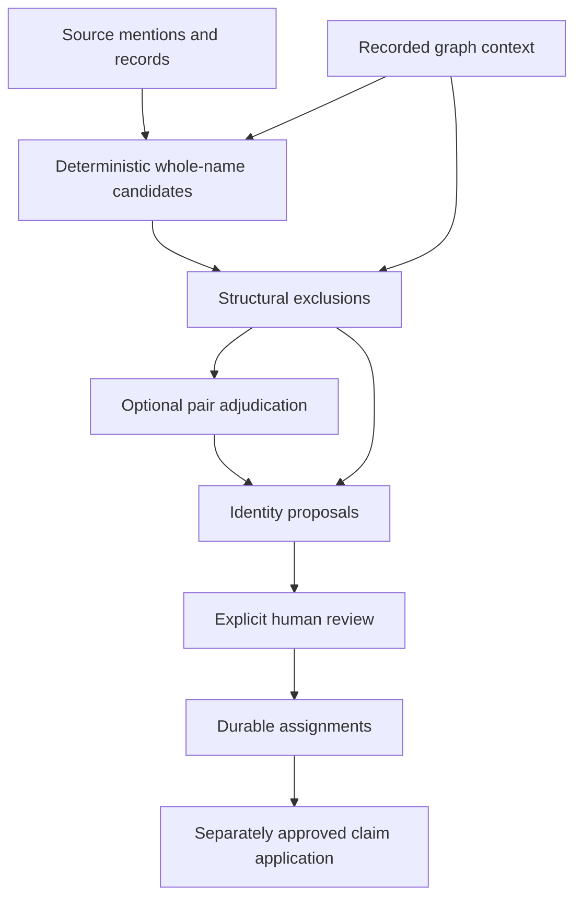

# Names, mention records and matching

The pipeline interprets how a source names an entity before proposing whether mentions refer to the same persistent entity. Neither a parsed name nor a matching verdict establishes historical truth or human approval. The [contract](CONTRACT.md) governs evidence and authority; [extraction](EXTRACTION.md), [GEDCOM adaptation](GEDCOM.md) and [durable identity review](IDENTITY_REVIEW.md) describe the operations that consume these representations.

## Three representations

| Representation | Purpose and limits |
| --- | --- |
| Label and aliases | Display and lookup terms. They have no statement-level citation, qualifier or rank, and are not durable identity. |
| Name and appellation claims | Source-attributed assertions about a name or form of address, with the source's typing and perspective where stated. |
| Structured mention record | A document-local interpretation of name components and naming context, used in cleanup and matching. These components are not graph name-part properties. |

A referenced name claim preserves evidence that the term layer alone cannot express. Conversely, a label is not automatically repeated as a sourced `name` statement. The manifest's local ID, the identity map and the persistent assignment authority have different scopes; none can be replaced by a display name.

## Source-attributed names (ADR-0011)

`birth_name`, `married_name`, `nickname` and `official_name` record types the source states. Contextual wording such as née/geb., a stated legal change or marriage wording can support typing. Position in a list, gender or the existence of a marriage cannot supply a missing type. Store the source's form and citation, without guessing a fuller spelling or translating a name. Like other assertions, a name claim can carry the dates the source states for its use or change.

Generic `name` records a distinct additional form whose type the source leaves open. It does not repeat the label or a form already typed by that source. In model extraction, an ordinary shortening, initial, spelling variant, part of the label or unmarked nickname use in narrative is not a generic-name claim. Such forms can still be aliases or record components. [GEDCOM name adaptation](#gedcom-name-adaptation) has explicit rules for structured tags and bracketed forms.

Validation rejects a generic-name claim on a known non-person or vocabulary subject; a human or `unclassified_entity` is accepted. It also rejects a form equal to the subject's known label under NFC normalization, collapsed whitespace and lowercasing, preserving accents and the difference between `ß` and `ss`. An existing QID without known kind or label cannot receive those checks. This validation does not prove that the model interpreted a name's type correctly.

Source-attributed claims remain when cleanup removes a redundant alias. Graph mutation depends on the application route: the legacy writer appends name variants, while [reviewed retained additions](IDENTITY_REVIEW.md#apply-later-cohort-identity-additions) deliberately do not append aliases. The static site currently shows a flat alias list; frontend name factoring and composed-alias search remain [#140](https://github.com/WillHirsch/yizkr/issues/140).

## Address forms and perspective (ADR-0018)

An appellation is a source's way of naming or addressing a person that is not a plain name form: a relational form such as “Tante Rahel” or “Omama”, a non-name pet form such as “Pünktchen”, or a courtesy name such as “Nana Maisie”. It belongs in the proposed aliases and in a sourced `referred_to_as` statement. A spelling, shortening, diminutive or initial of an ordinary name is not automatically an appellation.

`perspective` identifies the source-supported person or named family from whose viewpoint the form is used; the schema also permits an unclassified entity. Leave it absent when no such entity is established. Do not create a family from “our”, invent the viewpoint holder or infer the membership of a named family. Reciprocal address is two assertions, each on its referent with its own perspective; no dyad object is needed.

A literal kinship term can also support a historical relationship. A courtesy or uncertain term does not prove kinship. “My husband”, “the deceased” and “our great grandmother” used as descriptions rather than address forms are not aliases or appellations; any supported relationship is a separate assertion. A named person keeps a name label. An unnamed person can keep the source's own relational or descriptive words as their label, subject to [extraction's scope exclusions](EXTRACTION.md#entity-manifest-and-fallback).

A general nickname can be a record nickname and, where explicitly typed, a `nickname` claim. A form defined only through one person's relationship or way of addressing another does not thereby become a record nickname. Appellations are excluded from person matching keys where identified, while record nicknames and appropriate typed graph names can contribute. There is no general resolver that turns a bare appellation plus perspective into a proven identity.

## Structured mention records (ADR-0035)

An `EntityRecord` contains a document-scoped ID, label, aliases, kind, summary, mention lines and extraction eligibility. Its optional `structure` describes the source's naming of that entity. The four variants are:

| Kind | Status and fields |
| --- | --- |
| Human | Status `name`, `role`, `kinship`, `courtesy`, `placeholder` or `description`; given names, surnames, patronymics, nicknames, titles, suffixes and unsplit forms. Each given name has its written form, optional supported standard form and initial flag; surnames have written forms and type `birth`, `married` or `other`. |
| Place | Status `toponym`, `deictic`, `generic` or `adjective`; written names with optional toponym/generic head, address with written/street/number fields, and nearest-first `within` containers with evidence. |
| Organization | Proper names, words naming its kind, and places. An institution can have a kind and location without a proper name. |
| Family | Surnames. |

Other kinds have no structured record. A non-name person status says how the source refers to the entity, not that the entity cannot exist or later acquire an identity. A nationality adjective remains a place record of status `adjective` with the source's wording; parsing it does not invent a country name.

Use source conventions to distinguish given names from surnames. Where they do not distinguish them, retain an `unsplit` form. Preserve surname particles and compound surnames. A standard given-name form is a supported normalization, not a translation or an expansion of an initial; an initial has no standard expansion. Kinship words are not name parts or titles. Titles and suffixes are retained metadata rather than identity keys.

### Validation and set-aside behavior

Record validation checks schema shape, agreement with the entity kind and source fidelity. Name parts must occur as folded whole words in the label or aliases, except for standard given-name forms, organization places and place containers. A family surname can also end inside the final word, such as `Löbig` in “the Löbigs”. These exceptions and the folding rules mean the check is not a proof of semantic correctness. A supported place form combining its label and one of its containers is also accepted.

Mechanical normalization can read an optional empty field as absent, drop empty parts, or read an allowed object containing only written text as a string. Repairs are counted. If the remaining record cannot validate, extraction sets the record aside and counts the reason while preserving the entity's label, aliases and kind. It does not fabricate replacement components. Missing and rejected records therefore remain visible in coverage and affect matching strength.

Each `within` entry needs evidence from the source that names its container. Entries with missing evidence, evidence absent from the source, evidence not naming the container or malformed shape are dropped individually, with separate reasons; a bad container need not discard an otherwise valid record. A quotation's presence does not establish that it conveys containment: the critic checks the passage in context. A form's district field can support containment; an unrelated list of towns cannot.

Containers are ordered nearest first and are also represented as places with their own records. The record describes the mention; a graph containment assertion still needs its own source-supported claim and citation. No geography is inferred from familiar names. [Place modeling](PLACES.md#containment-as-an-assertion-adr-0038) describes sourced `part_of`/`location` claims, and [GEDCOM](GEDCOM.md) describes PLAC chains, placeholders and their evidence boundaries.

Records live in persisted batch/document products and compatible cached model responses, outside Git. They are not themselves written as graph name-part assertions. Coverage distinguishes records supplied, absent and set aside, statuses, repairs and container drops; the [run report](RUN_REPORT.md) aggregates these diagnostics. A structurally valid record can still misread the source.

### Records and historical assertions

Parsing a marker is not the same as asserting the history it may express. A stated civil status, sex, parentage, relationship or event role becomes a separately sourced claim when supported. `civil_status` names no partner and creates no marriage by itself. Sex can follow source wording or grammar, never an inference from a given name. Prefer the source's own reference to an unnamed person over an invented descriptive name.

Birth/death dates and places are assertions on people in extraction and GEDCOM; missing evidence, an unreadable date and a supported unknown death date remain distinct. Roles on other events and unions use `principal`, `partner`, `spouse`, `witness` and `officiant`. Prompt instructions about historical interpretation and roles exceed generic schema validation: validation does not require a role on every participant. See [kinship](LIFE_EVENTS.md#kinship-roles-and-other-life-assertions-adr-0014), [time and uncertainty](LIFE_EVENTS.md#dates-and-bounds-adr-0034), [GEDCOM](GEDCOM.md) and [artifact subjects](ARTIFACTS.md#claims-about-artifacts-adr-0039) for their current assertion rules. The mention record does not replace those rules.

## Term cleanup (ADR-0022)

`pipeline.names` cleans terms using validated records; it does not semantically parse a name. It removes blank aliases, repetitions of the label and duplicates under stored-term normalization/lowercasing. With a valid person record, it can remove derivable reorderings and short forms while retaining forms that introduce a name part or spelling variant. Without a valid record it makes no name-part inference to remove otherwise acceptable aliases.

Cleanup preserves supported spelling distinctions such as “Gustav Löbig” versus “Gustav Lobig”. It composes no new names and does not split compound surnames. Sourced appellations containing non-name words are retained and added when missing; marking a plain derivable reordering as an appellation does not rescue it. An otherwise redundant alias can remain when it is the only form retaining a record title or suffix.

A person's label changes only when a validated `referred_to_as` claim explicitly marks it as an appellation and a valid record with status `name` supplies a suitable existing name span. The selection does not compose across intervening non-name words or broken brackets. The former label returns to alias cleanup, which normally retains the appellation but can still remove a plain derivable name form. If a generic `name` claim now merely repeats the corrected label, chunked postprocessing removes and counts it.

This cleanup runs in chunked extraction's name-settling step and in GEDCOM adaptation. It is not a universal transformation applied to every single-pass extraction caller. Removing derivable aliases is also not guaranteed to preserve all future matching recall: batch records can construct candidate whole forms, while graph items do not store all those components.

### GEDCOM name adaptation

The adapter uses `GIVN`, `SURN`, `SPFX`, `NPFX`, `NSFX`, slash notation and recognized `TYPE` tags. Birth/maiden, married/marriage, aka/nick/nickname and official/legal/change/immigrant/adopted types map to the corresponding typed name properties. `NICK` and supported quoted inline names supply nicknames. Subfields can supply components missing from the NAME value; completed forms become aliases where supported. This is deterministic tag interpretation, not the model's contextual free-text reading.

Parentheses alone do not imply a nickname. Bracketed material becomes an alias/unsplit form and, where eligible, generic `name`; a cue such as “geb.” inside it is not semantically parsed into a birth-name assertion. The first usable name supplies the label, normally omitting bracketed material, with fallbacks for a person named only through that material. Quotes are distinguished from internal apostrophes.

A recognized type can suppress generic `name` even when an incomplete or unsupported representation prevents a typed claim. `_MARNM` needs supported slash-delimited surname structure for a typed claim. Placeholder-containing incomplete names do not acquire whole-name assertions by deleting uncertainty; a complete bracketed subform can still supply its own claim. Name/excerpt language follows recognized `HEAD.LANG`, otherwise `und`. The adapter's diagnostics count unsupported or incomplete material; they do not certify complete semantic interpretation.

## Matching candidates and structural exclusions (ADR-0017)

Graph reconciliation first requires matching kinds and an intersection of whole-name keys. It does not block on arbitrary shared tokens or prefixes. For a person with a record, only status `name` contributes named-person keys: eligible whole labels/aliases, unsplit forms, nicknames and composed whole forms from written/standard given names or nicknames with surnames/patronymics. Those compositions are matching inputs, not newly stored aliases. Person appellations are excluded where identified.

For places, only `toponym` records supply named-place keys, using own written names and addresses. A bare toponym is not substituted when a generic head distinguishes, for example, a camp from a town. Other entities or entities without records can supply eligible whole labels/aliases. The graph roster also reads birth, nickname and official name claims; it excludes married-name claims as potentially surname-only forms and lacks the batch's full structured components. Equal keys establish candidacy, not equivalence.

`impossible_pair` is a pure, symmetric structural filter over the facts supplied to it. It excludes a pair linked by a supported irreflexive kinship predicate or two identified places when one transitively contains the other. Batch kinship facts contribute only already-resolved QID references. Graph kinship fields use truthy father/mother/spouse/child/sibling values without requiring a source reference; they are not a complete union or kinship inference system. Containment follows sourced, nondeprecated `part_of`/`location` edges and requires both places' QIDs. Labels cannot substitute for those identities, and a new unbound place cannot be pruned by graph containment.

The filter does not exclude graph candidates for date disagreement. Dates and other disagreement remain evidence for adjudication and review. Unknown structural facts do not create exclusions, but mistaken supplied assertions can exclude a legitimate candidate; this is not an infallible or universally source-verified test. Adjudication receives explicit candidates and evidence rather than searching freely. A `distinct` place verdict proposes no new geography. `reconcile-graph` exports equivalence advice without merging items or creating a containment handoff.

### Corpus clustering and durable identity

Corpus clustering compares mentions across source batches, rather than matching them against an existing graph roster. It uses kind-specific records, relational context and additional conflict rules. Recordless humans, places, organizations and families can meet on eligible exact names but do not link confidently; kinds that take no record can still merge on exact names. Union and event matching also depend on their members/principals. Person birth/death statements provide date evidence, including supported derived bounds; they are not extracted birth/death event identities.

The [clustering guide](../src/yizkr/pipeline/README.md#corpus-clustering-clusteringpy-the-scratch-runs-identity-map) and [extraction's reconciliation section](EXTRACTION.md#reconciliation-and-authority) describe confident components, conflict handling and optional adjudication. In particular, clustering's date-conflict rules differ from the graph candidate filter's decision not to prune by date. Neither an algorithmic confidence label nor a model's `same` verdict is human confirmation.

Mention fingerprints hash a proposal snapshot's source SHA-1, normalized label, kind, mention lines and occurrence among otherwise identical mentions. They exclude structured interpretation and model-local IDs; changed labels, kinds or mention lines can change the key, while indistinguishable duplicates remain ambiguous. Cluster IDs hash sorted member fingerprints. Claim fingerprints hash the assertion, qualifiers, source and locator through mention fingerprints, preserving date precision and bounds but excluding excerpts, confidence, judgment notes and review state. CSV review uses a different claim hash, which includes excerpt, note and confidence and excludes only row approval. None of these keys establishes durable correspondence or carries consent.

Recorded graph projections support replay and bounded freshness checks, not a transaction or permission to create items. An empty candidate list grants no creation permission. Use [durable identity review](IDENTITY_REVIEW.md) for accepted assignments, correspondence across changed source products, explicit negative decisions, separate human confirmation and approved historical-claim application. Its review basis includes evidence, interpretation, uncertainty and judgment notes while excluding confidence. Source interpretation, identity approval and claim approval remain separate.

Implementation: [record schemas and validation](../src/yizkr/claims.py), [name cleanup](../src/yizkr/pipeline/names.py), [graph reconciliation](../src/yizkr/pipeline/reconcile.py), [corpus clustering](../src/yizkr/pipeline/clustering.py) and [GEDCOM](../src/yizkr/pipeline/gedcom.py).
