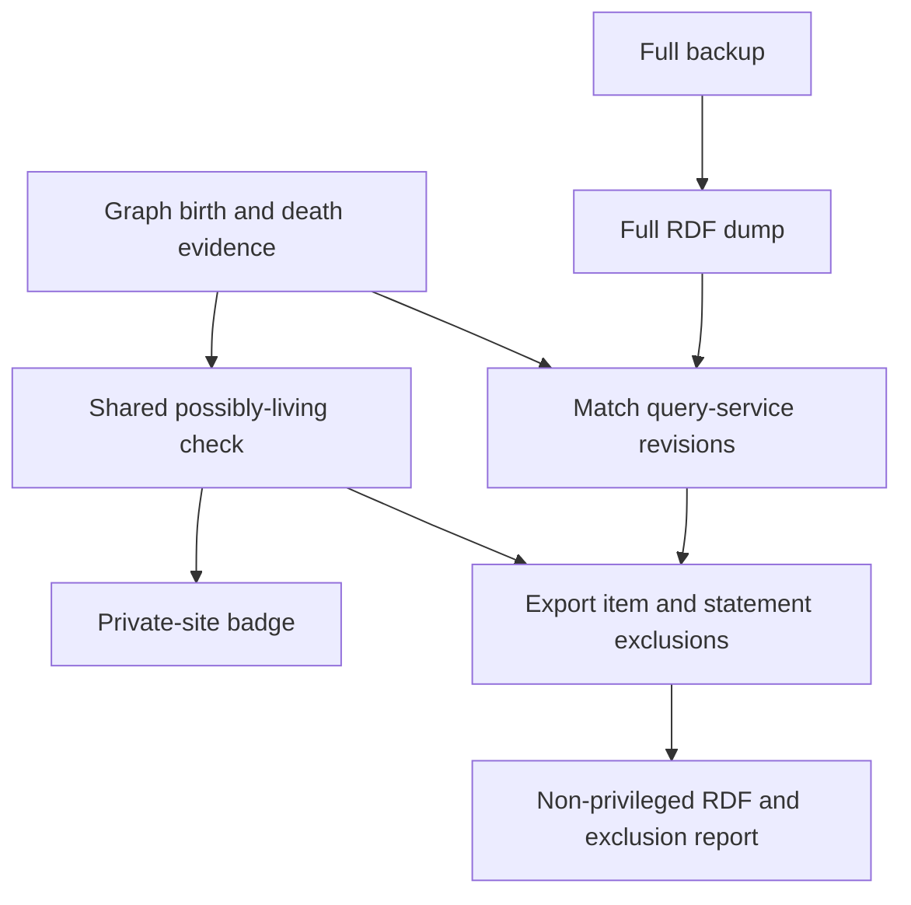

# Runtime privacy and the non-privileged export (ADR-0020)

Archive data and exploration remain private by default. Retaining an assertion, displaying a death or passing a filter grants no publication permission. The [contract](CONTRACT.md#human-authority-and-privacy) governs disclosure; the existing non-privileged export is a filtered view, not a public-safe archive. Text on a retained item can still name a living relative.

The current runtime check uses graph evidence and a default cutoff of **123 years**. It does not implement a general human-confirmed-facts-only release policy. The final privacy requirement and cutoff remain separate decisions in [#70](https://github.com/WillHirsch/yizkr/issues/70) and [#72](https://github.com/WillHirsch/yizkr/issues/72); an internet-facing site remains separately authorized work under [#163](https://github.com/WillHirsch/yizkr/issues/163). This guide describes the implemented controls without deciding those issues.

## The shared possibly-living determination

There is no stored living flag or manual living/dead override. `core.privacy.is_possibly_living` receives birth bounds, a death-evidence result and a cutoff year. It releases a person from the possibly-living classification when either eligible death evidence exists or **every active birth statement** allows only years at or before the cutoff. With no death evidence, no birth, any unreadable/open upper bound or any potentially recent birth keeps the person possibly living.

The cutoff is the current UTC year minus the configured number of years, inclusive; it is not an exact birthday calculation. Backup accepts `--cutoff-years`, while the private site uses the default. Consumers agree only when they use compatible evidence, date and cutoff settings. “Released” here means passing this computation, not confirmed historical truth or permission to disclose.

### Birth evidence and dates

The reader uses all nondeprecated birth statements rather than sampling a truthy value. A readable `latest_date` bounds the birth even if its main value is unknown or too coarse; multiple latest bounds use the latest permitted year. An unreadable latest bound cannot establish release. With only an earliest bound, the range stays open at its late end. Otherwise the value's precision supplies its latest year. Inconsistent bounds cannot force an artificially early result: a latest date wholly before the value or earliest bound is discarded, leaving the remaining evidence to decide.

Privacy deliberately permits the later interpretation of a round-hundred or round-thousand coarse date. For example, a century-precision value stored as 1900 allows through 1999 for this check, even though ordinary Wikibase display can read it as the 19th century. Precision coarser than a millennium supplies no usable upper bound by itself. The birth query reads values and bounds without adding a margin for `circa`. These are consumer-specific limits, not a general interpretation of source uncertainty.

Unsupported BCE or non-Gregorian dates raise instead of being converted or silently omitted. Site/export preflight also checks unsupported dates throughout the graph, including deprecated statements, qualifiers and references. [Dates and reader limits](LIFE_EVENTS.md#unsupported-dates-and-reader-limits) distinguishes graph-wide checks from helpers that only validate values they receive.

### Death evidence is route-specific

| Route | What the current reader accepts |
| --- | --- |
| Direct person properties | Truthy `date_of_death`, `place_of_death`, `cause_of_death`, `burial_place` or `age_at_death`, including applicable unknown values. Deprecated and no-value statements supply no truthy death evidence. This route does not independently require a historical reference or human confirmation. |
| Union ended by a partner's death | `ended_by_death_of` with qualifying historical `stated_in` support. A source that also calls the alleged deceased person widowed cannot alone establish disclosure support for that end. Another qualifying source can still support it; process-only references cannot. |
| Curator-made death event | A uniquely identified principal with qualifying participation and event evidence, under the principal/rank checks below. An informant or witness is not released merely by attending a death. |

Source-stated unknown death and burial values are distinct from missing or unreadable data; their production rules are in [life events](LIFE_EVENTS.md#unknown-values-missing-evidence-and-burial). A derived “died by” date is not an additional release route or an independent witness.

For curator-made vital events, principal identity must be unique across the event's principal-marked statements, including deprecated ones. A conflicting deprecated principal can therefore prevent release. A qualifying participation must be nondeprecated and carry no role other than principal; once another statement identifies that same principal, a roleless duplicate can qualify. Birth reading permits nondeprecated participation, while death reading uses the relevant best participant rank. A dated birth event supplies its principal's birth; an ambiguous event can add restrictions to participants who already have birth evidence but cannot manufacture a new release. An event with no identified principal releases nobody on that basis.

The same-source widowhood concern is a disclosure constraint, not a reason to erase historical assertions or reject every such batch. [Union review](LIFE_EVENTS.md#unions-and-their-events-adr-0036) explains the advisory and legitimate successive-marriage cases. Direct death properties, union ends and curator events have different checks; do not generalize one route's safeguards to the others.

## Selecting people is a separate operation

Before deciding eligibility, the readers select items with person evidence. Evidence can include a human type, a person-specific subject property, being the value of a kinship/refuge/death-end relation, or participation in a recognized person-event kind. Selection can read deprecated evidence: changing a rank does not necessarily stop the item being assessed as a person.

This is a fixed implemented set, not a general inference that every person-related property proves personhood. For example, `civil_status`, official name, religion, membership, depiction and perspective do not by themselves select the subject through the person-property list. Vessel, organization and military-unit typing can suppress participation-only evidence; other person evidence still applies. A correctly typed event's own truthy death properties have a narrow exception so that the event need not become a person, while other evidence and family typing can still select it. The authoritative sets and selection predicates are in [core/privacy.py](../src/yizkr/core/privacy.py).

The export also examines its dump independently. An item with person evidence that the query-service assessment did not release is excluded, including a person found only by the dump's broader structural traversal. Family and typing exclusions below are additional rules, not consequences of a person's birth/death result.

## Private site and filtered export

The private static site keeps people and source material available to authorized users and applies a possibly-living badge using the shared predicate. Listed families are always badged. It does not run the export's complete deletion filter, so a badge is not a preview of every exported item or statement. For example, the export can omit an untyped item that the site's badge does not identify as possibly living.

The person page can display an unknown death, a dated death, a derived bound or a union end alongside a possibly-living badge. Displaying evidence does not override eligibility. The site is built from the live graph and remains a private exploration surface, not the publication product described in #163.

### Additional export exclusions

`nonprivileged_exclusions` and the statement filter apply structural rules beyond the shared birth/death check:

| Scope | Current exclusion behavior |
| --- | --- |
| People, families and typing | Exclude unreleased people, all family items, and items without a usable nondeprecated type, with vocabulary/class exceptions. Redirects follow the relevant target and item evidence. A family is not released merely because its recorded members are old or deceased. |
| Events and participation | Exclude person-kind events with no known participant, and events whose participant statements all have unknown/no values. An impersonal event with no participant statements is not automatically excluded. Links to protected people/groups can propagate exclusion through participant, value or qualifier references. |
| Groups | Traverse recorded membership through redirects and nested groups with cycle handling. Empty groups, unknown-valued participation or unreleased members prevent a released-group exception. A group with known released members can be harmless to an impersonal event without becoming an exportable family or a safe participant in a person-kind event. A released person is assessed personally rather than as an unreleased household head. |
| Unions and boundary events | Apply the relevant participant/reference rules, and remove events starting or ending an excluded union. The partner named by `ended_by_death_of` is not a boundary event and is assessed separately. The export has no universal two-known-partner cardinality gate: a one-partner union is not automatically excluded for that reason alone. |
| Statements and shared nodes | Remove an entire statement when its item-valued main value or qualifier names an excluded item. Remove unsupported truthy output too; retained shared reference/value nodes survive where another kept statement still uses them. |
| Source text and process notes | Remove judgment-note properties and entire caption statements. Apply the held-artifact/container-reference filter described below. Unreadable triples are omitted. |

Event/group exclusions are computed repeatedly until no further items are excluded. They distinguish privacy-protected items from items excluded merely for missing typing: a link to an untyped place need not remove a whole event, although its statement is removed. Normal/preferred human items are not ordinary events for this propagation unless also typed as family; unions are not ordinary events either. These distinctions make “every event touching any excluded item is removed” an inaccurate description.

The source-text filter removes another document's reference/excerpt from a document-subject assertion about held media or an artifact contained by that source. If separate retained evidentiary support remains, the statement can remain. If only process provenance remains, or a text-valued qualifier prevents separating the container's words, the whole statement is removed. Claims about unheld document mentions follow their source's ordinary rules. [Artifact claims](ARTIFACTS.md#claims-about-artifacts-adr-0039) defines the relevant subject forms.

Retained labels, aliases, descriptions, names, claim text and reference excerpts are not screened for mentions of living people. Removing item links and captions does not make the remaining text public-safe. The filter also does not prove that source assertions or entity assignments are correct.

## Export consistency, refusal and recovery

`yizkr backup` produces a full database backup, media archive and full RDF separately from the non-privileged RDF. The database and media preserve the archive; WDQS is derived state. [The deployment runbook](../deploy/README.md#backups-and-the-non-privileged-export) owns commands, scheduling, retention and restore operations.

The filtered export waits for the query service to match the dump's non-redirect item/property revisions exactly and checks consistency again around assessment. Lag, a missing revision or concurrent changes cause refusal rather than an export assessed against different data. An entity whose revision never reaches WDQS can require an edit or a full query-service reload; waiting longer alone need not solve it.

Unsupported dates, unhandled sitelinks or unsupported property datatypes also refuse the export. A refusal preserves other completed backup products, reports the failed filtered product and avoids publishing it as a successful partial export. Refused backup runs still count toward configured retention, so repeated failures do not preserve an older successful filtered export indefinitely. Output uses `nonprivileged.nt.gz` and `nonprivileged-exclusions.json`, assembled through partial files with exclusions published first. Retained shared RDF nodes are placed in a kept entity's block so a query-service reload can consume them.

`--no-nonprivileged-export` is the preferred skip option. The warning-producing `--no-public-export` CLI alias and old Python export aliases remain supported compatibility interfaces. Neither name authorizes public disclosure. Skipping or refusing the filtered export does not itself make the private backup safe to share.

Implementation: [person evidence and predicate](../src/yizkr/core/privacy.py), [dump analysis and filtering](../src/yizkr/backup.py), [private-site readers](../src/yizkr/staticsite.py), [supported dates](../src/yizkr/core/dates.py) and [CLI options](../src/yizkr/cli.py).
