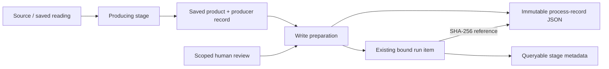

# Run provenance

Machine-written claims cite their source and a process-run item separately. Run items expose the recorded producing stages and the context that applied their results. They do not establish human approval or make a disposable run retained.

## Recorded facts

The shared transcription, extraction, critique and GEDCOM operations capture observed code, start/end times and their existing generation dependencies. Place reconciliation records the actual proposing client and prompt hashes. Deterministic stages have no invented model. Model metadata is read from the borrowed client, including through observation/cache wrappers; recording provenance does not initialize or call a provider.

| Graph representation | Meaning |
| --- | --- |
| `run_stage` statements | Stage names, with the associated facts as qualifiers rather than disconnected lists |
| `process_kind` | Record purpose at run level; deterministic, model, mixed, manual or unknown at stage level |
| `model_identifier`, `model_effort` | Actual recorded model identity and effort, when available |
| `prompt_hash`, `cli_config_hash`, `stage_version` | Named loaded-template digests, client/configuration fingerprint and semantic stage version or dependency fingerprint |
| `model_manifest_hash` | Manifest used by that producer, or the current application manifest at run level |
| `pipeline_version`, `provider_cli_version`, `software_commit`, `software_dirty` | Package/provider version and observed code state |
| `process_started_at`, `process_ended_at` | Recorded stage times as UTC ISO 8601 strings; native Wikibase date precision cannot preserve process clock times |
| `scratch_run`, `run_manifest_hash`, `identity_map_hash`, `unratified_run` | Supplied scratch/run/map context; scratch output is explicitly unratified |
| `provenance_limitation` | Missing legacy facts or values the graph cannot faithfully represent |
| `run_record_sha256` reference | Digest of the immutable record supporting each projected statement |

The complete JSON retains dependency details, resource and configuration hashes, model/client fields and code observations. Values exceeding Wikibase string constraints remain in that record with a graph-visible limitation; they are not silently truncated into a different model or version. Missing facts remain absent or explicitly unknown. Old batches cannot supply a dirty flag, end time or prompt/configuration facts that they never recorded.

Resource and configuration snapshots are taken before execution. Prompt hashes identify the loaded template components by module/constant name, separately from package-resource file hashes: a running process can retain a template after its file is edited. These are the operation's template dependencies, not a log of individual requests. Place reconciliation also records hashes of its actual assembled requests.

Write preparation records its current code and configuration separately from the producer. It has no claimed completion time: publishing metadata before writes does not prove the whole write completed. Retrying identical metadata reuses the same run binding, record files, statements and references. Enriching a batch with provenance does not change its established creation operation.

## Storage and reuse

Process records are canonical UTF-8 JSON files named `<sha256>.json`. Publication is exclusive and verifies any existing file; reading verifies both its digest and canonical encoding. Application records carry references to separately preserved producer records as well as their stage summaries. Keep these directories with the graph/run backups: a digest is an integrity check and lookup key, not a network download location.

- Reviewed and scratch drivers use `process-records/` in the run directory.
- `yizkr ingest write` uses `process-records/` beside its supplied batch; `--process-records PATH` selects another directory.
- Direct `BatchWriter` and place-application calls accept `record_dir`; their default is `var/process-records/`.

These records are durable evidence, independent of the response cache. Saved readings and batches retain their original producer when reused. Code/timing provenance is excluded from semantic comparisons used for clustering and review; a provenance-only change does not revoke an unchanged approval. Actual processing compatibility, content and review basis retain their separate checks.

Place-review CSVs carry a portable `producer_origin` JSON field. Copying the CSV preserves the proposing process; applying a reviewed answer adds current application context without relabeling the proposer as the reviewer or the currently configured model. Conflicting or malformed origins refuse before writes. Legacy CSVs lacking an origin are supported with an explicit unknown producer. Human approval remains the review decision, separate from model provenance.

## Admission and limits

Before a write to an actually retained target, or before marking a target retained, the application freshly checks for a known full commit and clean code. Either host or server retained marker activates the check; inability to read the server state fails closed. Tracked edits and relevant untracked code/resources count, including ignored source under `src/` and `scripts/`; ordinary runtime outputs do not. An unavailable code observation is not accepted as clean.

Disposable scratch execution still permits dirty code and records it. Its stronger refusal to write or reset a retained target remains. A clean checkout is an admission condition, not human authorization, supported incremental ingestion or keeper readiness. Durable identity assignments, clustering-decision provenance and retained writer integration continue under [#130](https://github.com/WillHirsch/yizkr/issues/130); the owner controls the keeper transition under [#159](https://github.com/WillHirsch/yizkr/issues/159).

Bootstrap the current model before writing enriched run metadata. [The fictional integration lane](TESTING.md#live-integration-and-the-transition) exercises real bootstrap, extraction/place run projection, immutable references, WDQS queries and unchanged repeated writes. It uses authored producer metadata; it does not evaluate provider output or read private corpus data.
