# Scratch-run stages and data products

This guide expands the [whole-corpus overview](ARCHITECTURE.md#whole-corpus-scratch-runs) into the inputs, processing and outputs of each implemented stage. Use the [scratch-run runbook](runbooks/scratch-run.md) for commands and operational procedures.

This is the implemented disposable rebuild mode. The [current contract](CONTRACT.md) also requires retained ingestion and permits explicit graph-snapshot inputs for reconciliation; shared text and deterministic GEDCOM operations and their freshness planning are implemented, while durable identity/review state and media adapter migration (#719) remain implementation work. Current scratch writes refuse retained instances and never confer human approval.

In the paths below, `R` is a run directory such as `var/scratch/<run-id>`, and `D` is one document's directory within it. Ordinary documents use `R/<document-directory>/`; independently read embedded images use `R/excerpts/<media-sha1>/`. These are path templates, not example corpus contents. For real corpus runs, all these products are local-only runtime data.

Rectangles represent processing or explicitly labelled transient data; cylinders represent persisted files and stores. Process labels distinguish **LLM** inference, **deterministic** local code and **instance I/O**. A stage can combine these. Stage model calls use the [response cache](LLM_CACHE.md) when configured; an LLM-labelled operation can therefore reuse a response without contacting the engine.

## Stage contracts

The contracts below describe current data products and processing. [Shared operations](ARCHITECTURE.md#shared-text-stage-operations) implement text reading, extraction, critique and deterministic GEDCOM adaptation; media/container readers and corpus stages retain their own adapters. Publication remains caller-owned. A fixed registry declares stages, roles and artifacts for execution, estimation and reports; execution and estimation share read-only view observation and a pure freshness decision. Text and GEDCOM documents compare declared generation dependencies as well as input hashes. Older records for those kinds missing that metadata recompute once; legacy media/container adapters retain their existing reuse rules. See [view and response reuse](LLM_CACHE.md#views). Stage names in the logs are `transcription`, `extraction`, `critique`, `gedcom`, `clustering`, `reset`, `register`, `write`, `places` and `site`. `transcribe` and `extract` are the model-role names used by configuration and flags such as `--refresh`, rather than the logged stage names.

### Per-document stages

| Stage | Process type | Inputs | Persisted products |
| --- | --- | --- | --- |
| Transcription | Deterministic routing, text reading and validation; LLM vision where needed (`transcribe` role) | Source bytes and media SHA-1; optional `D/transcription.corrected.txt`; language and engine settings | `D/transcription.json`; language resolution in `D/state.json`; for containers, `D/derived-media.json`, image bytes and independent image transcriptions |
| Extraction | LLM entity discovery, preparation reading and claim extraction (`extract` role); deterministic chunk packing, merging and validation | `D/transcription.json`, source SHA-1, claim schema, model vocabulary and optional `D/preparation.pointer.txt` | `D/batch.json`; `D/extraction/coverage.json`; optional `rejects.json`, `gaps.ndjson`, `containers.json`, `quotes.json` and `preparation.json` in that extraction directory; `D/gaps.csv` when gaps are surfaced |
| Critique | Advisory LLM assessment (`critique` role), followed by deterministic finding validation | `D/batch.json`, the full numbered transcription and model vocabulary | `D/critique.json`; stage attention and anomaly records where applicable |
| GEDCOM | Shared deterministic parser/adapter operation; no model calls | One GEDCOM byte snapshot and its expected source identity; declared adapter/schema/resources | `D/batch.json`; complete/failed execution status, dependencies, warnings, unsupported tags and adaptation outcomes in `D/state.json`; processing fingerprint in `D/derivations.json` |

Non-GEDCOM documents run transcription, extraction and critique in that order. GEDCOM documents run only `gedcom`. An excerpt follows the ordinary three stages, but adopts its container's checked image transcription without a second vision call.

### Corpus stages

| Stage | Process type | Inputs | Persisted products and instance effects |
| --- | --- | --- | --- |
| Clustering | Deterministic candidate matching plus LLM adjudication of eligible ambiguous pairs; no wiki | Completed documents' original `batch.json` files, source identities and transcription views; clustering rules, thresholds and adjudicator configuration | `R/corpus/clustering/identity-map.json` and `adjudication.json`: final membership, review evidence, verdicts, raw answers, counts and reuse inputs |
| Reset | Deterministic orchestration with instance/Docker I/O | Identity map, batches, registration metadata, exclusion hash, code and model manifest; place-stage configuration; current instance records and kept markers | Reset/rebuilt or reused instance; `R/corpus/reset/record.json`; host-side write-phase state |
| Register | Deterministic instance I/O | Original batches and identity map for preflight; source bytes, titles, derived-media inventory and container relationships | Artifact/media/fragment items and uploaded files; `R/corpus/register/record.json` with artifact and derived-media QIDs, refusals and failures; updated write-phase state |
| Write | Deterministic claim preparation and instance I/O | Original batches, identity map, registration record, run metadata and write-phase state | Referenced Wikibase statements and marked extraction-run items; `R/corpus/write/record.json`; updated write-phase state and, on completion, instance-contents record |
| Places | LLM selection among existing places, deterministic link validation and instance I/O | Completed write, registration and identity records; written batches' source-stated container chains; transcription views; live place roster and containment | `R/corpus/places/record.json` and `responses.json`; source-attributed containment statements; updated write-phase and instance-contents records |
| Site | Deterministic rendering from live instance queries | Expected run from the reset record and revision from write/places records; instance vocabulary and WDQS results | `R/corpus/site/site/` containing the private site; `R/corpus/site/record.json` with disagreement and privacy counts |

The barrier waits until every document has completed its required stages or failed. Corpus stages receive only completed documents: `needs attention` qualifies, while a failed document does not. A pause or abort that leaves unfinished stages holds the barrier. The driver first runs one canary of each kind end to end, then schedules the remaining documents stage by stage; the data dependencies below do not imply that every document runs end to end before the next starts.

Implementation: [document stages and paths](../src/yizkr/pipeline/orchestrate.py), [scratch scheduling](../src/yizkr/pipeline/scratch.py) and [corpus write stages](../src/yizkr/pipeline/scratchwrite.py).

## The document views and their consumers

This is the non-GEDCOM path. Critique branches off the extracted batch: its findings accompany that batch rather than becoming a replacement batch.

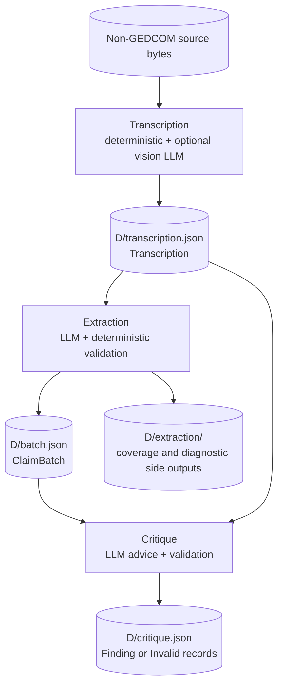

The main products have different meanings:

| Product | Data shape | Used by |
| --- | --- | --- |
| `transcription.json` | `Transcription`: artifact SHA-1, text, language and engine; optional document class, pages and check flag | Extraction and critique; image locations for adjudication; source evidence for places; report/diff; reuse checks |
| `batch.json` | `ClaimBatch`: `schema_version`, `extraction_run`, `entities[]`, `claims[]` | Critique, clustering, registration preflight, writing, report/diff |
| `critique.json` | List of validated `Finding` records or `Invalid` records retaining the model's object and validation reasons | Report/diff and anomaly checks; claim-review notes in the separate reviewed-ingest workflow |
| `extraction/coverage.json` | Coverage, retries, rejection reasons, unread objects, fallback reasons, citation and preparation checks | Run attention, anomalies and reporting |
| `extraction/rejects.json` | Rejected claim objects and their validation problems; present when there are rejects | Local inspection of extraction losses |
| `extraction/gaps.ndjson` / `gaps.csv` | Relations the model could not express with the vocabulary | Vocabulary-gap inspection; these are not accepted graph claims |
| `extraction/containers.json` | Audit of place-container evidence against the transcription, including retained and removed entries | Local inspection of containment evidence |
| `extraction/quotes.json` | Claims whose excerpts were not located in the transcription, with nearby text | Local citation inspection; the audit alone does not remove the claim |
| `extraction/preparation.json` | The document's own statement about machine-assisted preparation and the passages it covers, when one was read | Local inspection of the sourcing-circumstance marker |

`batch.entities` is the document's **entity manifest**, containing local IDs, labels, aliases, kinds, mention lines and optional structured name or identity notes. It is distinct from the repository's model manifest and the run's `run.json`. There is no separate persisted `entities.json` or extraction `manifest.json`.

Each claim contains a subject, property, typed value, qualifiers and source reference. The source names media by SHA-1 and can add physical and printed page numbers, a region and a transcription excerpt. Local entity IDs remain document-scoped until the identity map connects them across the corpus.

Claims can also describe the source document or an image it places, using artifact references and the properties the model allows for those subjects. A container's captions and documentary assertions cite the container; an excerpt's independently extracted claims cite the image. Place records carry source-evidenced container chains in `structure.within`. The contract also represents an explicitly asserted death whose date is unstated, or a burial whose place is unstated, using an unknown value on the permitted property. A blank field or "date unknown" alone asserts neither. The detailed restrictions live in the [modeling conventions](MODELING.md).

Schemas: [Transcription](../src/yizkr/pipeline/transcribe.py), [ClaimBatch and entity/claim records](../src/yizkr/claims.py), [critique findings](../src/yizkr/pipeline/critique.py).

## Transcription: text, pages and embedded images

The route is selected by code. Text files and corrected text need no vision call. PDFs and slide decks are read page by page where possible; pages needing vision and eligible embedded images use the model. A PDF with no usable text layer is sent to vision as a whole document. Decks and other ZIP archives are never sent whole to vision. Exclusions are checked before processing; image bytes excluded by a deck-member name are also excluded wherever those same bytes occur in the corpus.

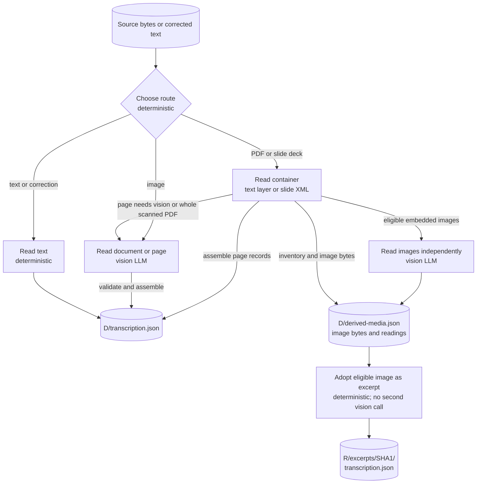

The vision response is a `TranscriptionRecord`: document class and pages with physical page index, printed page number, status, text, languages and notes. Code validates it and constructs the persisted `Transcription`. Its page records also locate text within the assembled transcription and record image SHA-1s and reading provenance. Text-file and correction transcriptions have no page records. Page notes are not source text.

For a paged container, the additional products are:

- `D/derived-media.json`: image identities, filenames and placements in the container.
- `D/derived-media/<sha1><suffix>`: the retained image bytes.
- `D/derived-media/<sha1>.transcription.json`: an independently read image's checked transcription, when available.

An independently read image can become an excerpt document when it has a transcribed or illegible document page. Images that are wholly blank or not document pages, excluded images and images already represented by corpus files do not become excerpts. Repeated placements of the same image share one excerpt by media SHA-1. The container keeps its own text; the image's claims cite the image. Excerpt extraction and critique then run as normal and produce their own `batch.json` and `critique.json`.

Implementation: [routing and excerpt adoption](../src/yizkr/pipeline/orchestrate.py), [transcribers](../src/yizkr/pipeline/transcribe.py), [transcription record](../src/yizkr/pipeline/transcription_record.py) and [container readers](../src/yizkr/pipeline/containers.py).

## Extraction: entity discovery, chunks and validated claims

Extraction starts with an entity-manifest call even for short documents. The normal path below separates model inference from deterministic processing. Entity and chunk intermediates are in memory; the cylinders show the persisted inputs and outputs.

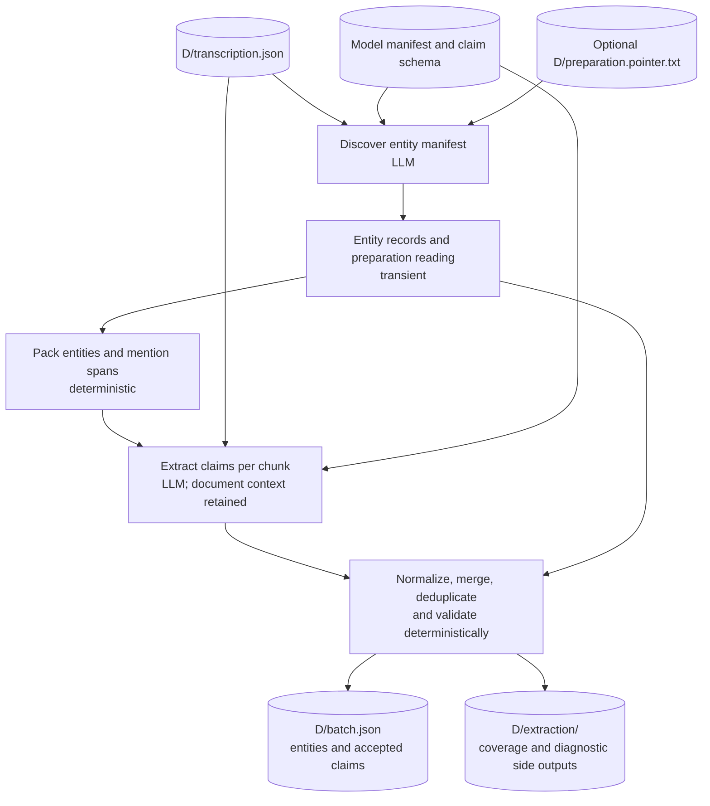

Chunk replies carry claim objects and a completion sentinel. Code maps references to the entity manifest, assigns source/page provenance, settles names, deduplicates claims and validates schema and vocabulary. Place-container evidence is checked against the transcription; unusable entries are removed and audited. Claim excerpts are also located in the transcription, with missing quotations recorded for inspection. These citation audits are distinct from schema rejection: a missing claim quotation alone does not remove the claim.

Rejected objects are recorded separately from accepted claims. Raw model responses belong to the shared LLM cache, when enabled, rather than separate chunk files under `D/extraction/`. The entity manifest and line-range segmentation each have two attempts keyed separately. Chunk answers cut short or lacking their completion sentinel are rejected and retried; a stale cached answer consumes no engine retry. If every claim in a chunk lacks the same required field, one extra attempt names that field. A complete, parseable second answer replaces the first and is validated in the merge; if the second call fails, is cut off or is refused, the first stands. Classifier refusals are not retried or routed through an alternative context path.

If the engine answered but its entity manifest remains unusable after its attempts, extraction falls back to LLM line-range segmentation, then deterministic line windows if segmentation's answers are unusable too. Output-limit give-ups can also trigger fallback. If every call of a tier fails without an answer, extraction fails the document instead of falling back. Chunk packing remains deterministic. A valid empty entity manifest means no claims and needs attention; it does not force a fallback. Coverage records the tier and reasons used.

An exhausted chunk failure fails the document's extraction stage. Salvaged claims are kept only in the diagnostic envelope `D/extraction/incomplete.json`; they cannot supply an accepted batch. A previous batch file can remain after a failed refresh, but the failed document is excluded from corpus-stage inputs. Extraction also fails when its merged batch has no claims because output could not be parsed or all claims were rejected. Accepted claim-free output can produce an empty batch with attention. These outcomes are distinct from individual unreadable or rejected objects in an otherwise usable batch.

Implementation: [chunked extraction](../src/yizkr/pipeline/chunking.py), [claim parsing and validation](../src/yizkr/pipeline/extract.py) and [stage orchestration](../src/yizkr/pipeline/orchestrate.py).

## Source preparation: how the document says its text was made

The entity-manifest call also reads the document's own statement about machine assistance in preparing its text. This uses the `extract` role; it is part of extraction, not another scheduled stage.

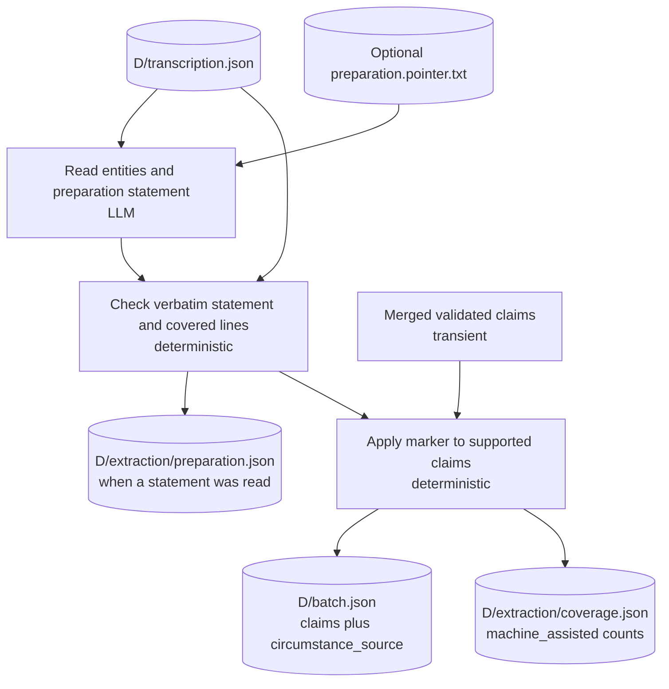

A pointer quotes where the document speaks; it does not supply the curator's own assertion. Code checks that the quoted statement occurs in the transcription and applies `sourcing_circumstances = machine_assisted` only to the claims it covers. The claim's `circumstance_source` retains the evidence for that marker, which the writer adds as a separate source-reference block. A container's preparation statement does not mark an excerpt's independent batch. Missing or unusable readings, and fallback extraction without a manifest reading, supply no marker.

Implementation: [preparation reading and marking](../src/yizkr/pipeline/preparation.py) and [extraction merge](../src/yizkr/pipeline/chunking.py).

## Critique: advice about the batch and its citations

The critic receives the batch's entities and claims, vocabulary and the whole numbered transcription. Claim excerpts and the evidence for place containers are located beside their source lines. It checks whether those passages support the claims, including their dates, as well as entity kinds, property choices and identity interpretations.

A valid finding names an entity, optionally a claim, alias or place container, an axis, category, issue and suggestion. Code checks those references against the batch and vocabulary. An invalid finding is retained with its validation reasons. Both are stored in `D/critique.json`; neither rewrites, approves or removes anything in `D/batch.json`. The critique view depends on both the batch and the transcription, so changed citation context invalidates it too.

Scratch writing consumes the original batch regardless of the critic's concerns. A stage failure can prevent the document completing its required stages, but findings or `needs attention` alone do not. An empty critique can mean no concerns or an unfinished answer: the shared operation reports completeness explicitly, and `D/state.json` records it under `detail.stage_results.critique`, alongside stage attention for unfinished output. Findings from an incomplete answer remain advisory and create no approval. A batch with no entities and no claims needs no critique model call.

Implementation: [critic](../src/yizkr/pipeline/critique.py) and [critique persistence](../src/yizkr/pipeline/orchestrate.py).

## GEDCOM: a deterministic route to the same batch contract

The shared GEDCOM operation parses structured records rather than transcribing them. Standalone, reviewed and scratch ingestion all submit `GedcomRequest` to `derive_gedcom`. The request identifies the source and may bind it to the discovery-time artifact hash. The operation reads bytes once, hashes and decodes that snapshot, and returns a complete validated `ClaimBatch` with diagnostics and invocation dependencies. A changed source, decoding failure, unsupported date or invalid adaptation raises without publishing output. Callers publish the batch and apply workflow policy; the operation does not create approval or access the graph.

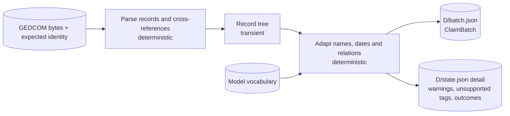

The adapter preserves the GEDCOM export as the source of its assertions and keeps supported source-citation information in its mapped claims. Name interpretation in this path is deterministic too. The diagnostic keys in document state are `gedcom_warnings`, `gedcom_unsupported` and `gedcom_outcomes`; unsupported records are visible rather than silently becoming invented claims.

Freshness uses the same planner and persisted generation record as text stages. Adapter, schema or declared resource changes recompute the batch; model configuration and cache availability do not. A legacy record without processing metadata recomputes once. Canonically unchanged output preserves the stored batch, process provenance and review basis. A failed recomputation records failure without replacing the previous batch or its dependency record. If dependencies changed, that batch remains stale until a successful retry; explicit refresh remains invocation policy.

Scratch execution and estimation use the discovered documents' declared stages within `--until` to select model and cache preflight. A GEDCOM-only run stopping at extraction needs neither a provider login/model configuration nor the LLM cache; it still checks exclusions, run storage and anomaly configuration. A corpus stage declaring `calls_engine`, such as clustering, retains the engine checks even when every document is GEDCOM. Estimation counts no GEDCOM model call. Reports continue to read recorded completed `gedcom` stages and the same batch/diagnostic fields in historical runs.

Implementation: [shared GEDCOM operation](../src/yizkr/pipeline/gedcom_stages.py), [GEDCOM adapter](../src/yizkr/pipeline/gedcom.py), [stage declarations and freshness](../src/yizkr/pipeline/stage_planning.py) and [caller-owned publication](../src/yizkr/pipeline/orchestrate.py).

## Clustering: deterministic evidence and model adjudication

After the barrier, clustering reads the original batches of completed documents, including GEDCOM and excerpts. It first constructs candidate pairs and clusters deterministically, then asks the model about eligible ambiguous pairs. It reads no wiki roster and does not use critique findings. Transcription views supply locations for images named in the adjudicator's evidence; the stage never makes a transcription.

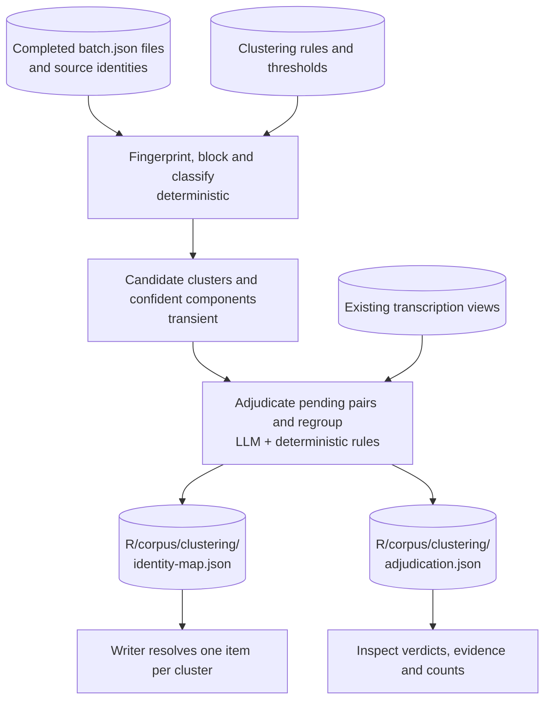

The deterministic pass merges confident clusters and safe confident components inside ambiguous clusters. Conflicting clusters remain separate. Adjudication asks only unresolved ambiguous pairs that could change a merge, excluding conflicting clusters and pairs already held in a merged confident component. It packs questions in batches and uses the `critique` model configuration; its calls are reported as role `adjudication` under stage `clustering`.

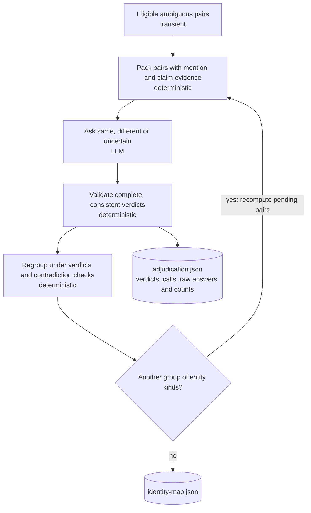

In development scratch runs, validated `same` and `different` verdicts can join or keep apart the candidate's components, subject to the deterministic contradiction checks. An uncertain or missing verdict leaves the candidate at its deterministic result. People and other initial kinds are settled before unions, and unions before events, so later questions use the earlier identity decisions. A verdict does not replace any source-attributed claim value. Keeper mode records verdicts for review without applying these model-driven merges.

The identity map contains `mentions` keyed by fingerprint with cluster membership and decision method; `clusters` with their members; `review` candidates and supporting evidence; aggregate `summary`; and reuse `inputs`/configuration and a decision `hash`. Fingerprints incorporate source identity, kind, label and mention span rather than relying on a document's temporary local IDs. Methods can include `confident_component` and `adjudicated`, as well as confident, ambiguous, conflicting and singleton outcomes.

The stage reuses its map and adjudication record only while their inputs and model configuration stand and no call was refused. Recomputed calls can still reuse cached model responses. The records contain source words and remain local. The map's `review` field is inspection data, not a human approval gate in a development scratch run.

Implementation: [deterministic clustering](../src/yizkr/pipeline/clustering.py), [adjudication](../src/yizkr/pipeline/adjudication.py), [fingerprints](../src/yizkr/pipeline/fingerprints.py) and the [clustering detail](../src/yizkr/pipeline/README.md#corpus-clustering-clusteringpy-the-scratch-runs-identity-map).

## Reset and registration: crossing into the live instance

These stages introduce instance I/O. The write key describes what the run would put on the instance: whole batches with their original run provenance, identity map, registration metadata, exclusions, writer version, executable/runtime dependencies and model manifest. Declared resource patterns include Python, model/pipeline YAML, Markdown prompts and published queries; package prose documentation is excluded. The changed dependency policy differs from an older recorded write key once, so its first use may rebuild the disposable instance. Later documentation-only edits preserve the key. The place key extends it with the place-stage prompt, version, batch size and model configuration. A full run's final instance-contents key is the place key, because the instance then includes the place stage's additional statements.

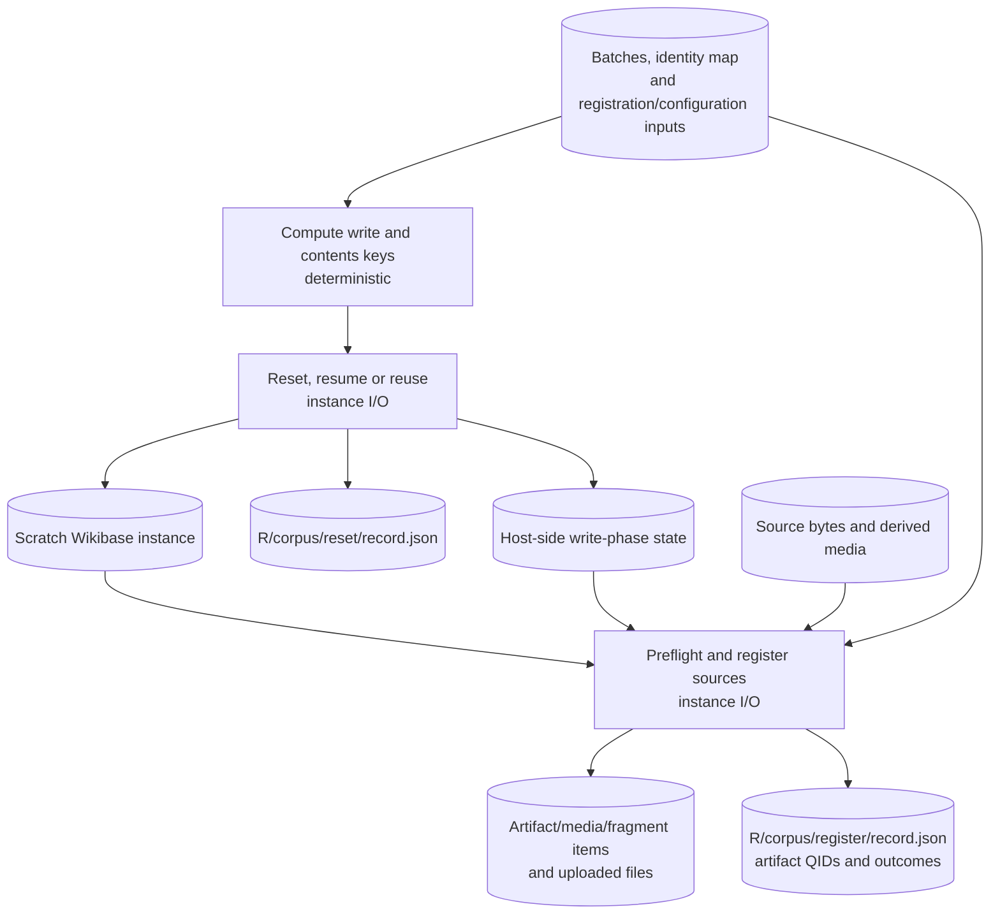

The diagram's instance and artifact boxes are views of the same wiki, before and after registration. Reset refuses a kept instance. A matching completed contents record allows reuse; a valid interrupted write phase allows continuation. Otherwise reset rebuilds and bootstraps the instance. A new run normally has new run stamps and therefore a new key.

Register checks the batch and map before creating its sources, then registers documents, fragments and derived media as needed. Its record maps document SHA-1s to artifact QIDs, records each container's registered derived-media QIDs under `placed`, and records batch refusals or registration failures. Image excerpts can require registering their containers too. Registration flags also reach `R/alerts.jsonl`.

Host-side state lives under the configured instance-state directory, outside `R`: `write/scratch-run.json` tracks run/key/epoch and instance revision/log watermarks, while `contents.json` records completed contents. Register, write and places verify that no intervening writer changed the instance. A fresh reset removes prior write-side records and place responses for the replaced instance. Each write-side stage records its own `record.json` in `R/corpus/<stage>/`.

Implementation: [reset and registration stages](../src/yizkr/pipeline/scratchwrite.py), [instance state](../src/yizkr/core/instance.py), [reset](../src/yizkr/reset.py) and [registrar](../src/yizkr/pipeline/registrar.py).

## Writing: validated scratch claims become graph statements

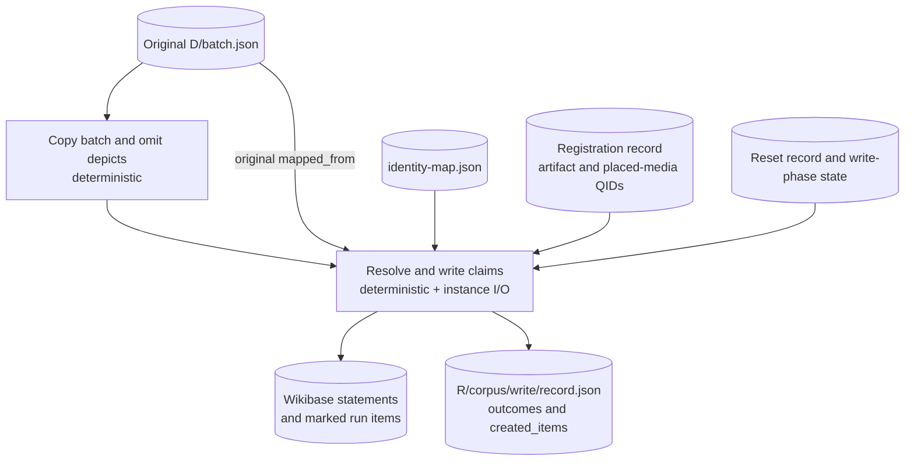

Validation here means the code accepted the claim shape and write policy; it is not human approval or a finding that the historical assertion is true. The resulting statements remain unratified development output.

Write supplies the original batch as `mapped_from` when resolving mentions, so omitting `depicts` claims does not change their identity. Scratch does not create or consume `batch.approved.json`, `batch.resolved.json` or identity and claim-review CSVs as part of this path. Extraction can still produce the diagnostic `gaps.csv`.

The writer resolves sources using their registered media SHA-1 and finds or mints the item for each identity cluster needed by written claims. The registered `placed` media determine which artifacts a container's captions and other permitted document claims can name. Claims are written at normal rank with source and extraction-run provenance; preparation evidence can add its own source-reference block. Run items are marked as unratified scratch output.

The write record counts written/referenced statements, skipped/refused claims by reason, self-references, omitted `depicts`, notes and minted items. Self-references are also counted by cluster and property and raised as anomalies. These outcomes are separate from extraction's rejects. Each document's `created_items` maps its local entity IDs to QIDs, which the places stage uses to connect mention records to written items. Once the write is complete, the instance-contents record holds the write key; the places stage advances it to the place key.

Implementation: [write stages](../src/yizkr/pipeline/scratchwrite.py) and [writer](../src/yizkr/pipeline/writer.py).

## Places: resolve the containers that sources name

The `places` stage follows a completed write. It waits for WDQS to show that write, reads the existing places and their containment, and joins those items to the written documents' place records through `created_items`. Transcription views supply the page and language of each container's evidence. An incomplete write produces no place questions or recorded proposals.

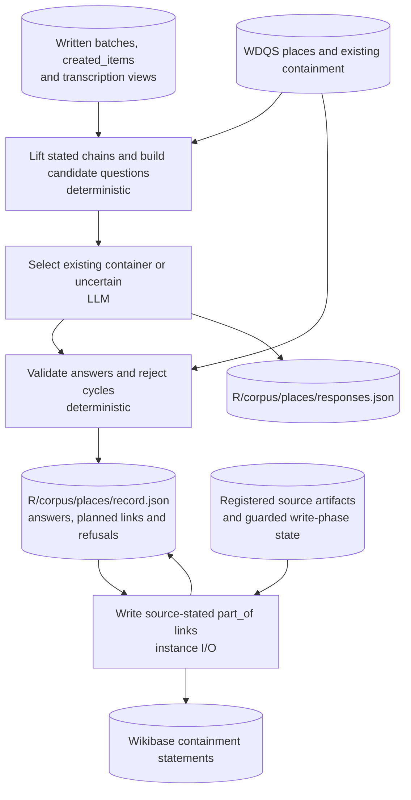

The model answers an identity question: which existing namesake a source's container means. It does not invent geographic containment. Questions cover a container with several candidate items, or a link stated only by a mention record rather than an already-written claim. A container with no candidate is counted and left out. A single-candidate link already expressed by a claim needs no call. The stage uses the `extract` model configuration, with calls reported as role and stage `places`; prompts use numbered candidates, names and evidence rather than QIDs.

An uncertain answer writes nothing. Schema problems, conflicting answers and links closing a cycle are counted and refused. Valid links become `part_of` statements at normal rank, with the source artifact, container evidence and available page locator, plus the stage's run item. Time qualifiers come from a supporting claim; a record-only link supplies no time. Equal statements can gain references, and an already represented source assertion is skipped.

The stage keeps its plan and per-link outcomes in `record.json`, and raw answers in `responses.json`. A valid partial write can resume those links without asking again; the records belong to the current reset and place key. Model-call interruptions can instead reuse completed responses through the shared cache. The live-stack lock and write-phase watermarks guard the stage, and final completion records the place key as the instance's contents.

Implementation: [place worklist, adjudication and link writing](../src/yizkr/pipeline/places.py) and [scratch place stage](../src/yizkr/pipeline/scratchwrite.py).

## Site: query views and preserved graph counts

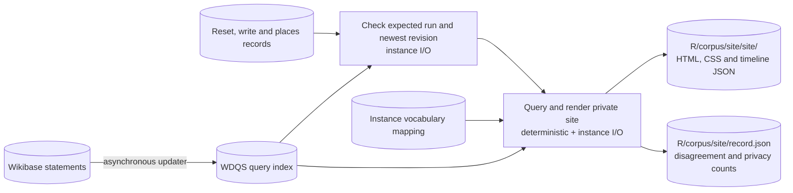

When run items were written or reused, the site stage waits for WDQS to expose the expected scratch run and the newest revision recorded by write or places, rather than only checking that the endpoint answers. With no run items, it builds without waiting for a nonexistent run marker. The doubled `site/site/` is the actual output path: the first directory is the corpus stage, the second is its site artifact.

The site includes possibly-living people and is a private view of the development graph. Its stage record preserves different-source disagreement totals and counts by property, along with possibly-living and release-by-cause counts. The report can read these after the next instance reset without querying the graph that was replaced.

Implementation: [site stage](../src/yizkr/pipeline/scratchwrite.py) and [site builder](../src/yizkr/staticsite.py).

## Run evidence, reports, diffs and control

These are consumers of the stage products, rather than additional automatic stages after `site`. Reports and diffs can inspect partial runs too.

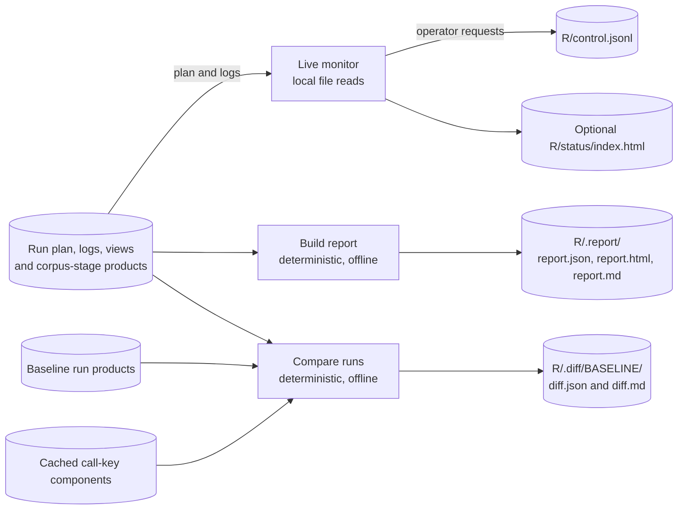

The driver observes control requests between stages; the monitor does not execute stages itself. The files supporting this are:

| Product | Purpose |
| --- | --- |
| `R/run.json` | Plan, document identities/kinds/stages, settings and invocation history |
| `R/events.jsonl` | Stage starts/outcomes, corpus-stage progress, model/cache calls, reuse and timing |
| `R/alerts.jsonl` | Anomalies and registration flags |
| `R/control.jsonl` | Pause/resume/abort requests and invocation markers |
| `D/state.json` | Source identity, document status, errors and stage-specific details |
| `D/derivations.json` | Input/content hashes and text-stage processing dependencies for persisted-view reuse; review bindings remain separate |

Report reads run files and the model manifest, without the corpus, wiki, engine or cache. Diff reads two runs and optionally cache-key components for attribution, never cached response contents or the live graph. The default baseline is the latest earlier completed run on main. Reports include the written claims' outcomes, clustering decisions, place-stage counts and the site record's disagreement/privacy counts. They do not reconstruct missing graph results from source files: absent stage evidence is reported as unavailable. Detailed HTML/JSON stays local; `report.md` and `diff.md` contain the aggregate summaries used as development evidence.

For vocabulary review, the separate `yizkr gaps rollup` command reads per-document gap outputs and writes `R/gaps-rollup.csv` by default. It groups normalized predicates, counts occurrences and retains examples for local inspection; decision columns remain for the curator and are not applied automatically. See the [gap rollup](../src/yizkr/pipeline/gaps.py).

Implementation and formats: [run manifest](RUN_MANIFEST.md), [monitor](MONITOR.md), [reports](RUN_REPORT.md), [diffs](RUN_DIFF.md) and [view/cache reuse](LLM_CACHE.md).
