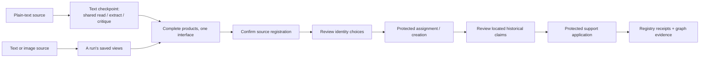

# Add one source to an established graph

`pipeline.source_ingestion.SourceIngestion` provides a Python workflow for one source: take its complete reading and proposals, explicitly register the source, review its identities, then separately review and apply historical claims. It preserves existing assignments, QIDs, evidence and curator edits. It neither resets the graph nor authorizes a keeper transition.

The workflow takes a source's products from one of two places:

- **The text checkpoint.** Without `document_dir`, `prepare()` reads, extracts and critiques one plain-text source with the shared text stages and keeps the results in the workspace.
- **A document's saved views.** With `document_dir`, the products are the complete views a run saved for one plain-text source or standalone image, in that document's directory. The workflow runs no stage and makes no model call for them.

Both satisfy one products interface (`ReviewedProducts`): the source artifact and SHA-256, the reading, the claim batch, the warnings shown at claim review (extraction attention, critique attention and critique findings) and a content digest. Each phase loads the products again, which rechecks the current source bytes and exclusions. PDF and PPTX sources, the images they place (excerpts) and GEDCOM files are refused with a reason.

The caller supplies a `WikiClient`, a shared `ReviewStore`, a source path, a workspace and an explicit exclusions file. Model clients are borrowed only by text-checkpoint preparation; the caller owns their configuration, cancellation and cleanup. This is a developer API. Standalone map-bound write commands retain their guards; a general ingestion UI and retained orchestration of container formats are separate capabilities.

## Preconditions and data products

Use an established, verified deployment generation and the [server mutation controls](../deploy/README.md). Run normal model bootstrap before using the identity vocabulary. Legacy graph state without verified source and entity bindings needs migration; labels cannot supply missing correspondence. A retained target additionally requires currently clean, committed code. The API never creates or removes retained markers.

Keep the source, exclusions file, saved document directory and shared review database outside the workspace. The exclusions file may explicitly be empty; missing or unreadable policy refuses processing. Admission checks current bytes and policy before processing and again before mutation. Source identity follows its bytes, with SHA-256 also checking the local product snapshot; a filename change does not allocate a different source owner.

| Product | Contents and authority |
| --- | --- |
| `products/text-products.json` | Text checkpoint: atomic and checksummed, holding reading, extraction, critique, settings, dependencies and original process records. Completed stages survive interruption independently of the response cache. |
| Incomplete-stage diagnostics | Unfinished extraction or critique and its reasons. These are inspectable, but cannot enter registration or review through this workflow. |
| Saved document directory | A run's views of one document (`transcription.json`, `batch.json`, `critique.json`) with its `state.json` and `derivations.json`. The workflow only reads it. |
| `target.json`, `registration.json` | Pinned deployment/generation and explicitly confirmed source metadata, including the products digest. The registry's verified source binding remains authoritative. |
| `mentions.json` | Correspondence to the shared review store's durable mentions. Reopening with an empty replacement review database refuses. |
| Shared `ReviewStore` | Explicit, scoped identity and historical-claim decisions. Document preparation and source registration grant neither. |
| Shared `CreationRegistry` | Accepted assignments, original creation authorizations, write intents and verified support receipts. |
| `records/`, `mutation.capability` | Process records and, while protection is held or release is unresolved, private recovery capability. Preserve these with the workspace. |



## Saved document products

`document_products.load_document_products` admits one document's saved views as a run left them. Admission checks the saved products' own consistency and does not recompute freshness against current code: it compares no processing fingerprint, so a view made by earlier code is admitted while it is complete and consistent. To take up a code or setting change, run the document's stages again first (the run decides which views are stale and reuses valid cached model responses), then start a new workspace for the changed products.

Admission refuses unless all of these hold:

- The source's current bytes hash to the artifact that the saved state, the reading, every claim's source reference and each stage's recorded result name.
- The current exclusions, read again from their file, exclude neither the source's current name, its recorded name nor its SHA-1.
- The document is text or a standalone image. A PDF or deck is a container whose placed images are separate owners, an excerpt is registered through the container that places it, and a GEDCOM file has no reading to locate claims in; each refuses with its reason.
- The state records the document as batched and every stage of its kind (`stage_planning.stages_for`) as complete. An unfinished critique, which a run saves as its view, and an earlier batch left behind by an incomplete refresh are refused.
- The dependency record (`derivations.json`) holds the content of the saved reading and batch, and says each view was made from the views and inputs beside it as they are now: the batch and critique from this reading, the critique from this batch.

The warnings shown at claim review are the critique view's findings and the attention reasons the run recorded for extraction and critique. A run saves those reasons in `state.json` under `detail.attention`, keyed by stage, when the stage completes, beside the stage's recorded result. The loader requires that result to be complete, but no digest binds the reasons to a view, so it cannot detect a reason edited by hand. The text checkpoint and saved views give claim review the same warnings for the same products.

Do not run stages on the document directory while the workflow uses it. A changed or partly rewritten directory either refuses admission or yields different products; once a source is registered, products whose digest differs from the registration refuse every later phase.

## Calling the workflow

Create a workflow with explicit connection and policy inputs. With the text checkpoint:

```python
from pathlib import Path

from yizkr.pipeline.identity_review import ReviewStore
from yizkr.pipeline.source_ingestion import SourceIngestion
from yizkr.pipeline.text_products import TextSettings

with ReviewStore(Path("var/review.sqlite")) as review:
    workflow = SourceIngestion(
        Path("inputs/fictional-certificate.txt"),
        Path("var/text-addition"),
        client=wiki,
        review_store=review,
        exclusions_file=Path("policy/exclusions.txt"),
    )
    products = workflow.prepare(
        settings=TextSettings(language="de"),
        extractor_client=extractor,
        critic_client=critic,
    )
    registration = workflow.prepare_registration(
        "certificate", "Fictional birth certificate"
    )
```

With a run's saved views of a standalone image:

```python
with ReviewStore(Path("var/review.sqlite")) as review:
    workflow = SourceIngestion(
        Path("inputs/gravestone-photo-1956.png"),
        Path("var/gravestone-addition"),
        client=wiki,
        review_store=review,
        exclusions_file=Path("policy/exclusions.txt"),
        document_dir=Path("var/scratch/fictional-run/gravestone-photo-1956"),
    )
    products = workflow.prepare()  # admits the saved views; runs no stage
    registration = workflow.prepare_registration(
        "photograph", "Photograph of the Löbig gravestone"
    )
```

For the text checkpoint, `prepare()` uses shared text stages and performs no graph reads or writes. Chunked extraction is the default because its entity manifest supplies located mentions for identity review. Explicit single/auto extraction preserves its existing limitations: a short single extraction may supply claims without an entity manifest, which cannot establish historical identity assignments. Plain text is unpaged; an invented page number is not a valid locator. Critique remains advisory: a completed critic's findings do not veto claims, but its relevant warnings become part of the material presented for historical approval. An unfinished critic is visibly incomplete and must be retried. For saved views, `prepare()` admits the products and refuses any setting or client.

Continue through explicit boundaries, persisting decisions in the ordinary review store:

1. Inspect the registration's destination, source digests, title and type. Call `register_source(registration, expected_digest=registration.digest, actor=...)` to confirm that exact registration. It uploads the source file and binds its item through a fresh `Registrar.register_artifact` inside server exclusion, and preserves the original confirmation on retry.
2. Call `prepare_identities()` to inspect current candidates. Supply explicit `ReviewProposal` choices through `prepare_identities(choices)`: `assign` names a verified existing binding; `new_entity` is an explicit creation choice. Use the [durable identity review APIs](IDENTITY_REVIEW.md#apply-later-cohort-identity-additions) or their review-sheet adapter to record decisions against the returned proposal revisions and digests.
3. Call `apply_identities(("local-mention-id",))` for the selected local IDs. Current graph context, source admission and approval are rechecked under server exclusion. Apply at most one new entity per call, refreshing candidate review between creations. Accepted identities and unchanged approvals carry forward.
4. Call `prepare_claims((claim_index, ...))`. Inspect the exact claims, source locations, assigned identities and critique warnings. Record separate `ClaimDecisionInput` choices through `record_claim_decisions(review, prepared, decisions)`. A source registration or identity decision is never historical-claim approval.
5. Call `apply_claims((claim_index, ...))`. Only selected approved claims are applied, using the assignment-aware writer and exact source-support receipts. Face associations retain their separate explicit confirmation requirement.

Identity and claim review locate mentions and excerpts in the reading by the same literal-occurrence rules for every admitted kind: a mention by the one occurrence of its label or an alias in its manifest lines, and a claim by the one occurrence of its excerpt in the reading, within the page it names. An image's pages are those of its reading record.

The query index must have caught up with current entity revisions before candidate capture. A stale index refuses; retry preparation when synchronization completes. No saved candidate list establishes current absence.

## Resume and supported limits

Reopen with the same workspace, products, original review database, source bytes and target deployment. For the text checkpoint, `prepare()` with no clients or settings reuses completed products and their recorded settings. If a stage is incomplete, provide only the clients needed to finish it. An explicitly different setting or changed source byte requires a new workspace; this API does not silently replace an interpretation that already has decisions or graph effects. Saved views are loaded afresh in every phase; products that changed after registration refuse in that workspace.

Retry an interrupted registration before identity work. Retry identity or claim application with the same selected scope and workspace; the server registry resolves verified effects, including a successful graph write whose local call failed before recording a receipt. Ambiguous dispatch remains a refusal, never permission to resend blindly. A changed generation, source ownership, relevant candidate material or review decision refuses rather than rebinding a workspace. Unsupported reassignment, merge and split remain explicit failures.

The local workspace lock protects its checkpoints; the server guard protects graph decisions and effects. Preserve a surviving `mutation.capability` file and follow [guard recovery](../deploy/README.md) if release fails. Do not delete it to force another operation. Backup and restore the graph, shared review database, products and referenced process records coherently.

This path supports one supplied text source or standalone image and bounded additions. It does not discover folders, run stages for saved views, register containers or the images they place, migrate old CSV approvals, correct an existing interpretation, implement split/reassignment, or mark a real archive retained. The [fictional integration lane](TESTING.md#live-integration-and-the-transition) checks actual retained admission, preservation of existing curator terms and statement rank/references, interrupted support recovery and repeated no-op application with fixed authored model answers, and takes a fictional image's saved views through real upload, source binding, identity and claim application; it establishes wiring and persistence, not model quality or keeper readiness.

## For stage authors

A new stage or reading route needs no second wiring on this path. Declare it in the stage registry (`stage_planning.STAGES`, with its view and document kinds) and run it through the shared per-document execution, which saves its view, records its inputs in `derivations.json` and records its result and attention in `state.json`. Admission then requires that stage to be recorded complete and its view to be made from the saved views it names, with no change to this workflow. A view that review must show reaches it only through the products interface: the loader maps the saved reading, batch, critique findings and the extraction and critique attention onto it. A new document kind enters only when its reading and claims belong to the source alone; containers and the images they place need registration of several owners.
