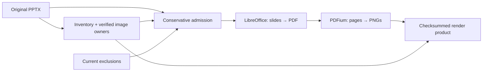

# Source reading

A reading preserves what a source says, its location and uncertainty, before [extraction](EXTRACTION.md) proposes historical assertions. It does not translate, resolve identity or use graph facts to complete missing text. The [ingestion contract](INGESTION_CONTRACT.md#source-identity-and-attribution) defines source ownership; [container architecture](ARCHITECTURE.md#container-inventory) defines PDF/PPTX preparation, exclusions and representation boundaries. This guide describes the reading product and its checks.

## Reading products and routes

`Transcription` identifies the original media by its SHA-1 and holds text, a document-level language and producer information. Located pages, document class, source context and a validation flag are present when the route supplies them. The reading remains a document product independently of the [response cache](LLM_CACHE.md); its text is not written wholesale to the graph. Extracted claims carry supporting excerpts and locators.

| Route | Process and product |
| --- | --- |
| Vision | A model returns a structured `TranscriptionRecord`; code validates it and builds the located transcription. |
| Supplied text or curator correction | Deterministic text reading produces a transcription without a vision record. Separate supplied text does not replace the source media's identity. |
| Paged PDF/PPTX | A format reader assembles located page/slide text and provenance, with independent image readings and vision page readings where supported. The assembled container has no whole-document vision class. |
| Adopted image reading | Verified existing reading products supply the independent image's transcription without another vision call. |

These are shared [stage operations](ARCHITECTURE.md#shared-document-stage-operations), used by the [reviewed text-source workflow](TEXT_INGESTION.md) and the [whole-corpus workflow](SCRATCH_WORKFLOW.md). PPTX has an optional [local rendering API](#pptx-render-preparation), but whole-slide vision routing and attributed readings remain unimplemented under [#747](https://github.com/WillHirsch/yizkr/issues/747). PDF fallback behavior is not evidence that the same route exists for PPTX. The HTR adapter is a stub, not another supported reading engine.

### Structured vision record (ADR-0037)

The complete answer must be one JSON object, optionally inside a single unlabelled, `json` or `text` fence. Prose surrounding that object fails parsing. For Claude Code, answer assembly uses assistant text after the last tool result, excluding earlier narration; consecutive text turns without another tool result are joined.

| Field | Meaning |
| --- | --- |
| `document_class` | A manifest artifact class, or `unclassified`. |
| `pages[].page` | Strict integer physical index, consecutively numbered from 1. |
| `printed_page` | Printed/written identifier exactly as read, such as `iv` or `3a`, or null. |
| `status` | `transcribed`, `blank`, `illegible` or `not-a-document-page`. |
| `text` | Source text, with `[illegible]`, `[?]` and `[redacted]` editorial marks as needed. A `transcribed` page requires nonblank text. |
| `languages` | Language codes, dominant language first. |
| `notes` | Reader observations about the page, separated from source text. These are not PPTX speaker notes, which are source content. |

Unknown fields, classes or statuses and invalid page sequences fail. Limited normalization accepts finite numeric printed-page values as strings, null text/notes/languages as empty, and upper-case language codes as lower-case. It does not infer missing statuses or repair arbitrary malformed answers.

The prompt preserves prose reading order and line breaks. Tables, columnar lists and form grids use one line per row with `|` between cells, including empty cells; wrapped cell text stays on its row. Multi-column running prose is read column by column, not converted into table rows. These layout instructions are model instructions, not independently verified table structure.

## Pages, media and source ownership

A physical page is a position in the input media, not a new witness. Whole-PDF vision must return exactly one record page per PDF page; a scanned spread stays within that page. A standalone image may contain several document pages. When such an image supplies one page of a paged PDF, its record pages are merged into that physical position, preserving their text and joining printed-page identifiers.

Vision text uses `[Page N]` markers; PPTX assembly uses `[Slide N]`. `TranscribedPage` stores text offsets, original-image references, record fields and reading-method provenance. Native text/XML pages have no inferred printed numbers, languages or reader notes. Vision page fields remain available even when the assembled container has no document class.

Extraction prompts display a known printed identifier beside its physical marker without adding lines. Claims cite the physical page; code supplies any corresponding printed-page locator from the reading, rather than trusting a model-generated value. Blank/unknown printed identifiers and non-single-page locators do not gain a guessed number. Printed numbers describe the cited physical page, including a spread whose only visible number belongs to one half.

Every original embedded image is an independent source, including full-page PDF scans and PPTX background assignments. Its reading and printed numbers belong to that image, while placement records locate it within the container. Native shapes remain container content. A generated page render is a representation of its constituent sources; it does not turn several owners into one witness. Located `source_context` separates body, speaker-note and image support. Unsupported or ambiguous attribution remains explicit; see [artifact ownership](ARTIFACTS.md#container-sources-adr-0008) and [shared source consumers](ARCHITECTURE.md#shared-source-consumers).

### PDF reading limits

A page proved to show only one readable original image uses `image-source`: that image is read independently once, and the container keeps a marker without duplicate claims. Other pages use usable visible native text, no reading for an empty page, or vision for text annotations, detected occlusion, scan-like overlays and unusable/garbled text. Size and coverage help select a reading route; they never determine source ownership. [The PDF route description](LLM_CACHE.md) explains the paged/whole-document choice and reuse; [textlayer.py](../src/yizkr/pipeline/textlayer.py) defines the detectors.

The native-text detector misses some hidden text: thick stroked overpaint, clipping, text matching its background color and zero fill opacity. It can therefore read such text as if visible. Nontext annotations on native-text pages can be counted without being read. A successful parse does not establish complete visual coverage or resolve mixed-source attribution. With configured exclusions, an unsafe or uninspectable representation refuses rather than bypassing the [model-input boundary](LLM_CACHE.md#pdf-model-input-exclusions).

### PPTX render preparation

[`prepare_slide_renders(source, directory, *, excluded, settings)`](../src/yizkr/pipeline/slide_renders.py) prepares reusable slide PNGs through a direct Python API. Callers supply the original PPTX, a dedicated local workspace and the current exclusion predicate `(sha1, names) -> bool`. This operation is separate from ingestion stage routing: it calls no model, produces no transcription and writes no graph data.

| Step | Inputs and process | Product |
| --- | --- | --- |
| Inventory and admission | Deterministic package inspection, existing source bindings and current exclusions; verify every supported visual image contribution. | Ordered slide/body IDs, image-part and placement IDs, and digests of consulted package XML. Speaker notes remain separate. |
| Rendering | Local LibreOffice Impress exports a temporary PDF; PDFium rasterizes every slide in presentation order, including hidden slides and excluding notes pages. | PNG bytes, pixel dimensions and renderer/environment identity. Defaults: 1,600-pixel long edge and 120-second rendering deadline. |
| Publication and reuse | Recheck source bytes and admission; verify recorded outputs before reuse. | `slide-renders.json`, content-addressed PNGs under `slide-renders/`, and representations attached to existing slide-body parts in `container-inventory.json`. |

The optional renderer needs a local LibreOffice executable, Fontconfig (`fc-list` and `fc-conflist`) and the package's pinned PDFium dependency. `SlideRenderSettings` selects the executable, output size and timeout. Each conversion uses a temporary profile and directory; subprocesses use the existing execution cancellation and process cleanup. No global LibreOffice configuration is changed. The export options are defined in [LibreOffice's PDF parameters](https://help.libreoffice.org/latest/en-US/text/shared/guide/pdf_params.html).

LibreOffice imports the intact package, so admission checks external relationships, DTD/entity declarations and linked image formats throughout it, including notes and metadata. These checks do not make nonvisual content a contributor to the slide PNG.

Admission supports native text/vector shapes, directly placed raster pictures and resolved picture backgrounds inherited through layout, master and theme. All original images retain their independent owners, including background assignments. A plain opaque sRGB background can suppress an ancestor picture; ambiguous overrides, including background `noFill`, transparency modifiers and overlapping picture-background definitions, refuse. LibreOffice can retain an inherited picture under `noFill`, so treating that form as an empty background would bypass exclusions. Inherited visible shapes or text without represented placements, external relationships, opaque media, charts, extensions and other unsupported drawing constructs also refuse. Empty inherited placeholders used for formatting are supported. Admission is conservative and all-or-nothing for the presentation; successful rendering does not establish correct attribution for a future composite reading.

The product records original-input digests, ordered contribution proofs, renderer/version/configuration, font and Fontconfig digests, and output hashes. An aggregate basis also binds the source-owner identities and processing-code hashes; owner bindings remain in the accompanying inventory. Changes to these inputs invalidate reuse. Current exclusions apply even to a previously rendered product, including its PNG hash and filename. Missing or damaged PNGs are regenerated; unavailable canonical owner bytes or an unreadable prior inventory block instead of allocating a replacement owner. A render record whose inventory is missing also refuses. Publication writes files before its completion record, and reuse verifies the record, inventory and bytes together after interruption. The workspace lock coordinates this API's callers; use a dedicated directory rather than sharing it with an active ingestion run. These checks support reproducible reuse in the recorded environment, not identical pixels across different LibreOffice or font installations.

## Validation: failure and attention

The transcription check rejects structurally or operationally unusable readings:

- Reported input-tool failure, output-limit termination or empty output.
- A vision answer without a valid record, including an older recordless vision view.
- Fewer record pages than the known media count, or extra pages for whole-PDF vision.
- Implausibly little readable text for known multi-page media: fewer than three letters/digits per transcribed page. Blank, illegible and non-document pages do not require text; editorial marks do not count.
- For recordless text only, failure-tier signatures such as tool output or an answer consisting of engine narration.

With a valid record, wording signatures in source text or reader notes only flag the reading. This prevents correspondence sharing an engine's vocabulary from being rejected as a refusal. Flagged readings continue downstream with attention available through [anomalies](ANOMALIES.md); a flag is not proof of correct reading. Signatures are English-only, so a refusal placed inside valid record fields in another language can pass unflagged. A refusal outside the required record fails structurally regardless of language. Unknown media page counts cannot support completeness or multi-page length checks. Yield anomalies compare classified readings within their record's document class; unclassified readings are grouped by document kind.

Reused views from checked reading routes and cached model answers undergo current validation, with flags recomputed rather than trusted from storage. Curator corrections are exempt from model-answer quality checks; source identity and exclusion admission still apply. A rejected cached response can be replaced by one fresh call in the same attempt; a newly failed answer is not retried indefinitely. Record content, including class, statuses, printed numbers, languages and notes, affects downstream freshness. Producer metadata and check flags are excluded from the transcription's semantic content hash. [Persisted-view rules](ARCHITECTURE.md#persisted-views-and-model-response-reuse) describe regeneration and review preservation.

## Language selection (ADR-0015)

The run and CLI default to `--language auto`, with `--fallback-language en`. An explicit language forces the document-level code; it does not ask transcription to translate.

- Whole-vision readings use the record: each page's letters/digits outside editorial marks weight its first language, grouping regional variants by primary subtag. A tie follows first occurrence; the returned code retains the first spelling. A record naming no language uses the fallback.
- Recordless readings and assembled paged containers use offline `py3langid` over the source text outside editorial marks. Fewer than 12 remaining characters, unavailable detection or confidence below 0.5 uses the fallback.

Resolution is recorded as `override`, `record`, `detected` or `fallback`, with confidence where applicable. This is one document-level hint; extraction can give each supporting excerpt its own language. Low-level transcriber constructors default to explicit `en`, so direct callers wanting detection must request `auto`.

## Inference configuration (ADR-0016)

Model and effort are caller configuration, not properties of a source. The scratch CLI applies these defaults:

| Role | Model | Effort |
| --- | --- | --- |
| `transcribe` | `YIZKR_LLM_MODEL` | `--extract-effort`, default `low` |
| `extract` | `--extract-model`, default `claude-sonnet-5` | `--extract-effort`, default `low` |
| `critique` | `YIZKR_LLM_MODEL` | `--review-effort`, default `high` |

Judgment operations using the critique role, including identity adjudication, inherit that role's settings. `--extract-model inherit` selects the main model. The Python `ScratchDriver` instead defaults `extract_model=None`, also inheriting the main model: direct API calls do not acquire CLI defaults implicitly. Shared stage operations borrow their caller's client.

At `make_client`, an explicit model overrides `YIZKR_LLM_MODEL`; an explicit effort overrides `YIZKR_LLM_EFFORT` for Claude Code. Standalone commands constructing a client without overrides use those environment settings. The Anthropic adapter takes the model override but does not apply the effort setting. Scratch preflight requires configured model IDs and rejects aliases; resume also checks recorded settings and actual client configuration. Use the [run manifest](RUN_MANIFEST.md#one-run-several-invocations) and [cache guide](LLM_CACHE.md) for pinning, refresh and configuration changes, rather than assuming these defaults prove model quality.

## Archived readings and compatibility

`yizkr scratch import-transcriptions` is a guarded cache-adoption command, not a general document-product migration. It reads archived `state.json`, `transcription.json` and available event timestamps, applies mandatory exclusions before reading transcription content, matches corpus media bytes and retains the original producer provenance. It skips differing readings of the same media and never replaces another answer merely to achieve a cache hit. Deterministically read text and corrections have no model response to adopt.

Its current prompt gate is restrictive: current-format transcription views lack the prompt identity the importer requires and are skipped as `prompt unknown`. Legacy `artifact_qid` views are eligible only when their known prompt hash equals the current transcription prompt; it currently differs, so those are skipped as `another prompt`. Imported text would also have to pass current structured-record validation. Thus neither format currently supplies an adoption through this command; do not treat arbitrary archives as usable cache seeds or rewrite their provenance to bypass the gate. Existing valid document products and response-cache entries have their separate reuse contracts.

Implementation: [record schema](../src/yizkr/pipeline/transcription_record.py), [transcribers](../src/yizkr/pipeline/transcribe.py), [validation](../src/yizkr/pipeline/transcription_check.py), [language selection](../src/yizkr/pipeline/language.py), [archive importer](../src/yizkr/pipeline/import_transcriptions.py).
