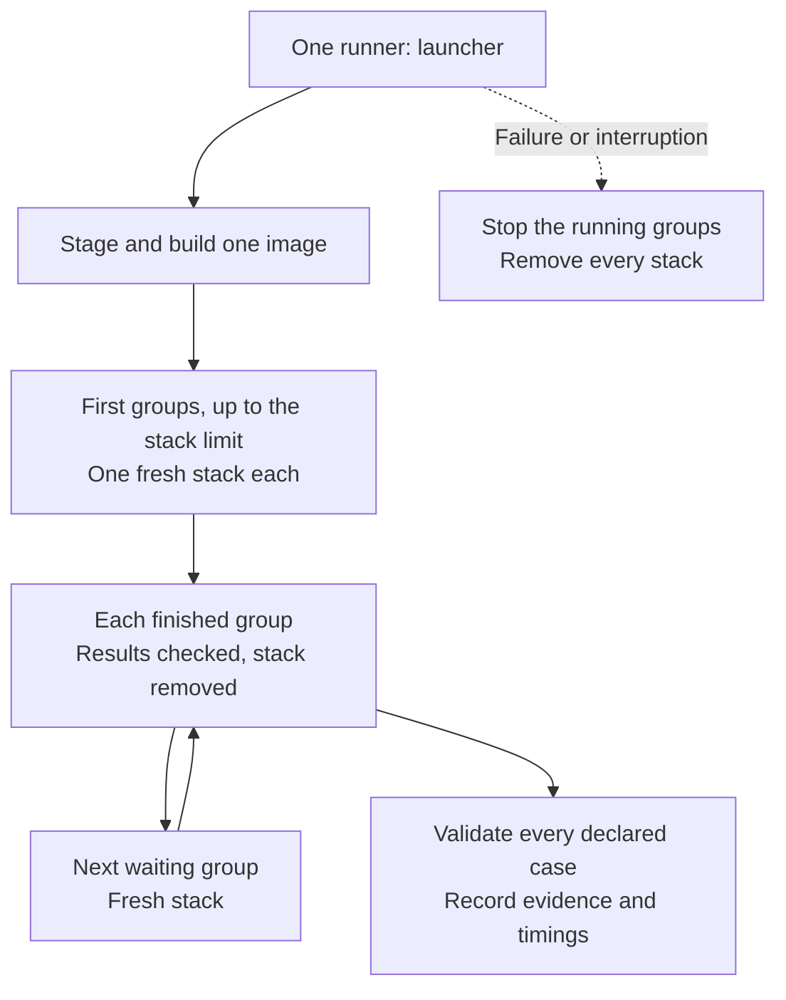

# Testing

Choose evidence for the behavior and boundary being changed. The [current contract](CONTRACT.md) defines the outcomes; [AGENT_PROTOCOL.md](AGENT_PROTOCOL.md) covers review, permissions and who can run checks involving private data. Each tool's `--help` describes its command options.

## Verification by risk

Use focused checks while implementing and CI's broad offline result for the revision under review. Do not repeat the full suite merely because a push or fix round occurred. Broaden or repeat checks when changed code, a failure or an unresolved risk warrants it.

| Change | Normal evidence |
| --- | --- |
| Documentation or mechanical edits | Relevant formatting, links and diagrams; review changed commands. Executable prompts and queries are behavior inputs even when stored in Markdown. |
| Internal refactor | Affected existing behavioral tests and callers, plus the broad offline result. Add cases for meaningful coverage gaps; an equivalent implementation does not itself require new tests. |
| Changed parser or schema semantics | Focused fictional semantic and rejected-input cases for the changed behavior, plus affected callers. Fixtures need not preserve known defects. |
| Material prompt, model or inference change | Schema/wiring checks and observed outputs from a bounded representative sample or suitable existing corpus evidence, with configuration recorded. Purely mechanical edits do not automatically require fresh model calls. |
| Writer, identity, migration or query boundary | Repeatable fictional checks against the real affected writer/query engine; verify returned evidence and relevant repeated or interrupted writes. |
| Privacy, exclusions or review gates | Positive and negative boundary cases inspecting actual outbound model inputs, persisted statements or emitted exports, as applicable. |
| Cancellation, locking or concurrency | Fake clocks for scheduling logic; controlled real threads, processes or locks for operating-system behavior. |
| Performance-sensitive work | Focused measurements against a relevant budget or comparable baseline. A generous hang guard is not a performance test. |

Tests establish intended behavior: provenance, uncertainty, identity, review, isolation and recovery. Prompt literals, exact query syntax, helper structure and historical prose are not substitutes for semantic results. Replace obsolete assertions with the affected implementation rather than preserving defects or requiring a repository-wide test rewrite first.

### Ownership of test migration

Migrate incidental assertions within the subsystem change that encounters them. Keep schema validation, template-key checks, nonempty source/process provenance, cache and restart behavior, lifecycle safeguards and environment isolation. An exact value is appropriate when it is part of the supported interface; a current implementation choice alone is not a contract.

| Subsystem change | Replacement evidence |
| --- | --- |
| Source reading, extraction and critique | Explicit authored response scenarios for deterministic orchestration checks; inspect outgoing source inputs and accepted/rejected products. Prompt-policy changes need bounded observed model outputs where interpretation matters. Canned responses cannot establish that prompt wording works. |
| Query library and publication | Returned fictional evidence at the real query boundary, and decoded query payloads at the publication boundary. Keep vocabulary, projection and template-key checks. Move remaining query-construction assertions with the affected query; do not remove a guard until its semantic obligation has coverage. |
| Runtime orchestration and tooling | Controlled completion, cancellation, lock ownership and deadline behavior. Select retry intervals explicitly in scheduling tests rather than freezing the production default. |

These are responsibilities of the affected subsystem work, not a separate repository-wide rewrite prerequisite. [Transcription validation performance](#transcription-validation-performance) has a separate local check.

The [small semantic acceptance set](#semantic-acceptance) checks deterministic archive behavior; real-model evaluation is a separate bounded activity. A canned engine establishes orchestration, not inference quality. Whole-corpus evidence is required when cross-document interactions or material uncertainty remain beyond bounded checks; record the reason and affected stages. A prompt, model or pre-write code edit alone does not require a corpus run. Changes merge in the order of the corpus evidence they need, and whole-corpus evidence is read after they merge, when the affected stage is next run on main; a regression it shows is fixed by a follow-up change. A change to the clustering settings is the exception, with its scratch diff and the owner's sign-off before merge. The order, the procedure and the local-only boundary are in [AGENT_PROTOCOL.md §5](AGENT_PROTOCOL.md#5-integration-and-corpus-evidence).

## Current test layers and limits

**Offline unit tests.** `tests/unit` is the default for `uv run pytest -q` or `make test`; `pyproject.toml` excludes the `live` marker unless requested. CI installs the locked base and development dependencies with `uv sync --locked --dev` and always runs lint, including Markdown formatting. Except for verified prose-only changes described below, it runs `pytest -n auto --dist loadfile`. Pillow is an explicit development dependency for image fixtures. Optional model SDKs and face engines are not needed: tests substitute those boundaries, including the Anthropic opt-in guard. After the full offline job passes, a separate `fictional-integration` job runs the required real writer/query lane described below; neither job evaluates real models.

The fixtures in `tests/unit/conftest.py` isolate host settings, model login and instance records. Tests provide their own configuration. In the test's own process, the package's checkout keeps the code version first observed in the session, and a write digests the model manifest as it was when the unit tests started, so a unit test's writes record the same code version and manifest however the checkout changes while the suite runs. Most filesystem sync calls are replaced; use `@pytest.mark.real_fsync` when actual sync behavior matters. Anomaly timers are recorded rather than started. A test that calls `monkeypatch.undo()` removes these function-scoped protections too; use `monkeypatch.context()` for a temporary patch.

The network guard rejects non-loopback lookups and connections, removes proxy variables and fails the test even if code catches the refusal. It is not a complete process sandbox: UDP sends, child processes and earlier-scoped fixtures are not covered. Tests and subprocesses must use fictional inputs and explicit temporary paths. Unit tests must not reach archive credentials or runtime state.

The import-boundary test, `tests/unit/test_import_boundary.py`, enforces the [package layering](ARCHITECTURE.md#package-layering). It reads the imports of every module under `src/yizkr` from the source text without running them, so an import whose module name is computed at run time is not seen. It fails on an import against the layering and on an allow-list entry that no longer occurs; planted package trees show that each rule catches an import.

**Design citations and links.** A rule is cited by the path of the document that states it and the quoted heading, as in `docs/LIFE_EVENTS.md, "Unions and their events"`, or in a Markdown document by a relative link to the heading. An ADR that has a file in `docs/adr` is cited by its number, ADR-NNNN, with a section number only where that file has the numbered heading. A number whose file was removed is neither cited nor used again. `tests/unit/test_doc_references.py` checks every tracked text file, as `git ls-files` lists them, and reads a citation wrapped across comment lines or split between adjacent string literals as one. It finds four kinds of reference that do not resolve: an ADR number without a file; a section number after the number of an ADR that has a file, matching none of that file's numbered headings; a section sign that follows neither an ADR number nor AGENT_PROTOCOL.md, outside `docs/AGENT_PROTOCOL.md` and `docs/adr`, which number their own sections; and a quoted name after the path or name of a tracked Markdown document that begins none of its headings or bold paragraph labels. One sign, which cites the GEDCOM 5.5.1 specification in `src/yizkr/pipeline/gedcom.py`, is exempt by name. Without a baseline, the same test fails on a relative link in a tracked Markdown document that resolves to no tracked file or folder, or whose fragment names no heading or explicit anchor of its Markdown target, and on a section number cited for AGENT_PROTOCOL.md that none of its numbered headings has. Prompt templates under `src/yizkr/pipeline/prompts/` are not documents to it. Planted trees show each failure. Run it alone with `uv run pytest -q tests/unit/test_doc_references.py`.

The four kinds are counted against a baseline, `tests/unit/doc_references_baseline.json`, which records how many findings of each kind each file held when the check was added. The test fails when a file holds more findings of a kind than its entry records, a file without an entry recording none, and when an entry is higher than what the file holds, so the baseline only shrinks; the failure names each file, kind and number to record. A change that removes a counted citation, or deletes a file that holds one, lowers that file's entry to the named number in the same change, and removes a kind or an entry that reaches zero. A new citation follows the convention rather than raising an entry. The rewrite of the counted citations is #909, #910, #911, #912, #913, #914 and #915, each removing its entries; the change that removes the last entry deletes the baseline, the code that reads it, this paragraph and the baseline sentence under [Prose-only CI](#prose-only-ci).

**Offline pipeline coverage.** `tests/unit/test_fixture_corpus.py` exercises per-document stages, the barrier, clustering, response reuse, reports and fixture identity traps with a canned engine behind the real LLM cache. Explicit scenarios select the recorded misreading or corrected response independently of prompt wording. A changed request controls cache invalidation; the scenario controls only the response to a fresh call. The autouse `_no_write_side` fixture removes reset, registration, writing, places and site from the driver's corpus stages unless a test uses `write_side`. Separate write-side unit tests use an in-memory instance and stand-ins for reset, locking or site generation. These checks do not demonstrate a complete real-stack ingestion, query result or model interpretation. Existing fixture traps and strict expected failures need review when their subsystem changes.

The substitutions are explicit boundaries of offline coverage:

| Stage or service | Default offline substitution | Boundary left to integration |
| --- | --- | --- |
| Transcription, extraction and critique in the fixture corpus | Authored engine responses through the real response cache | Actual model interpretation is not evaluated. |
| Corpus reset, registration, writing, place reconciliation and site generation | `_no_write_side` removes every `touches_wiki` corpus stage; `write_side` tests provide their own fake wiki and service stand-ins | Real Wikibase acceptance, persistence and query results are not established. |
| Host settings, login and instance records | `_no_host_settings`, `_no_claude_config` and the instance-record fixtures use only test-supplied settings and temporary paths | No permission to use archive settings, credentials or runtime state is implied. |
| Network, filesystem flushes and pause timers | The network guard rejects off-host access; flushes are replaced unless `real_fsync`; pause timers are recorded | These defaults do not establish external-service, crash-durability or real-timer behavior. |
| Code version and model manifest of the checkout | `_one_checkout` gives every observation of the package's checkout the code version first observed in the session, and a write a copy of the model manifest made as the unit tests start | Telling a changed checkout from an unchanged one is tested on temporary checkouts in `test_run_manifest.py`, not through unit-test writes. Child processes a test starts observe the checkout afresh. |

**Live integration.** `tests/fictional_integration`, marked `live`, exercises the required disposable writer/query lane and fails when its setup is missing. `tests/integration/test_live_*.py`, also marked `live`, exercises an explicitly configured stack or a real model; its availability checks can skip tests. These are separate invocations. Query-string unit assertions do not establish the rows returned by an actual engine.

**Local slide renderer.** The optional [LibreOffice/PDFium check](../tests/integration/test_slide_rendering.py) uses an authored fictional presentation to verify slide order, hidden-slide export, image contributions, separate notes and reusable render products. The [selected-slide reading checks](../tests/integration/test_slide_reading.py) exercise actual rendering through the shared media API and durable driver, using authored model answers to verify located body/notes, published input provenance, reuse after response-cache removal and estimation without changing saved products. Run them with a local LibreOffice executable and Fontconfig installed:

```sh
YIZKR_TEST_LIBREOFFICE=/usr/bin/libreoffice uv run --locked pytest -q tests/integration/test_slide_rendering.py tests/integration/test_slide_reading.py
```

They skip when `YIZKR_TEST_LIBREOFFICE` is unset; selecting an unavailable or failing renderer fails the tests. They use temporary files and no model, corpus or graph access. Default CI does not install LibreOffice; offline renderer tests substitute conversion while exercising the real PDFium rasterizer. These optional checks verify the selected local renderer environment and reading assembly, not general Office visual fidelity or model interpretation quality. Mixed-slide checks use authored block-ID answers and verify exact native assembly with independently owned image readings.

The offline [selected-slide workflow checks](../tests/unit/test_slide_workflow.py) exercise execution through clustering, stored-reading reuse, render repair, fixed selection settings and independent-image ownership with controlled renderer/model outputs. Mixed-slide checks preserve exact native wording, separate notes and one image-owner batch across repeated placements and reuse. Estimator checks count both layout and independent-image calls, including unknown responses, while verifying that saved run products remain unchanged. These checks cover durable orchestration; the optional real-renderer checks above supply the conversion boundary.

[Routing-report checks](../tests/unit/test_slide_routing_report.py) distinguish recorded native decisions from missing or inconsistent metadata, verify local per-slide detail and keep arbitrary persisted labels out of aggregate output. Both recorded layout policy versions remain reportable. The bounded layout policy does not establish complete visual coverage or prove the model’s reading order.

**Real-model checks.** `tests/integration/test_live_chunked.py` exercises extraction and conversation resumption through the claude CLI and response cache. It needs a logged-in CLI and skips if unavailable. `$YIZKR_LIVE_CACHE` selects its cache; the default is `var/live-cache`. It does not acquire the stack lock. These checks do not establish broad extraction quality across the corpus, and a reused response establishes only the request/configuration it matches.

### Prose-only CI

The existing `test` job uses [ci_scope.py](../scripts/ci_scope.py) to inspect the complete local Git diff. For a pull request it verifies the tested merge commit's base and head parents, then compares the base with that merge result. For a push it compares the event's full before/after range, including every commit in the push. Manual runs, empty changes, missing history, malformed events or an unexpected checkout use full verification.

Only ordinary, non-executable Markdown files directly inside `docs/`, `docs/adr/` or `docs/runbooks/`, and these explicit guides, qualify:

- `README.md`
- `src/yizkr/pipeline/README.md`
- `src/yizkr/queries/README.md`

Both the removed and added paths and file modes count, including renames and deletions. Everything else takes the full route: executable prompts, query templates, fixtures, scripts, configuration, dependencies, workflow changes and unknown paths. Keep this allowlist narrow; a new executable consumer of a guide must either have an appropriate check in the prose route or remove that guide from eligibility.

Verified prose-only changes retain lint, the existing anomaly/engine-limit documentation consistency checks and the [design citation and link test](#current-test-layers-and-limits), selected in [ci.yml](../.github/workflows/ci.yml), so a prose-only change that breaks a link or adds a citation that does not resolve fails. They omit the remaining offline suite and the entire integration job. A documentation change that removes a citation the design citation test counts must also lower that test's baseline under `tests/`, so it takes the full route. Both job identities remain stable, with no workflow-level path filter; a classifier, setup, lint or selected-test failure still fails `test`. Integration waits for successful full offline verification, avoiding database-runner minutes when an earlier check fails. This intentionally prioritizes total Actions minutes over full-suite turnaround time.

### Optional-engine compatibility

Run this explicit local check when changing optional dependencies or the supported runtime, or before using those engines. It installs the locked `llm` and `faces` extras in an isolated environment and verifies real imports and CPU-provider availability without API calls or model-weight downloads:

```sh
uv run --locked --isolated --no-default-groups --extra llm --extra faces python - <<'PY'
from importlib.metadata import version

import cv2
import onnxruntime
from anthropic import AsyncAnthropic
from insightface.app import FaceAnalysis

providers = onnxruntime.get_available_providers()
assert "CPUExecutionProvider" in providers, providers
print(AsyncAnthropic.__name__, FaceAnalysis.__name__, cv2.__version__, providers)
for package in ("anthropic", "insightface", "onnxruntime", "opencv-python-headless"):
    print(f"{package}=={version(package)}")
PY
```

Missing dependencies or import failures fail this check rather than skip it. It is separate from default CI and adds no unconditional Actions job. The default suite checks application policy and wiring with stand-ins; this command checks installation/import compatibility, not face-model initialization, inference quality or a remote service. Do not construct `FaceAnalysis` merely to test imports: its initialization can download model weights. Any real inference evaluation needs its own declared fictional inputs, model/configuration and evidence scope; existing private-data and disclosure permissions still apply.

## Semantic acceptance

Run the compact deterministic set with:

```sh
uv run pytest -q tests/unit/test_semantic_identity.py tests/unit/test_semantic_evidence.py
```

These tests run in the ordinary offline suite and inherit its host-settings and network isolation. [The reusable scenarios](../tests/fixtures/semantic_acceptance.py) select fictional evidence from [the example universe](EXAMPLES.md). They separate source text and intended outcomes from the current `ClaimBatch` and durable review adapters. No model supplies the deterministic inputs.

| Scenario | Required observation | Production boundary exercised |
| --- | --- | --- |
| Gustav's register extract gives 7 January 1919; his naturalisation certificate gives 1 July 1919 | Both birth dates retain their precision, normal rank and separate source/location/process support. Repeating the application adds nothing. | Durable identity review, claim decisions and reviewed claim application (`assignment_writes.apply_reviewed_claims`) |
| Two Ursula Löbigs: the daughter born in 1911 and the unrelated widow in the 1912 directory | The identical name does not merge these incompatible people, including after temporary IDs and input order change. | Corpus identity construction |
| Two mentions proposed as the same Gustav | A confident machine verdict alone assigns nothing: acceptance refuses the undecided proposals. Only an approved decision places both mentions on the chosen existing item; a rejection is kept as a negative and assigns nothing, so no claim of either mention can be prepared. The contradictory evidence and its provenance survive the assignment, including after temporary IDs and input order change. | Durable identity review, assignment acceptance and claim review |
| A face-region proposal for a known fictional person | Neither an undecided proposal nor an approval without explicit association confirmation can authorize the association. Explicit approval permits the displayed person/region with provenance; a changed association cannot reuse that approval. | Face proposal construction. Refusal: claim decisions and reviewed claim application, with the face claim in place of an approved text claim, since a face proposal cannot enter claim review. Confirmed write: the review sheet and `BatchWriter`, until #892 removes that route and keeps the case for the face route of #160 |

The durable cases use the production review store, assignment authority and reviewed claim application, with WikibaseIntegrator serialization, over the detached in-memory wiki of `test_identity_provenance.py`. Their assertions inspect accepted assignments, prepared claims and the wiki's stored statements and references. Only the face confirmed-write test still uses `BatchWriter` directly, with the detached transport from `test_pipeline.py`, and inspects emitted statements. The transports supply scripted reads and storage. This establishes transformation and gate behavior, not Wikibase acceptance, server persistence, WDQS results, recovery or concurrency. [The isolated integration lane](#live-integration-and-the-transition) remains necessary for those boundaries. The face case uses synthetic detections and embeddings; it does not establish recognition quality.

When replacing evidence, stage or identity implementations, keep the source cases and semantic expectations and adapt their small input/output adapters. Compare attributed values, identity membership and approved associations; do not require prompt literals, generated IDs, record order or helper calls. Extend the set for a consequential new behavior rather than duplicating every existing unit case. These checks do not claim that all [target ingestion cases](INGESTION_CONTRACT.md#fictional-contract-cases) pass: retained-state splits remain unimplemented; the bounded text-addition lifecycle and interrupted support recovery are checked in the required retained case below. Focused durable-review tests cover approval carry-forward after verified rereading; the real assignment-authority and historical-write cases below exercise the corresponding server boundaries. Do not freeze known defects as expected semantic results.

### Optional real-model evaluation

This evaluation is separate from the deterministic checks and is not a prerequisite for using them in refactors. Its purpose is to observe interpretation quality against independently specified expectations. The source texts in the scenario fixture are usable inputs; their prepared batches, expected outcomes and curator decisions are gold data, never model input.

1. Declare the question and sample before calling a model. A bounded extraction sample is `birth-extract-1938`, `naturalisation-1952`, `family-tree-1984` and `directory-1912` from the scenario fixture. Use each complete selected reading, preserving its language, source identity and location; do not combine unrelated sources into one witness. Face approval is a deterministic policy check, not an extraction-quality score. A face-recognition evaluation needs separately specified fictional images and expected regions; the synthetic embeddings here are insufficient.
2. Record a reproducible configuration: repository commit (including prompts, vocabulary and adapters), fixture source keys and content hashes, engine/provider, requested full model ID and actual reported model, client/CLI version, effort and any sampling controls the provider supports, extraction strategy, chunk/retry/concurrency settings, and cache policy. Record unavailable controls explicitly. Retain the exact requests and raw responses, parsed batches, rejects, incomplete-output reports and any later review decisions in a dedicated evaluation directory outside tracked files. These records let another evaluator reconstruct the calls; they cannot guarantee identical new samples from a hosted model.
3. Feed the fixture's transcription adapter to `text_stages.extract` with an explicit `ExtractionRequest` naming that transcription, its artifact and `strategy="single"`. This concrete procedure uses a configured client from `yizkr.pipeline.llm.make_client("claude-code", ...)`, with dedicated transcript storage, and the request's `raw_dump`, `rejects_dump` and `diagnostic_dump` paths. Inspect the returned completeness status; diagnostic batches are not completed proposals. If the change concerns chunking, critique or reconciliation, name and invoke that actual stage and record its additional inputs/settings instead. Do not infer its quality from a single-call extraction check. Close the client after the run. Stop before graph writes.
4. Inspect outputs against the expectations below, resolving temporary references by source and described role, not generated identifiers. Record each obligation as satisfied, failed or unassessable, with the observed evidence and missing information. Abstention can be correct for an unsupported identity; omitting an explicitly stated birth date is a coverage failure. A parsing error, failed call or skipped input is not a passing abstention. Keep machine proposals separate from later human decisions.
5. A useful initial budget is three fresh repetitions of each selected input per configuration, serially. Use a separate initially empty response cache per repetition, or disable response reuse; record actual engine calls and cache hits. A replay is useful for reproducibility but is not another independent sample. Report all attempts, including failures and retries, and per-case variability rather than selecting the best answer or treating a small pass rate as a general quality estimate. If a different budget is needed, declare it before inspecting outputs.

| Evaluation obligation | Required or permitted result |
| --- | --- |
| Contradictory dates | Extract each explicitly stated date with day precision and the correct source. When the two readings are considered together, retain both; do not choose a canonical birth date or invent an explanation for the disagreement. Other supported assertions from the reading are allowed. |
| Homonyms | Preserve the daughter's birth evidence and the widow's stated status with their own attribution. Keep their identities separate or unresolved; matching names alone do not justify equivalence. Do not invent the widow's birth date or a family relationship. |
| Provenance and uncertainty | Preserve available source locations and trace machine interpretations to their process. Do not fabricate citations, precision or independent corroboration. Distinct defensible names/representations are allowed if their evidence remains inspectable. |
| Human decisions | A proposed identity match or face link may remain unresolved. No machine confidence or textual name match counts as curator approval. Model outputs must not acquire human approval state. |

A canned response can prove request/response wiring and downstream handling but cannot establish whether a model read the source correctly. These few fictional readings also do not measure handwriting, layout, multilingual coverage, face recognition or corpus-wide interactions. Use suitable media samples for those questions and complementary corpus review when the risk requires it, following the local-only procedure above. Report deterministic results, observed model results and corpus evidence separately; an unrun optional evaluation contributes no quality evidence.

## Focused and broad runs

```sh
uv run pytest -q tests/unit/test_names.py
uv run pytest -q tests/unit/test_names.py::test_name
uv run pytest -q tests/unit -k 'name_expression'
uv run pytest -q --lf
```

Replace the example test name or expression with an actual target. Use `uv run pytest -q` when a broad local run resolves a risk or CI evidence is unavailable. Otherwise rely on CI's broad result for the reviewed revision. `make lint` runs Ruff and the Markdown formatting check; use the relevant checks on changed files while working.

CI uses `uv run pytest -n auto --dist loadfile --durations=20`, keeping each file in one worker and reporting the twenty slowest test stages. Local runs are serial unless `-n` is given. Use parallelism when machine capacity permits; concurrent test-heavy sessions can make every run slower. Real-stack tests share a lock and are not an xdist workload.

For concurrent behavior, coordinate with events, barriers or pipes rather than timing sleeps. Keep bounded hang guards so failed synchronization terminates. The existing `test_no_real_time.py` checker enforces fake-clock conventions, an explicit allowlist and module-level `HANG_GUARD` values of 30–600 seconds. This is an implementation constraint of the current suite, not evidence of performance. In particular, the transcription backtracking check catches catastrophic hangs but can miss a several-fold slowdown; meaningful performance changes need a suitable measurement.

## Transcription validation performance

Run the focused benchmark when changing transcription validation or its regex signatures. It uses two repetitive legacy-text inputs and a 48-page structured reading assembled from fictional letters, with an engine diagnostic on the final page. Every validation must retain its expected pass/rejection/flag and page-count result. The measured operation is `check_transcription`; input construction, JSON parsing, rendering, imports, process startup and model calls are outside its scope.

The designated environment is an otherwise idle Linux x86_64 host running CPython in the locked development environment. Measure the accepted baseline and candidate serially on the same host, interpreter and CPU affinity, without concurrent test-heavy work. Record the baseline on accepted main immediately before the change, then run the candidate with the same benchmark and fixtures:

```sh
uv sync --locked --dev
# On accepted main:
make benchmark-transcription ARGS="--output /tmp/transcription-baseline.json"
# In the candidate checkout, with the same locked environment:
make benchmark-transcription ARGS="--baseline /tmp/transcription-baseline.json --output /tmp/transcription-candidate.json"
```

Each workload gets one untimed warm-up followed by five samples of three validations. Reports retain every sample's wall and CPU seconds per validation, the source revision and dirty flag, interpreter/platform/CPU/affinity details, lockfile digest and workload digest. The budget is **candidate median wall time no greater than 1.5 times the accepted baseline**, independently for each workload. CPU timings help interpret scheduling noise; they do not replace the wall-time budget. Medians limit the influence of an isolated outlier; this small check is a material-regression guard, not a claim of statistical significance or a complete ingestion benchmark.

Without `--baseline`, the command only records a measurement and prints no budget verdict. With a baseline, the Python module exits 1 for a budget breach; incompatible or invalid reports, unexpected validation results, setup errors or a hung worker exit 2. The Make target reports either failure with exit 2. The child has a separate 60-second hang guard. Comparisons refuse different environment metadata, workloads or sampling settings. Output paths must be new files, so neither a candidate nor a failed comparison overwrites accepted evidence.

Investigate a breach and rerun a comparable baseline/candidate pair under quiet conditions if load or thermal variation is suspected. Record both results in the PR; do not hide a failure by widening the budget or replacing the baseline with the slower candidate. An intentional workload, environment or budget change needs a separately explained calibration. Keep raw reports outside the repository; report measurements and limitations in GitHub. This check runs explicitly and adds no timing assertion to normal unit tests or always-on Actions job. It supplies regression evidence, not a promised reduction in CI minutes.

## Assignment path cost

Run the offline benchmark to measure what one identity and one claim cost on the reviewed assignment path as the graph grows, and to give a change to that path its before and after. `make benchmark-assignments` (`scripts/assignment_cost.py`) generates fictional cohorts ([EXAMPLES.md](EXAMPLES.md#generated-cohorts)) and takes each register, in order, through `SourceIngestion`: registration (`prepare`, `prepare_registration`, `register_source`); identity review (`prepare_identities` with explicit choices, `assign` to the entity an earlier register's mention received and `new_entity` otherwise, each approved in the review store); one `apply_identities` call per mention, because a protected operation creates at most one entity; claim review (`prepare_claims`, which prepares through `prepare_claim_review`, each claim approved); and one `apply_claims` call for the register's claims. The production `WikiClient`, WikibaseIntegrator, query reader, mutation guard and creation registry run unchanged against an in-memory Wikibase and query service (`tests/fixtures/fake_wikibase.py`) that answers them at the transport, so each request the code sends is counted once, by kind; a request the fake does not model fails the run. The query service's index follows the wiki only when the driver synchronises it, before each identity preparation and application, because the path refuses a stale index rather than waiting for it. The benchmark reads no archive setting or instance record, calls no model and changes nothing in `src/yizkr`. Stages before registration, model calls and map-derived choices (`prepare_cluster_proposals`) are outside it.

```sh
uv sync --locked --dev
make benchmark-assignments ARGS="--output /tmp/assignment-cost.json"
# One size, compared with an earlier report:
make benchmark-assignments ARGS="--size small --baseline /tmp/assignment-cost.json --output /tmp/assignment-cost-candidate.json"
# Also attribute every request to the yizkr functions that sent it (slower):
make benchmark-assignments ARGS="--size small --trace --output /tmp/assignment-cost-trace.json"
```

Three sizes span fifty times in identities and in entities:

| Size | Registers | People per register | Shared with an earlier register | Claims per register | Entities before the first register | Identities | Claims |
| --- | --: | --: | --: | --: | --: | --: | --: |
| small | 2 | 1 | all | 1 | 203 | 2 | 2 |
| medium | 10 | 2 | half | 2 | 1,203 | 20 | 20 |
| large | 50 | 2 | half | 2 | 10,203 | 100 | 100 |

Every size starts from the bootstrapped model's 203 properties and items; medium and large add 1,000 and 10,000 people already in the graph, items that no register names and that hold no registry binding. The report is a new JSON file (an existing one is never overwritten). It gives every operation's kind and register, the graph's state before it (entities, bindings, authorizations, assignment commits, application plans, identity and claim proposals), its server requests by kind, the records it wrote by kind, its review-store calls and the proposal rows `list_proposals` returned, and its wall time; each phase's totals; and the mean cost of one identity (its share of its register's identity review, and its application), one claim (its share of its register's claim review and application) and one registration. The request categories are entity scans (whole-instance enumerations, `iter_entities` or `list_entity_ids`) and the listing and 50-entity batch requests they take, revision reads, immutable page reads (two requests each), item reads, writes (page edits, item creations and edits, uploads), query-service queries by purpose, and other requests: the mutation guard, revision and log watermarks, retained-code checks, registry page listings and creation checks, vocabulary reads, page texts, file reads and logins. With `--trace` the report also counts every request by the chain of yizkr functions that sent it. With `--baseline` the command prints the ratio of each per-identity and per-claim category to the baseline's, for each size measured at the same scale, and gives no verdict. A missing or unreadable baseline, a file that is not a report of format 1 with sizes (the regression baseline below has none) or an existing `--output` ends the command with a message and exit 2 before anything is measured. Any failure once measuring has begun, such as a request the fake does not model, a refusal by the path or a report that cannot be written, stops it with a traceback and exit 1; `make` reports either as exit 2. On the development host the small size takes seconds, medium about three minutes and large about forty minutes, with at most about 700 MB of memory.

### What one identity and one claim cost

Measured on a shared development host. The request counts do not depend on the host; the seconds do, and with other work running they are indicative only.

Mean cost of one identity:

| Size | Entities before | Server requests | Entity scans | Entity-scan requests | Immutable page reads | Item reads | Writes | Query-service queries | Review-store calls | Proposals read | Seconds |
| --- | --: | --: | --: | --: | --: | --: | --: | --: | --: | --: | --: |
| small | 203 | 1,239 | 11.0 | 68 | 481 | 7.0 | 11.0 | 14.0 | 85 | 32 | 1.27 |
| medium | 1,203 | 4,570 | 9.5 | 210 | 1,856 | 14.4 | 11.3 | 10.5 | 108 | 230 | 5.60 |
| large | 10,203 | 18,769 | 9.5 | 1,564 | 7,239 | 44.5 | 11.1 | 10.5 | 108 | 1,090 | 18.31 |

Mean cost of one claim:

| Size | Entities before | Server requests | Entity scans | Entity-scan requests | Immutable page reads | Item reads | Writes | Query-service queries | Review-store calls | Proposals read | Seconds |
| --- | --: | --: | --: | --: | --: | --: | --: | --: | --: | --: | --: |
| small | 203 | 1,248 | 13.0 | 104 | 494 | 8.0 | 10.0 | 0.0 | 66 | 26 | 0.86 |
| medium | 1,203 | 2,800 | 8.0 | 241 | 1,117 | 7.5 | 7.0 | 0.0 | 52 | 94 | 2.31 |
| large | 10,203 | 10,596 | 8.0 | 1,841 | 3,835 | 7.5 | 7.0 | 0.0 | 52 | 434 | 4.69 |

The small size applies one claim per register and medium and large two, so a claim's share of each application's fixed scans halves from small to medium.

Each phase's requests per operation, as the mean over the size's operations, grow with the cohort and the graph it meets:

| Phase                | small | medium |  large |
| -------------------- | ----: | -----: | -----: |
| Registration         |   106 |    172 |    772 |
| Identity review      |   146 |    666 |  3,133 |
| Identity application | 1,092 |  4,237 | 17,202 |
| Claim review         |   168 |    575 |  2,172 |
| Claim application    | 1,080 |  5,026 | 19,020 |

Immutable registry page reads dominate. Their two requests each are 78 and 80 per cent of the small and medium sizes' requests and 75 per cent of the large size's, where entity scans and revision reads take 15 per cent. Most are the chain replays and the generation page rereads that come with every registry call. A mean also hides that an operation's cost grows with what came before it. Fitted over the medium size's operations (to within 2 per cent of each, apart from 7 for the first claim review), each operation costs a fixed number of requests, a number more for each earlier creation (in these cohorts each creation's binding, authorization and assignment commit come together; an assignment to an earlier register's entity adds a commit alone, which costs each later identity application about ten more immutable page reads), and about 22 more requests per 1,000 entities for each of its entity scans:

| Operation | Entity scans | Requests at 1,203 entities, no earlier creation | More per earlier creation | More per 1,000 entities | Proposal rows read per stored proposal |
| --- | --: | --: | --: | --: | --: |
| Registration | 3 | 172 | 0 | 66 | 0 |
| Identity review, two mentions | 3 | 165 | 93 | 66 | 9 |
| Identity application, new entity | 8 | 1,367 | 579 | 176 | 17 |
| Identity application, assignment | 8 | 575 | 554 | 176 | 17 |
| Claim review, two claims | 2 | 197 | 58 | 44 | 7 |
| Claim application, two claims | 14 | 1,406 | 557 | 308 | 10 |

The large size's operations, fitted the same way, give the same figures per earlier creation and per stored proposal to within 4 per cent, and fixed parts larger by about nine times the entity column's figure, for the 9,000 more entities they meet. A cohort's total therefore grows with the square of its creations, and every operation also grows with the entities it meets. The reads that grow:

- **With entity count:** every whole-instance scan: `WikiClient.iter_entities` called directly in `Registrar`'s instance read and `_admit_registration`; `source_bindings.source_owners`, called alone in `claim_review._authority` and through `unique_source_qids` in `_verify_source`, `apply_cohort_additions`, `identity_provenance._targets` and `assignment_writes._authority`; and `capture_graph_projection`'s two entity ID listings with the revision reads of every entity. The query service's revision index and roster return a row per entity or typed item, in one query each.
- **With assignment-chain length:** `CreationRegistry.assignment_snapshot` replays every commit: it reads the commit's page and, for a creation commit, `verify_reviewed_creation` rereads the creation's binding and records, with generation page rereads between them. It runs once per identity review and claim review, ten times per identity application, and 3n + 5 times per application of n claims that need a write.
- **With authorization count:** `CreationRegistry.reviewed_creation_authorizations` lists and reads every authorization, twice in each `capture_cohort_context` and once more in `authorize_reviewed_creation`; each capture reads the item of every bound creation; `matching_candidates` runs `block_candidates` once per source and earlier creation.
- **With binding count:** `SourceIngestion._request` lists and reads every indexed binding, and prepares the review once more, on each prepare and apply call; `accept_reviewed_assignments` verifies every binding in `current_targets` and checks each approved creation against every target.
- **With review-store size:** `ReviewStore.list_proposals` returns every stored proposal, and each review and application calls it 7 to 17 times.

Records written:

| Unit | Items created | Item edits | Registry pages |
| --- | --: | --: | --- |
| Registration | 1, the artifact, and the file's upload | 1 | creation intent, dispatch and receipt |
| Identity, new entity | 2, the entity and its identity record | 2 | creation intent, dispatch and receipt of each item; binding index; authorization; assignment commit; alias receipt (10) |
| Identity, assignment to an earlier register's entity | 1, the identity record | 2 | the identity record's creation intent, dispatch and receipt; assignment commit; alias receipt (5) |
| Claim | none | 1 | application intent, support dispatch reservation and application receipt (3) |
| Each claim application, besides its claims | 1, the process item | 1 | the process item's creation intent, dispatch and receipt; application plan (4) |

An identity's two item edits are the identity record's run statements and the entity's identity statement; a claim application's other edit is the process item's run statements. A mention that brings a name its item lacks also writes an alias intent page and an alias edit of the item. The generated cohorts repeat each person's name exactly, so they never do, and the figures above omit those writes.

### Whole-graph and whole-history reads, checked

Reading the code suggests that the reads below cover the whole graph, or its whole history, on every operation. Each is checked against the measured counts and confirmed or corrected.

- **`unique_source_qids` reads every live entity; `assignment_writes._authority` calls it and replays the assignment chain at least three times for each claim that needs a write.** Confirmed: a claim application runs `_authority` twice before its plan, three times for each claim that needs a write and once for the process item, nine full scans and nine replays for two claims. `prepare_claim_review`, which `apply_claims` runs again before applying, adds a scan and a replay each time through `claim_review._authority`, and `_verify_source` three scans: fourteen full scans in all.
- **`apply_cohort_additions` allows one creation per protected operation; each preparation and each application captures the whole graph and refuses until the query service has indexed the previous creation.** Confirmed, with more queries than listed: each identity preparation and each application captures once, with two entity ID listings and every entity's revision (two revision reads per 50 entities), the revision index twice, the roster and containment, and also the unsupported-date, birth and death queries `fetch_roster` sends (seven queries a capture), and three revision-and-log watermarks (six requests). The driver synchronises the index first, so no refusal is measured; a real stack waits for its updater there.
- **`authorize_reviewed_creation` reads every earlier authorization; `capture_cohort_context` reads them all twice and the item of each bound one; `matching_candidates` calls `block_candidates` once per source and creation context.** Confirmed, and `match_cohort` also runs `block_candidates` once per source.
- **`accept_reviewed_assignments` verifies every binding in `current_targets`, which `prepare_cohort_additions` fills with every indexed binding, and checks each approved creation against every target.** Confirmed. With the chain replays, which verify each creation commit's binding and reviewed creation again, an identity application calls `verify_binding` and `verify_reviewed_creation` about eleven more times for each earlier creation.
- **`publish_cohort_assignment` runs once per accepted mention, replays the chain at its start and at each revalidation, scans every entity for source ownership (`identity_provenance._targets`) and creates one metadata item.** Corrected: it replays the chain six times (at its start, at its own revalidation and at four in `publish_identity_record`) and `_targets` scans every entity three times (before publication, after the metadata item's creation and at completion). Besides the metadata item it makes the two item edits and the alias receipt in the table above. With the capture and acceptance (`accept_reviewed_assignments` and its `append_assignments`), an identity application replays the chain ten times.
- **`SourceIngestion._admit_registration` and `_verify_source` scan every entity for each registration and each later step.** Confirmed, and `Registrar` scans the whole instance once more per registration: three full scans per registration. `_verify_source` scans once per identity or claim review, twice per identity application and three times per claim application.
- **`prepare_review` loads every stored proposal three times per call.** Confirmed. `SourceIngestion` prepares the review three times per identity review, five times per identity application, twice per claim review and three times per claim application, and pinning a projection or an application, or recording claim decisions, reads the proposals once or twice more: 9, 17, 7 and 10 full reads per operation.
- **Each read of an immutable registry page is two API requests (`WikiClient.immutable_page`), and most registry calls reread the generation page.** Confirmed: generation rereads are 35 to 48 per cent of each operation's immutable page reads at the medium size.

Not listed: each protected operation sends four to six requests to the server's mutation guard (begin, inspect, end and `assert_active`), and each retained-code check (`require_retained_code`) is a request: two per registration, seven per new entity's application, five per assignment's and 4n + 3 per application of n claims.

### Regression baseline

`tests/unit/test_assignment_cost.py` measures the small size, the regression scenario, in the offline unit run (a few seconds) with the benchmark's `--write-baseline`, and compares each operation's server requests by kind, review-store calls, proposal rows read and records written by kind with `tests/fixtures/assignment_cost_baseline.json`. It is a performance baseline read through the benchmark's own report, not a check of how the path is built: it reads no clock, and the only names from the path's code that it holds are the review store's public methods. It counts API requests by kind, review-store calls by method (every public method of `ReviewStore` but `close`) and written records by the registry kind their page locator gives (`fake_wikibase.record_kind`), so a renamed review-store method or a new locator format also moves it, and takes the same update. It fails when a change sends more or fewer requests, calls the review store more or less often or writes other records, and lists each operation's changed counts. The other checks there keep the generated cohorts reviewable (each scale draws one cohort from the universe's tables, a larger one extends it, the people already in the graph leave its registers unchanged, no full name is drawn twice, every mention is anchored and every claim located, and the fake refuses a request it does not model) and check the benchmark's comparison, its refusals before measuring, and that a failure once measuring has begun keeps its traceback.

When a change moves the counts on purpose, record them with it:

```sh
# On accepted main, before the change:
make benchmark-assignments ARGS="--output /tmp/assignment-cost-before.json"
# With the change:
make benchmark-assignments ARGS="--write-baseline"
make benchmark-assignments ARGS="--baseline /tmp/assignment-cost-before.json --output /tmp/assignment-cost-after.json"
```

Commit the new baseline with the change, update the tables above from the new report, and say in the pull request which counts moved and why. A change to the cohort tables, the generator or the driver moves the counts too, and takes the same update. A change that moves only time changes nothing here.

### On a real stack

An opt-in mode of the integration launcher runs the small size on a fresh fictional stack, to give the wall time of an identity and a claim, query-service waits included, by which to scale the offline counts:

```sh
make test-integration ARGS="--measure --state /tmp/yizkr-fictional-measure"
# Recovery after a hard kill, with the same state directory:
make integration-down ARGS="--measure --state /tmp/yizkr-fictional-measure"
```

`--measure` runs the launcher's `MEASUREMENT_CASES` instead of `REQUIRED_CASES`, each group on a fresh stack of its own; CI never passes it, and it adds no case to the required lane. Each mode's `run` and `down` also tear down the other mode's stacks on the same state directory, which a killed run can leave, without listing them in the evidence: one more stack removal each, usually of a project that does not exist. The [assignment-cost case](../tests/fictional_integration/test_assignment_cost.py) takes the small cohort through the same driver against the real Wikibase and query service. It counts every API request and query-service query at the transport by the offline kinds and times each operation. Before each identity preparation and application it waits until the query service's revision index equals the API's entity revisions, polling every quarter second for at most 300 seconds, and times those waits apart (`sync_seconds`, `sync_seconds_per_identity`). It then measures the same cohort against the fake in the same process. The run writes `<state>/assignment_cost.json` with both reports and, for each operation, the request and write kinds whose counts differ, beside the lane's usual evidence, which names the run `make test-integration ARGS="--measure"`. Record the run's revision, command, source hash and result in the pull request. Give each measurement run a new state directory: in a shared one its evidence would replace a required run's, and an earlier run's report would survive a failed run, since a run first clears only the lane's evidence files from its state directory.

## Live integration and the transition

The designated lane is CI's `fictional-integration` job, run on pull requests, main pushes and manual workflow dispatch. The same required invocation runs locally or in an authorized cloud session:

```sh
make test-integration
# Select an explicit evidence/lock directory when needed:
make test-integration ARGS="--state /tmp/yizkr-fictional-evidence"
# Run one fresh group at a time on a host with less available memory:
make test-integration ARGS="--stacks 1"
# Print the declared groups and their cases; needs no Docker:
python3 scripts/fictional_integration.py list
```

The launcher needs Python 3.11+, Git and Docker with Compose on the local socket; host package installation and `deploy/.env` are unnecessary. It stages only its allowlisted repository source, fixtures and deployment controls, and builds one test image with the locked Python dependencies. `REQUIRED_CASES` in [the launcher](../scripts/fictional_integration.py) declares every required case once, with the group whose fresh MariaDB/Wikibase/WDQS stack runs it. The pytest selectors, the result checks, the evidence, recovery and `list` derive from that declaration, so a new case is one entry there and a new group is a new group name; no other group changes. Groups start in declaration order and run concurrently within the same runner and Actions job, at most four stacks at a time unless `--stacks` sets another limit. A waiting group starts once a finished group's stack has been removed. Each stack starts empty, so groups do not inherit each other's fixture history, and a group runs its cases in their declared order. `--stacks 1` runs and removes one group before starting the next, with the same required coverage.



Every declared case must run exactly once and pass. Setup failure, test failure, a skipped, omitted, duplicated or unexpected case fails the invocation, as does a declaration that names a case twice. Each group stops after its first failure and reports the twenty slowest test stages; the first failure or an interruption stops the running groups, starts no waiting group and cleans every project. An incomplete run cannot pass the aggregate required-case check. The default offline command deselects these tests; invoking a test directly without its dedicated setup fails rather than falling back to another deployment.

[The dedicated Compose file](../deploy/fictional-integration/compose.yml) is independent of the archive deployment. Its fixed fictional credentials and connection settings, project-specific volumes, instance records and locks never inherit archive defaults. Each group's services use their own internal network with no published ports; no archive credentials, corpus directories, runtime state or Docker socket are mounted into them. Host bind mounts contain only allowlisted, staged deployment controls: upload settings, mutation-guard code/configuration and the fictional guard probe. The checkout, selected state directory and group determine each project identity, and a nonblocking lock refuses concurrent use of that lane. Different worktrees have separate projects and locks.

The required case in [test_write_query.py](../tests/fictional_integration/test_write_query.py) bootstraps the real model, uploads the two authored fictional birth-source texts, creates their person through a declared identity map and writes both contradictory birth dates through `BatchWriter`. Fresh API reads verify two normal-rank values at day precision with separate source and process references, page locations and excerpts. Before querying, the test waits until WDQS's `schema:version` reaches each entity's current MediaWiki revision, including the query vocabulary. It then runs the production disagreement-report query and checks both attributed rows. A fresh client repeats bootstrap, registration and both writes; entity IDs, statements, references and query results must remain unchanged.

The same write/query case produces a real deterministic clustering record and checks ordinary unratified identity origins. It interrupts the metadata item’s creation response and retries through a fresh writer, then repeats the write without duplicate items or reference blocks. The production identity-provenance query preserves the map/cluster/producer evidence and exposes no assignment or human confirmation, including when an authored orphan confirmation names the same record. Kindless and unsupported-kind object references remain untyped while their operational record links expose the same origin evidence. This reuses the existing stack and case; it makes no provider calls.

That case also writes authored remarriage history and a deliberately suspect survivor/deceased reading. It verifies that widowhood does not discard union-end assertions, that their source references survive repeated writes, and that the real privacy query withholds release based only on same-source widowhood/death ambiguity. Independent historical support can establish death; process-only support cannot. These checks exercise retained statements and privacy eligibility, not model reading quality or permission to publish the archive.

The required [container case](../tests/fictional_integration/test_container_sources.py) inventories a fictional presentation and PDFs, then uses the common source projection with the real registrar and writer. It checks exact original JPEG deduplication across formats and PDF reading routes, repeated placement references, distinct body and notes citations, and caption ownership on the embedded source. A placed-document attribution persists with its source and process references; missing or storage-normalized blank excerpts and an invalid caption subject are refused without changing historical item claims. Repeated writes and a changed reading encoding preserve the existing owner and references; a newly excluded source cannot be registered through the projection. A generated image matching an existing artifact's bytes cannot adopt that owner without its original container/part composition evidence. These authored cases make no model calls and do not establish extraction quality or complete pipeline execution.

The required [slide-attribution case](../tests/fictional_integration/test_slide_attribution.py) takes mixed-slide block ordering, image-free selected vision, native text and separate speaker notes through shared media reading and extraction, then real registration, writing and the production artifact-assertions query. Parent citations retain their body or notes locations; repeated image placements share one owner whose image-only assertion stays separate. Process records and source references survive replay without duplicate entities or statements. An excluded contributor or missing native-layout proof refuses before graph changes. Renderer pixels and model responses are authored stand-ins: this case exercises graph persistence and returned query evidence, not Office conversion or model interpretation quality. The optional local renderer checks above exercise conversion separately.

The required [creation-recovery cases](../tests/fictional_integration/test_write_recovery.py) interrupt real item creation before its receipt is published, change the item's display terms, and resume through a fresh client without allocating another QID. They also finish a source's self-referenced registration after interruption, verify repeated writes, and race independent clients for one server dispatch reservation. A conflicting same-field update checks that the curator's newer value survives; nonconflicting stale edits may be merged by Wikibase. These checks establish the implemented creation and per-item conflict boundaries, not atomic or arbitrarily concurrent batch writes.

The required [assignment-authority case](../tests/fictional_integration/test_assignment_authority.py) verifies entity-ID lookup after curator label changes, atomic publication of a two-mention reviewed delta, competing independent clients and retry after a lost successful publication response. It preserves earlier assignment revisions and checks that the entity set and existing sourced statements, ranks, references and item revisions remain unchanged. The test uses real SQLite review stores and immutable MediaWiki pages. It does not establish assignment-aware graph writing, migration or later-cohort candidate completeness.

The required [identity-migration case](../tests/fictional_integration/test_identity_migration.py) starts with a genuinely bound fictional map entity, curator-edited terms/ranks and nonempty sourced statements. It publishes an ordinary unratified origin on that existing entity, then verifies current explicit assignment review, refusal of missing creation evidence and ambiguous occurrence correspondence, migration without replacing QIDs, and graph-only method/record/confirmation reads. Its existing migration and query synchronization check that accepted and unratified origins coexist on the same entity, with assignment and human-confirmation fields only on the accepted rows. Interrupted metadata publication resumes without duplicate process items or reference blocks; historical claims, the original map origin and existing source/run references remain intact. The historical adjudication metadata is deliberately absent and queried as a limitation, not inferred from current settings.

The three required [assignment-write cases](../tests/fictional_integration/test_assignment_writes.py) use real SQLite identity and historical decisions, accepted assignments and registered source bindings. They check subject/object/item-qualifier roles against authoritative statement GUIDs and individual reference hashes; distinct sources sharing a statement; renamed entities and preserved ranks/references; repeat receipts and a new confirmation of already-present support; partial receipt publication and recovery without resending completed effects; and pre-effect refusal of ambiguous equal statements or curator artifact-only citations. Two independent clients with distinct approved plans race at one target revision: exactly one historical update may dispatch, and recovery must identify the same support. These checks do not claim automatic recovery from a reserved attempt with no visible effect or safe rebasing after an intervening edit.

The required [owner-override case](../tests/fictional_integration/test_owner_override_provenance.py) distinguishes ordinary approval from a rejected candidate followed by an explicitly reviewed replacement. It exercises the accepted evidence and graph projection boundary, preserving existing sourced kind statements, ranks and references while exposing override origin and human confirmation separately. The replacement mention's name becomes an alias beside the curator's label. It does not authorize movement of an established assignment.

The required [graph-projection case](../tests/fictional_integration/test_graph_projection.py) records real API revisions, WDQS roster facts and verified bindings without changing graph or registry state. It preserves competing direct and principal-event birth readings, normal/preferred/deprecated ranks, date uncertainty, curator determination methods, and separate source/page/excerpt references through saved replay; a witness receives no birth reading. It replays matching with live reads disabled, refuses a deliberately stale index response, and refuses an independent curator edit during capture. Unit checks cover source-qualified cohort matching, retained assignments, negative constraints and incomplete adjudication. These checks establish read-only proposal behavior, not candidate-absence authority, protected new-entity creation or model quality.

The required [production-query cases](../tests/fictional_integration/test_production_queries.py) run the query templates in `src/yizkr/queries` and the readers built on them (the disagreement report, reconcile's roster and `fetch_place_containment`) against the lane's query service, and check their rows for a fictional fixture. The fixture is written straight to the wiki through WikibaseIntegrator, in the shapes an instance holds: machine readings with their source and run blocks, curator statements with a source block alone, artifacts that cite themselves, a page fragment and an embedded photograph that cite their whole, curator ranks, legacy `spouse` statements and curator-made birth and death events. The disagreement report pairs only what different artifacts state, through precision spans, stated ranges, each end of a period, a century as Wikibase counts it, and containment followed at any time but never through a deprecated edge or one that cites a run alone. The person timeline dates an event by participant rank and type, a death event on its principal's timeline alone, and each end of a period with its own range. The kinship query derives relations from the stated steps at their ranks and inverts the terms sources assert. The under-witnessed queue lists single-source machine statements without a curator's sibling, and the unclassified-entities query counts each type hint in lower case. The roster reads kinship QIDs, dates at century and decade precision, a death of unknown date and the appellations of `referred_to_as` statements. The photo gallery and the places map name media files, containers, coordinates and connections. Each exclusion is checked against the statements the API holds, read back first, and rows are compared as multisets, or as sets where the query's DISTINCT or a check of one row a statement or hint makes them one. These cases run in the identity group and assert about their own items alone, apart from the unclassified-entities rows, which count every entity on the stack under its hint: their one row a hint and their order hold over any data, the fixture's hint counts assume that no other case on the stack states its hints, and the empty hint's count is a lower bound. A further case writes the same fixture on a stack of its own, the `queries` group, and runs every production query over the whole stack. Each gives rows except two: identity-provenance, which the write/query case checks, and unreferenced-statements, which finds no statement without a reference until the case writes one, and then lists exactly that statement. The fixture bypasses the writer, so these cases establish the queries' rows on what an instance holds, not that the writer produces it; unit tests check the query text and the writer's serialization.

The required [cluster-proposals case](../tests/fictional_integration/test_cluster_proposals.py) runs in a group of its own, `clusters`, so that its first increment meets a stack holding only the bootstrapped model and its registered source: a deployment generation, and no entity or assignment. It registers Gustav's birth-register extract, makes the clustering stage's identity map of it (`ensure_identity_map`, with its producer record), derives and prepares the choices with `prepare_cluster_proposals`, approves the one `new_entity` choice in the review store and applies it with `apply_cohort_additions` under the real server guard. A second increment registers the naturalisation certificate. The map of both sources puts the two mentions of Gustav in one confident cluster, so the new mention's one choice is `assign` to the entity the first increment created; deriving the choices again from unchanged inputs leaves that choice and its decision as they were. After the second application, the production identity-provenance query returns, for each of the two assignments, the map's method (`singleton` for the creation, `confident` for the joining mention), its cluster and the map's hash, with the curator's separate confirmation and both the clustering and the confirmation stages. The static site's entry for each of the two origins, made from those rows (`staticsite.identity_origins`, `SiteBuilder.origin_html`), names the map's method by its label, shows the confirmation beside it with the cluster and the map's hash, and does not call it unreviewed machine output. Readings and mention records are authored; no model is called.

Every invocation starts from empty volumes and removes its own containers, volumes and networks after success or failure. The selected state directory (by default a checkout-specific directory beneath the system temporary directory) keeps aggregate `evidence.json` and JUnit `results.xml`, with each group's evidence, available JUnit results and test/service logs in a folder named after the group. Evidence records the tested Git revision, dirty-tree flag, source-content hash, image IDs, stack limit, actual non-skipped cases and cleanup outcomes. It also records durations: each case's pytest time (setup, call and teardown, so a group's first case includes its bootstrap), each group's stack start, checks, teardown and total, the setup before the first stack and the run's wall time. Every run ends by printing these timings with the ten slowest cases; in CI the same report appears in the job summary. CI uploads the directory as `fictional-integration-evidence`. A dirty-tree run identifies its source hash but is not evidence for an unchanged commit; record the relevant revision and command in the PR. Before #159 retains the shared instance, retain a successful demonstration of this lane and its real checks.

The launcher handles ordinary interruption with teardown. After a hard kill or failed cleanup, recover only this lane with the same state selection:

```sh
make integration-down
# If the run selected an explicit directory, use that same directory:
make integration-down ARGS="--state /tmp/yizkr-fictional-evidence"
```

Recovery refuses while another invocation holds that lane's lock. It cleans every declared group's project and any unsuffixed fictional project left by an interrupted earlier launcher, without staging application sources. A project of a group the current declaration does not name, left by a hard kill on another revision, is recovered with that revision's launcher. It does not reset or stop the archive deployment. Each fixture clears only its own instance-contents record at entry and exit. Missing integration evidence still blocks affected persistence changes, not unrelated work.

### Lane time budget

The budget for a non-prose change is **25 minutes from push to a complete CI result**, with the whole lane in one job on one GitHub standard Linux runner (four CPUs, 16 GB). It is measured as the run's total duration, from its first job's start to the end of the lane job, not counting time spent waiting behind another run of the same branch. The offline job takes about three minutes of it. The lane's wall time is its setup before the first stack (staging, image build and code admission, about half a minute) plus the longest group's total, which includes that group's own stack start: groups within the stack limit run at once, and the longest is declared first, so it starts first. Each run's timing report and evidence give the wall time, every group's phases and the slowest cases to compare with the budget.

The runner's CPUs are the lane's limit. With four stacks at once, the groups' check times add up to about 10 to 75 per cent more than with two, varying with the runner, so a higher stack limit shortens the lane mainly by removing waits for a free stack, and it lengthens cases on the whole. A new case therefore goes into the group with the most room under the longest group's time; a case that resets or restarts its stack takes a group of its own. A group beyond the stack limit waits for a free stack, so its time adds to that of the group it follows.

A pull request's CI run over the budget is rerun once before it counts, because runner speed varies between runs of the same commit. If the rerun is also over, the pull request is not marked ready until it is back within budget, by moving cases between groups, adding a group or making a slow case faster. If none of those suffices, it reports its measured times and the owner decides: a higher stack limit, measured first with the `lane_stacks` input of a manual CI run; more runners; or a new figure here.

The lane runs every group for every non-prose change. Of 48 consecutive non-prose changes on main, 42 changed a data file, fixture, deployment control, workflow or module that every group uses, so selection would have skipped no group. Imports do not reveal the files, commands and server controls a case uses at run time, so selecting groups from the changed files cannot fail safe. Skipping the whole lane when no staged lane input, workflow or Makefile changes could fail safe, but it would have applied to three of those 48 changes, and the CI scope classifier (`scripts/ci_scope.py`) does not report lane inputs.

### Additional live checks on an explicit disposable target

The optional existing suite remains available to a centrally coordinated local session that has checked its configured target is disposable. Corpus-derived graphs remain local-only even when a test adds fictional entities. Test runs, mutants and development resets must never mutate retained data:

```sh
make test-live
# Equivalent, or select an individual relevant module:
uv run pytest -m live tests/integration -v
```

These commands use the configured stack; they do not create or prove an isolated target. Check the target before running them. `tests/integration/conftest.py` skips for missing configuration or an unreachable stack, so a zero exit status alone is insufficient: inspect whether the intended tests ran. Record the commit, relevant tests and result as integration evidence.

These configured-stack sessions acquire the live-stack lock and clear the instance-contents key at entry and exit, so a scratch run cannot mistake fixture writes for its own contents. Fixtures mark their own entities, and repeated writes within a session check reuse. Global graph invariants still inspect other sessions' data; an invalid fixture or mutant can contaminate later runs despite unique labels. Recovery is a supported reset of the disposable target, not a reset of retained data.

`test_live_scratch_reset.py` and `test_live_scratch_write.py` require `YIZKR_LIVE_RESET=1`, run in separate sessions from other modules, and refuse retained instances. A failed reset stops the session. Keep those safeguards; the general live suite does not provide equivalent isolation merely because these modules do.

Whole-graph readers reject unsupported dates such as BCE or non-Gregorian dates. A fixture that violates a global supported-input constraint can therefore prevent unrelated queries or exports from running. Check refusal without leaving invalid shared state, or use a disposable target whose reset is part of the test's controlled lifecycle.

The required [cohort-additions case](../tests/fictional_integration/test_cohort_additions.py) exercises current candidate review, original creation approval, assignment acceptance and graph provenance against the real server guard. It includes newly appearing candidates, direct competing API writes, receipt recovery and reuse after a display rename. After a curator has renamed the entity and changed a statement's rank, repeating the earlier application appends no alias, and a second source's mention adds its label and name variant as aliases, with the entity's label, description and existing statements unchanged; only then is the entity offered as a candidate for a third source's mention named by that variant alone. Historical claims retain separate review and applied-support receipts. The lane also executes a PHP subprocess/database probe before cases: request shutdown keeps the server lock, restart retains its owner, stale capabilities are refused, and draining an orphaned database transaction waits for rollback. This uses the existing fictional stack, with no additional bootstrap or Actions matrix. The deployment's single-host/dedicated-database-account assumptions remain explicit; these checks do not establish arbitrary external SQL or multi-host exclusion.

The cohort case also prepares a text source through `SourceIngestion.prepare`, which runs the scratch driver's document stages over it with fixed fictional answers as borrowed clients, on an actually marked retained instance; that run touches no wiki, so the kept marker does not refuse it. It confirms source registration, separately reviews identities and claims, preserves a curator’s terms and preferred statement rank with earlier references, interrupts after a real support write, then resumes with a fresh client/store and no model clients, admitting the saved views without running a stage. An unchanged repeat adds no graph revisions. Retained markers are removed from this isolated fixture before unrelated cases; no archive target is used.

The required saved-image case in the same module draws the example universe's gravestone inscription on a generated PNG. The production scheduler saves that image's reading, batch and critique from authored answers, so no provider is called. `SourceIngestion` admits those saved views from their document directory and runs no stage: registration uploads the image and binds its source item through `Registrar.register_artifact`, and the test checks the uploaded file's SHA-1 and type. It then assigns the mention to an existing fictional person and applies a separately approved birth claim whose reference cites the image item and its literal excerpt; an unchanged repeat adds no graph revisions. Unit tests cover the admission refusals. This case establishes the real upload and reviewed write boundary for an image source, not vision reading quality. Both cases in this module must run first in their stack, before cases that leave untyped legacy items: those make cohort candidate coverage incomplete, which refuses identity application. `REQUIRED_CASES` therefore declares them first in their group, the cohort case before the saved-image case, and a case added to that group goes after them.

The fictional test image contains its own committed Git snapshot of the copied package and test files. `runtime_snapshot_commit` identifies that synthetic test-source commit; `revision` remains the original checkout revision and `source_sha256` identifies the staged inputs. They are distinct provenance fields. A once-per-image probe calls the real retained clean-code guard, proves that a tracked executable edit refuses, restores it and checks clean admission again. No production admission check is patched or bypassed.

### Configured-stack cases against the required lane

The table below classes every case of the configured-stack suite (`tests/integration/test_live_*.py`) against the required lane, so that the issues that absorb those cases act on a named class rather than a guess: #899, #900 and #901 absorb coverage only the configured suite has. Lane cases are in `tests/fictional_integration` and listed in `REQUIRED_CASES` in `scripts/fictional_integration.py`; unit tests are in `tests/unit`. A module has one row, whose `all (N)` counts each parametrized variant, or one row for each test function, which its parametrized variants share. The table is a working inventory: an issue that deletes or absorbs a case updates its row, and the table goes when the configured-stack suite does. An issue the table sends a row to absorbs that row or re-classes it, even where the issue's acceptance as written names less.

Some modules use another's helpers, so an issue that deletes a module first moves what a remaining test imports from it: `test_live_registrar.py`, `test_live_upload_names.py` and `test_live_write_time_registration.py` import `files_with_bytes` from `test_live_presentation.py`, and `test_live_upload_names.py` imports helpers from `test_live_write_time_registration.py`; `test_live_scratch_places.py` and `test_live_scratch_write.py` import `test_live_scratch_reset.py`; `test_live_nonprivileged_export.py` imports `write_fixture` from `test_live_privacy.py`; and `tests/unit/test_scratch_places.py` runs the scenario of `test_live_scratch_places.py` offline from that module's documents and engine. The suite's support files have importers outside it too: `tests/unit/test_live_fixture_mark.py` imports `tests/integration/conftest.py`; `tests/unit/test_live_lock.py` imports `tests/integration/live_lock.py` and runs pytest sessions through that conftest; `tests/unit/test_mutate_harness.py` imports `live_lock.py` and loads the conftest in a subprocess; and `tests/unit/test_scratch_reset.py` imports `live_lock.py`. `src/yizkr/reset.py` and `scripts/mutate.py` also load `live_lock.py` from the checkout by its path. Whichever issue removes the suite's conftest or `live_lock.py` first moves what these import.

Each `test_live_*.py` row has the class **Lane lacks**: the case reaches a real boundary that no lane case asserts. The row names the issue that absorbs it: #899 (reset, backup, and the non-privileged export with its privacy check), #900 (the scratch write stage, write-time registration and the place stage) or #901 (the static site). Four boundaries need a further issue:

- _stored value shapes_: what the instance accepts, keeps and gives back for value shapes and text the lane does not write (unknown and no values, quantities, century precision and Wikibase's display of it, monolingual language codes, Unicode normalization and clean-up, length limits, line breaks and outer whitespace, and characters the writer's Unicode tables do not know), and that repeating a write changes nothing: no edit is sent for them, and the vocabulary's mapping page, which a repeated bootstrap sends again unchanged, gains no revision;
- _file uploads_: MediaWiki's upload warnings, file history and duplicate files, and the file names it takes. This issue also checks, through write-time registration, that a deck's description made from its file name fits the 250 characters Wikibase takes; the term limit as such belongs to stored value shapes;
- _interrupted mints_: recovery through the creation registry, on the real wiki, of the mints the lane's recovery cases (`test_write_recovery.py`) do not interrupt: a page fragment's, and a run item's, which takes two writes (its creation, then its kind, which cites the item itself), so that a re-run types a run item left without its kind. The writer's run item and the place stage's (`places.ensure_places_run_item`) are both minted in two writes, so this outlives the map-bound writer;
- _model engine_: chunked extraction and conversation resumption through the claude CLI and the response cache. This is a model boundary rather than a stack one, and the lane makes no model call, so the further issue decides where such a check lives and how it fails when the CLI is unavailable.

A case whose outcomes the lane asserts only in part is classed by the part the lane lacks, and its row names what the lane already covers. A case is not kept beside the lane when a lane case asserts every outcome it asserts at the same boundary, when a unit test shows its outcome and the outcome does not rest on what the instance does that a unit fake only simulates, or when its subject exists only in the map-bound writer or the single-batch route: such a case is deleted, with its row.

The classes come from reading the tests and the code they reach. No configured-stack run is recorded for the code they were read against, so a class says what a case asserts and at which boundary, not that it passes. Rows note what reading cannot settle: a dependency on what else the shared instance holds, on an interpreter or image version, on Docker or on an engine's answers. The readers that take the whole graph (the site, the export, the privacy check and the disagreement report) can also fail on unrelated invalid data, as described above. Reading shows that the two interrupted-mint cases cannot pass as written: the creation registry prefixes each creation's edit summary with its intent marker (`yizkr.core.write_recovery`), and the cases interrupt only a write whose summary equals theirs, so no write is interrupted and `pytest.raises(ConnectionLost)` fails. A write that matched would not raise either: `CreationRegistry.create` catches what the write raises, finds the item it made from the wiki's revisions and returns its binding, so `ConnectionLost` cannot reach the case. The lane's recovery cases interrupt with an exception the registry does not catch.

The end state is one required real-stack lane, `make test-integration`, which creates its own stacks and fails when a required case cannot run, and no second suite whose zero exit could be mistaken for evidence. Coverage only the configured suite has moves into the lane (#899, #900, #901 and the further issues above), except the model-engine check, which goes where its further issue decides and fails when it cannot run. Until then, the configured-stack cases that remain still skip when they cannot run; #897 makes them fail instead.

| Module | Case | Class | Evidence |
| --- | --- | --- | --- |
| `test_live_backup.py` | all (1) | Lane lacks | #899: `yizkr backup` and the non-privileged export's exclusions. It reads the whole instance and needs it to hold a released person. |
| `test_live_century_dates.py` | all (2) | Lane lacks | Further issue, stored value shapes: `test_wikibase_shows_the_intended_century` (Wikibase's display of a century-precision date). #901: `test_the_site_names_the_century_wikibase_shows` (the query service's value for that date as the site formats it). |
| `test_live_chunked.py` | all (2) | Lane lacks | Further issue, model engine. Passing depends on the engine's answers or on a cached response; reading cannot settle it. |
| `test_live_container_claims.py` | `test_the_nonprivileged_export_leaves_the_caption_out` | Lane lacks | #899: the export leaves the caption out whole and keeps the image's own statement. |
| `test_live_deaths.py` | all (8) | Lane lacks | Further issue, stored value shapes: `test_an_unknown_value_is_a_somevalue_snak_written_once` and `test_an_unknown_value_never_matches_a_no_value` (an unknown value stored, kept apart from a curator's no value and found again). #899: `test_the_check_releases_by_an_unknown_value_and_an_age` and `test_the_export_keeps_whom_they_release` (the lane's write/query case runs the privacy check for widowhood and direct death support only). #901: the four site cases. |
| `test_live_document_subject_forms.py` | `test_the_nonprivileged_export_leaves_the_container_s_claim_out` | Lane lacks | #899: the export leaves the container's claim out whole and keeps the export's claim about its media item. |
| `test_live_event_people.py` | all (4) | Lane lacks | #901: the site's roster and person pages. #899: `test_the_check_does_not_assess_a_death_event`. It writes death events through `curator_event_writes`. |
| `test_live_event_privacy.py` | all (2) | Lane lacks | #899: `test_the_export_releases_only_each_events_principal`. #901: `test_the_site_badges_whom_the_export_drops`. It writes events through `curator_event_writes`. |
| `test_live_gedcom.py` | `test_gedcom_excerpts_of_an_export_without_a_language_are_undetermined` | Lane lacks | Further issue, stored value shapes: the instance takes `und` for a monolingual text. |
| `test_live_gedcom.py` | `test_every_code_the_adapter_maps_to_is_one_the_instance_takes` | Lane lacks | Further issue, stored value shapes: the instance's monolingual languages hold every code the adapter maps to. |
| `test_live_gedcom.py` | `test_gedcom_undated_death_is_an_unknown_date_of_death` | Lane lacks | Further issue, stored value shapes: an unknown value stored and found again. |
| `test_live_gedcom.py` | `test_gedcom_write_is_idempotent` | Lane lacks | Further issue, stored value shapes: a repeated write of shapes the lane does not write, unknown values among them. |
| `test_live_gedcom_containment.py` | `test_the_place_stage_names_and_settles_every_link` | Lane lacks | #900: the place stage's read of the graph (`places.fetch_places`) through the query service. |
| `test_live_gedcom_containment.py` | `test_a_placeholder_is_record_only` | Lane lacks | #900: the place stage's read of the graph, which asks nothing of a placeholder's links. |
| `test_live_homonyms.py` | `test_the_site_builds_a_page_for_each` | Lane lacks | #901: the site builds a page for each of two people under one label. |
| `test_live_homonyms.py` | `test_the_backup_runs` | Lane lacks | #899: `yizkr backup` beside two people under one label. |
| `test_live_interrupted_mints.py` | all (2) | Lane lacks | Further issue, interrupted mints: a page fragment's mint cut short leaves every fragment typed, under its plain label and `part of` the artifact on its page; a run item's mint cut short is typed by the re-run, and a further re-run leaves its revision unchanged. The lane's `test_write_recovery.py` cases interrupt only the creation of a cluster's entity, which takes its kind in its creation write, and of a source artifact registered with no page fragment, so the lane reaches the re-run's branch that types a run item left untyped only with a run item typed already, where it does nothing. Reading shows that both cases cannot pass as written (see above). |
| `test_live_locators.py` | all (3) | Lane lacks | Further issue, stored value shapes: `test_each_page_is_a_reference_block_of_its_own` and `test_a_rewrite_adds_nothing` (a page number and excerpt sent decomposed are kept in NFC, and a repeated write finds them). #901: `test_the_site_and_the_query_show_each_place`. |
| `test_live_mention_vocabulary.py` | all (1) | Lane lacks | Further issue, stored value shapes: a repeated bootstrap makes no new revision of the mapping page. The bootstrap sends the page's text each time, so the unchanged revision is MediaWiki's no-change edit, which the unit fake does not model. `test_mention_records.py::TestBootstrap::test_it_creates_the_new_vocabulary_once` shows the rest, and the lane's repeated bootstrap checks only its counts. |
| `test_live_nfc_lookups.py` | all (1) | Lane lacks | Further issue, stored value shapes: a run item's label sent decomposed is kept in NFC and found again. |
| `test_live_nonprivileged_export.py` | all (11) | Lane lacks | #899: the export's exclusions, what it keeps and the query service's munger over both dumps. #901: `test_the_site_badges_whom_the_export_drops`. The two munger cases skip without Docker or the query-service image. It writes events through `curator_event_writes`. |
| `test_live_notes_unions.py` | `test_kinship_class_qualifiers_land_and_a_rerun_adds_nothing` | Lane lacks | Further issue, stored value shapes: a quantity qualifier kept as `+0` and found again. |
| `test_live_pipeline.py` | `test_register_creates_artifact_fragment_and_media` | Lane lacks | Further issue, file uploads: the registration's upload gives the artifact its file page. `test_write_query.py::test_fictional_write_query_roundtrip` covers the rest: each registration creates its artifact and page fragment. |
| `test_live_pipeline.py` | `test_agreeing_second_source_appends_reference` | Lane lacks | #900: a rerun of the corroborating source's batch writes and references nothing and skips its claim. #900's second run repeats such a write only if two sources of its corpus agree on a value. No lane case repeats a corroborating source's write: `test_container_sources.py::test_common_sources_preserve_owners_placements_and_citations` repeats a caption write whose reference blocks share one `stated in` and differ by locator. `test_write_query.py::test_fictional_write_query_roundtrip` covers the rest: in `_widowhood_history` an independent source's agreeing claim adds one reference block to the existing statement and writes no statement. |
| `test_live_pipeline.py` | `test_item10_vocabulary_writes_and_is_idempotent` | Lane lacks | Further issue, stored value shapes: a quantity kept as `+2` and found again. |
| `test_live_presentation.py` | all (1) | Lane lacks | Further issue, file uploads: one file for the bytes two decks share. Its case also asserts what the lane does not: the slide qualifier on each deck's `part of`; each container's `stated in` added to the image's single `instance of`, `media SHA-1` and `media file` statements rather than a duplicate statement; every statement on the media item stated in; and a repeated registration of both decks that makes no revision of the media item. `test_container_sources.py::test_common_sources_preserve_owners_placements_and_citations` covers the rest: one owner for an image placed by a deck and two PDFs, its `part of` locators for each placement, and a repeated registration that changes no claim. |
| `test_live_privacy.py` | all (2) | Lane lacks | #899: `test_the_export_excludes_whom_no_birth_releases`, the privacy check's reading of births, which the lane's widowhood check does not reach. #901: `test_the_site_badges_whom_the_export_drops`. It writes spouse statements through `legacy_spouse_writes`. |
| `test_live_registrar.py` | all (2) | Lane lacks | Further issue, file uploads: a stored file is never overwritten, the same bytes are stored once, and each item's file holds the bytes its hash names. |
| `test_live_registration_flags.py` | `test_the_fixture_items_are_unhashed` | Lane lacks | Further issue, file uploads: it checks the fixture the file-uploads cases of this module read, whose second item names a second file of the same bytes, stored only because the fixture's upload overrides MediaWiki's warnings. `test_registration_flags.py::TestTheInstanceAsRead::test_an_item_naming_a_file_without_a_hash_is_unhashed` shows the registrar's reading of such items. |
| `test_live_registration_flags.py` | `test_its_bytes_under_another_title_are_flagged` | Lane lacks | Further issue, file uploads: MediaWiki's duplicate warning and its list of every file that holds the bytes. |
| `test_live_registration_flags.py` | `test_a_re_run_finds_each_and_flags_it_again` | Lane lacks | Further issue, file uploads: the copy's `shared-file` flag is raised again from MediaWiki's list of every file that holds its bytes, two of them through the fixture's overriding upload; run without the case before it, the copy's first registration also meets MediaWiki's duplicate warning. `test_registration_flags.py::TestArtifactFlags::test_a_re_run_flags_the_found_item_again` shows the registrar's re-run. |
| `test_live_scratch_places.py` | all (1) | Lane lacks | #900: the place stage after the write, with its links and a second run that adds nothing. It needs `YIZKR_LIVE_RESET=1` and resets the instance. |
| `test_live_scratch_reset.py` | `test_the_reset_runs_twice_and_empties_the_instance` | Lane lacks | #899: the reset repopulates the stack. |
| `test_live_scratch_reset.py` | `test_a_write_after_a_reset_voids_the_recorded_key` | Lane lacks | #899: a write after a reset voids the recorded contents key. |
| `test_live_scratch_reset.py` | `test_a_kept_instance_refuses_the_reset` | Lane lacks | #899: the reset refuses a kept instance. |
| `test_live_scratch_write.py` | all (1) | Lane lacks | #900: the scratch write stage, its run items and the instance-contents record over two runs. It needs `YIZKR_LIVE_RESET=1` and resets the instance. |
| `test_live_site.py` | all (12) | Lane lacks | #901: the static site built from the query service. The summary counts read the whole instance, and the case asserts only floors for them. |
| `test_live_site_sources.py` | all (5) | Lane lacks | #901: the site's pages of what sources say about an artifact. |
| `test_live_stack.py` | `test_smoke_roundtrip` | Lane lacks | #899: `yizkr smoke-test` (`yizkr.smoke.run_smoke`), which the reset runs as its last step. |
| `test_live_stored_terms.py` | all (2) | Lane lacks | Further issue, stored value shapes: terms and text trimmed and cleaned up as the instance keeps them, and a repeated write that sends no edit. |
| `test_live_text_forms.py` | all (3) | Lane lacks | Further issue, stored value shapes: decomposed text kept in NFC, and a repeated write that sends no edit. |
| `test_live_text_limits.py` | all (2) | Lane lacks | Further issue, stored value shapes: the instance's 400-character value limit, and a repeated write that sends no edit. |
| `test_live_text_shapes.py` | all (2) | Lane lacks | Further issue, stored value shapes: line breaks, outer whitespace and the 250-character term limit, and a repeated write that sends no edit. |
| `test_live_unknown_characters.py` | all (4) | Lane lacks | Further issue, stored value shapes: characters the writer's Unicode tables do not know. Every case skips on an interpreter whose Unicode tables assign U+1E08F (the locked Python 3.11 does not), and the outcome depends on the instance image's normalization tables. |
| `test_live_upload_names.py` | all (1) | Lane lacks | Further issue, file uploads: the file names MediaWiki takes and the description length Wikibase takes, through write-time registration. |
| `test_live_write_time_registration.py` | `test_re_registration_creates_no_duplicates` | Lane lacks | Further issue, file uploads: a repeated registration makes no revision and uploads no file. `test_write_query.py::test_fictional_write_query_roundtrip` covers the rest: a fresh client's registration finds every artifact and fragment and creates nothing. |
| `test_live_write_time_registration.py` | `test_the_write_registers_a_deck_its_slides_and_its_image` | Lane lacks | #900: write-time registration of a deck, its slides and its image through the scratch driver. |
| `test_slide_reading.py`, `test_slide_rendering.py` | all | Not classified | Opt-in office-rendering checks that use no stack; #897 covers them. |

## Optional mutation testing

A reproduced original failure, a convincing negative control or a targeted mutant can show that an assertion detects a consequential regression. Mutation testing is optional; there is no mandatory spec or table for each edited test. A mutant failing during setup does not prove that the intended assertion detected the fault. Inspect the failure and explain the behavior it establishes.

`scripts/mutate.py` applies exact text edits, runs selected tests and restores the source. Use a worktree-specific environment so pytest imports the code being mutated:

```sh
uv run python scripts/mutate.py SPEC
uv run python scripts/mutate.py --help
```

A TOML spec has one table per mutation; replace these illustrative paths and texts with the real target:

```toml
[[mutation]]
name = "blank names are kept"
file = "src/yizkr/example.py"
old = 'if not name.strip():'
new = 'if False:'
tests = ["tests/unit/test_example.py::test_blank_names_are_dropped"]
# count = 2     # replace this many occurrences instead of one
# live = true   # run selected live tests on an authorized disposable target
```

Commit the target file first: the harness refuses dirty, untracked or symlink targets and ambiguous replacements. Nothing else should edit tracked files while it runs. It checks for stray checkout writes, restores the mutated file's bytes/mode/mtime, invalidates bytecode and uses process groups to clean up children. Tests write under temporary paths and tear down anything they detach from those groups.

The baseline runs once per distinct test list and must pass with at least one test passing rather than skipping. Collection or syntax errors are not valid kills. Other failures can be reported as kills, so inspect their relevance. The harness prints a table and optionally JSON; share the spec and relevant result when using them as evidence. Specs need not be checked into the repository.

A `live = true` mutation requires a configured stack and holds the live-stack lock across baseline and mutant runs. Arrange it centrally against an explicitly disposable target. An uncatchable termination such as SIGKILL can leave the mutated file and child run in place; do not impose a tool timeout that prevents the harness's own cleanup. No mutation may target retained data.

## The query-engine sandbox

`scripts/synthetic_graph.py` writes a deterministic fictional graph in the query service's Wikibase representation and a vocabulary map. `scripts/wdqs_sandbox.py` loads it into a disposable query engine. This supports actual row checks and query comparisons without using the archive. It does not test the real writer or a complete ingestion.

With `DIR` replaced by a scratch directory outside the repository:

```sh
uv run python scripts/synthetic_graph.py --persons 250 --seed 7 \
    --out DIR/g.ttl
make wdqs-sandbox-up
uv run python scripts/wdqs_sandbox.py load DIR/g.ttl
uv run python scripts/wdqs_sandbox.py query \
    src/yizkr/queries/disagreement-report.rq --repeat 3 --max-rows 20
make wdqs-sandbox-down
```

The graph covers source-attributed dates, precision and ranges, contradictions, containment, residences, spouses, ranks and redirects. The same arguments produce the same bytes on a given Python version. Labels are fictional neutral placeholders.

The sandbox container has no network, ports or volumes and defaults to 768 MB and one CPU. It has its own per-checkout state and lock, and never takes the archive's live-stack lock. `query` renders templates using the loaded vocabulary map; `--raw` accepts a finished query. Query and load timeouts bound individual requests, not an entire repeated command.

Cancellation stops the command's own query. An interrupted load can wait up to 20 seconds for the engine to finish or abort its write. Cleanup ignores further interrupts until complete. Compare variants within a session with repeats; sandbox timings do not predict deployed performance. Run `down` when finished to release its memory.

## The live-stack lock

The current stack harness takes an exclusive flock at `$YIZKR_LIVE_LOCK`, default `~/.cache/yizkr/live-stack.lock`, from the first stack fixture until session end. Unit runs and model-only tests do not take it. The path must be absolute (`~` expands); the default is per user, so worktrees share it. Configure a distinct lock for a separate instance, and ensure all users of one instance agree on its lock.

A waiting session reports the holder and fails setup after `$YIZKR_LIVE_LOCK_TIMEOUT` (default 7200 seconds). Never delete a held lock file: replacing it would allow a second independent lock. The kernel releases the flock when all holders close it; a detached or surviving child can keep it held after the original process dies.

The mutation harness can pass its hold through `$YIZKR_LIVE_LOCK_FD`; the fixture validates the descriptor and marks it close-on-exec. An uncatchable harness termination can leave pytest holding the lock, so inspect the recorded holder and its child run rather than deleting the file.

Live tests, the mutation harness, scratch reset and the scratch write-side stack context acquire the lock. Bootstrap and other writers do not all acquire it. Orchestration must still serialize those operations against the same stack. Locking coordinates access; it does not establish that the configured instance is disposable or safe for tests.
