# Add one text source to an established graph

`pipeline.text_ingestion.TextIngestion` provides a Python workflow for one plain-text source: prepare durable readings and proposals, explicitly register the source, review its identities, then separately review and apply historical claims. It preserves existing assignments, QIDs, evidence and curator edits. It neither resets the graph nor authorizes a keeper transition.

The caller supplies a `WikiClient`, a shared `ReviewStore`, a source path, a workspace and an explicit exclusions file. Model clients are borrowed only during preparation; the caller owns their configuration, cancellation and cleanup. This is a developer API. Standalone map-bound write commands retain their guards; a general ingestion UI and multi-format retained orchestration are separate capabilities.

## Preconditions and data products

Use an established, verified deployment generation and the [server mutation controls](../deploy/README.md). Run normal model bootstrap before using the identity vocabulary. Legacy graph state without verified source and entity bindings needs migration; labels cannot supply missing correspondence. A retained target additionally requires currently clean, committed code. The API never creates or removes retained markers.

Keep the source, exclusions file and shared review database outside the workspace. The exclusions file may explicitly be empty; missing or unreadable policy refuses processing. Admission checks current bytes and policy before processing and again before mutation. Source identity follows its bytes, with SHA-256 also checking the local product snapshot; a filename change does not allocate a different source owner.

| Product | Contents and authority |
| --- | --- |
| `products/text-products.json` | Atomic, checksummed checkpoint: reading, extraction, critique, settings, dependencies and original process records. Completed stages survive interruption independently of the response cache. |
| Incomplete-stage diagnostics | Unfinished extraction or critique and its reasons. These are inspectable, but cannot enter registration or review through this workflow. |
| `target.json`, `registration.json` | Pinned deployment/generation and explicitly confirmed source metadata. The registry's verified source binding remains authoritative. |
| `mentions.json` | Correspondence to the shared review store's durable mentions. Reopening with an empty replacement review database refuses. |
| Shared `ReviewStore` | Explicit, scoped identity and historical-claim decisions. Document preparation and source registration grant neither. |
| Shared `CreationRegistry` | Accepted assignments, original creation authorizations, write intents and verified support receipts. |
| `records/`, `mutation.capability` | Process records and, while protection is held or release is unresolved, private recovery capability. Preserve these with the workspace. |

```mermaid
flowchart LR
    S["Plain-text source"] --> P["Shared read / extract / critique"]
    P --> D["Durable product checkpoint"]
    D --> R["Confirm source registration"]
    R --> I["Review identity choices"]
    I --> A["Protected assignment / creation"]
    A --> C["Review located historical claims"]
    C --> W["Protected support application"]
    W --> E["Registry receipts + graph evidence"]
```



## Calling the workflow

Create a workflow with explicit connection and policy inputs:

```python
from pathlib import Path

from yizkr.pipeline.identity_review import ReviewStore
from yizkr.pipeline.text_ingestion import TextIngestion
from yizkr.pipeline.text_products import TextSettings

with ReviewStore(Path("var/review.sqlite")) as review:
    workflow = TextIngestion(
        Path("inputs/fictional-certificate.txt"),
        Path("var/text-addition"),
        client=wiki,
        review_store=review,
        exclusions_file=Path("policy/exclusions.txt"),
    )
    products = workflow.prepare(
        settings=TextSettings(language="de"),
        extractor_client=extractor,
        critic_client=critic,
    )
    registration = workflow.prepare_registration(
        "certificate", "Fictional birth certificate"
    )
```

`prepare()` uses shared text stages and performs no graph reads or writes. Chunked extraction is the default because its entity manifest supplies located mentions for identity review. Explicit single/auto extraction preserves its existing limitations: a short single extraction may supply claims without an entity manifest, which cannot establish historical identity assignments. Plain text is unpaged; an invented page number is not a valid locator. Critique remains advisory: a completed critic's findings do not veto claims, but its relevant warnings become part of the material presented for historical approval. An unfinished critic is visibly incomplete and must be retried.

Continue through explicit boundaries, persisting decisions in the ordinary review store:

1. Inspect the registration's destination, source digests, title and type. Call `register_source(registration, expected_digest=registration.digest, actor=...)` to confirm that exact registration. It uses a fresh registrar inside server exclusion and preserves the original confirmation on retry.
2. Call `prepare_identities()` to inspect current candidates. Supply explicit `ReviewProposal` choices through `prepare_identities(choices)`: `assign` names a verified existing binding; `new_entity` is an explicit creation choice. Use the [durable identity review APIs](IDENTITY_REVIEW.md#apply-later-cohort-identity-additions) or their review-sheet adapter to record decisions against the returned proposal revisions and digests.
3. Call `apply_identities(("local-mention-id",))` for the selected local IDs. Current graph context, source admission and approval are rechecked under server exclusion. Apply at most one new entity per call, refreshing candidate review between creations. Accepted identities and unchanged approvals carry forward.
4. Call `prepare_claims((claim_index, ...))`. Inspect the exact claims, source locations, assigned identities and critique warnings. Record separate `ClaimDecisionInput` choices through `record_claim_decisions(review, prepared, decisions)`. A source registration or identity decision is never historical-claim approval.
5. Call `apply_claims((claim_index, ...))`. Only selected approved claims are applied, using the assignment-aware writer and exact source-support receipts. Face associations retain their separate explicit confirmation requirement.

The query index must have caught up with current entity revisions before candidate capture. A stale index refuses; retry preparation when synchronization completes. No saved candidate list establishes current absence.

## Resume and supported limits

Reopen with the same workspace, original review database, source bytes and target deployment. `prepare()` with no clients or settings reuses completed products and their recorded settings. If a stage is incomplete, provide only the clients needed to finish it. An explicitly different setting or changed source byte requires a new workspace; this API does not silently replace an interpretation that already has decisions or graph effects.

Retry an interrupted registration before identity work. Retry identity or claim application with the same selected scope and workspace; the server registry resolves verified effects, including a successful graph write whose local call failed before recording a receipt. Ambiguous dispatch remains a refusal, never permission to resend blindly. A changed generation, source ownership, relevant candidate material or review decision refuses rather than rebinding a workspace. Unsupported reassignment, merge and split remain explicit failures.

The local workspace lock protects its checkpoints; the server guard protects graph decisions and effects. Preserve a surviving `mutation.capability` file and follow [guard recovery](../deploy/README.md) if release fails. Do not delete it to force another operation. Backup and restore the graph, shared review database, products and referenced process records coherently.

This path supports one supplied text source and bounded additions. It does not discover folders, migrate old CSV approvals, correct an existing interpretation, implement split/reassignment, or mark a real archive retained. The [fictional integration lane](TESTING.md#live-integration-and-the-transition) checks actual retained admission, preservation of existing curator terms and statement rank/references, interrupted support recovery and repeated no-op application with fixed authored model answers; it establishes wiring and persistence, not model quality or keeper readiness.
