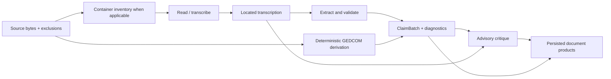

# Ingestion pipeline (`yizkr.pipeline`)

The pipeline turns supplied sources into inspectable readings, attributed claim proposals and graph evidence. The [current contract](../../../docs/CONTRACT.md) governs evidence, privacy and human authority. Two supported workflows use the shared document stages: disposable whole-corpus rebuilds and reviewed additions of one plain-text source to an established graph.

## Supported workflows

| Workflow | Entry point | Review and destination |
| --- | --- | --- |
| Whole-corpus development | `yizkr scratch run` | Unattended, unratified proposals on an explicitly disposable instance; never writes face associations or authorizes retention. |
| One retained text source | `pipeline.text_ingestion.TextIngestion` | Explicit source registration, identity decisions and separate historical-claim approval; preserves established identities, evidence and curator work. |
| Individual operations | `yizkr ingest <step>` | Explicit adapters for preparing and inspecting products, review sheets and guarded writes. Each command retains its own preconditions. |

The [text-source guide](../../../docs/TEXT_INGESTION.md) documents the retained Python API, durable products and recovery. It supports one text source and bounded additions; a general multi-format retained workflow and curation interface remain separate work. CSV claim approval does not establish durable identity correspondence or make a map-bound writer an incremental writer.

## Whole-corpus execution

The [scratch runbook](../../../docs/runbooks/scratch-run.md) gives commands, prerequisites and recovery instructions. The [stage breakdown](../../../docs/SCRATCH_WORKFLOW.md) identifies each stage's inputs, outputs and process type. The driver owns scheduling, document publication and run resources; the stage APIs own document processing semantics.

```mermaid
flowchart LR
    sources["Admitted source files"] --> documents["Shared document stages"]
    documents --> products["Readings, batches and diagnostics"]
    products --> cluster["Corpus clustering"]
    cluster --> identity["Identity-map snapshot"]
    identity --> reset["Disposable reset / reuse guard"]
    reset --> register["Register sources and placements"]
    register --> write["Write attributed proposals"]
    write --> views["Place reconciliation and private views"]
```

Before any source processing, the driver checks the explicit exclusion policy and prepares container inventories. The first document of each kind acts as a canary. Remaining documents advance by stage, followed by a barrier before corpus-wide work. A failed document remains visible and does not silently become a successful empty batch. Cancellation stops active model work and worker pools before resources are released.

A scratch invocation keeps its declared settings. It may reuse valid products, resume unfinished work, or continue past a completed document barrier under the documented code-change rules. Changed source bytes or missing state/derivation records cause the affected directory to be set aside before fresh processing. Malformed or unreadable state instead fails the document and remains untouched for recovery. Original files remain available for inspection. Reset and write-side operations refuse a retained target.

Implementation: [scratch driver](scratch.py), [document state and discovery](document_state.py), [run resources](run_resources.py), [stage planning](stage_planning.py), [scratch writer](scratchwrite.py).

## Document preparation and products

| Product | Purpose |
| --- | --- |
| `state.json`, `derivations.json` | Source ownership, status, input hashes and declared processing dependencies. Publication is atomic; incomplete or unrelated records cannot establish freshness. |
| `container-inventory.json` | Original embedded sources, placements, exclusions, preparation limitations and reading outcomes for PDF/PPTX containers. |
| `transcription.json` | Source reading with locations, language and original process provenance. A curator correction can supply the reading. |
| `batch.json` | Located claims and an entity manifest from extraction or deterministic GEDCOM conversion. |
| Extraction diagnostics | Coverage, rejected or unreadable proposals and schema gaps, retained for inspection. |
| `critique.json` | Advisory findings grounded in the source reading and proposed claims; never supplies human approval. |
| `run.json`, `events.jsonl`, `alerts.jsonl` | Invocation configuration, stage outcomes, controls, attention and diagnostics. |

The retained text API uses its own atomic `products/text-products.json` checkpoint containing the same shared-stage results. Its [workspace and authority table](../../../docs/TEXT_INGESTION.md#preconditions-and-data-products) distinguishes checkpoints from durable decisions and graph receipts.

Text files are read deterministically; images and scanned material may use a model. PDF and PPTX readers preserve original embedded-image ownership and placement locators. Rendered/prepared images are representations of existing sources. Each admitted image source can produce its own extraction; compiler context does not become independent evidence. GEDCOM uses the deterministic adapter and emits explicit diagnostics for unsupported material.

Exclusions apply before reading or model admission, including embedded content. A missing or unreadable policy refuses processing; an explicitly empty policy is valid. Source preparation never uses graph facts as historical evidence. See the [ingestion contract](../../../docs/INGESTION_CONTRACT.md) and [container architecture](../../../docs/ARCHITECTURE.md#container-inventory).

## Reuse, resources and inspection

Persisted products and human decisions are independent of the model-response cache. Shared stage descriptors determine freshness from source inputs, generation settings and semantic code/resources. Recomputed identical content does not invent new evidence. Cached responses still pass current parsers and validation, and reused readings still pass applicable quality checks. `--refresh ROLE` and programmatic role epochs provide explicit resampling controls.

The execution owner lazily creates model clients and the response cache, propagates cancellation, drains workers and closes owned resources. Transcription import shares discovery and client configuration without constructing a document scheduler. The [cache guide](../../../docs/LLM_CACHE.md), [run manifest](../../../docs/RUN_MANIFEST.md) and [cancellation architecture](../../../docs/ARCHITECTURE.md#cancellation-and-execution-ownership) describe these boundaries.

Run products may contain private source material. Keep them in ignored `var/` or outside the repository. Use `yizkr scratch watch`, `report` and `diff` to inspect runs; detailed reports stay local. Host prerequisites and supported optional engines are documented in the scratch runbook and [testing guide](../../../docs/TESTING.md).

## Corpus clustering (`clustering.py`, the scratch run's identity map)

Corpus clustering proposes correspondence between source mentions and emits a reproducible identity-map snapshot. Labels and a map hash are not durable entity identities. Blocking, constraints and adjudication operate on recorded source-derived context; explicit graph matching records its projection separately.

The map writer checks complete mention coverage, verifies durable bindings and preserves its one-map-per-generation restriction. The [durable identity APIs](../../../docs/IDENTITY_REVIEW.md) provide reviewed assignments, recorded graph matching and protected additions. Identity decisions and historical-claim decisions remain distinct. Unsupported correction, merge and split refuse rather than guessing correspondence.

## Individual stage and review commands

`yizkr ingest --help` lists the supported adapters. `register`, `transcribe`, `extract`, `gedcom`, `reconcile`, `resolve`, `export-review`, `apply-review` and `write` are useful for explicit operations and inspection. The Python [shared stages](../../../docs/ARCHITECTURE.md#shared-document-stage-operations) serve callers that already own execution resources.

Claim review sheets identify rows by content-derived `claim_id`, so sorting cannot transfer decisions to another claim. Explicit per-row approval and supported corrections are checked against the supplied batch. Source locations are evidence to inspect, not editable authority. `apply-review` emits the approved or corrected subset for standalone writing. The writer retains registration, identity-map and retained-state guards. Durable retained applications use the shared review store and support receipts through the text-source API.

Every `depicts` association needs affirmative confirmation of that exact proposed association. General document/run approval cannot supply it. Face detection and matching produce proposals for review; enrollment and confirmed writes remain separate operations. Scratch runs exclude this workflow. See [face-region architecture](../../../docs/ARCHITECTURE.md#human-confirmed-face-links) and the [claim contract](../claims.py).

## Verification

Use [TESTING.md](../../../docs/TESTING.md) to select evidence by risk. Offline tests use fictional inputs and scripted model answers to check stage behavior, exclusions, freshness, cancellation and authority. The isolated fictional Wikibase/WDQS lane checks real registration, writes, queries and recovery. Scripted answers establish wiring and persistence, not model quality. Corpus evidence is required only where the remaining risk needs it.

Prompt templates are packaged Markdown resources under `prompts/`. Changing their exact text changes model inputs and cache keys. Preserve deliberate formatting and `str.format` placeholders when editing them.
