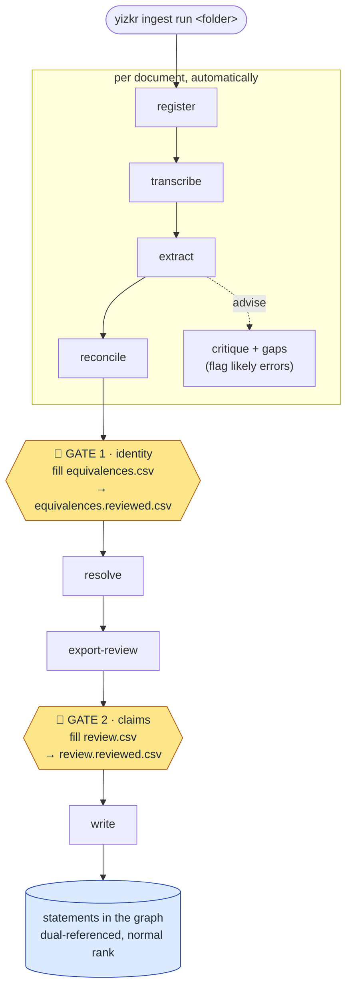

# Ingestion pipeline (`yizkr.pipeline`)

Takes an artifact from a digitised file to reviewed, source-referenced
statements in the graph (R3, ADR-0003). Every step reads and writes plain
files, so a run pauses for review, can be inspected, and resumes.

## The ingest loop: one command, two gates, repeat

`yizkr ingest run <folder>` is the whole workflow. It advances every
document in the folder as far as it can, then **stops at a human review
gate** and prints what to do. Fill in the gate's CSV, run the *same command
again*, and it picks up where it paused — repeat until every document
reports `written`.



The two amber hexagons are the human gates — the run pauses there until you
save the reviewed CSV, then continues on the next `ingest run`.

**The two gates**

- **Gate 1 — identity** (`awaiting equivalences review`): *is each person or
  place in this document the same as one already in the graph?* Fill the
  `decision` column of `<doc>/equivalences.csv` and save it as
  `equivalences.reviewed.csv`. A document with nothing to match skips this
  gate.
- **Gate 2 — claims** (`awaiting claim review`): *are these extracted facts
  correct, and who is a living person?* Fill `<doc>/review.csv` and save as
  `review.reviewed.csv`.

**What keeps it safe.** A gate opens only when its `*.reviewed.csv` exists
*and* is newer than the CSV it reviews — edit the source CSV and the gate
re-arms. No reviewed file, nothing writes; identity is never auto-confirmed
and no claim reaches the graph without an explicit `approve` (R3, ADR-0007).

**Reading a run.** Each document prints a status — `awaiting equivalences
review` (Gate 1), `awaiting claim review` (Gate 2), `written` (done), or
`failed` (errored; just re-run to retry). The exit code summarises the
batch: `0` all written, `2` something awaits you, `1` something failed.
Re-running is always safe: finished work is skipped, and a corrected
upstream file re-does only what depends on it (make-style freshness).

State for each document lives in `var/runs/<folder>/<doc>/` — every stage's
output is a plain file you can open, correct, or delete to force a redo.
GEDCOM (`.ged`) files take a deterministic adapter in place of
transcribe/extract; the gates, resolve, and write are identical.

```sh
uv sync --dev            # from the repo root
uv run yizkr ingest --help
```

Connection settings come from `deploy/.env` (same variables as the
smoke test); the vocabulary comes from `model/manifest.yaml` resolved
against the live instance (run `model/bootstrap.py` first).

## The stages, individually

The stages below are what `ingest run` orchestrates for you. Each is also a
standalone `yizkr ingest <step>` command (see `--help`) for debugging or
re-running one step in isolation — but for a normal ingest you only ever run
`ingest run` and fill the two gates above.

- **register** — uploads media (idempotent by content), ensures the
  artifact item (`instance of`, `media file`) and optional page
  fragments (`part of` + page qualifier). Statement provenance:
  `stated in → the artifact itself` (see docs/MODELING.md, "Artifacts
  and registration"). Runs before extraction so claims can cite QIDs.
- **transcribe** — engines: `llm` (LLM-vision, ADR-0004), `textfile`
  (wrap an existing/manual transcription; keeps the pipeline fully
  local), `htr` (Transkribus-style platform adapter, stub for now).
- **extract** — engines: `llm` (prompts with the claim JSON Schema and
  the uncertainty rules; output is schema- and manifest-validated
  before it goes anywhere) or `file` (prepared claims JSON through the
  same validation).
- **reconcile** — blocks the document's entities against a roster of the
  whole graph (shared kind + name token, minus pairs a graph fact proves
  cannot match, ADR-0017), then an LLM adjudicates each candidate as
  same / uncertain / distinct. The proposals are **Gate 1**
  (`equivalences.csv`); only your `approve` rows take effect, because a
  wrong merge corrupts every downstream attribution (identity is never
  auto-confirmed, ADR-0007). A document with no proposals skips the gate.
- **resolve** — applies the approved equivalences, then replaces remaining
  `local` refs whose label exactly matches an existing item; anything
  fuzzier is left for the reviewer, who sees `NEW:<local_id>` vs a QID in
  the claim CSV.
- **export-review / apply-review** — one CSV row per claim for
  OpenRefine or any spreadsheet (R4). Rows are matched back by
  `claim_id`, a content hash: sorting or filtering the sheet cannot
  mis-apply decisions, and edited claim content is detected loudly.
  **Only explicit `approve` decisions pass** — no decision means no
  write; human confirmation is part of the data flow (R3).
- **write** — mints the extraction-run item, creates items for
  unresolved subjects (reusing exact-label matches), writes each claim
  at normal rank with two references: `stated in → artifact/fragment`
  (with page/region/excerpt locator qualifiers) and `inferred from
  extraction run → run item`. Re-runs skip existing statements.

## Resolving entities across artifacts

Reconcile (Gate 1) matches a document's entities against **everything
already in the graph**, so it resolves the new document against artifacts
from *earlier* runs. What it does **not** see, by default, are the other
documents in the *same* folder run: the loop takes every document to Gate 1
in one pass, before any is written, so siblings are invisible to each other
and two artifacts naming one person land as two items. Two mechanisms close
that gap:

- **`yizkr reconcile-graph`** — a separate, curator-run pass that proposes
  duplicate *pairs among items already in the graph* (across every artifact
  and prior run). You review the proposals like an equivalences CSV;
  approved pairs are executed by you — a wiki item merge, or a referenced
  `said to be the same as` statement (identity of two existing items is a
  contestable judgement, ADR-0007). This is how "the Donald from the census"
  and "the Donald from the letter" become one item under the default flow:
  run it **after** a folder ingest to consolidate cross-artifact duplicates.

- **`yizkr ingest run --serial`** (ADR-0019) — processes artifacts one at a
  time, most-connective first (a greedy overlap of their entity names, so a
  family tree or GEDCOM leads), each **fully written before the next
  reconciles**. A later artifact's "Donald" then matches the earlier,
  already-rich "Donald Bennett Hirsch" at its *own* Gate 1 — resolved once,
  in context, with no duplicate to merge later. This removes the routine
  need for `reconcile-graph`; keep that command for occasional cleanup
  (pre-existing dups, cross-run dups, and within-artifact dups the
  extraction manifest missed — serial is a *cross*-artifact fix).

  ```mermaid
  flowchart LR
      x["extract EVERY<br/>artifact"] --> s["sequence<br/>(hubs first)"]
      s --> a1["artifact 1<br/>· 2 gates · write"]
      a1 --> a2["artifact 2<br/>· 2 gates · write"]
      a2 --> a3["artifact 3 …<br/>each sees the prior"]
  ```

  The trade is rhythm, not decisions: because each artifact must be written
  before the next reconciles, a serial run advances **one artifact per pass**
  — clear its two gates, re-run, next artifact. That is more re-invocations
  than the default's ~3, but **fewer review decisions** (no cross-artifact
  duplicate is ever reviewed twice). **Advancing the process = re-running
  `ingest run`** after you save a reviewed CSV; a future frontend (or a
  `--watch` mode) will drive those re-runs for you.

## Face proposals (`ingest/faces.py`, ADR-0005)

A face proposal is an ordinary claim — `depicts` on the photograph,
person as value, `relative position within image` qualifier, the
photograph as its own source — so proposals ride the same review flow
above, and only human-confirmed identifications reach the graph, with
dual provenance (photograph + region; detection run).

The curator loop ("initial manual inputs", R5):

```sh
yizkr ingest detect-faces --file photo.jpg --artifact Q29 \
    --gallery gallery.json --detections det.json --out faces-batch.json
yizkr ingest enroll-face --detections det.json --face 0 \
    --label "A. Person" --qid Q26 --gallery gallery.json
yizkr ingest match-faces --detections det.json \
    --gallery gallery.json --out faces-batch.json
# then: export-review -> decide -> apply-review -> write
```

Unmatched faces produce no claim (an unidentified face has no person
to depict); they wait in the detections file for enrolment. Detection
uses an InsightFace-class model running **locally** — installing the
optional dependencies (`uv sync --extra faces`) never sends images
anywhere. If the model-pack auto-download is blocked in your network,
fetch `buffalo_l` manually into `~/.insightface/models/buffalo_l/`.

## The claim contract (`yizkr/claims.py`)

Every step exchanges `ClaimBatch` JSON. The non-negotiable rules are
structural in the schema:

- `source` (artifact + fragment locators) is a **required** field —
  a referenceless claim cannot be represented (ADR-0003).
- Batches carry `extraction_run` metadata for the second, process
  reference (ADR-0003).
- There is **no rank field** — pipeline writes are always normal rank;
  preferring is a curator act on the wiki (ADR-0002).
- Time values carry explicit precision and calendar; ranges and
  "circa" are qualifiers, and inconsistent precision is rejected
  rather than silently narrowed or padded (docs/MODELING.md).

Properties and vocabulary items are referenced by **manifest key**
(`spouse`, `circa` — see `model/manifest.yaml`), never by local P/Q id:
ids are per-instance and only the writer resolves them, at write time.

```sh
uv run yizkr claims --json-schema           # JSON Schema, used in LLM prompts
uv run yizkr claims --validate batch.json   # schema + manifest check a file
```

## Privacy

No step talks to any external service by default; the whole pipeline
runs with `textfile` + `file` engines. Choosing `--engine llm` sends
artifact content — which may describe living people — to the
configured provider. There is no default credential and no fallback;
each provider has its own explicit opt-in (below).

## LLM providers (`--llm`)

Two Anthropic-backed providers, differing in how usage is billed:

- **`anthropic`** — the Anthropic API via the `anthropic` package
  (`uv sync --extra llm`). Token-based billing; setting
  `ANTHROPIC_API_KEY` is the opt-in.
- **`claude-code`** — the Claude Code CLI in headless mode
  (`claude -p`), using the CLI's own login, so a Claude Pro/Max
  **subscription** covers usage instead of per-token billing. Install
  the CLI and log in once; being logged in is the opt-in. The engine
  strips `ANTHROPIC_API_KEY` from the child process (a stray key would
  silently switch back to token billing — use `anthropic` if you want
  that), restricts the CLI to the Read tool only (images are read from
  disk for vision; nothing can be executed or written), and runs in a
  neutral directory so no project CLAUDE.md leaks into prompts. Note
  subscriptions have rolling usage windows rather than API rate
  limits — fine for evening-sized ingestion runs, less suited to bulk
  backlogs.

Pick the model for either provider with `$YIZKR_LLM_MODEL`.

## Tests

`make test` runs the offline suite (fakes for LLM and detector, no
instance needed). `make test-live` runs the encoded end-to-end flows
against the running stack — including the overwrite regression that two
values on one property must coexist.
