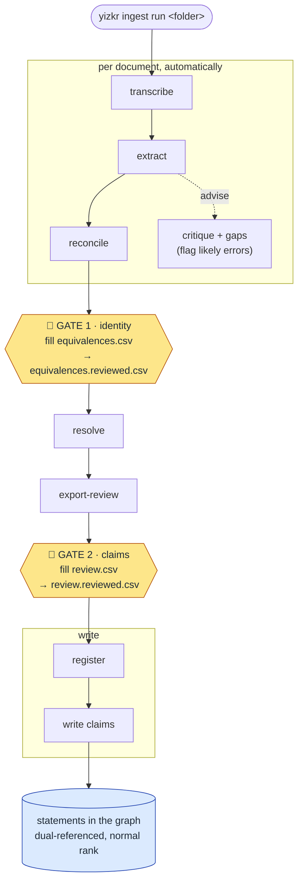

# Ingestion pipeline (`yizkr.pipeline`)

Takes an artifact from a digitised file to reviewed, source-referenced
statements in the graph (R3, ADR-0003). Every step reads and writes plain
files, so a run pauses for review, can be inspected, and resumes.

Whole-corpus scratch runs (`yizkr scratch run`, ADR-0025) have a runbook
of their own, [docs/runbooks/scratch-run.md](../../../docs/runbooks/scratch-run.md),
and a live monitor, [docs/MONITOR.md](../../../docs/MONITOR.md).

## The ingest loop: one command, two gates, repeat

`yizkr ingest run <folder>` is the whole workflow. It advances every
document in the folder as far as it can, then **stops at a human review
gate** and prints what to do. Fill in the gate's CSV, run the *same command
again*, and it picks up where it paused — repeat until every document
reports `written`.



The two amber hexagons are the human gates — the run pauses there until you
save the reviewed CSV, then continues on the next `ingest run`. Nothing
before the write reads or writes the wiki: registration is the write's
first step, just before the claims that cite the document (ADR-0025 §2;
**register** below), and resolve matches nothing by label (#109).

**The two gates**

- **Gate 1 — identity** (`awaiting equivalences review`): *is each person or
  place in this document the same as one already in the graph?* Fill the
  `decision` column of `<doc>/equivalences.csv` and save it as
  `equivalences.reviewed.csv`. A document with nothing to match skips this
  gate, and in `ingest run` no document has anything to match: its
  reconcile step reads no roster from the graph (see **reconcile** below).
  An `equivalences.csv` with rows from an earlier run is still reviewed
  here.
- **Gate 2 — claims** (`awaiting claim review`): *are these extracted facts
  correct?* Fill `<doc>/review.csv` and save as `review.reviewed.csv`. Each
  row shows the claim's locators: `page` (the physical page),
  `printed_page` (the number printed on that page, from the transcription
  record, empty where there is none; ADR-0037), `region` and `excerpt`.
  They are for checking only: an edit to them is ignored, never written.
  The `critique_notes` column surfaces the extraction critic's concerns
  (ADR-0013), each on exactly one row, tagged with its axis and category
  (ADR-0023 §3). There is no living-status decision: privacy is a runtime
  determination, never curation (ADR-0020).

**What keeps it safe.** A gate opens only when its `*.reviewed.csv` exists
*and* reviews the CSV as it is now: a reviewed file is bound, by content
hash, to the CSV it was first seen with, so editing the source CSV re-arms
the gate. A batch whose content changed moves both reviewed files aside as
`*.reviewed.superseded-<n>.csv` (kept, never deleted), and so does a
re-exported CSV whose rows changed, so decisions about the old rows cannot
open gates for the new ones. No reviewed file, nothing writes; identity is
never auto-confirmed and no claim reaches the graph without an explicit
`approve` (R3, ADR-0007).

**Reading a run.** Each document prints a status — `awaiting equivalences
review` (Gate 1), `awaiting claim review` (Gate 2), `written` (done),
`paused` (the run's control file held one of its stages), or `failed`
(errored; re-run to retry, unless the model's answers caused it: see
below). The exit code summarises the batch: `0` all written, `2`
something awaits you, `1` something failed. The codes are the ones every
`yizkr` command exits with (`yizkr --help`, `yizkr.core.exits`): `2`
also when the run stopped short for a pause of the engine or its cache
(`PassPaused`: a claude CLI other than the pinned version, a usage
limit, a cache another process holds, and the like), `3` when a command
refuses before doing what it was asked (a usage error, an input it will
not act on, a missing never-ingest list; the scratch commands give such
a refusal `1`), and `130` on Ctrl-C. A pause
or a refusal prints its message alone, with no traceback; only an error
no command anticipates prints one, and exits `1`. Re-running is always safe:
finished work is skipped, and a corrected upstream file re-does only what
depends on it (make-style, by content hash; modification times are never
read).

A transcription that fails the transcription check (below), such as a
tool-failure message, or an answer that is not the transcription record
(a refusal in place of the page's text, say), fails its
document the same way: the reason is recorded as the `error` in the
document's `state.json` and in the run's events, and no transcription is
kept. The check runs on every vision and text-file transcription a run
makes, whether its answer comes from the engine or from the LLM cache,
and again on every one it reuses (below), so a stricter check applies to
every transcription, the stored ones included. A stored transcription
it now fails is moved aside as `transcription.superseded-<n>.json`, with
a `set-aside` event, and made again in the same run. An answer the cache
kept that fails it is rejected in the cache and asked for once more in
the same run, as the engine would have been asked without the cache; an
answer of the engine's that fails it fails the document, and the next
run asks again. Slide text from a deck and a curator's correction are
not checked.

An extraction that ends with no claims because the model's answers could
not be used fails its document too (ADR-0006 §5): a chunk failed, the
chunks' answers held JSON objects with content the parser cannot read
as claims (claims wrapped in one object or carried in the sentinel, say,
or written with other keys; an object that holds nothing at any depth,
such as `{}` or `{"claims": [{}]}`, counts for nothing), or validation
rejected every claim. The `error` leads with that outcome and names
every cause, then any fallback tier taken, with each attempt's reason. A
chunk that failed because its engine call failed, or its answer was cut
off, is asked again on the next run. A failure the model's answers
caused is not cured by re-running: the LLM cache replays the same
answers, at no engine cost, and they fail the same way (so a parser fix
does reach them). To ask the model again, run with `--epoch extract=N`
(a new epoch), which re-asks only the documents without a current batch,
such as a failed one, or with `--refresh extract`, which extracts every
document again. An extraction whose accepted answers say the document
holds no claims, on either tier, is no failure: its batch is kept, and
its `extraction` stage needs attention, with the reason. An entity
manifest that names no entity (an empty list) is such an answer, taken at
once: no second attempt, no segmentation and no fallback tier, and the
reason reads "the entity manifest names no entity".

State for each document lives in `var/runs/<folder>/<doc>/`: its views
(`transcription.json`, `batch.json`, `critique.json`, and the extractor's
coverage, rejects and gaps under `extraction/`) and the files the later
steps derive from them. A view persists and is reused while the inputs it
was made from are unchanged (the transcription is made from the source,
or a curator's correction; the batch from the transcription's content;
the critique from the batch's), so a re-run asks the engine nothing for a
document that has not changed, with or without a cache. A change to a
prompt, a model or the code does not make a view stale by itself (the
transcription check aside, above): `--refresh ROLE` makes a role's views
again, in place, and a scratch run starts from fresh state directories.
The model calls a view is made with go through the LLM cache
(`var/llm-cache`, `--cache`; ADR-0032): a call made before with the same
key (built from what the call sends: its prompt
text, the files it reads, and the engine, model, effort and configuration)
is answered from the cache, while parsing, merging and the transcription
check run whenever the view is made. So a fix to them costs no model call,
and a change to a prompt, a model or anything else a call sends asks the
engine again for exactly the calls it changes. `--epoch ROLE=N` samples a
role afresh under new keys (with `--refresh`, for views that stand), and
`--no-cache` runs without the cache: views are reused all the same, and a
view made again calls the engine for everything. To correct a
transcription, save the corrected text as `transcription.corrected.txt`
there. `var/runs/<folder>/` is also the run directory, with an event for
every stage started, done, reused or failed and every answer the cache
gives or cannot give; `yizkr stages state var/runs/<folder>` sums them up.
Every document directory the run makes has a `derivations.json` from its
first run. A directory without one (from before the records, or one that
lost its record), one whose views have lost their `state.json`, and one
whose document's source bytes changed (a different artifact, ADR-0010),
is moved aside whole as `.<doc>.superseded-<n>`, with nothing in it
deleted, and the document is ingested afresh in a new one. See
[docs/LLM_CACHE.md](../../../docs/LLM_CACHE.md) for the views, keys,
rejection, forks, the switches, the run directory and these set-aside
directories. Anomaly checks watch every run's stage outputs and raise
alerts in its run directory, and a fail-fast one pauses a slice through
its control file; their thresholds are in `anomalies.yaml` here, and
`$YIZKR_ANOMALIES` names a file of an operator's own over them
([docs/ANOMALIES.md](../../../docs/ANOMALIES.md)).
GEDCOM (`.ged`) files take a deterministic adapter in place of
transcribe/extract; the gates, resolve, and write are identical. The
adapter fills each person's and place's mention record from the export's
tags (ADR-0035 §6) and makes each family with two partners a marriage or
a partnership bounded by its weddings, divorce and annulment (ADR-0036
§5); it reports the tags it does not map, and counts the outcomes worth
reporting (unions and events by kind, name parts kept unsplit or
counted, an undetermined language) in the document's state and log.

```sh
uv sync --dev            # from the repo root
uv run yizkr ingest --help
```

Connection settings come from `deploy/.env` (same variables as the
smoke test); the vocabulary comes from `src/yizkr/model/manifest.yaml`
resolved against the live instance (run `yizkr bootstrap` first).

## Ingestion host prerequisites

The machine that runs `ingest run` needs, besides the stack in `deploy/`:

- **Python 3.11+ and uv.** `uv sync --dev` from the repo root installs
  the package.
- **An LLM engine** for vision transcription and extraction: the Claude
  Code CLI, logged in (`claude-code`), or `uv sync --extra llm` with
  `ANTHROPIC_API_KEY` set (`anthropic`). See
  [LLM providers](#llm-providers---llm).
- **The PDF renderer, from poppler-utils.** Vision transcription of a PDF
  renders its pages with `pdftoppm`, and the transcription check counts
  them with `pdfinfo`. Install it with
  `sudo apt-get install poppler-utils` (Debian/Ubuntu) or
  `brew install poppler` (macOS), and check it with `pdftoppm -v`.
  Without it, `ingest run` refuses to start when the folder holds a
  PDF, with that instruction, before any document is touched: it checks
  once per run, since a PDF needs the renderer even when its
  transcription comes from the LLM cache, and `pdfinfo` even when its
  transcription is a view the run reuses and checks again. Images need
  no renderer, and neither does a PDF read page by page (below), which
  gives the engine images, but whether a PDF is read whole is known only
  once its pages are read, so the check covers every PDF.
- **Nothing to install for PDF text layers.** A PDF's pages are read with
  pypdfium2 (Apache-2.0 or BSD-3-Clause), a dependency in
  `pyproject.toml` whose wheels bundle PDFium, Chromium's PDF engine
  (BSD-3-Clause): offline, in the pipeline's own process.

## The corpus and the never-ingest list

The corpus lives outside the repository, in the private folder named by
`$YIZKR_CORPUS_DIR`, the default folder for `ingest run`.
`$YIZKR_EXCLUDE_FILE` names the never-ingest list. Both are set in
`deploy/.env` or the environment; the setup and the list's format are in
[deploy/README.md](../../../deploy/README.md#the-corpus-and-the-never-ingest-list).

- **Fail closed.** `ingest run`, like any later production or extract-all
  mode, refuses to start without a list; an empty file is an explicit,
  allowed list. A configured list that is missing or unreadable, or that
  holds a line which would silently match nothing, is an error.
- **One shared check.** Every entry point that reads source documents asks
  `yizkr.core.corpus.is_excluded()` before it uses a document's content.
  `ingest run` drops a listed document at discovery, so it gets no
  artifact, no transcription and no state. The single-file steps
  (`register`, `transcribe`, `extract`, `gedcom`, `detect-faces`) run
  without a list, but refuse a listed file once one is configured. For
  `extract`, that is the media its transcription names: by its SHA-1,
  and by name and hash through `--media`, the media file, which must be
  the one the transcription names. A transcription keeps no file name,
  so with a list that names files by pattern, `extract` refuses to run
  without `--media`. The registrar asks `is_excluded()` too, as the
  write begins: a listed file is refused before anything of the wiki
  is asked, so it is never registered or uploaded, and an embedded
  medium the list names is left out. New entry points must call it
  too: transcription import (#104), the run driver (#118) and faces
  (#160).

## The stages, individually

The stages below are what `ingest run` orchestrates for you. Each is also a
standalone `yizkr ingest <step>` command (see `--help`) for debugging or
re-running one step in isolation — but for a normal ingest you only ever run
`ingest run` and fill the two gates above.

- **derived media** (decks) — records the images a deck embeds in the
  deck's state directory, not on the wiki: `derived-media.json` keys each
  distinct image by the SHA-1 of its bytes (ADR-0010), with its names in
  the deck, the slides it is on, and the deck's own SHA-1 and title, and
  `derived-media/` keeps its bytes, in a file named for that SHA-1. The
  record stands while it is there whole, made for the deck's bytes as
  they are now, and each image's file is a regular file (not a symlink)
  named for the image's SHA-1 and holding those bytes; otherwise it is
  made again, and only the files that are not what they should be are
  written. The write registers the images and uploads their bytes
  (ADR-0008), as its first step (**register**, below). Media other than
  images are counted and reported, not recorded. A PDF read page by
  page (below) records the images placed within its pages in the same
  record, by its transcription stage, each named for its places ("page
  6, image 1") with the pages it is on; the write registers them after
  the PDF, each `part of` it once per page (ADR-0008).
- **excerpts** — each image a PDF places within a text-layer page, or a
  deck embeds on a slide, with a reading of its own that passes the
  check, is a document of its own (kind `excerpt`, `ExcerptRun`), in
  `excerpts/<sha1>/` of the state directory: its transcription is that
  reading, taken without a call, and its extraction and critique cite
  the image. The same image in several PDFs and decks is one excerpt;
  one whose bytes a document of the corpus has, or that the never-ingest
  list names, is none. `ingest run` takes excerpts after the folder's
  documents; the scratch driver as their container's transcription ends,
  the first as the excerpts' canary. An excerpt's write registers each
  container that places it, with its images.
- **paged containers** — a PDF (kind `pdf`) and a deck (kind
  `presentation`) take the `paged` route (`yizkr.pipeline.containers`,
  ADR-0008 as amended by #502): a reader per format gives the pages,
  each with its own text where the file holds it and the images placed
  on it, and one transcriber (`transcribe.PagedTranscriber`) makes the
  transcription and reads each image on its own. A deck's slides are
  read from their XML (method `slide-xml`), behind `[Slide N]` markers,
  each image read on its own marked below its slide's marker
  (`[Slide 2, image 1: sha1:…]`); an image in a format the vision engine
  does not read (a TIFF) is noted, not read.
- **transcribe** — engines: `llm` (LLM-vision, ADR-0004), `textfile`
  (wrap an existing/manual transcription; keeps the pipeline fully
  local), `htr` (a Transkribus-style platform adapter, dropped as LLM
  vision is sufficient for handwriting: a stub that raises; #171). In
  `ingest run` and `scratch run`, a PDF with a page whose text layer is
  usable is read **page by page** (#176, `yizkr.pipeline.textlayer`):
  such a page from its text layer, deterministically, without a model
  call (the method `pdf-text-layer`, version 1); a page that shows text
  in an annotation, hides text under something painted after it, an
  annotation included (a redaction box, say, since hidden text is never
  read from the text layer, within the limits ADR-0008 lists), is a scan
  (images cover most of it and its visible text lies over them, an OCR
  layer being drawn invisibly), or whose text layer is empty, garbage or
  garbled, by a vision call of its own; a page with nothing to read by
  nothing; and each image placed within a text-layer page by a vision
  call of its own, as a witness of its own (#178, ADR-0008), unless it is
  too small to hold text or the never-ingest list names its SHA-1. The
  PDF's transcription holds its own text, page by page behind `[Page N]`
  markers, with each image marked where it sits by its SHA-1, never what
  was read from it; its `pages` record each page's method apart from its
  content, and each image's transcription is kept beside the image in
  `derived-media/`. A PDF with no such page, a scan, is read whole, by
  one call that gives the engine the PDF itself, so the LLM cache and the
  transcription seed answer it under the key they hold its answer under.
  PDFium is started afresh for each PDF and draws fonts a PDF does not
  embed with its own, never the host's, so a page reads and renders alike
  on every host and in every run. The standalone `ingest transcribe
  --engine llm` reads a PDF whole.
- **transcription record** — the vision engine answers the transcription
  prompt with a record (ADR-0037,
  `yizkr.pipeline.transcription_record`): the document's class, from the
  manifest's artifact classes or `unclassified`, and per page the page
  number printed on it, a status (`transcribed`, `blank`, `illegible`,
  `not-a-document-page`), its text with the editorial marks
  (`[illegible]`, `[?]`, `[redacted]` where text is blacked out or
  covered; a table, list in columns or form grid written one line per
  row, its cells separated by ` | ` and its empty cells kept), the
  languages it is written in, and notes. The transcription view keeps the record's fields on its `pages` (the page's physical
  index stays `page`, and the printed number is `printed_page`) and the
  class as `document_class`; its text opens each page with a `[Page N]`
  marker. The document's language hint is the language that holds most
  of the record's text. `Transcription.printed_pages()` gives the printed
  page numbers by physical index. A PDF read page by page fills the same
  fields for each page: a vision page from its reading's record, a
  text-layer page as transcribed, and a page with nothing to read as
  blank.
- **transcription check** — runs on the output of the `llm` and
  `textfile` engines (in `ingest run`, the vision and text-file methods)
  before anything uses it, in `ingest run` and `ingest transcribe`
  alike; a deck's slide text, a PDF's text layer and a curator's
  correction are not checked, a deck's images' readings are. It is
  `yizkr.pipeline.transcription_check`, a step with its own version,
  apart from the transcription's. It runs on every transcription a run
  makes, from the engine or the LLM cache, and on every transcription
  view a run reuses, so a changed check applies to every transcription
  without asking the engine again for one it passes. A stored view it
  now fails is moved aside and made again, and a cached answer it fails
  is rejected in the cache and asked for once more (docs/LLM_CACHE.md).
  It reads the record, not the wording, and fails the document only on an
  unambiguous signal: a tool error the engine's stream reports, an
  answer the engine stopped at its output limit, an answer that is not
  the record (a page without a status among the ways; a refusal in any
  language), a record with fewer pages than the media (or, for a PDF
  read whole, more), a blank output, fewer than 3 letters or digits per
  page the record calls transcribed in a document of two or more pages,
  and, in a text with no record only, a tool token no source writes (the
  PDF renderer missing, a traceback, an API error) or an output that is
  wholly the engine's announcement ("Let me read the image."). Inside a
  record every signature only flags, and the flag tier reads each page's
  notes too (ADR-0037 §3). A record's near-miss shapes (a printed page
  number given as a number, null text, a code in capitals) are
  normalised, not refused. Editorial marks don't count, and a single
  image has no floor, since a photograph may carry no text at all. The engine's phrases in English ("I couldn't
  open the PDF", "I can't transcribe this", "unable to comply with your
  request") only flag the output, since a printed email or letter could
  hold them too: the transcription goes on, carries the flag (`flag`) and
  raises a `transcription-flag` alert (docs/ANOMALIES.md). Such a phrase
  counts only in the engine's own voice: opening the output, a page
  section (after a "Page 2" or "[Page 2]" heading) or a line labelled
  "Note:", "NB:", "Error:" or "Warning:", or naming the page it skipped,
  and not about the correspondents' own attachment, writing or request
  ("the attachment you sent", "the old handwriting on the back of the
  photograph", "your request for copies of the register"). The reason of
  a failure is recorded and the failed output is never passed on. A PDF
  read page by page is checked where the vision engine read it, each
  page and each image apart, as a single image: a page that fails fails
  the document, while an image that fails is left without a
  transcription of its own, which the stage's attention reports. Text
  read from a text layer is the document's own and is never checked.
- **extract** — engines: `llm` (prompts with the claim JSON Schema and
  the uncertainty rules; output is schema- and manifest-validated
  before it goes anywhere) or `file` (prepared claims JSON through the
  same validation). The `llm` engine sets every claim's source artifact
  itself, to the key its transcription names, whatever the model wrote
  there: the SHA-1 of the media transcribed (`ingest transcribe
  --file`, with the `textfile` engine too, never the text file; in
  `ingest run`, the source file's bytes). The prompts name the artifact
  by that key, never by QID, and ask each claim to cite it, so neither
  a transcription nor a prompt changes with the instance or a reset.
  Where the transcription record gives a page's printed number, the
  prompts show it beside the page's `[Page N]` marker, and the extractor
  sets a claim's `printed_page_number` from the record for the one
  physical page its `page_number` names, never from the model
  (ADR-0037 §2). A prepared file's claims cite their artifacts
  themselves. The GEDCOM
  adapter (`ingest gedcom`) cites the export's own bytes.
- **reconcile** — in `ingest run`, proposes nothing. A proposal matches
  one of the document's entities to an entity of a roster, and a stage
  before the write reads nothing from the wiki (ADR-0025 §2), so no roster
  of the graph, nor its place containment, reaches the step. It writes an
  `equivalences.csv` with no rows, and **Gate 1** has nothing to review.
  Matching against a kept graph's roster comes back as an explicit, keyed
  input (#130); across a scratch run's corpus, identity is corpus
  clustering's (#105). The standalone `yizkr ingest reconcile` step still
  reads the graph: it blocks a batch's entities against a roster of the
  whole graph (shared kind + a whole name form, read through the mention
  record: ADR-0007 as amended by #388), then an LLM adjudicates each
  candidate as same / uncertain / distinct. Both sides' dates reach the
  adjudicator at the precision their sources state, as the site shows
  them ("the 19th century", "the 1830s", never a first year): the
  batch's from its claims, the roster's from each date statement's value
  node and its precision (rule 5). It passes the blocking
  neither the batch's claims nor the place containment, so the
  impossibility filter (ADR-0017) prunes next to nothing there. Only your
  `approve` rows of its CSV take effect, because a wrong merge corrupts
  every downstream attribution (identity is never auto-confirmed,
  ADR-0007).
- **resolve** — applies the approved equivalences; every other `local`
  ref stays local, for the write to find its item through the identity
  map (#109), so the claim CSV shows it as `NEW:<local_id>`.
- **export-review / apply-review** — one CSV row per claim for
  OpenRefine or any spreadsheet (R4). Rows are matched back by
  `claim_id`, a content hash: sorting or filtering the sheet cannot
  mis-apply decisions, and edited claim content is detected loudly.
  The sheet shows a date as the site does, at the precision its source
  states: a century as "the 19th century", a decade as "the 1890s",
  never as its first year (a correction is still typed as `YYYY`,
  `YYYY-MM` or `YYYY-MM-DD`).
  **Only explicit approvals pass** — a per-row `approve`, or the
  `bulk-accept` that accept-all writes — and no decision means no write;
  human confirmation is part of the data flow (R3). apply-review refuses
  the whole sheet, writing nothing, when it has `bulk-accept` on any
  claim whose property in the batch is `depicts`, whatever the sheet's
  cells say (only a per-row human decision confirms a depicts claim,
  ADR-0005), when it carries an equivalences sheet's `entity_id` or
  `verdict` column (its approvals may be ratified machine verdicts), or
  when it has no column named exactly `claim_id`, before reading any row
  (a column like it, by accept-all's comparison, is refused in
  accept-all's words). `ingest apply-review` prints each refusal as one
  line, exits 1 and writes no `--out`.
- **accept-all** — writes a `*.reviewed.csv` from a gate CSV with the
  `decision` column pre-filled, so a curator can flip the few outliers
  instead of typing a decision on every row. It writes `<input-stem>`
  `.reviewed.csv` beside the input (so `equivalences.csv` →
  `equivalences.reviewed.csv`, `review.csv` → `review.reviewed.csv`) and
  detects the gate by the CSV's columns:
  - **claims** (`review.csv`): every row → `bulk-accept`, an approval
    that also records the whole-sheet disposition (ADR-0023). When
    `ingest run` writes a sheet with no decision other than
    `bulk-accept`, each new statement it writes gets the distinct
    low-scrutiny edit summary `ingest: write bulk-accepted claim`, so it
    can be found for reappraisal. Any other decision on the sheet, such
    as a `reject` on one flipped outlier, makes the whole sheet an
    ordinary review (`ingest: write reviewed claim`), and `ingest write`
    always writes that summary. Only a per-row human decision confirms a
    `depicts` claim (ADR-0005): accept-all refuses the whole sheet,
    writing nothing, if any row's `property` is `depicts`, or if it
    lacks the exactly named `claim_id` column or exactly one `property`
    column, so its depicts rows cannot be found.
  - **equivalences** (`equivalences.csv`): each row is set from its
    machine `verdict` — *ratify the verdict*, not a blanket approve:
    `same → approve`, `distinct → reject`, `uncertain → blank` (left for
    the human). An entity the machine calls `same` against two items is a
    contradiction it can't ratify, so those rows are left blank and
    reported. Distinct-judged pairs are therefore never silently merged.

  It is a deliberate human bulk-accept — each decision is written
  explicitly, per row, and the machine never runs it on its own — not
  auto-confirmation. Refuses to overwrite an existing reviewed file
  without `--force`.
- **register** — the write's first step (ADR-0025 §2): `ingest run`
  registers a document just before it writes the claims that cite it, and
  a re-run of the write registers again, finding by SHA-1 what the earlier
  write registered. Registration uploads media (idempotent by content; a
  wiki file is never overwritten or stored twice, ADR-0010) under a name
  in the form MediaWiki takes as it is (every letter kept, `-` for each
  character it refuses, cut to fit its 240-byte limit with room for a
  content tag; ADR-0010 as amended by #373), ensures the artifact item
  (`instance of`, `media file`, `media SHA-1`; its description cut to the
  250 characters Wikibase takes) and optional page fragments (`part of` +
  page qualifier). Statement provenance: `stated in → the artifact itself`
  (see docs/MODELING.md, "Artifacts and registration"). Claims cite an
  artifact by the SHA-1 of its media, never by QID, and the write resolves
  that key through the `media SHA-1` statement registration writes, so a
  batch written to another instance, or after a reset, finds its artifacts
  there once they are registered. An item whose bytes a file another item names holds, or whose
  title is the label of an item with no hash, is flagged, never adopted:
  each write raises it as a `shared-file` or `unhashed-title` alert while
  that holds (#371; docs/ANOMALIES.md).
- **write** — first checks that the run's identity map, made once an
  invocation over the run's documents and kept in
  `corpus/clustering/identity-map.json`, holds every mention of the
  approved batch (refusing the document, before anything is registered,
  when it does not); then, once registration (above) has found or made
  the document's items, resolves each cited artifact's media SHA-1 to its
  artifact item (refusing the whole batch, before any write, if some
  media has no item), mints the extraction-run item, and finds or makes
  the one item of each entity's cluster in the map, never by its label
  alone (docs/MODELING.md, "One item per cluster"; #109). An instance
  holds the writes of one map: a write with another map than its run
  items record is refused, before the document's artifact is registered,
  and the instance is reset first. The label an
  item takes follows its side: an artifact-kind entity such as a GEDCOM
  media object may take the label of an artifact or a part of one,
  never one registration made, an artifact with a hash or its page
  fragment, and any other entity the label of an item that is neither,
  nor of a vocabulary or run item. An entity that may not take its label
  takes its label tagged `[media object]`, or, whatever its kind, `[not
  an artifact]`, its name an alias; people and places are placed before
  media objects, so a person takes a label no item holds. Each artifact
  registered under the label of a media object that does not take it,
  content-tagged or not, is raised as an `unhashed-title` alert, and an
  entity that may take neither its label nor its tagged label, as a
  media object whose tagged label a registered item holds too, is
  refused, with its claims, before the first write (ADR-0010 as amended
  by #444 and #109). A claim whose item value, its own or a
  qualifier's, is its subject's item once the map, an approved
  equivalence or a curator's correction puts both on one item, as
  clustering may merge a father and a son of one name, is refused before
  the first write and counted apart (docs/MODELING.md; #491): the step's
  record names it in `refused` and again in `self_references`. It writes
  each claim
  at normal rank with two references: `stated in → artifact/fragment`
  (with page/region/excerpt locator qualifiers) and `inferred from
  extraction run → run item`, the run block holding a claim's judgement
  note, and the run block of an item's `instance of` its entity's note
  (ADR-0035 §4, #410). Re-runs skip existing statements: each block is
  compared whole, so a second claim of the run adds its run block only
  where its note differs. A claim of a retired property (`spouse`) or a
  reference property is refused before the first write, as validation
  refuses it (#410).

## Resolving entities across artifacts

In `ingest run`, reconcile matches a document's entities against nothing
(above), so no Gate 1 row ties an entity to an item already in the graph,
and **resolve** matches nothing by label: the write finds each entity's
item through the run's identity map (#109), the corpus clustering's map
of the run's documents (**Corpus clustering** below), so two documents
of the run naming one entity meet on its item when the map puts their
mentions in one cluster. The write reads the instance's labels once, with
the vocabulary known (a fresh
client reads them for the vocabulary as well). Two artifacts naming one
person the map keeps apart land as two items. A scratch run leaves
identity to corpus clustering too (#105), and #119 removes this
per-document path; until then, two mechanisms remain:

- **`yizkr reconcile-graph`** — a separate, curator-run pass that proposes
  duplicate *pairs among items already in the graph* (across every artifact
  and prior run). You review the proposals like an equivalences CSV;
  approved pairs are executed by you — a wiki item merge, or a referenced
  `said to be the same as` statement (identity of two existing items is a
  contestable judgement, ADR-0007). This is how "the Gustav from the birth
  register" and "the Gustav from the naturalisation" become one item under
  the default flow: run it **after** a folder ingest to consolidate
  cross-artifact duplicates.

- **`yizkr ingest run --serial`** (ADR-0019) — processes artifacts one at a
  time, most-connective first (a greedy overlap of their entity names, so a
  family tree or GEDCOM leads), each **fully written before the next
  reconciles**. A later artifact's "Gustav Löbig" meets the item an
  earlier artifact wrote when the identity map puts the two in one
  cluster, never by the label alone (#109). A variant name
  ("Gustl") is not matched at Gate 1, since reconcile reads no roster, so
  `reconcile-graph` stays the way to consolidate such pairs, as well as
  pre-existing dups, cross-run dups, and within-artifact dups the
  extraction manifest missed (serial is a *cross*-artifact fix).

  ```mermaid
  flowchart LR
      x["extract EVERY<br/>artifact"] --> s["sequence<br/>(hubs first)"]
      s --> a1["artifact 1<br/>· claim review · write"]
      a1 --> a2["artifact 2<br/>· claim review · write"]
      a2 --> a3["artifact 3 …<br/>each sees the prior"]
  ```

  The trade is rhythm: because each artifact must be written before the
  next reconciles, a serial run advances **one artifact per pass** — clear
  its claim review, re-run, next artifact: about one re-run per artifact,
  where the default takes every document to its claim review in one pass
  and writes them all in the next. In return each artifact resolves
  against what the earlier ones wrote. **Advancing the process =
  re-running `ingest run`** after you save a reviewed CSV; a future
  frontend (or a `--watch` mode) will drive those re-runs for you.

  Serial extracts every artifact up front (the sequencer needs all the
  manifests). That phase is parallelisable: `--extract-concurrency N`
  transcribes/extracts N artifacts at once. It multiplies with
  `--chunk-concurrency` (N × chunks concurrent LLM calls), so keep the
  product within your engine's limits — modest on the subscription
  `claude-code` engine (rolling usage windows), higher on `anthropic`
  (API rate limits). The phase reads nothing from the wiki and writes
  nothing to it: registration and the write come after it, one artifact
  at a time, so only the LLM-heavy extraction overlaps. Default 1.

## Corpus clustering (`clustering.py`, the scratch run's identity map)

A scratch run decides identity once, across the whole corpus, before any
write (#105, #58). Past the barrier, the scratch driver's first corpus
stage, `clustering`, clusters the mentions of every document whose
stages completed, asks the model about the pairs it could not decide
(`adjudication.py`, #106, below), and keeps the result in
`<run>/corpus/clustering/identity-map.json`. It reads the documents'
batch views and, for adjudication alone, the run's engine through the
LLM cache: no wiki, no query service
(`tests/unit/test_no_wiki_before_write.py` runs it under a wiki that
refuses). The module docstrings are the full account; in short:

- **Mentions and fingerprints** (`fingerprints.py`). Every entity of every
  manifest, the GEDCOM export's included, is a mention. Its fingerprint
  hashes its artifact's SHA-1, its canonical label, its kind and its
  excerpt span (the manifest's `mention_lines`), never the manifest's
  local id, so it survives a manifest renumbered by another extraction.
  An empty span stands in where there is none (the export's places,
  occupations and media, a record without lines, the refs of a batch
  without a manifest), and an occurrence number tells apart two mentions
  of one batch that are otherwise equal. A cluster id is the hash of its
  members' sorted fingerprints. A claim's fingerprint (`claim_prints`)
  hashes its subject's mention fingerprint (never a cluster id), its
  property, its canonical value and qualifiers (dates and their bounds as
  stated), its artifact and its locator, so it outlives a re-clustering;
  the run diff (#198) matches claims on it.
- **Records, not wording** (ADR-0035 §7). Every key comes from a
  mention's record (`EntityRecord.structure`): a person's given names by
  their standard forms and as written (never by prefix: "Gustl" meets
  "Gustav" only where its document gives that standard form) and
  nicknames, each with the person's own surnames and patronymics and its
  kin's surnames (a given name that folds like any of those surnames, or
  like a word of a kin's label where the kin has no record, pairs with
  no kin's surname); a
  place's names and address as written, save a short form that is
  another name's toponym ("Klurnau" beside "Lager Klurnau"); an
  organisation's proper names, or else each kind with each of its places;
  a family's surnames. Only a person whose status is `name`, and a place
  whose status is `toponym`, keys. No key pairs two parts that fold
  alike; an `unsplit` form keys each ordered pair of its distinct words,
  and a key only a GEDCOM `unsplit` form gives never makes a link
  confident. Parts fold case and accents, and an umlaut keys a second
  time written out (DIN 5007-2: "Floerburg" meets "Flörburg"). A mention
  of those kinds without a record is *recordless* (so a document's
  mention whose record was set aside never meets the GEDCOM export, whose
  people and places have records): it keys on its exact
  normalised name, meets only mentions without a record, never links
  confidently, and is counted. A recordless mention that may be a person
  (any kind but a place, an organisation or a family, an unclassified
  entity and a ref with no kind included) never keys on a form its
  document gives as an appellation (a `referred_to_as` value, ADR-0018).
  Whether a record stands (ADR-0035 §5) is
  extraction's verdict, taken before the alias cleanup; clustering reads
  any record of its entity's kind. No word list and no token length
  remains.
- **Blocking** proposes pairs by those keys, never by one shared token.
  Events and unions meet through their people: a birth or a death its
  principal's own through that principal, a union through its couple,
  and a union's wedding or end through its union's couple; a wedding of
  any kind is blocked with any other, and a divorce, an annulment and an
  end of unstated kind together. A mention that key-matches the GEDCOM
  export pairs with those anchors only, and a person with no surname
  meets only the export's people of its given name. A key more than
  `max-key-mentions` mentions share is a hub: none of them is blocked on
  it, the hubs and the mentions holding one are counted, and the review
  lists them. A key that finds a mention of the export is never a hub,
  since each mention holding it pairs with its anchors only, and nor is a
  person's lone given name, which only meets the export. Lookups go
  through indexes, so the work grows with the mentions and the pairs
  proposed.
- **Cannot-link.** Two ids of one manifest are kept apart (soft). The
  export's places and occupations are exempt, as the adapter mints one
  per string, and so are the refs of a batch without a manifest, which
  are chunk-scoped and never unified. Kin and place containment that the
  manifests state between their own ids are lifted into mention space,
  and `reconcile.impossible_pair` (ADR-0017) then rules out a pair one of
  them joins (hard). Dates never rule a pair out.
- **Links.** A pair is a confident link only on corroborated evidence:
  for people a shared key, counting only through given parts (given
  names, and the words of an `unsplit` form, which state no standard
  form) that may be one name: never two standard forms that share no
  key, nor one nickname of two people who both give given names or
  unsplit words sharing none, nor a given part whose standard form shares no key with the
  given names of the other's nickname holder (a holder with no given
  names bars nothing); a key that does not count is `weak`. It links
  with kin that agree (kin that share a key, never a
  surname alone) or dates that agree (a century or an open "before"
  agrees with nothing), while stated sexes that differ, or a
  civil status `unmarried` stated after a marriage another source
  states, keep it ambiguous; for places a shared name whose containers
  (a record's `within` and the places `part_of` and `location` claims
  put it in) are
  one set or nest, compared as one set; for organisations a shared
  proper name of two words or more, one of one word only with places
  that agree, or, with no proper name, a shared kind with places that
  agree, and never with places that differ (places a location claim names
  agree when they would link as places, or one lies in the other by the
  manifests' containment; a recordless one is compared by its exact
  names, and never agrees; places a record names agree only when one
  list lies among the other, as a place nests, and a part with a record
  is shared, are `unknown` when only a part without a record is, and
  differ otherwise); for families
  never, since a surname
  names many; for unions a couple of two whose members merged, and
  weddings whose dates do not conflict (ADR-0036 §3); for a union's
  wedding or end, unions that merged, kinds that can be one and dates
  that agree; for two births or two deaths, each its principal's own
  (its date, if any, not conflicting with the date the person's own
  claims give), principals that merged, and never for one that is
  nobody's own (no principal, several, or one whose own date conflicts
  with it); for other events every
  participant of the one with fewer merged into one cluster with a
  participant of the other, and dates that agree; otherwise an exact
  name. A recordless mention never links confidently, nor does one of no
  kind, nor one matching more than `max-anchors` GEDCOM anchors (a place
  counts those it matches exactly, and those it nests in as one).
- **Clusters.** The closure over every candidate pair gives the candidate
  clusters: *conflicting* when one joins a cannot-link pair, else
  *ambiguous* when any of its links is, or when two members that were
  never a pair contradict each other (dates, kin of one name whose dates
  conflict, names that do not match), else *confident*. A confident
  cluster merges. An ambiguous one merges each of its *confident
  components*, the closure over its confident links, with the method
  `confident_component` (ADR-0007 as amended by #568): each is
  re-checked as a cluster is (a cannot-link pair, a pair said
  `different`, two members that contradict) and stays apart if the check
  fails. Only the ambiguous links between components, and those inside a
  component kept apart, are left for adjudication or cluster review; one
  inside a merged component is settled by it (its review pair's
  `inside_component`). This holds in keeper mode too. A conflicting
  cluster merges nothing, its components included. Members left apart
  are counted.
- **Thresholds** live in `clustering.yaml` beside the module: GEDCOM
  anchoring, the hub limit,
  how far a circa date widens, the widest date range that corroborates,
  how many GEDCOM anchors a mention may match and still link
  confidently, and the pairs per adjudication call behind the stage's
  estimate of the calls. The defaults come from the corpus clustering
  experiment (#71, `scripts/experiments/cluster_calibration.py`); #74
  settles them on scratch runs.
- **Adjudication** (`adjudication.py`, ADR-0007 as amended by #106 and
  #568, ADR-0025). The ambiguous pairs of each ambiguous candidate
  cluster that no merged confident component holds, and no other (never
  a conflicting cluster's, never a confident link), each asked on its
  own two mentions' evidence,
  go to the model in batches of `pairs-per-call`, a cluster's pairs
  together, through the run's LLM cache in the `critique` role's engine,
  model and effort, the calls named `adjudication` in the run's events.
  Each call is keyed by what it sends: the prompt, which gives each
  pair's two mention fingerprints, clustering's comparison and each
  mention's evidence (kind, label, aliases, its mention record, and its
  document's claims about it and naming it, each value by its label and
  kind, dates at their own precision as the site shows them, "the
  1830s", "the 19th century"), and names documents by SHA-1 and no item
  by its QID. Each pair gets `same`, `different` or `uncertain` with a
  one-sentence reason; a line outside that schema, a pair answered two
  ways and an answer cut off are refused and counted. In a
  development-stage run the verdicts merge unattended: clustering is
  made again under them, and a cluster whose every pending pair is
  `same` or `different` is cut at its `different` pairs. Each part the
  closure over its confident links and `same` pairs makes (its confident
  components joined by `same` pairs) merges unless
  it holds a pair contradicted: a `different` pair joined another way (a
  cannot-link), a `same` pair that differs by more than its own dates (a
  verdict excuses a date conflict on its own pair, never stated sexes,
  civil statuses or kin that conflict, a place's containers or an
  organisation's places that differ, or event kinds that cannot be
  one), or any two members whose evidence says they differ. A cluster
  of two whose one pair no `same` could merge is not asked in a
  development-stage run (no verdict changes a cluster), and is counted.
  A part that holds a pair contradicted falls back to its confident
  components. A merged part's method is `adjudicated` when a `same` pair
  is among its links (the components it joins included),
  `confident_component` when its confident links alone join it. A
  cluster with an `uncertain` pending pair or one without a verdict
  stays as it is without verdicts: its components merged, the rest
  apart. People are asked first, then unions, then
  events, each group after clustering again, so a union whose couple
  merged may need no call. In keeper mode every pending pair is asked
  once, the verdicts are recorded for the cluster review sheet (#108),
  and the verdicts merge nothing (the confident components merge, as in
  clustering's own map). Verdicts, reasons, each call's pairs and raw
  answer, and the counts are kept in
  `<run>/corpus/clustering/adjudication.json`, local-only like the map;
  both are reused while the clustering's inputs, the prompt, the stage's
  code, the role's engine, model, effort and epoch, a refresh of the
  role, the batch size and the mode stand, and while no call was
  refused.
- **The map.** Each mention's fingerprint maps to its cluster and the
  method that put it there (`confident`, `confident_component`,
  `adjudicated`, `ambiguous`, `conflicting`, `singleton`, or
  `unclustered` for a mention its manifest
  does not mark for extraction). The map's `hash` covers those decisions alone. It also
  lists each ambiguous or conflicting candidate cluster with its pairs,
  the evidence for each, and the pair that makes it conflict or the
  members that contradict, then each hub key with the mentions holding
  it, and a summary of counts. The stage reuses the
  map while the documents' batches (by content), the stage's `VERSION`,
  the source of the modules that make it, the Unicode version and the
  thresholds stand, and makes it again otherwise; the same decisions give the same cluster ids
  and hash. What reaches the run's events is counts within fixed labels.
- **Not yet.** Overrides with never-re-ask come with #107, and the
  cluster review sheet, which is to show keeper mode's verdicts, with
  #108. The owner reviews ambiguous and conflicting clusters once,
  before the keeper run.

## The scratch run's write side (`scratchwrite.py`, ADR-0025 §1, §2)

After clustering, a scratch run's corpus stages are `reset`, `register`,
`write`, `places` and `site` (#200, #201). They touch the wiki, and only
`places` makes model calls: the reset stage resets the instance unless
the instance-contents record still stands for the run's key (the place
key: the write key with the place prompt and model), register registers
each document as `ingest run` does at its write, write writes every
claim of each batch through the run's one identity map with no approval
file (depicts claims left out and counted), marking each run item an
unratified scratch run's, places asks which existing place each
container a written place's mention record states means and writes the
links the sources state (ADR-0009, ADR-0038 §3 and §8.5: through the
LLM cache, each link `part of` the place the answer names, stated in its
document with the time its claim gives, no review CSV; cycles,
conflicts and answers outside the schema refused and counted), and site
builds the LAN site, whose header names the run. Register, write and
places refuse unless this run reset the instance and nothing else has
written to it since. docs/runbooks/scratch-run.md, The write
side, says how to run them and what each records.

## The run-to-run diff (`rundiff.py`, ADR-0025 §4)

`yizkr scratch diff [<baseline>] [<run>]` says what changed between two
scratch runs, and why: the settings that differ; per stage, how each
document's stage came about in each run, each recompute put down to the
components of its calls' keys that changed against the baseline's
(read, components alone, from the LLM cache), and whether each view
changed; every figure of the two run reports side by side (absent, never
0, where an older report lacks one); anomaly findings new and resolved;
documents newly failing or no longer failing; claims matched by their
fingerprints, added, removed and changed per document and property;
mentions added and removed; and cluster merges and splits by membership.
The baseline defaults to the latest completed run on main. It reads the
two run directories alone (and the cache's key components), never the
wiki, the engine or the corpus, and writes `diff.json` (local) and
`diff.md` (aggregates, may be posted) into the run's `.diff/<baseline>/`.
docs/RUN_DIFF.md has the details and the reviewer checklist.

## Face proposals (`src/yizkr/pipeline/faces.py`, ADR-0005)

A face proposal is an ordinary claim — `depicts` on the photograph,
person as value, `relative position within image` qualifier, the
photograph as its own source — so proposals ride the same review flow
above, and only human-confirmed identifications reach the graph, with
dual provenance (photograph + region; detection run). The claim's
subject is the photograph's item (`--artifact`), and its source is the
photograph's bytes, by SHA-1 (`--file`), which the detections file
keeps as `photo_sha1`.

The curator loop ("initial manual inputs", R5):

```sh
yizkr ingest detect-faces --file photo.jpg --artifact Q29 \
    --gallery gallery.json --detections det.json --out faces-batch.json
yizkr ingest enroll-face --detections det.json --face 0 \
    --label "A. Person" --qid Q26 --gallery gallery.json
yizkr ingest match-faces --detections det.json \
    --gallery gallery.json --out faces-batch.json
# then: export-review -> decide -> apply-review -> write
```

Unmatched faces produce no claim (an unidentified face has no person
to depict); they wait in the detections file for enrolment. Detection
uses an InsightFace-class model running **locally** — installing the
optional dependencies (`uv sync --extra faces`) never sends images
anywhere. If the model-pack auto-download is blocked in your network,
fetch `buffalo_l` manually into `~/.insightface/models/buffalo_l/`.

## The claim contract (`yizkr/claims.py`)

Every step exchanges `ClaimBatch` JSON. The non-negotiable rules are
structural in the schema:

- `source` (artifact + fragment locators) is a **required** field —
  a referenceless claim cannot be represented (ADR-0003).
- The source artifact is named by **content**, the SHA-1 of its media
  (`{"kind": "artifact", "sha1": ...}`), never by QID: the same batch
  holds on any instance and after a reset, and the writer resolves the
  key to the artifact item at write time (ADR-0010).
- Batches carry `extraction_run` metadata for the second, process
  reference (ADR-0003).
- There is **no rank field** — pipeline writes are always normal rank;
  preferring is a curator act on the wiki (ADR-0002).
- Time values carry explicit precision and calendar; ranges and
  "circa" are qualifiers, and inconsistent precision is rejected
  rather than silently narrowed or padded (docs/MODELING.md). A
  century is given by its first year as Wikibase counts centuries (the
  19th as 1801), and a century given by any other year is refused.

Properties and vocabulary items are referenced by **manifest key**
(`spouse`, `circa` — see `src/yizkr/model/manifest.yaml`), never by
local P/Q id: ids are per-instance and only the writer resolves them,
at write time.

```sh
uv run yizkr claims --json-schema           # JSON Schema, used in LLM prompts
uv run yizkr claims --validate batch.json   # schema + manifest check a file
```

## Privacy

No step talks to any external service by default; the whole pipeline
runs with `textfile` + `file` engines. Choosing `--engine llm` sends
artifact content — which may describe living people — to the
configured provider. There is no default credential and no fallback;
each provider has its own explicit opt-in (below).

## LLM providers (`--llm`)

Two Anthropic-backed providers, differing in how usage is billed:

- **`anthropic`** — the Anthropic API via the `anthropic` package
  (`uv sync --extra llm`). Token-based billing; setting
  `ANTHROPIC_API_KEY` is the opt-in.
- **`claude-code`** — the Claude Code CLI in headless mode
  (`claude -p`), using the CLI's own login, so a Claude Pro/Max
  **subscription** covers usage instead of per-token billing. Install
  the CLI and log in once; being logged in is the opt-in. The engine
  restricts the CLI to the Read tool only: `--tools Read` makes it the
  one tool the model is offered and `--allowedTools Read` the one tool
  approved, so images and PDFs are read from disk for vision and nothing
  can be executed or written. A call whose stream reports offering the
  model any other tool pauses the pass (`CliToolsMismatch`) and its
  output is discarded. Note subscriptions have usage windows (five
  hours, and weekly) rather than API rate limits. A call a limit refuses
  never fails a document: the engine asks again once the limit lifts, or
  pauses the pass (`UsageLimitReached`) with the time it can go on, and it
  stops its calls, from what the CLI itself reports of each window, at a
  reserve of it left to development sessions, going at full speed short
  of it (`$YIZKR_CLAUDE_RESERVE`, `$YIZKR_CLAUDE_MAX_WAIT`;
  docs/LLM_CACHE.md, Subscription limits) — best-effort, since the engine
  reads only the utilization the CLI reports once one of its own warning
  thresholds is passed, so the reserve gives no protection below the first of
  those. (CLI 2.1.309 also reports each window's use in its
  `rate_limit_event`'s `unifiedWindows`, whatever the thresholds; the
  engine does not read it.)

  A call the platform's **safety classifier** refuses is no limit and no
  login fault (#614). The engine reads it from the stream's structure,
  never from the notice's text, as the CLI's own stream-json schema
  describes it (each sign is enough alone): an API-error assistant
  event whose message has the stop reason `refusal` (with the refusal's
  `stop_details`), a `model_refusal_no_fallback` system event, or an
  error result with the stop reason `refusal`; a server-side safety
  monitor's block is an API-error assistant event whose `api_error`
  field (the CLI's typed kind, not its `error` class) is
  `safety_monitor_blocked`. A stream cut off before an explicit
  non-error result is read like any other exit, so a refusal it carries
  is never cached as the answer.
  Such a call raises `ClassifierRefused`, which names the refusal and
  its category (`cyber`, `bio`, ...) where the CLI gives one as a plain
  token, and carries neither the CLI's notice nor its explanation. The
  engine does not ask it again, as it does a limit, and the LLM cache
  keeps nothing for it, so the next run asks again. Its stage records
  it as any failed call: a `call` event with outcome `error`, error
  `ClassifierRefused` and stop reason `refusal`, and the stage's own
  handling of a failed call (the extractor's chunk retries ask a chunk
  again, a fork's failure drops the chunk to inline context, and the
  entity manifest's or segmentation's second attempt asks again too; a
  failed document's reason names `ClassifierRefused`). The run report
  and the monitor count it under its own name, in the call errors and
  the failure labels. A refusal a
  fallback model then answered ends on a result that reports no error,
  and is the answer. A call that exits with any other failure keeps the
  hint that the CLI may not be logged in.

  A pass runs on one **pinned** CLI version (#133): the one installed
  when its first client starts. Install 2.1.309, which `claude-opus-5-5`
  needs (2.1.280 or newer; docs/runbooks/scratch-run.md). The engine
  does not compare the version with the model's needs, but a call the
  API refuses with status 400 because the CLI does not support its model
  pauses the pass (`ModelUnsupported`, with no time to go on) rather than
  failing a document, and no further call is made; a scratch run's
  preflight makes one trivial call per (model, effort) pair the
  invocation's roles run, to refuse such a run before it starts. The
  first client pins the installed version; every later client is
  checked when it starts, and every call against the version its stream
  reports. A
  mismatch (an update landed mid-pass, say from another Claude Code
  session's auto-update) raises `CliVersionMismatch`, which pauses the
  pass: it unwinds past per-document error handling, no further call is
  made, the call's output is discarded and completed outputs are kept.
  Run the pass again once the version is settled. The engine sets
  `DISABLE_AUTOUPDATER=1` for its own calls; disable auto-update in your
  interactive sessions too while a long pass runs.

  Calls are **isolated** from your own Claude Code configuration:
  `--setting-sources ""` (no user, project or local settings, so no
  hooks, permission rules, plugins from settings or CLAUDE.md; built-in
  plugins still load, as the init event shows, and add no tools, skills
  or commands), `--strict-mcp-config` (no MCP servers, claude.ai
  connectors included), `--disable-slash-commands` (no skills or
  commands), `--permission-mode default` (the mode 2.1.237 started `-p`
  in, as 2.1.309 does with telemetry off; some versions between started
  it in auto mode, whose availability depends on the account),
  `--settings
  '{"autoCompactEnabled":true}'` (see below), and a child environment
  built from an **allowlist**. A call inherits only `PATH`; `HOME`,
  `CLAUDE_CONFIG_DIR` and `CLAUDE_CODE_OAUTH_TOKEN` (the config
  directory, which holds the login, the global config and the session
  store); `TMPDIR`; and the proxy and certificate variables
  (`HTTP_PROXY`, `HTTPS_PROXY` and `NO_PROXY` in upper or lower case;
  `NODE_EXTRA_CA_CERTS`, `NODE_USE_SYSTEM_CA`, `SSL_CERT_FILE` and
  `SSL_CERT_DIR`). Nothing else passes from the pipeline's environment:
  not a stray API key, which would switch billing; not what a Claude
  Code session that launches the pass exports to it; and not the dozens
  of variables the CLI reads that change a call, such as the thinking
  switches (`MAX_THINKING_TOKENS`), the prompt-caching and cache-TTL
  switches (`DISABLE_PROMPT_CACHING*`, `ENABLE_PROMPT_CACHING_1H`,
  `FORCE_PROMPT_CACHING_5M`, which change the cost forked extraction
  relies on), tool search (`ENABLE_TOOL_SEARCH`) and compaction
  (`DISABLE_COMPACT`, `DISABLE_AUTO_COMPACT`), nor any a later CLI
  version adds. `SHELL` and the locale stay behind too: the CLI names
  the shell in the model's context and formats some numbers there with
  its runtime's default locale. Empty variables are left out, as unset.
  The CLI would take `CLAUDE_CONFIG_DIR` raw, without expanding `~` and
  reading a relative value against its own working directory, so a
  client normalises it once when it starts (`~` is your home directory,
  and a relative value is taken from the pipeline's working directory)
  and passes the absolute path on. A relative `HOME` is refused
  (`CliHomeRelative`).
  On top, the engine sets `DISABLE_AUTOUPDATER`, `DISABLE_GROWTHBOOK`
  (no server-side feature flags), `CLAUDE_CODE_MAX_OUTPUT_TOKENS=64000`
  (see below), `CLAUDE_CODE_DISABLE_AUTO_MEMORY`,
  `DISABLE_ERROR_REPORTING`, `DISABLE_TELEMETRY` and
  `CLAUDE_CODE_HARBOR_KITE=0` (the CLI's internal name for its
  cross-session messaging socket: on 2.1.309, 0 keeps a telemetry-off
  `-p` call from listening on a socket your other Claude Code sessions
  can reach; it has no effect on 2.1.237, which has no socket). Calls
  run in
  `<tmp>/yizkr-claude-code`.

  The config directory still reaches a call. Its **global config**
  (`.config.json` in the config directory if that exists, else
  `.claude.json` in `$CLAUDE_CONFIG_DIR`, or in your home directory when
  that is unset) has an `env` map that the CLI copies into its own
  environment at every start, past both `--setting-sources` and the
  allowlist. So a client refuses to start, and the pass pauses before
  any further call, while that map is not empty (`CliConfigEnvironment`);
  the error names the file and the variables, never their values. Keep
  such variables in your shell, or in the `env` block of your user
  settings (`settings.json` in the config directory), which pipeline
  calls do not load. The CLI also falls back to the global config for a
  few settings; the one that changes a call, `autoCompactEnabled`, is
  pinned on by the `--settings` argument, which outranks that fallback.
  The **login** in the config directory decides the account and how it
  is billed. The global config also caches the **account data** the
  server sends at every start, which your own sessions refresh too. It
  can change the system-prompt text, the output-token budget, the
  default model and the auto-compact windows, and no local setting keeps
  it out. The engine pins what it can: `CLAUDE_CODE_MAX_OUTPUT_TOKENS`
  takes the budget out of its reach (64000, the Claude 5 default, capped
  at the model's ceiling in the CLI's built-in model catalog, so the
  budget follows the CLI version and the model alone); `--tools Read`
  keeps out the tools it can add; and an explicit `--model` wins over
  its default model. The rest is outside the pipeline's control.

  Machine-managed settings under `/etc/claude-code` always apply to the
  CLI: they are machine policy, outside the pipeline's control.

  The client's `effective_config` lists what the engine sets for a call:
  the flags (the pinned settings among them), the working directory, the
  variables it sets and the names of the variables passed, never their
  values. `config_hash` fingerprints it for the run record and for the
  LLM cache's keys (ADR-0032). It follows the working directory, and so
  `TMPDIR`, but not the login, the server's account data, managed
  settings or the machine: a run with another `TMPDIR` asks the engine
  again, and a change the server makes is not seen by the cache.

  **Transcripts.** The CLI stores each session under
  `~/.claude/projects/` (or `$CLAUDE_CONFIG_DIR/projects/`); sessions
  stay persistent because forks resume from there. Once a session is
  finished with, the engine moves its transcript into
  `$YIZKR_CLAUDE_TRANSCRIPTS` (a directory, normally in the run record)
  or, when that is unset or `delete`, deletes it: a one-shot call's or a
  fork's when the call returns, a conversation's when it is closed or
  its client is garbage-collected, or at process exit. A process killed
  outright can leave some behind, in the project directory the CLI
  names after the working directory (`-tmp-yizkr-claude-code` when the
  temporary directory is `/tmp`).

Pick the model for either provider with `$YIZKR_LLM_MODEL`.

## Tests

`make test` runs the offline suite (fakes for LLM and detector, no
instance needed). `make test-live` runs the encoded end-to-end flows
against the running stack — including the overwrite regression that two
values on one property must coexist.
